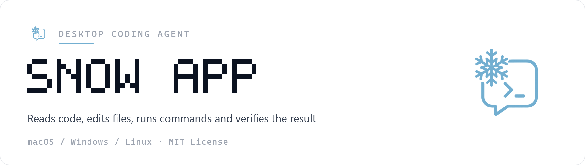
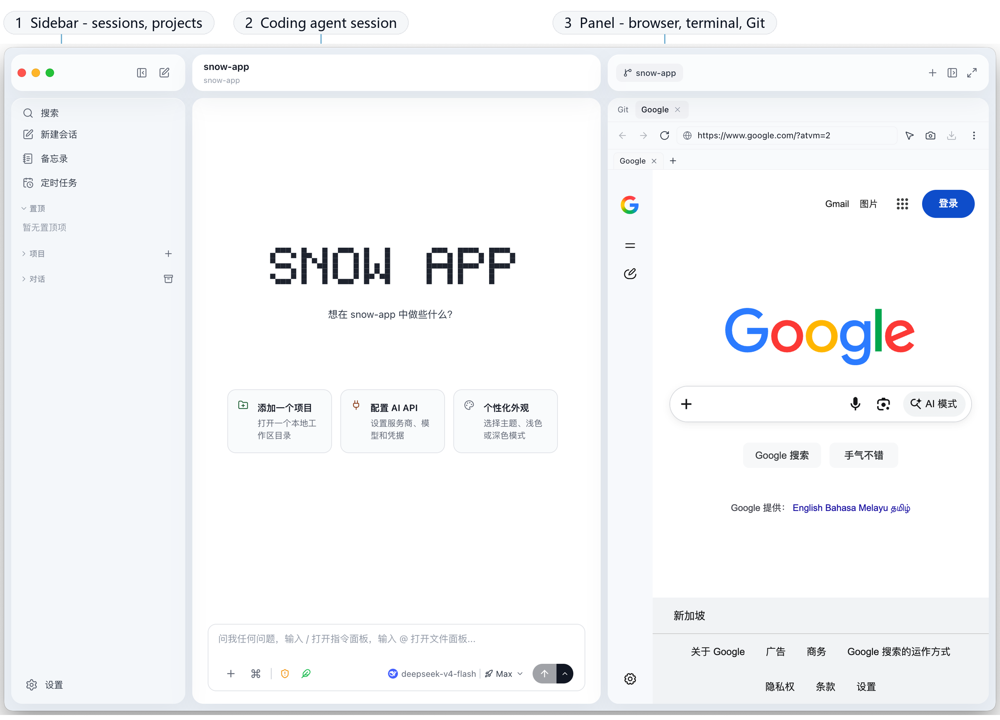
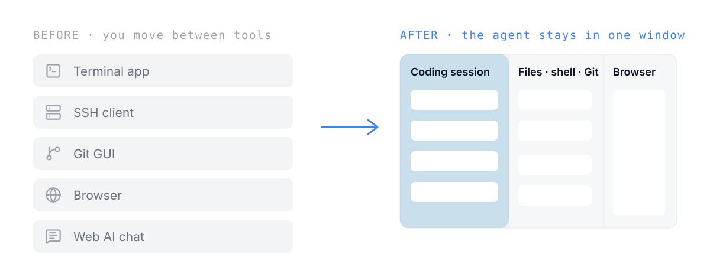
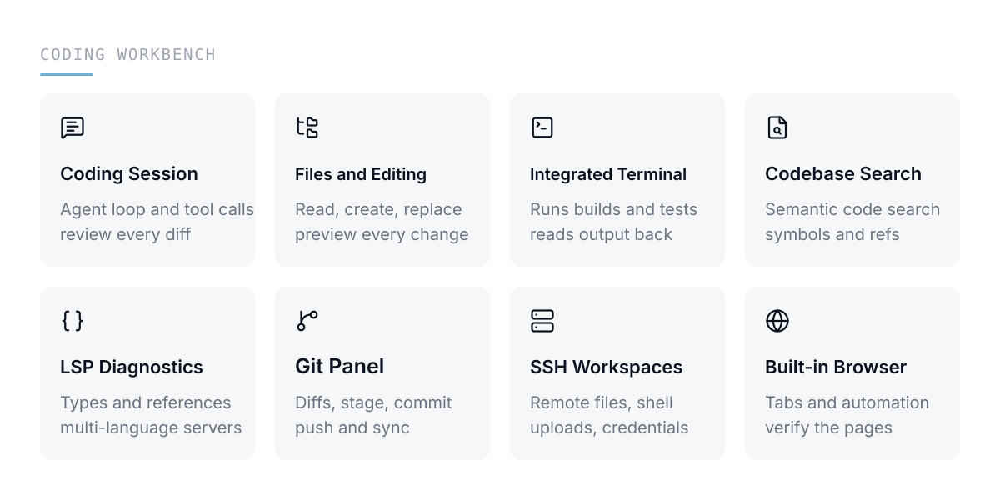
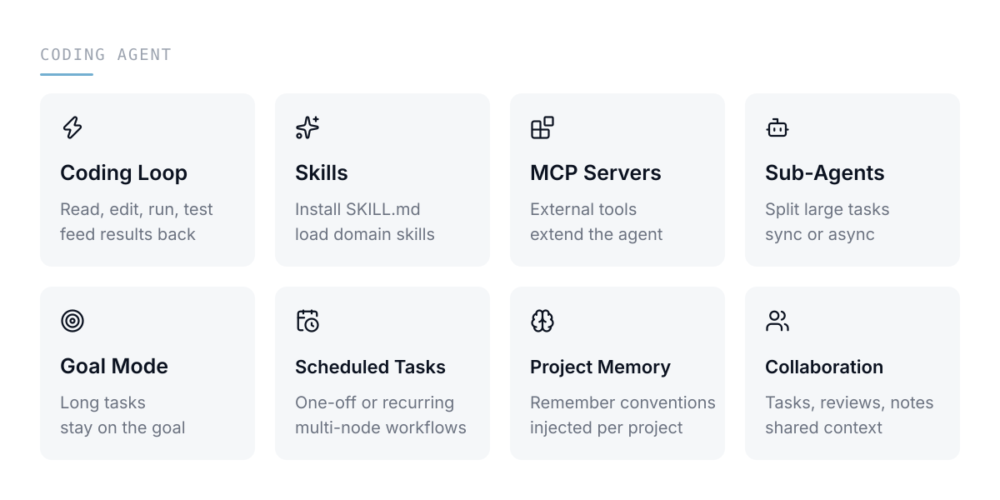
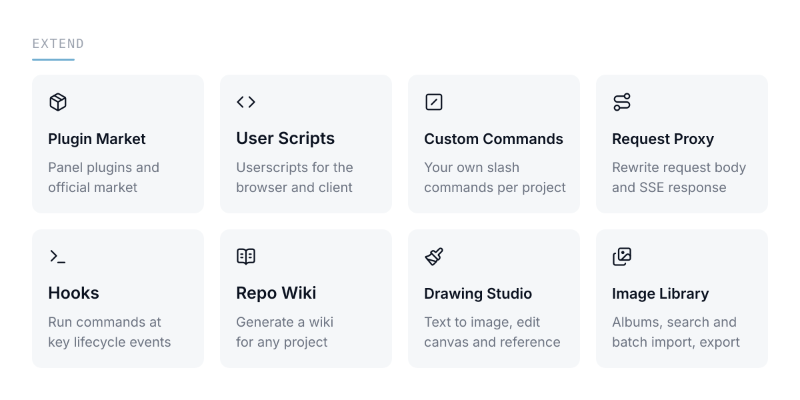

<p align="center">
  
</p>

<p align="center">
  <a href="https://github.com/MayDay-wpf/snow-app/releases"></a>
  
  
</p>

<p align="center">
  QQ group: <a href="https://qm.qq.com/q/avnZQ7gw0M">910298558</a>
  &nbsp;·&nbsp;
  Friendly links: <a href="https://linux.do">Linux DO</a>
  &nbsp;·&nbsp;
  <a href="https://linux.sb/">Linux.sb</a>
</p>

Snow App is a desktop coding agent: describe a task and it reads the code, edits files, runs commands, checks diagnostics and verifies the result. The terminal, Git, SSH, browser and file tree it works with stay in the same window, so every change can be reviewed, approved and rolled back on the spot.

[中文文档](./README_zh.md)

## What it looks like

<p align="center">
  
</p>

## From moving context around to an agent doing the work

<p align="center">
  
</p>

## A coding agent's workbench

<p align="center">
  
</p>

These panels are not tools sitting side by side; they are the agent's senses and hands: terminal output, browser pages, Git state and diagnostics all share one conversation context.

## Coding loop and extensions

<p align="center">
  
</p>

Beyond the coding loop, skills, MCP servers and sub-agents plug in on demand; scheduled tasks support multi-node workflows, and project memory persists per project and is injected automatically.

## Extend the agent and the content

<p align="center">
  
</p>

Plugins, user scripts and the request proxy rewrite the agent's interface and requests; repo wiki, the drawing studio and the image library keep content work inside the same session.

## Security and experience

<p align="center">
  
</p>

Tool approval and privacy masking decide what the AI may do and see. App lock is off by default, covers the interface without encrypting disk data, and stores only a salted PIN hash.

## Continue on mobile

<p align="center">
  
</p>

Pair a phone from **Settings → Mobile Remote Control** and keep working from a mobile browser: switch workspaces and models, approve tools, answer questions, and send images or files. LAN pairing needs no cloud service; the optional public mode uses a self-hosted, authenticated TLS tunnel with one-time pairing, session revocation and sensitive-output redaction. See the [setup guide](docs/en/2-guides/23-mobile-public-remote-control.md).

## Requirements and first run

- **Node.js** >= 18
- **Rust** stable toolchain (builds the native module)
- **macOS**: Xcode Command Line Tools ｜ **Windows**: Visual Studio Build Tools (C++ workload) ｜ **Linux**: `build-essential`, `pkg-config`

```bash
npm install
npm run dev        # start in development mode with HMR
npm run build:app  # build a distributable package into release/
```

> **macOS users:** if the app reports "damaged" or "cannot be opened" after installation, run:
>
> ```bash
> sudo xattr -rd com.apple.quarantine /Applications/Snow\ App.app
> ```

## More

- Full documentation: [docs/](./docs/README.md)
- License: [MIT](./LICENSE) · Copyright (c) 2026 MayMay
