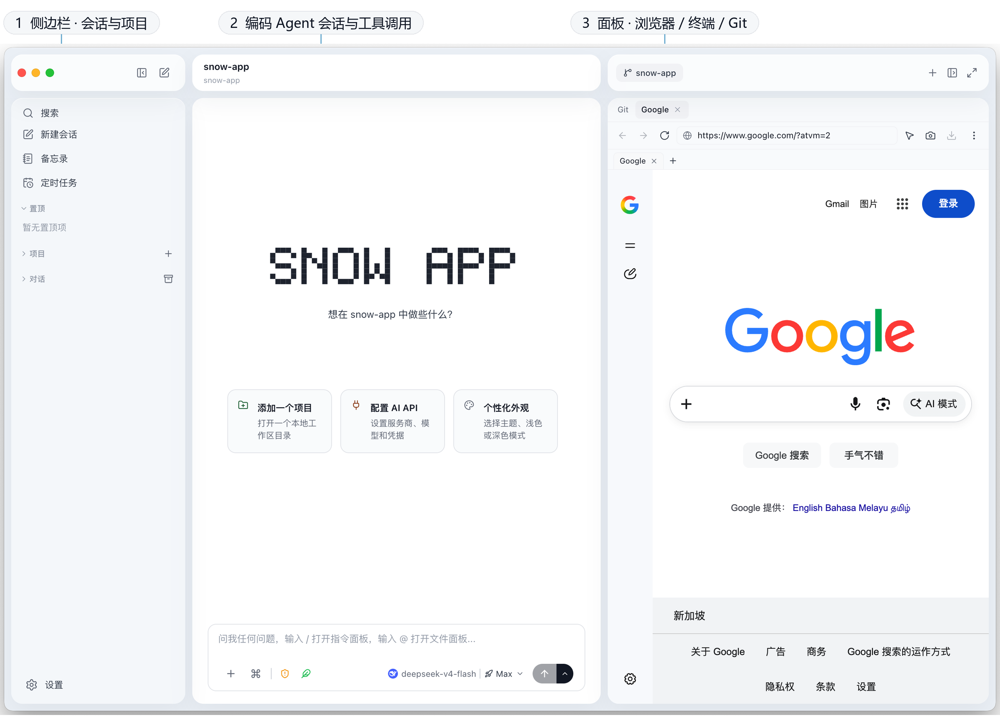
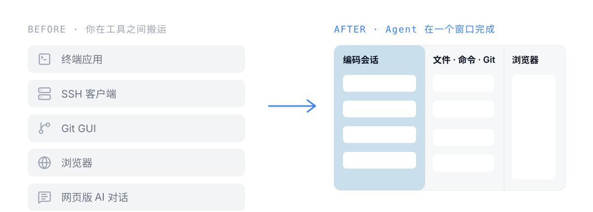
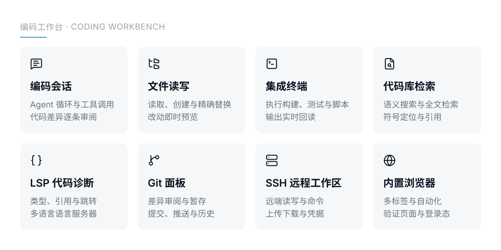
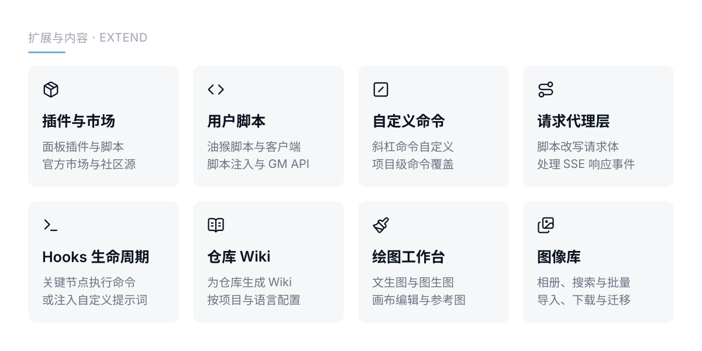

<p align="center">
  
</p>

<p align="center">
  <a href="https://github.com/MayDay-wpf/snow-app/releases"></a>
  
  
</p>

<p align="center">
  QQ 群：<a href="https://qm.qq.com/q/avnZQ7gw0M">910298558</a>
  &nbsp;·&nbsp;
  友情链接：<a href="https://linux.do">Linux DO</a>
</p>

Snow App 是一个桌面编码 Agent：你描述任务，它自己读代码、改文件、执行命令、查看诊断并验证结果。它使用的终端、Git、SSH、浏览器和文件树都摆在同一个窗口里，每一处改动都能当场审阅、授权和回滚。

[English](./README.md)

## 安装后长什么样

<p align="center">
  
</p>

## 从搬运上下文到 Agent 自己动手

<p align="center">
  
</p>

## 一个编码 Agent 的工作台

<p align="center">
  
</p>

这些面板不是并排的工具，而是 Agent 的感官和手脚：终端输出、浏览器页面、Git 状态与代码诊断都在同一份会话上下文里，不需要你在几个工具之间复制粘贴。

## 编码能力与扩展

<p align="center">
  
</p>

编码循环之外，技能、MCP 服务器与子代理都可以按需接入；定时任务支持多节点工作流，项目记忆按项目持久保存并自动注入。

## 扩展 Agent，也承接内容

<p align="center">
  
</p>

插件、用户脚本和请求代理层能改写 Agent 的界面与请求本身；仓库 Wiki、绘图工作台和图像库让内容产出也留在同一个会话里。

## 安全与体验

<p align="center">
  
</p>

工具授权与隐私脱敏决定 AI 能做什么、能看到什么；应用锁默认关闭，只遮盖界面而不加密磁盘数据，PIN 仅保存加盐哈希。

## 手机上继续

<p align="center">
  
</p>

在「设置 → 手机远控」完成配对后，可以用手机浏览器继续当前会话：切换工作区与模型、审批工具、回答问题、发送图片与文件。局域网模式不依赖云服务；可选的公网模式使用自建的 TLS 鉴权隧道，支持一次性配对、会话撤销与敏感输出脱敏。详见[手机远控指南](docs/zh-CN/2-使用指南/23-手机公网远控.md)。

## 环境与启动

- **Node.js** >= 18
- **Rust** stable 工具链（构建原生模块）
- **macOS**：Xcode Command Line Tools ｜ **Windows**：Visual Studio Build Tools（C++ 工作负载）｜ **Linux**：`build-essential`、`pkg-config`

```bash
npm install
npm run dev        # 开发模式启动，带热更新
npm run build:app  # 打包可分发安装包，输出到 release/
```

> **macOS 用户注意**：如果安装后打开提示「已损坏」或「无法打开」，在终端执行：
>
> ```bash
> sudo xattr -rd com.apple.quarantine /Applications/Snow\ App.app
> ```

## 更多

- 完整文档：[docs/](./docs/README.md)
- 开源协议：[MIT](./LICENSE) · Copyright (c) 2026 MayMay
