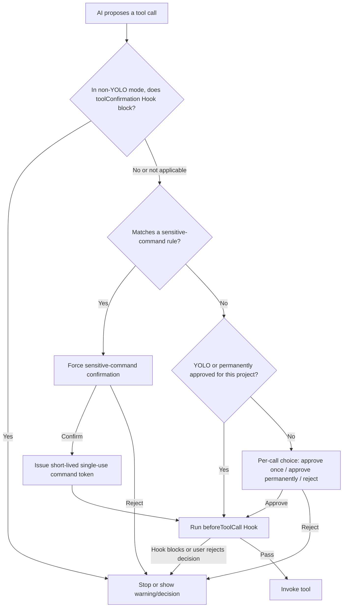

# 16-Security, Privacy, and Tool Authorization

Snow App connects AI suggestions, tool execution, local data, and external services in one desktop application. This guide explains the available security controls, the boundaries they actually protect, and the judgments that remain the user's responsibility.

> Security controls reduce risk; they do not certify a command, website, Hook, or external MCP server as safe. Before deleting data, running scripts, uploading content, or importing sessions, always verify the target, arguments, and scope of impact.

## 1. Window isolation model

Different Snow windows use different policies. It is inaccurate to claim that every window is sandboxed.

| Window/content         | `contextIsolation`      | Node integration | Sandbox                         | Notes                                                                                                             |
| ---------------------- | ----------------------- | ---------------- | ------------------------------- | ----------------------------------------------------------------------------------------------------------------- |
| Snow main window       | Enabled                 | Disabled         | **Disabled** (`sandbox: false`) | Controlled native capabilities are exposed through preload / `contextBridge`; the main window permits `<webview>` |
| Built-in browser popup | Enabled                 | Disabled         | **Enabled**                     | Created by the main process for guest `window.open` / `target=_blank` requests                                    |
| System browser         | Outside Snow's renderer | Not applicable   | Not applicable                  | A normal `window.open` in the main window is denied and delegated to the system browser                           |

Main-window renderer code cannot use Node APIs directly. `contextIsolation` separates page and preload contexts, but the main window is explicitly not sandboxed; only predefined bridge APIs can ask the main process or Rust layer to act. The built-in `<webview>` and every remote page loaded in it form an additional trust boundary.

Browser popups share the opener webview's session and cookies and preserve `window.opener` and `postMessage` for OAuth. A popup may open another popup, which receives the same sandboxed, context-isolated, no-Node policy. Snow closes these popups with the main window so that orphan windows do not remain, particularly on macOS.

## 2. Privacy filtering

Privacy filtering is disabled by default (**Settings → Privacy**, settings page id: `privacy-settings`). When enabled, it processes only the **tool results** selected in settings. It is not global DLP for chat input, web pages, logs, Hooks, or every network request.

The default selected tools are:

- `filesystem-read`
- `grep-search`
- `bash-terminal-execute`

The settings UI can additionally select `codebase-search`, `websearch-websearch-search`, and `websearch-websearch-fetch`. Results from unselected tools remain unchanged.

### 2.1 Local mode

Local mode applies regex and validation rules in the Rust MCP backend before the result crosses the NAPI boundary into Node/Electron. Rules cover private-key blocks, JWTs, common API keys, sensitive key-value pairs, `Authorization` values, URL query tokens, Chinese national ID numbers, and payment-card numbers.

Local mode does not call an external service, but rules can still produce false positives, false negatives, or leave contextual clues from which a secret can be inferred. Enabling filtering is not a reason to read unnecessary credential files or widen a tool's scope.

### 2.2 API mode and failure fallback

API mode sends the text to the configured privacy-filter HTTP API as JSON containing `text`, `aggregation_strategy: "simple"`, and `mask_token: "[{label}]"`. When an API key is configured, Snow attempts to send both `x-api-key` and Bearer `Authorization` headers. A successful response must contain `masked_text`.

The API endpoint therefore becomes another trusted party, and the text being filtered leaves the device. On an HTTP error, network failure, response parsing error, or missing `masked_text`, Snow **falls back to local rules** rather than passing the original text through. Only an exceptional failure of the local background task itself can return the original text, so data minimization and human review are still required for highly sensitive work.

## 3. Tool authorization flow

In normal mode, each tool call requests its own authorization. Rejecting one call in a parallel batch does not automatically reject the other calls. A user can approve once, reject, or—when a project is active—permanently approve the tool for that project.

`beforeToolCall` runs before actual execution even when YOLO auto-approves a tool. In non-YOLO mode, a `toolConfirmation` Hook also runs before the authorization UI. Because some paths continue with normal authorization if a Hook itself fails, a Hook must not be the sole security control.

## 4. Permanent project authorization

“Always approve” is bound to the active project/workspace `directoryId`:

- switching projects loads a different approved-tool set;
- without an active project, the choice is not persisted as cross-project approval, although the current call can proceed;
- a persistence failure does not roll back the already approved current call;
- approval is granted by tool name and does not understand the business risk of each argument set.

Permanently approve only narrow, auditable, recoverable capabilities. Terminal execution, file writes, browser-state restoration, and external MCP tools are generally better kept behind per-call review.

The **project authorization panel** next to the composer (or the `/permissions` command) lists the tools permanently authorized for the current project and lets you **delete** approvals no longer needed; the command is disabled in YOLO mode.

## 5. YOLO mode

YOLO is a persistent global setting. When enabled, ordinary tools can skip per-call authorization, and non-sensitive items already waiting in the authorization queue are approved. It is intended for controlled, recoverable, pre-reviewed environments—not conversations containing production credentials, personal data, or shared workspaces.

YOLO **does not bypass every security control**:

- a non-interactive Bash command that matches a sensitive-command rule still requires explicit confirmation;
- `beforeToolCall` Hooks still run;
- tool argument validation, project enablement, and sub-agent tool allowlists remain effective.

Interactive terminal commands are **checked by the sensitive-command gate too**: the `isInteractive` flag only controls how the terminal session is presented (input box, no timeout) and is no longer a bypass channel; legitimate interactive commands such as `npm init` or `git add -i` that match no rule are unaffected.

## 6. Sensitive-command rules

Sensitive commands are detected using enabled regular expressions (**Settings → Sensitive Commands**, settings page id: `sensitive-command-settings`; agents can also read/write them via `config-set settings sensitiveCommands`). Snow uses global rules plus the effective inherited/overridden project rules. An invalid regex is skipped so it cannot break all subsequent checks. A match exposes the rule ID, pattern, and description in the confirmation UI.

After confirmation, Snow issues a token for the **exact command text**. The token lasts about 60 seconds and is deleted when consumed; the Rust Bash executor checks the token, command, and expiry. It cannot authorize a different command or be reused.

The settings page also offers an optional **decision model assist** (off by default, stored in the `sensitive_command_assist` system setting). With a decision model selected, a command that matches a rule is evaluated by that model (TypeSafe System One) before the prompt appears. The question is a **risk judgement** of the command's real effect — its text, its working directory and the model's own description of it are part of the state, and a matched rule is only a hint (rules also fire on file names, arguments and commit messages). The verdict, its reason category, the confidence, and the model name are shown on the confirmation card. The same request also asks a score question for a **risk level** (low / medium / high, the level with the highest probability; both TypeSafe Jev and OpenAI Decisions support it), shown as a badge next to the verdict with the score on hover. The risk level is for display and logging only; whether a confirmation is needed is still decided by the verdict alone. A missing level, or a level outside the preset scale, is never guessed: that evaluation shows no risk badge, the verdict still applies, and the cause is logged as a warning (module `decision_model`). Turning on **let the decision model handle the gate** makes the verdict effective — an allow verdict runs the command with an authorization token, a deny verdict rejects that command — while the default keeps the prompt and the human decision. Under delegation you can also turn on **still ask me when denied** (off by default, only available while delegation is on): an allow verdict still runs directly, but a deny verdict no longer takes effect on its own — the confirmation card appears, marked "The decision model denied this command. Confirming execution overrides that verdict.", so you can review the reason category, confidence and model name before deciding; it appears in YOLO mode as well. Confirming runs the command and the tool card shows "Model denied, confirmed by user"; rejecting behaves like any other rejection. Every review is written to the system log (module `sensitive_command`, with rule IDs, model name, reason category, confidence, the user's choice and a truncated command) so the false-deny rate can be evaluated. The switch never grants a permanent exemption; loosening the gate is still done by editing the sensitive rules. A rejected sensitive command never terminates the run: whether the user clicks reject or the decision model denies it, only that one command is denied and the reason goes back to the model as its tool result, so the AI keeps working with a different approach (ordinary tool authorization still ends the run when the user rejects it without a reason). A disabled assist, an unselected or unavailable model, or any request failure leaves the original confirmation flow untouched.

**Include recent conversation** (off by default) lets the judgement see why the command was proposed, so "the user just asked to clean the build output" and "the AI decided to delete `build/` on its own" can get different verdicts. When on, every judgement sends the most recent conversation messages to the selected decision model (**conversation messages to send**, default 8, configurable from 1 to 50): user and assistant text, plus the name, an argument summary and an output summary of each finished tool call (the command under review itself is not part of it). The renderer trims each item before sending; images and inline base64 data are replaced by placeholders, and tool outputs pass the existing privacy filter (Settings > Privacy, per tool) again before they leave the machine. The decision model never reads the conversation history itself — only this trimmed slice. Both providers support it: OpenAI Decisions receives the slice in the official GA form as native multi-turn `input` (messages plus `function_call` / `function_call_output` items paired by `call_id`, with the pending command in a final developer message). An endpoint that only speaks the pre-GA protocol (its `input` accepts only plain text and user messages with `input_text` / `input_image` parts) rejects that body with a 400; the request then falls back to a compatible form — the slice rendered as role-labelled text with the pending command as the next text part of the same user message, prefixed so it is not taken for a user request — and that endpoint keeps using the compatible form, with one WARN written to the system log (module `api`); TypeSafe Jev has no multi-turn input, so the slice goes into the state as a structured `recentConversation` field, which is the documented way to give Jev a conversation. The whole state shares the provider's character budget (48,000 for TypeSafe Jev, 200,000 for OpenAI Decisions, derived from each provider's documented context limits): when the slice does not fit, the oldest messages are dropped, the card shows that the context was truncated, and a warning is logged (module `decision_model`). With the switch on but no usable messages the command is judged without context and the card says so. A malformed slice is an error: the assist falls back to manual confirmation instead of silently judging without context. With the switch off the request is exactly the same as before.

Important limitations:

- rules catch only the textual patterns they cover; a dangerous unmatched command can still run;
- an invalid skipped regex provides no protection;
- argument composition, encoding, and indirect script calls can exceed the rule author's intent;
- interactive commands require the same authorization token (`isInteractive` is a presentation hint and never bypasses the check);
- the sensitive-command gate is an additional control, not proof that a shell command is safe.

## 7. Hooks and external MCP servers

### 7.1 Hooks

Hooks can run shell commands, inject context, and change the tool-call flow. Command exit codes are generally interpreted as follows:

| Exit code | Outcome                                                           |
| --------- | ----------------------------------------------------------------- |
| `0`       | Pass; stdout may become injected context                          |
| `1`       | Soft warning; structured decision JSON may open a confirmation UI |
| `2+`      | Block the current flow when that lifecycle point is blockable     |

Fire-and-forget Hooks such as `onStop` and `onSessionStart` cannot truly block the originating flow; pending decisions are reduced to ordinary warnings. Treat every Hook script and dependency as a local automation program with its own supply-chain trust.

### 7.2 External MCP servers

An external MCP server may launch a local process over stdio or connect to an HTTP service. Its tool declarations, network endpoints, authentication, and side effects come from the external implementation. Snow's authorization controls whether Snow initiates a call; it does not prove that the service is internally safe or prevent it from retaining, forwarding, or misusing data within its granted reach.

See [Configure MCP Servers](1-configure-mcp.md) and [Configure Hooks and Sub-agents](5-configure-hooks-and-subagents.md).

## 8. App lock (PIN + Google Authenticator)

The app lock under **General settings -> Privacy** covers the whole interface behind a PIN so that nobody walking by can read your sessions. Locking **only blocks viewing**: running sessions, streaming generations, terminals, the embedded browser, scheduled tasks, and mobile remote control all keep working in the background.

- **Prerequisite**: Google Authenticator must be bound first. The settings page generates a Base32 secret locally and shows an `otpauth://totp/...` QR code; scan it (or type the key manually), then confirm the binding with a 6-digit code. The secret is stored only in the local app database. **A PIN and an authenticator binding must always coexist**: when either one is missing the lock counts as disabled, so the app can never lock you out with no way back in.
- **PIN storage**: The PIN is 4-8 digits and is stored as a salted PBKDF2-HMAC-SHA256 hash (random salt, 120k iterations). No plaintext PIN reaches the database, and verification runs in the Rust backend with a constant-time comparison.
- **Lock timing**: Choose "immediately after losing focus", "1 minute", "5 minutes", or "10 minutes". The countdown is owned by the main process and is cancelled as soon as the window returns to the foreground; "Lock now" in the settings page locks manually at any time. **Every launch starts locked**, so restarting the app can never bypass the PIN.
- **Locked appearance**: A frosted-glass layer covers the entire interface, including the top bar and both side panels, and only accepts a PIN or an authenticator code. Background progress resumes exactly where it was after unlocking.
- **Forgot PIN**: Switch to "Forgot the PIN? Use Google Authenticator" on the lock screen and enter a 6-digit code (a +/-1 step, 30-second window is accepted). Reset the PIN right after unlocking.
- **Failure protection**: Five consecutive failures start a cooldown (30 seconds, doubling up to 5 minutes). PIN and authenticator codes share the counter, which is not cleared by restarting the app.
- **Change, disable, rebind, and unbind**: changing the PIN and disabling the lock both accept the current PIN or a 6-digit authenticator code, so a forgotten PIN is no longer a dead end; rebinding verifies the current PIN, while **unbinding only accepts an authenticator code**. Disabling the lock keeps the authenticator binding so it can be re-enabled later, whereas unbinding also disables the app lock and clears the PIN: a PIN must never exist without the authenticator. PIN configuration stays hidden until an authenticator is bound.
- **Mobile remote unlock**: once the authenticator is bound, the mobile LAN and public remote pages offer an "Authenticator" mode whose 6-digit code unlocks the page in place of the pairing token (the switch can be turned off any time in the settings page; turning it off leaves only the pairing link or token). Code failures are rate-limited separately (5 per 5 minutes) and never consume the desktop attempt counter or cooldown.

The app lock protects what is visible on screen, not the data on disk; the local database is not encrypted. For encryption at rest, rely on full-disk encryption of the operating system.

## 9. Recommended security baseline

1. Leave YOLO off by default and retain per-call approval for writes, terminal commands, and external tools.
2. Permanently approve the smallest project-specific tool set and revoke approvals that are no longer needed.
3. Define specific, testable sensitive-command regexes for destructive operations while retaining human review.
4. Prefer local privacy filtering for highly sensitive projects; review an API endpoint's data policy before choosing API mode.
5. Do not give a page, Hook, or MCP server credentials beyond the current task.
6. Verify the publisher, source, and permission changes before installing or updating third-party extensions.
7. Periodically review logs, project approvals, and enabled Hooks/MCP servers; disable suspicious components and rotate exposed credentials immediately.

## 10. Misconceptions and troubleshooting

| Misconception/symptom                                    | Correct interpretation or action                                                                         |
| -------------------------------------------------------- | -------------------------------------------------------------------------------------------------------- |
| “The main window is sandboxed”                           | Incorrect: it uses `sandbox: false`, while context isolation is enabled and Node integration is disabled |
| “Browser popups do not share login state”                | OAuth popups share the opener webview's session and cookies                                              |
| “A privacy API failure passes the original text through” | API failures fall back to local rules; local-task failures and rule misses still matter                  |
| “YOLO bypasses sensitive commands”                       | Matching non-interactive commands still require confirmation                                             |
| “Permanent approval applies to every project”            | Approval is bound to the current project/workspace                                                       |

For browser credentials and login state, continue with [Browser Settings, Passwords, and Data Import](17-browser-settings-passwords-and-import.md). For the complete boundary matrix, see [Security and Trust Boundaries](../3-reference/5-security-and-trust-boundaries.md).
