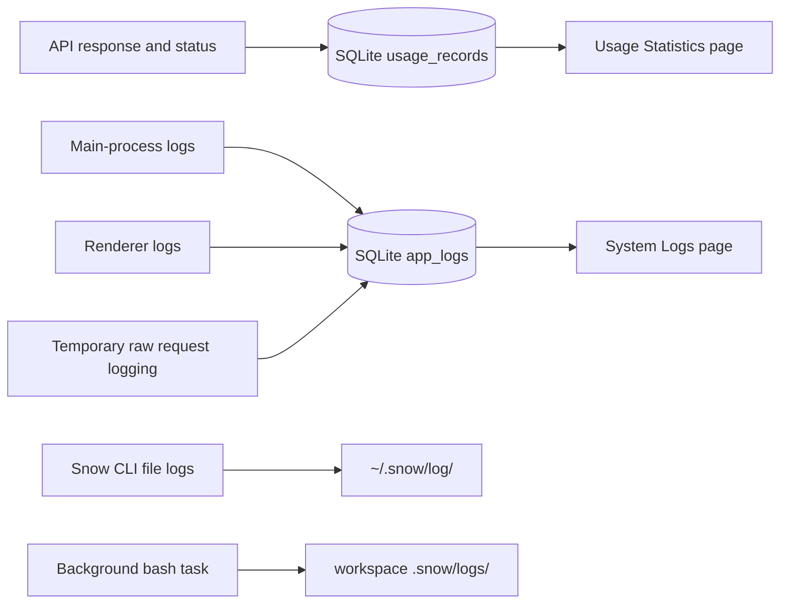

# 20-Usage Statistics and System Logs

> This guide explains the actual accounting rules in the Usage Statistics (settings page id: `usage-settings`) and System Logs (`system-logs`) settings pages, the three independent log sources, their lifecycles, and the security boundaries for troubleshooting.

## Data Flow Overview

Both `usage_records` and Snow App's `app_logs` are stored in Snow App's data directory, `~/.snowapp/snowapp.db` (SQLite). Keep the directory ownership clear: `~/.snowapp/` is Snow App's application-data directory, while `~/.snow/` is Snow CLI's user configuration/log directory. Files under `~/.snow/log/` are not Snow App's SQLite system logs. `<workspace>/.snow/logs/` contains workspace background-task output and is not an App log either. These sources have independent cleanup lifecycles.

## Usage Statistics

### Recorded Fields

An accounting record may contain:

- conversation and response identifiers;
- model, API profile/configuration, and request method;
- input, output, cache-creation, and cache-read tokens;
- status;
- whether the request came from a sub-agent;
- directory/project;
- local `created_at` time.

Records are stored in the SQLite `usage_records` table. The native list API supports optional conversation and directory filters, but the current Settings detail table does not use them.

### Decision Model Calls

Decision model requests (TypeSafe Jev / OpenAI Decisions) are recorded once they finish, so the Usage page also covers the token consumption of codebase review, the `decision-evaluate` tool, and sensitive command decisions:

- `request_method` is always `decisions`; model statistics group by model plus request method, so these rows never merge with chat requests of the same model;
- `model` is the model name configured on the decision model entry, `api_profile_name` is the entry name, and `api_config_id` stays empty;
- For OpenAI Decisions, `usage.input_tokens` is stored as input tokens and `input_tokens_details.cached_tokens` / `cache_write_tokens` as cache read / cache write; both are already contained in the input count and are never added again; the API does not bill output, so output tokens are always 0;
- TypeSafe Jev responses carry no usage, so no record is written (zero-value records are skipped); a failed request writes one record with `status = 'error'` and zero tokens;
- Codebase review and `decision-evaluate` calls carry the current conversation and project; sensitive command decisions have no conversation, so `conversation_id` stays empty; connection tests are not recorded.

### Accounting Rules

The page applies these rules:

- total tokens = input tokens + output tokens;
- cache read is a subset of input and is not added to total tokens again;
- effective cache read = the smaller of cache read and input;
- non-cached input = input − effective cache read;
- only records with `status = 'error'` count as failed requests.

These rules avoid negative values or double counting when an upstream provider reports unusual cache values.

### Actual Date-Filter Coverage

Date ranges use local-day boundaries: `00:00:00` on the first day and `23:59:59` on the last day. Presets include Today, Yesterday, Last 7 Days, Last 30 Days, This Month, Last Month, and Custom.

> **Important: the date filter does not uniformly filter every area on the page.**

| Page area                  | Actual range                                                                                  |
| -------------------------- | --------------------------------------------------------------------------------------------- |
| Summary cards              | Affected by the selected date range                                                           |
| Daily heatmap              | Always requests roughly one year and does not follow the top date filter                      |
| Usage Records detail table | Currently requests all records, 20 per page, without date, conversation, or directory filters |

The summary-card totals therefore do not directly correspond to the rows on the current detail-table page.

## SQLite System Logs

### Browsing and Filtering

The System Logs page reads the SQLite `app_logs` table, 50 rows per page. It can filter by date and by `DEBUG`, `INFO`, `WARN`, `ERROR`, or all levels. The native API supports a module filter, but the current UI has no module input.

Fields may include `level`, `module`, `func`, `line`, `message`, `input`, `output`, `duration`, `context`, `error`, `source`, and `created_at`. Logs come from both main and renderer processes. Renderer entries written through IPC are forced to use `source: "renderer"`. Detail fields can be copied.

### Automatic Cleanup (Retention)

System logs keep the last 7 days by default. The page offers a log-retention choice: last 7 days, last 30 days, last 90 days, or keep everything; the value is stored as `app_logs_retention_days` in SQLite `system_settings` (0 means no cleanup). The app prunes expired logs once at startup and re-checks every 6 hours while running; switching the retention option on the page prunes immediately and reports how many entries were deleted. Pruning deletes only rows whose `created_at` is older than the retention window.

### Clear Behavior

The clear button uses two-step confirmation: the first click enters a confirmation state, and the second click must occur within three seconds. The native operation runs `DELETE FROM app_logs`.

> **Warning: clearing deletes every log row in `app_logs`, not only the currently displayed date, level, or page.**

## Raw API Request Logging

When request logging is enabled, the serialized API request-body JSON is written to `app_logs` as `input` on an `api_request` row. Request headers are not recorded. Sensitive-name fields and exact occurrences of the active API key are redacted before persistence; this is not a guarantee that every possible credential format will be detected.

The payload may contain system prompts, user content, tool inputs, file fragments, and other sensitive data. The UI therefore asks for confirmation before enabling it.

### Automatic Shutoff

- The default duration is 5 minutes;
- presets are 1, 5, 10, 15, and 30 minutes;
- the slider range is 1–30 minutes;
- enabling first persists the expiry and then turns on the switch;
- the UI updates the countdown every second and disables logging at expiry;
- the Rust write path also enforces the expiry, so logging stops and the switch is reset even when the log page is closed.

The switch and expiry are stored in SQLite `system_settings`. Enable raw request logging only briefly when ordinary logs are insufficient, reproduce once, disable it immediately, and remove sensitive logs that are no longer needed.

## Snow CLI File Logs: `~/.snow/log/`

`~/.snow/log/` belongs to **Snow CLI**, not Snow App's data directory. Snow App does not read or delete this directory. CLI file logs are for troubleshooting Snow CLI itself. To diagnose an App/session error, use Settings → System Logs or the read-only built-in `config-manage` tool with `action=logs`, which queries the `app_logs` table in `~/.snowapp/snowapp.db`.

## Snow App Built-in Log Tool: `config-manage` (`action=logs`)

The tool performs read-only queries against Snow App SQLite `app_logs`, with filters for `level`, `module`, time range, and pagination (up to 100 rows per page). The `logScope` argument selects the rows: `all` (default, application logs from every conversation plus unassociated system rows) or `current` (the calling conversation only). Empty/whitespace optional string filters are treated as omitted. `items`, `total`, and `hasMore` remain restricted to the calling conversation; the runtime overwrites any model-supplied `conversationId`. An additional `systemSummary` provides application-wide counts under the same level/module/time filters, without pagination: `total`, `withoutConversationId`, fixed `bySource.main/renderer` and `byLevel.DEBUG/INFO/WARN/ERROR` counts. It never returns identifiers, text, context/errors, paths or request/response bodies from other conversations or unassociated rows. Rows without a conversation ID may be newly written application logs, not necessarily legacy records; they contribute only to counts, not details. A current-conversation `total=0` therefore does not imply there are no system logs; compare `systemSummary.total`.

Current-conversation API request/response records include bounded `requestBody` / `responseBody` fields, with secret-named fields and the active API key redacted before persistence. Request headers are never logged. The response body is a normalized provider result, not a byte-for-byte copy of the streamed wire response. Current-conversation `context` and `error` may still contain paths or user data, so redact before sharing.

To inspect full log entries, use Settings → System Logs manually. The AI tool shows only the current conversation and redacted/truncated API bodies. Request logging can capture user content and prompts; it starts for 5 minutes by default (maximum 30 minutes) and turns itself off. Use it only briefly, then disable it after reproducing the issue.

## Background-Task Logs: `<workspace>/.snow/logs/`

When the bash tool starts a background task with `detach:true`, stdout and stderr are written to `<workspace>/.snow/logs/<name>-<timestamp>.log`. This output belongs to neither `app_logs` nor `~/.snow/log/`.

Stopping a task does not necessarily delete its log file. Before diagnosing or cleaning up, verify the workspace and exact file so that output from another project is not mistaken for an application log.

## Recommended Diagnostic Workflow

1. Record the time, project, API profile, model, and reproduction steps.
2. In Usage Statistics, confirm whether the request was recorded, whether its status is error, and whether token values look unusual.
3. Remember that the date filter affects only the summary; it does not filter the heatmap or current detail table.
4. Filter System Logs by today and `ERROR` / `WARN`, or call `config-manage action=logs` with time, level, and module filters. The tool injects the current `conversationId` and includes redacted/truncated request/response bodies for API rows.
5. Expand `module`, `func`, `context`, `error`, and related fields; inspect for secrets before copying.
6. Enable raw request logging briefly only when ordinary logs are insufficient.
7. Reproduce once, then disable request logging immediately.
8. `~/.snow/log/` is Snow CLI's file-log directory, not Snow App logs; Snow App no longer exposes a `logs` scope for reading it.
9. If the problem came from a background command, inspect `<workspace>/.snow/logs/` in the current workspace.

## Redaction Before Sharing

Before sharing logs, screenshots, or a database, remove at least:

- API keys, Authorization values, cookies, and custom headers;
- system prompts, ROLE content, user messages, and tool inputs;
- file-content fragments and information about private images;
- usernames, home-directory and workspace paths, and private network addresses;
- identifiers that can link a conversation, response, project, or profile.

“Stored only on this computer” does not mean “safe to publish.” Treat database backups and raw request logs as sensitive data.

## Lifecycle and Deletion Boundaries

| Data source             | Storage location          | Lifecycle                                                                                                                       | Deletion boundary                                                          |
| ----------------------- | ------------------------- | ------------------------------------------------------------------------------------------------------------------------------- | -------------------------------------------------------------------------- |
| Usage records           | SQLite `usage_records`    | No automatic retention period is defined in source; retained until database migration, recovery, or a future explicit cleanup   | The current Usage page has no clear action                                 |
| System and request logs | SQLite `app_logs`         | Pruned by the retention window (last 7 days by default; 30/90 days or keep-all selectable): once at startup, then every 6 hours | UI clear deletes all log rows; filters do not limit deletion               |
| Request-logging switch  | SQLite `system_settings`  | Automatically turns off and resets at expiry                                                                                    | Turning off the switch does not delete payloads already written            |
| Snow CLI file logs      | `~/.snow/log/`            | Independent CLI files; Snow App does not read/delete them                                                                       | Managed by Snow CLI                                                        |
| Background-task logs    | `<workspace>/.snow/logs/` | Retained with workspace files                                                                                                   | Not affected by the System Logs UI; workspace files are managed separately |

For complete backup and storage boundaries, see [Data Storage Locations](../3-reference/4-data-storage-locations.md).
