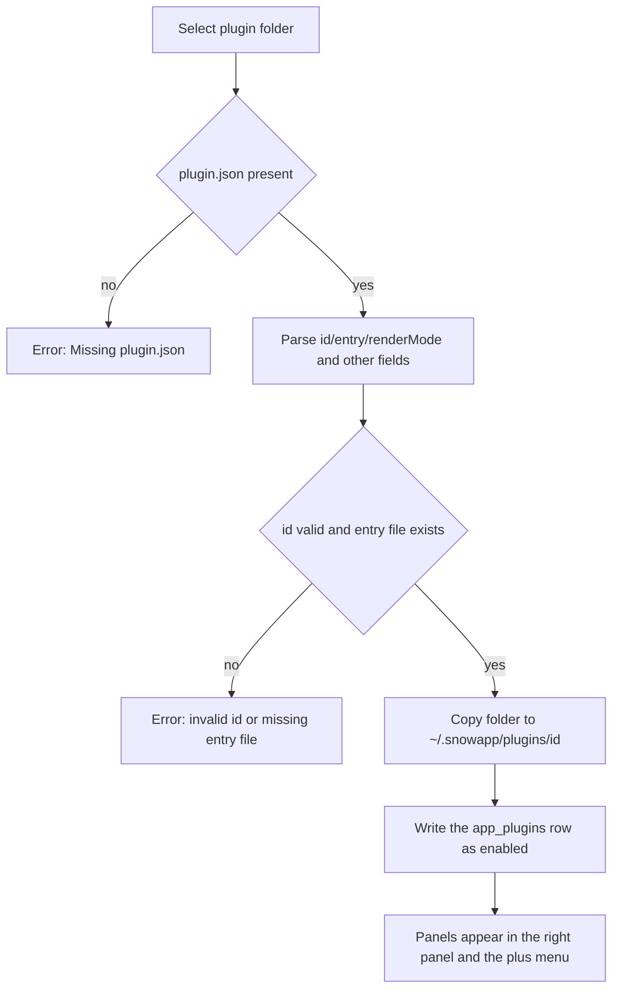
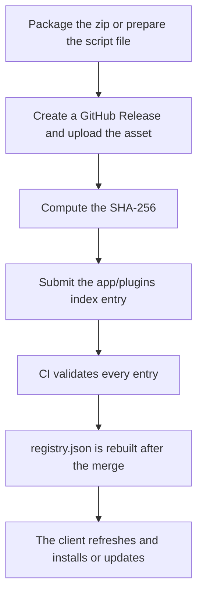
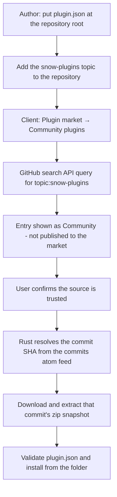

# 24-Plugin Development and Installation (Plugins)

> Applies to: Snow App desktop (Windows / macOS / Linux). A plugin is a **local folder** package that contributes custom tabs to the right panel; this guide covers installing/removing plugins (local folder, official plugin market, and the community channel), authoring one, and publishing it to the plugin market or making it discoverable through the community channel.

## Goal

- Install a plugin from a local folder or the **plugin market** and open the panels it provides;
- write a `plugin.json` manifest plus an entry module that reads metadata, writes application data through `api.write`, stores private settings, and declares privacy scopes;
- **publish** a plugin to the plugin market: prepare the Release asset, compute its SHA-256, and submit the index entry;
- know the two market channels: the **official market** (indexed, SHA-256 pinned, entries carry an "Official store" or "Verified" badge) and the **community channel** (repositories carrying the GitHub `snow-plugins` topic, labelled "Community — not published to the market");
- let the AI **install, toggle, reload, and uninstall plugins automatically** through the `plugins` scope of the `config` tool, without opening any settings UI.

## Prerequisites

- The plugin folder must contain `plugin.json` and the entry file declared in the manifest (`entry`, default `index.js`); a missing entry file fails the install.
- Plugins run as **local code**: with `renderMode: "esm"` the entry runs as an ES module inside the main renderer process with the same DOM and network access as the page, while `renderMode: "iframe"` runs the entry in a separate sandboxed document that can only reach the bridged API. Install only plugins you trust.
- Application data access is "read plus controlled write": reads go through `api.metadata` and writes through `api.write`, where each write action's `scope` decides whether a `privacy` declaration is required (see the writable-capabilities section below).
- Installation copies at most **128 MB** per plugin folder and skips `.git` and `node_modules`.
- One text file may be read up to 8 MB, one binary asset up to 16 MB.
- The plugin market needs network access to GitHub raw or the jsDelivr mirror; publishing a plugin requires its own GitHub repository and Release.

## Entry Point

The **Plugins** button at the bottom of the sidebar (with an installed-count badge) opens the plugin management page — a main-content view (view id `plugins`), not a settings page, and it has no settings page id. The page has three top-level tabs: **Plugin list** (badge: panel plugins plus client scripts), **Plugin market**, and **Metadata catalog** (badge: the metadata-domain count):

| Tab                  | Contents                                                                                                                                                                                                                                                                                                                                                                                                                                                |
| -------------------- | ------------------------------------------------------------------------------------------------------------------------------------------------------------------------------------------------------------------------------------------------------------------------------------------------------------------------------------------------------------------------------------------------------------------------------------------------------- |
| **Plugin list**      | The main management area; it carries two sub-tabs with counters, **Panel plugins** and **Script plugins** — the former covers the folder-installed plugins described in the rest of this guide, the latter holds client UI scripts                                                                                                                                                                                                                      |
| **Plugin market**    | Four categories: **Panel plugins** / **OAuth plugins** / **Script plugins** come from the snow-plugin-store index (one-click install or update, entries carry an "Official store" / "Verified" badge), while **Community plugins** searches third-party repositories carrying the GitHub `snow-plugins` topic (labelled "Community — not published to the market"); the differences between the two channels are described in the plugin market section |
| **Metadata catalog** | The app metadata domains plugins can read together with the write actions and the network capability a plugin can use                                                                                                                                                                                                                                                                                                                                   |

Under the **Panel plugins** sub-tab the toolbar offers **Install from folder** and **Refresh**; each row shows the plugin version, author and render mode, and a plugin that declares privacy scopes lists every requested data domain as an amber tag (localized, e.g. "API keys", "Messages") followed by the manifest `note`; clicking any amber tag opens the "Privacy scopes" dialog, which explains each scope in one line and lists the metadata domains it unlocks (field-level declarations name the exact fields) plus the writable capabilities aggregated per write domain, along with where it is declared (`privacy` in `plugin.json` / `@snow-privacy` in the script metadata header). The **Script plugins** sub-tab shows the script's `@snow-privacy` declarations as the same amber badges and opens the very same dialog. The **Metadata catalog** tab shows "Reading", "Writable" and "Network" sub-tabs: it groups all 36 domains with a one-line summary, the required privacy declaration, live-versus-polled behavior and accepted parameters, with keyword search, while the Writable sub-tab lists every write action with its required `scope` and declaration state and the Network sub-tab lists the `api.net.fetch` external request capability (forwarded by the main process, requires the `network` privacy scope). The per-row "Metadata n/36" and "Write n/212" links mark that plugin's declared (readable/writable) and undeclared (denied) domains and actions, so users can audit the `privacy` declaration. The page is management-only; open panels from the plus menu's Plugins group in the top bar or the right-panel plugin entry.

## Script plugins (client UI scripts)

The **Plugin list → Script plugins** sub-tab manages **client UI scripts injected into the Snow desktop window itself**; they are a different kind of extension from the panel plugins on the sibling **Panel plugins** sub-tab — same management page, but separate storage, execution model, and capability boundary:

| Dimension      | Panel plugins (Plugin list → Panel plugins)                                                                                   | Client UI scripts (Plugin list → Script plugins)                                                                                                                                                                                            |
| -------------- | ----------------------------------------------------------------------------------------------------------------------------- | ------------------------------------------------------------------------------------------------------------------------------------------------------------------------------------------------------------------------------------------- |
| Shape          | A local folder package: `plugin.json` plus an entry file (`entry`)                                                            | A single Tampermonkey-compatible file with a `// ==UserScript==` header                                                                                                                                                                     |
| Execution      | `renderMode: "esm"` runs as an ES module in the main renderer; `renderMode: "iframe"` runs in a sandboxed document            | A **dedicated isolated world** by default (sandboxed mode, no `window.snow`); declaring `@snow-sandbox false` or `@grant unsafeWindow` moves it to the main world (full-permission mode)                                                    |
| What it can do | Contribute right-panel tabs and read/write app data through `api.metadata` / `api.write` (gated by the `privacy` declaration) | Customize the UI through the anchor and slot contract and call the `GM_*` and `snow` APIs (gated by script scope and execution mode); read/write app data through `snow.metadata` / `snow.write` (gated by the `@snow-privacy` declaration) |
| UI entry       | The plus menu's Plugins group and the right-panel tab system                                                                  | No panel of its own; it acts on existing UI elements                                                                                                                                                                                        |
| Storage        | `~/.snowapp/plugins/<pluginId>/` plus the `app_plugins` table                                                                 | `~/.snowapp/browser-script/{script_id}.user.js` plus the `userscripts` table (`target` is `client` or `all`)                                                                                                                                |
| Install routes | **Install from folder**, the `config` tool's `plugins` scope                                                                  | **New script** / **Import file** / **Install URL** (https direct link) / **Build with AI**, the `config` tool's `userscripts` scope                                                                                                         |
| Icon           | The `icon` in `plugin.json` (`lucide:Name` or a plugin-relative path; a panel may override it with `panels[].icon`)           | The `@icon` / `@iconURL` metadata header (`lucide:Name`, an http(s) URL, or a data URI), shown in the Script plugins list                                                                                                                   |

Inside the sub-tab you can **create** a script (the modal editor prefills the client-script template), **import a file**, or **install from a URL**; while the list is empty its empty state also offers a **Build with AI** request box (describe what you want, the page closes, a new conversation starts and auto-sends the request, and the AI loads the `snow-app-docs` skill to locate the built-in docs and writes a `.user.js` following the client-script rules in 22-Userscripts before installing and enabling it); every script row can be enabled / disabled / edited / deleted and shows an **Update** button as soon as the market index lists a newer version (in-place update that keeps the enabled state, same as panel plugins). Both creating and editing use the very same large modal editor as **Settings → Browser settings → Userscripts** (`Modal` plus the line-numbered, highlighted `FileViewerContent`; the virtual file name is `<script name>.user.js` when editing — saving writes the database, re-matches and takes effect immediately, while closing the modal cancels). A script that keeps failing is auto-disabled after 5 consecutive errors. The directive table (including `@snow-privacy`), the GM / `snow` / `snow.metadata` / `snow.write` API list, the anchor and slot contract, and a minimal example live in [22-Userscripts](22-userscripts.md) under "Client scripts (desktop window)".

> Both entry points share the single `userscripts` table: the Script plugins sub-tab shows only scripts whose `target` is `client` or `all`, while the browser settings Userscripts list shows only `browser` and `all`; the metadata header's `@snow-target` or `@match snow://client/<view>` decides the home.

> **Script plugins declare their type explicitly as well.** Write `@snow-target client` (or `@match snow://client/<view>`) in the metadata header when authoring a client script: the directive is optional (default `browser`), but without it the script only appears under **Settings → Browser settings → Userscripts**, never under **Plugins → Plugin list → Script plugins**, and the market index cannot file it as a script entry — script entries should use `kind: "script"`.

## Steps

### 1. Install a plugin

1. Click **Install from folder** and pick the plugin folder (the level that contains `plugin.json`) in the system directory picker.
2. The backend reads and validates the manifest, copies the folder to `~/.snowapp/plugins/<pluginId>/` (on Windows `C:\Users\<user>\.snowapp\plugins\<pluginId>\`), writes the app database row, and enables it by default.
3. Installing a plugin with the same `id` again **replaces it in place**: the folder is overwritten with the new content while the saved enabled state is kept.



### 2. Manage installed plugins

Each row shows the name, version, author, render mode, and install path, plus:

- **Enable switch**: takes effect immediately; a disabled plugin contributes no panels, and an already open panel reports that the plugin is disabled.
- **Reload manifest**: re-parses `plugin.json` after manual edits inside the installed folder (an `id` that no longer matches the record is rejected).
- **Show in folder**: reveals `installPath`.
- **Update**: the installed lists share the market index — when a newer version exists the row shows an **Update** button (hovering shows `Installed v<from> → v<to>`) that updates in place without switching to the Plugin market tab; the button is disabled with an explanatory tooltip when the entry's `minAppVersion` is newer than the app.
- **Uninstall**: after a confirmation it deletes the database row and **removes the plugin folder** (irreversible).

### 3. Open plugin panels

Every panel declared in `panels` appears in the **plus menu** group of the top bar and in the right-panel tab system; clicking it opens a right-panel tab, and several panels can be open at once. Panel titles are resolved from `panels[].title` using the current UI language.

### 4. Author a plugin

Minimal folder layout:

```text
my-plugin/
  plugin.json
  index.js
  locales/
    zh-CN.json
  style.css
```

Sample `plugin.json`:

```json
{
  "id": "com.example.hello",
  "name": { "default": "Hello", "zh-CN": "你好" },
  "description": { "default": "Demo panel", "zh-CN": "示例面板" },
  "version": "1.0.0",
  "author": "You",
  "license": "MIT",
  "icon": "lucide:Sparkles",
  "kind": "plugin",
  "renderMode": "esm",
  "entry": "index.js",
  "panels": [
    {
      "id": "main",
      "title": { "default": "Hello", "zh-CN": "你好" },
      "icon": "lucide:Sparkles"
    }
  ],
  "locales": { "zh-CN": "locales/zh-CN.json" },
  "styles": ["style.css"],
  "privacy": {
    "scopes": ["apiKeys"],
    "note": "Reads API profiles to list models."
  }
}
```

Field reference (actual parsed semantics):

| Field                             | Type                       | Required | Default        | Constraints and notes                                                                                                                                                                                           |
| --------------------------------- | -------------------------- | -------- | -------------- | --------------------------------------------------------------------------------------------------------------------------------------------------------------------------------------------------------------- |
| `id`                              | string                     | yes      | —              | Letters, digits, `.`, `-`, `_` only, at most 96 characters, must not start with `.`; it is also the install folder name and the database key                                                                    |
| `name`                            | string or localized object | no       | `id`           | Object keys support `default`, `zh-CN`, `zh-TW`, `en`; other keys are kept as-is                                                                                                                                |
| `description`                     | string or localized object | no       | `name.default` | Same as `name`                                                                                                                                                                                                  |
| `version`                         | string                     | no       | `1.0.0`        | Display only                                                                                                                                                                                                    |
| `author` / `homepage` / `license` | string                     | no       | empty          | Display only                                                                                                                                                                                                    |
| `icon`                            | string                     | no       | empty          | `lucide:IconName` uses a built-in icon; any other value is read as a **relative** path inside the plugin folder; `http(s):` and `data:` prefixes are not resolved as assets                                     |
| `kind`                            | `plugin` or `oauth`        | no       | `plugin`       | Plugin type: `plugin` = panel plugin, `oauth` = OAuth sign-in plugin (it must also declare `oauth.entry`, otherwise the install fails); when omitted or invalid it is derived from whether `oauth.entry` exists |
| `renderMode`                      | `esm` or `iframe`          | no       | `esm`          | Case-insensitive; invalid values fall back to `esm`                                                                                                                                                             |
| `entry`                           | string                     | no       | `index.js`     | Path relative to the plugin folder, **must exist** or the install fails                                                                                                                                         |
| `panels`                          | array                      | no       | `[]`           | Each item requires `id`; `title` (or its `name` alias) defaults to `id`; `entry` defaults to the top-level `entry`; `icon` defaults to the plugin icon; `widthHint` is passed through                           |
| `locales`                         | object                     | no       | `{}`           | Maps a locale tag to the relative path of its message file                                                                                                                                                      |
| `styles`                          | string array               | no       | `[]`           | CSS file paths injected while the panel is mounted and removed on unmount                                                                                                                                       |
| `privacy`                         | array or object            | no       | `[]`           | The array form lists sensitive scopes; the object form reads `scopes` (also accepts `domains`) and `note`; `permissions` is accepted as an alternative key                                                      |
| `privacyNote`                     | string                     | no       | empty          | Only the `note` of an object-form `privacy` is read and displayed                                                                                                                                               |
| `minAppVersion`                   | string                     | no       | empty          | Currently stored and displayed only; **no version gating**                                                                                                                                                      |

> **Write `kind` explicitly when authoring a plugin.** The field itself is optional (when omitted it is derived from whether `oauth.entry` exists, so existing plugins keep their behavior), but declaring the type explicitly keeps the **Plugin list** grouping, the market index entry and the review flow from relying on inference: panel plugins write `"kind": "plugin"`, while OAuth sign-in plugins must write `"kind": "oauth"` together with `oauth.entry` (declaring `oauth` without `oauth.entry` fails the install; conversely, providing `oauth.entry` without declaring `kind` is still treated as an OAuth plugin).

A manifest panel may additionally declare `"chatInput": true` (only boolean `true` enables it; default `false`) for an input-toolbar entry. Existing `entry`, `icon`, `widthHint` and privacy semantics are unchanged; see section 6.1.

### 5. Write the entry module (`renderMode: "esm"`)

The entry is imported dynamically as an ES module; pick one of the export shapes:

```javascript
// Shape 1: default-export a React component (props: api / locale / panelId / panel / pluginId / isActive / inputText)
// inputText is the current raw chat-input content (keeps @@file:...@@ tag markers) and updates as you type
export default function Panel({ api, isActive }) {
  const { React } = window.SnowAppPlugin;
  const [count, setCount] = React.useState(0);
  return React.createElement(
    "button",
    { onClick: () => setCount(count + 1) },
    api.t("clicked", {
      defaultValue: "Clicked {{count}} times",
      values: { count },
    }),
  );
}

// Shape 2: export mount(container, api) returning a cleanup function or { unmount }
export function mount(container, api) {
  container.textContent = api.name;
  return () => {
    container.replaceChildren();
  };
}
```

Before mounting, the host injects a global `window.SnowAppPlugin`:

| Member                    | Description                                                       |
| ------------------------- | ----------------------------------------------------------------- |
| `React` / `createElement` | The host React instance, so plugins never bundle their own copy   |
| `icons`                   | The lucide icon namespace (also reachable as `api.ui.icon(name)`) |
| `api`                     | The same runtime API object passed to `mount(container, api)`     |
| `locale`                  | Current UI language (`en` / `zh-CN` / `zh-TW`)                    |
| `plugin`                  | `{ id, version, installPath }`                                    |

With `renderMode: "iframe"` those globals are not injected: the entry runs inside a sandboxed document and reaches the bridge as `window.SnowPlugin`, exposing `runtime: "iframe"`, `plugin: {id, name, version}`, `locale`, `t`, `metadata`, `write`, `storage`, `assets`, `net`, `on`, and `log` with the same semantics as the table below (an iframe may request the five capabilities `metadata`, `write`, `storage`, `assets`, and `net`; for writes it only has `api.write.run` and `api.write.domains`, without the per-domain sugar).

#### 5.1 Engineered sources and single-file bundles

The file named by `entry` is read in full and executed as one ES module. Relative imports such as `./utils.js` and bare specifiers such as `react` cannot be resolved. Sources may be split into modules, written in TypeScript or JSX, and depend on npm packages, but must be bundled into **one ES module file** before release; ship the build output, not the sources:

- **Build options**: `format: "esm"`, `bundle: true`, `splitting: false`. Code splitting produces several chunks, which cannot be loaded. Bundle each entry (panel, message footer, tool card, and so on) into its own standalone file.
- **Do not bundle React**: map `react` to the host's `window.SnowAppPlugin.React` (see the table above) so only one React instance exists. After that mapping, the `React` identifier required by the classic JSX transform can come from `import React from "react"`.
- **JSX transform**: prefer the classic transform (`jsx: "transform"`, compiled to `createElement` calls). With the automatic runtime (`jsx: "automatic"`), the output imports `jsx` / `jsxs` from `react/jsx-runtime`, where `key` is the third argument. Mapping them straight to `createElement` drops `key` and triggers `unique "key" prop` warnings in lists. Use a wrapper that explicitly merges the third-argument `key` into props before calling `createElement`.
- **Icons**: get host lucide icons through `api.ui.icon(name)`; do not bundle `lucide-react`.
- **Styles**: CSS is emitted as separate files; declare them in `styles`.
- **Size**: the entry is read as text, and a single text file is capped at 8 MB; the install directory is capped at 128 MB.

### 6. Runtime API

| API                                                                      | Description                                                                                                                                                                                                                                                                                                                                                                                                                                                                                                                                                                                                                                                                                                                                                                                                                  |
| ------------------------------------------------------------------------ | ---------------------------------------------------------------------------------------------------------------------------------------------------------------------------------------------------------------------------------------------------------------------------------------------------------------------------------------------------------------------------------------------------------------------------------------------------------------------------------------------------------------------------------------------------------------------------------------------------------------------------------------------------------------------------------------------------------------------------------------------------------------------------------------------------------------------------- |
| `api.id` / `api.version` / `api.name` / `api.installPath` / `api.locale` | Plugin identity and current language                                                                                                                                                                                                                                                                                                                                                                                                                                                                                                                                                                                                                                                                                                                                                                                         |
| `api.t(key, { defaultValue, values })`                                   | Message lookup; a missing `key` falls back to `defaultValue` then to the key itself; `{{name}}` placeholders are interpolated from `values`                                                                                                                                                                                                                                                                                                                                                                                                                                                                                                                                                                                                                                                                                  |
| `api.metadata.get(domain \| domain[], { params })`                       | Collects metadata domains, returning `{ generatedAt, domains, denied, withheld, unknown }`                                                                                                                                                                                                                                                                                                                                                                                                                                                                                                                                                                                                                                                                                                                                   |
| `api.metadata.subscribe(domain, listener, { params, intervalMs })`       | Subscribes: `live` domains re-emit on runtime snapshot changes (200 ms debounce) and other domains poll every `intervalMs` (minimum 1000 ms); without an interval only the initial value is emitted; returns `Promise<{ unsubscribe }>` (use `await`)                                                                                                                                                                                                                                                                                                                                                                                                                                                                                                                                                                        |
| `api.metadata.domains()`                                                 | Lists domains with authorization state: `{ id, scope, granted, live, sensitiveFields }`                                                                                                                                                                                                                                                                                                                                                                                                                                                                                                                                                                                                                                                                                                                                      |
| `api.write.<domain>.<action>(params)`                                    | Calls one write action (ESM only); identical to `api.write.run("<domain>.<action>", params)`                                                                                                                                                                                                                                                                                                                                                                                                                                                                                                                                                                                                                                                                                                                                 |
| `api.write.run(actionId, params)`                                        | Calls a write action by id and returns `{ ok, action, data, denied, error }` (see the writable-capabilities section)                                                                                                                                                                                                                                                                                                                                                                                                                                                                                                                                                                                                                                                                                                         |
| `api.write.domains()`                                                    | Lists write actions and declaration state: `{ id, granted, actions: [{ id, scope, granted, summary }] }`                                                                                                                                                                                                                                                                                                                                                                                                                                                                                                                                                                                                                                                                                                                     |
| `api.net.fetch(url, { method, headers, body, timeoutMs, responseType })` | Sends an external HTTP request through the main-process network stack: follows the app proxy settings, bypasses CORS, and sends no cookies; returns `{ ok, status, statusText, headers, body, bodyBase64?, url, error }` and never throws on network failure (the `error` field carries it). It requires the `network` privacy scope; without it, the call returns `error`. Timeout defaults to 30s (max 120s); the 5MB response body limit counts raw bytes. `responseType` defaults to `"text"` (the host decodes `body` as UTF-8); with `"arraybuffer"` the host does not guess a charset: `body` is an empty string and the raw bytes are returned as base64 in `bodyBase64`, so the plugin decides how to decode them (e.g. `TextDecoder("gb18030")` for GBK / GB18030 sites); base64 inflates the payload by about 33% |
| `api.storage.get / set / remove / all`                                   | Plugin-private persistence (the `app_plugin_values` table), values are strings                                                                                                                                                                                                                                                                                                                                                                                                                                                                                                                                                                                                                                                                                                                                               |
| `api.storage.getJson / setJson`                                          | JSON convenience wrappers over the same storage                                                                                                                                                                                                                                                                                                                                                                                                                                                                                                                                                                                                                                                                                                                                                                              |
| `api.assets.resolve(relativePath)`                                       | Reads an asset such as an image from the plugin folder and returns a data URL; `null` on failure                                                                                                                                                                                                                                                                                                                                                                                                                                                                                                                                                                                                                                                                                                                             |
| `api.ui.React` / `api.ui.icon(name)`                                     | Equivalent to `window.SnowAppPlugin.React` / icon lookup                                                                                                                                                                                                                                                                                                                                                                                                                                                                                                                                                                                                                                                                                                                                                                     |
| `api.log(...args)`                                                       | Logging prefixed with `[plugin:<id>]`                                                                                                                                                                                                                                                                                                                                                                                                                                                                                                                                                                                                                                                                                                                                                                                        |

Frequent `params` keys: `projectId`, `projectPath`, `directoryId`, `conversationId` (defaulting to the active project or conversation) plus domain-specific pagination and filters.

The `runtime` domain is the live data source: `conversation` is the full snapshot of the focused conversation (`conversationId`, `sessionKey`, `title`, `directoryId`, `isStreaming`, `isPaused`, `isAborting`, `streamTokenCount`, `streamElapsedMs`, `streamTtftMs`, `streamStartedAt`, `runTtftMs`, `lastRunDurationMs`, `streamingConversationIds`, ...), while `streamingSessions` lists every running conversation (including pending new-chat slots) with `sessionKey`, `conversationId`, `title`, `directoryId`, `isStreaming`, `isPaused`, `isAborting`, `messageCount`, `tokenCount`, `elapsedMs`, `ttftMs`, `runTtftMs`, `startedAt`, `lastRunDurationMs`, and `runTokenUsage`. `startedAt` is the wall-clock anchor of the current run, so live wall-clock duration is `Date.now() - startedAt` and live speed is `tokenCount / elapsedMs`, matching the stream metrics bar above the input box. `chatInput` carries the live input-area data (published by the input area while it is mounted; the last published value is kept when it is unmounted): `inputText` is the current raw chat-input content (keeping `@@file:...@@` / `@@image:...@@` tag markers, an empty string means nothing has been typed, updated as you type), `conversationId` is the conversation the input area is bound to (`null` for a fresh-chat input area), `maxContextTokens` is the context window limit of the API profile in effect for that conversation, and `isLoadingApiConfig` is the API config loading state. Together with `conversation.tokenUsage` (already normalized by Rust; cache reads are a subset of input) this reproduces the token usage ring next to the input box: `total = inputTokens + outputTokens` and the ratio is `min(total / maxContextTokens, 1)` (falling back to a full ring keyed on `total` when `maxContextTokens` is absent); treat `isLoadingApiConfig === true` as the placeholder ring so a still-loading config is not misread as a full window.

### 6.1 Prompt optimization and safe drafts (ESM)

Declare `panels[].chatInput: true` (boolean, default `false`) to show an enabled panel's icon before the model selector. Localized `chatInputTitle` falls back to `panel.title`; `chatInputAction` names a valid JS export (Unicode IdentifierName; invalid / empty values normalize to empty). **Empty actions / iframe only open the panel**; ESM Actions run only on a user click, without opening settings. The separate gear only opens that panel; it neither runs nor cancels an Action and works without draft text or API configuration. Execution is disabled for empty plain text (chips alone count as empty), unavailable / loading API configuration or an unmounted input. Streaming, stopping and compaction do not affect input availability. Users may manually optimize editable drafts during Agent runs and send results through the existing queue / steer policy. No automatic sends, optimization instructions in chat, or queue-entry writes are introduced. Existing plus-menu and right-panel entries remain unchanged; no plugin id is hardcoded.

Optional generic `panels[].chatInputSettings: { defaultVisible?: boolean, storageKey: string }` controls only the ESM Action configuration gear. `defaultVisible` defaults to `true`; `false` hides it initially. Omitting this contribution retains the existing visible gear. `storageKey` must be non-empty. The host reads a **JSON boolean** from that plugin's private storage; valid values override the default, while missing/invalid values or read failures fall back to the manifest default. Save with `api.storage.setJson(storageKey, boolean)`: successful writes notify the plugin store's storage revision to refresh the toolbar **without replacing plugin / Action identities or cancelling optimization**. The contribution is read from saved `manifestJson`, without new native panel-normalization fields. Visibility changes neither the wand contribution nor plugin enablement and do not save unsaved optimization rules. Prompt Optimizer opts into a hidden gear and saves its switch independently and immediately. This requires the accompanying host build; no released version is confirmed, and installing a plugin does not upgrade the host.

#### Secondary Actions on the same panel

Optional `panels[].chatInputMenuActions: [{ id, action, title, icon? }]` applies only to ESM / `chatInput: true` panels with a main `chatInputAction`. The renderer reads it from saved `manifestJson`, independently of valid `chatInputSettings`. Secondary Actions **share their parent's entry, identity, private preferences and safe Action pipeline**; they cannot declare a different `entry` and add no panel, scope or authorization capability.

The host retains at most 8 items and scans only the first 32. IDs must be unique within the panel, match `[A-Za-z_][A-Za-z0-9_-]*`, and have at most 64 raw characters. `action` shares the main Action's Unicode JS IdentifierName rule, with at most 128 raw characters. `title` accepts a string or localized map with a non-empty title; at most 16 language keys are scanned (keys up to 64, raw titles up to 256 characters). Optional `icon` is limited to 256 characters. Invalid, duplicate or entry-bearing items are ignored; empty / entirely invalid contributions fall back to the default Action and Open configuration.

Left-click keeps the main Action, including click-to-cancel while running. Right-click, the discoverable More button, and `Shift+F10` / `ContextMenu` / `Alt+ArrowDown` on a focused trigger open the menu. Without draft text / API, execution items are disabled but More and Open configuration remain accessible. Up / Down, Home / End, Enter / Space, Escape, outside clicks and focus leaving are supported. Escape restores trigger focus; selecting an item restores focus before its operation, and cleanup never steals focus from a newly opened Modal / configuration control. Menu execution cannot start or preempt a busy run. Open configuration only opens the parent `panel.id`, without executing, cancelling or saving unsaved rules. Merely opening / closing the menu incurs no API request; each execution still reloads saved preferences and creates a fresh API. Project / session / plugin / parameter identity changes close the old menu and reject late selections.

This contract is a local host-source capability requiring the accompanying host build and deployment, not confirmed released support. The currently running 0.4.22 package lacks this menu contract and the project-context Native exports. Installing a plugin does not upgrade the host; do not guess a `minAppVersion`. Older hosts ignore the field and retain one parent configuration panel and its original main Action. After removing a former second-panel declaration, users may need to close an already-open old tab once; the host does not silently rewrite panel storage or user data.

`optimizationInstructions?: string` supplies an optional optimization meta prompt / strategy. Its raw value is limited to **8000 Unicode code points**, not UTF-16 code units; non-string / oversized values are rejected in renderer and backend. The backend trims surrounding whitespace and treats empty text as omitted, preserving older requests. Instructions occupy a separate trusted system section and cannot override fixed safety constraints. Never concatenate API secrets or attachment content into instructions.

#### Generic input Action signature and interaction

Manifest panel example:

```json
{
  "id": "optimizer",
  "title": { "default": "Optimization strategy", "zh-CN": "优化策略" },
  "chatInput": true,
  "chatInputAction": "optimizeDraft",
  "chatInputTitle": { "default": "Optimize draft", "zh-CN": "优化草稿" },
  "chatInputMenuActions": [
    {
      "id": "project-context",
      "action": "optimizeDraftWithProjectContext",
      "title": {
        "default": "Optimize with project code (this run)",
        "en": "Optimize with project code (this run)",
        "zh-CN": "本次检索项目代码并优化",
        "zh-TW": "本次檢索專案程式碼並優化"
      },
      "icon": "lucide:Search"
    }
  ],
  "icon": "lucide:WandSparkles"
}
```

Export `async optimizeDraft({ api, signal, onStatus, confirm }): Promise<PluginChatInputActionResult>` from the entry module. The host does not call `mount`; configuration remains a separate panel. Types are exported from `src/renderer/plugins/pluginApi.ts`:

```typescript
type PluginChatInputActionContext = {
  api: PluginRuntimeApi;
  signal: AbortSignal;
  onStatus: (message: string) => void;
  confirm: (message: string) => Promise<boolean>;
};
type PluginChatInputActionResult = {
  message?: string;
  preview?: string;
  apply?: () => Promise<PluginChatInputActionResult>;
  undo?: () => Promise<void>;
};
```

- The right panel configures the meta prompt / strategy and saves private preferences. By default, a single wand click runs optimization; the plugin safely calls `applyDraft` to refill the input automatically and returns an `undo` closure based on `restoreToken`. The host exposes Undo through the "More actions" dropdown next to the wand; the input toolbar itself no longer shows a persistent button. No additional right-panel action is needed and no message is sent.
- The host input toolbar no longer renders a persistent preview box or a diff box. An Action's `preview` is kept only as result data, with no separate Apply / Copy entry point; when the draft is stale the result omits `undo` and is read-only, so a newer draft is never silently overwritten.
- `onStatus` updates the inline status text: during execution / Undo the primary button shows a spinner only and the text is kept for screen readers (`aria-live` still announces it); the result message appears next to the button once the Action finishes. Clicking the primary button again cancels only this Action's signal, never ordinary chat. Pass `signal` to `api.ai.optimizePrompt`; the scoped host API also combines the Action cancellation signal.
- `confirm` uses the existing host Modal: Confirm accepts, Close / Escape declines; cancellation or context invalidation settles the pending prompt and interrupts continuation. This is runtime UI confirmation, not tool authorization or automatic approval of a paid request.
- Each click loads messages, creates a **fresh API** (reloading current private storage; storage read failure prevents execution), loads the entry module and resolves `module[panel.chatInputAction]`. It never caches the configuration panel's API/storage snapshot; existing `api.storage` methods are unchanged. Cancellation is checked across awaited loading stages; a missing export shows an error without paid fallbacks.
- Parameters / API profile / model, project or real / pending session changes (including pending-to-real identity migration), plugin update / disable / removal, input unmount and non-editable compaction automatically cancel and invalidate callbacks. Late status, confirmation, results and scoped Action AI/write calls are rejected. Completed output may remain read-only after stripping `apply/undo`. Live Agent replies and streaming / stopping alone do not cancel optimization. The gear only opens this plugin panel and does not cancel the Action. Execution uses the saved strategy snapshot read for that click; unsaved panel edits do not affect it.
- Panel mount, module import top level and metadata subscription / refresh must never invoke Actions or paid APIs. The host invokes the export only on a user click; ESM remains trusted local code, not a sandbox for malicious top-level code. Refill / Undo must still use draft tokens, never guessed DOM writes, privacy bypasses or ordinary message-send channels.

`api.ai.optimizePrompt(options): Promise<{ content: string }>` is **ESM-only**; the iframe bridge has no `ai` capability. Options:

| Field                      | Type                    | Contract                                                                                                                                          |
| -------------------------- | ----------------------- | ------------------------------------------------------------------------------------------------------------------------------------------------- |
| `draft`                    | string                  | Required, non-empty plain text; send only after an explicit user optimization action, never automatically on mount, subscription or panel opening |
| `conversationId`           | string?                 | Optional conversation id; do not invent an id for a fresh chat                                                                                    |
| `apiProfile` / `model`     | string?                 | Optional profile / model overrides; backend owns defaults and model fallback                                                                      |
| `includeContext`           | boolean?                | Defaults to `false`; only explicit `true` includes history and requires `messages` in `privacy.scopes`                                            |
| `optimizationInstructions` | string?                 | Optional meta prompt / strategy; at most 8000 raw Unicode code points, whitespace-only text omitted, fixed safety constraints unchanged           |
| `contextRounds`            | number?                 | Non-negative integer; backend owns defaults and actual history selection                                                                          |
| `onChunk`                  | (delta: string) => void | Optional delta callback, not accumulated output                                                                                                   |
| `signal`                   | AbortSignal?            | Optional cancellation; rejects with `AbortError` when cancelled                                                                                   |

The host creates a separate UUID per request and uses dedicated optimization / cancellation channels. Cancelling never stops an ordinary chat session, and optimization input/output is not saved as conversation messages. Abort listeners are removed on success, failure and cancellation, and no chunks are delivered after stopping. Missing context privacy declarations reject before calling the backend; do not bypass privacy through other metadata or ordinary conversation APIs. Drafts do not automatically include chips, attachments or history: pass captured `text`, not `inputText`. Explicitly sending a draft to the model requires no new sensitive scope, but the panel must explain possible API costs.

Older running versions may lack these capabilities; `minAppVersion` is not a runtime gate. Check `typeof api.ai?.optimizePrompt === "function"` and use `api.write.domains()` to check the three draft actions. If unavailable, show an upgrade hint or a read-only preview; never fall back to guessed DOM writes or ordinary chat requests.

The three public `chatInput` actions use the existing standard response `{ ok, action, data, error?, denied? }`, with no new privacy scope. Check `ok` before accessing `data`:

| Action                   | Parameters                             | Success `data`                                                                            |
| ------------------------ | -------------------------------------- | ----------------------------------------------------------------------------------------- |
| `chatInput.captureDraft` | `{}`                                   | `{ draftToken: string, inputText: string, text: string, conversationId: string \| null }` |
| `chatInput.applyDraft`   | `{ draftToken: string, text: string }` | `{ restoreToken: string }`                                                                |
| `chatInput.restoreDraft` | `{ restoreToken: string }`             | `{ restored: true }`                                                                      |

- Capture requires the actual mounted, editable input. `inputText` is the complete original draft with encoded `@@file/image/...@@` chips; `text` contains plain text only, without expanding chips or reading file, image or referenced attachment contents.
- Apply replaces only plain text and retains captured chips verbatim, in their original order after the new text. Replacement text containing encoded chips is rejected. The user must still send manually. Restore recovers the complete captured input. Both use `useChatInputController.restoreContent` to synchronize the editor, immediate draft mirror and draft pool; neither sends messages.
- Tokens are random UUIDs in a host-private in-memory map, limited to 128 entries and five minutes, single-use, bound to plugin id, unique input instance, project, real / pending session, draft revision and actual original content. Do not persist tokens in plugin storage or use them across plugins.
- User edits, actual sends that change / clear the draft, programmatic restoration, project/session switching (including pending-to-real identity migration) or input unmount invalidate old results. Streaming, stopping and live Agent replies alone do not affect draft tokens. A→B→A changes still fail because revisions increment synchronously, not merely when text differs at render time. Restore also validates the actual applied input and revision, so subsequent user edits are never overwritten.
- Failures return `ok: false` and `error`, leaving content unchanged. Re-capture and obtain user confirmation after invalidation. `runtime.chatInput.inputText` and entry props are preview snapshots, not safe-capture substitutes.

Example flow (run from a button click; apply / restore are separate explicit user buttons):

```javascript
const captured = await api.write.run("chatInput.captureDraft", {});
if (!captured.ok) throw new Error(captured.error);
const controller = new AbortController();
const result = await api.ai.optimizePrompt({
  draft: captured.data.text,
  conversationId: captured.data.conversationId ?? undefined,
  includeContext: false,
  signal: controller.signal,
  onChunk: (delta) => appendPreview(delta),
});
// When the user confirms Apply:
const applied = await api.write.run("chatInput.applyDraft", {
  draftToken: captured.data.draftToken,
  text: result.content,
});
// On a separate Restore click, only use the token if applied.ok:
if (applied.ok) {
  await api.write.run("chatInput.restoreDraft", {
    restoreToken: applied.data.restoreToken,
  });
}
// Call controller.abort() on Cancel or panel unmount.
```

#### Optional project-code context (companion development build)

This is a current-source contract, **not a confirmed released host capability**; installing a plugin does not upgrade the host. It is available only to explicitly clicked ESM input Actions. Older hosts keep draft/history rewriting and report `unsupported`. The `codebase` metadata domain remains index status and file inventory, not a search API.

- Detect `api.ai.capabilities?.promptOptimization?.projectContext === 1`; `sourceReview`, `diff`, and `queryPlanner` also use version `1`. Main checks actual Native exports rather than assuming support from a version string or preload function.
- Declare `projectContext` in `privacy.scopes`, and `messages` when including history. This is not general filesystem access or a sandbox for malicious ESM code.
- `codebaseContext` and `includeContext` are independent. Omitted context or `mode: "off"` does not retrieve project code. Enhancement requires the current captured `draftToken`; capture also returns `projectId` for project preferences, not a caller-controlled search scope.
- The host non-consumingly validates the draft token, plain text, revision and real/pending input identity, then freezes the project and effective root. There is no global-active-project fallback or implicit linked-project search. SSH and unavailable worktree indexes degrade explicitly rather than pretending the main-repository index represents a worktree.

| `codebaseContext` field         | Contract                                                                                                                                      |
| ------------------------------- | --------------------------------------------------------------------------------------------------------------------------------------------- |
| `mode`                          | `off` / `auto` / `always`; auto plans locally before retrieval, ordinary chat does not call embedding, and always never bypasses safety gates |
| `budget`                        | `fast` / `balanced`; query, call-count, snippet/file count, total character and timeout caps apply                                            |
| `planner`                       | `local` / `model`; optional model planning runs at most once, never a multi-round Agent review                                                |
| `rerank`                        | boolean; explicitly enabled additional service, with bounded retrieval fallback                                                               |
| `reviewSources`                 | boolean; request source review; ambiguous names also require review                                                                           |
| `includePaths` / `excludePaths` | Project-relative directory/file arrays matched on path segments, not bare string prefixes; invalid or escaping paths are rejected             |

`api.ai.getProjectContext({ draftToken?, apiProfile?, model?, codebaseContext? })` performs a read-only, non-network status query and returns `bindingHandle/projectId/projectName?/status/authorized/services[]`. Without a token it inspects only the real mounted input binding. `api.ai.revokeProjectContextAccess(...)` idempotently revokes the plugin/project grant, including an old grant that no longer matches the current service configuration.

Authorization uses the host Action confirmation flow: no public plugin grant method or caller-supplied authorization boolean. The disclosure names the project and service roles: query to embedding, selected code to the optimization model, and optional additional planner/reranking requests and costs. Grants bind the plugin/project/root and actual service fingerprint. Main privately retains a short-lived single-use confirmation ticket; a configuration change while confirmation is open rejects the grant instead of silently authorizing the new configuration. Tool enablement and privacy declarations are separate checks.

Optimization returns `{ content, contextReport?, contextHandle?, reviewRequired?, warnings? }`:

- Reports contain `outcome/reason/sources/warnings/indexState/queryKind/characters/elapsedMs/cacheHit/truncated`. Sources expose only IDs, relative paths, line ranges, match kind, character count, candidate freshness and selection state, not raw code to the plugin.
- `reviewRequired: true` returns empty `content` before the final optimization-model request. Return `sourceSelection: { sources, defaultSelectedIds, contextHandle, apply }` from the Action for host checkboxes and a dedicated read-only code preview. Continue using the same `draftToken/contextHandle` and existing `selectedSourceIds`; `[]` continues without code. Caller-supplied paths cannot replace source IDs.
- `details: { originalText, contextReport?, warnings? }` plus `preview` supports receipt and original/result diff views. Keep this in current-run memory, not prompts, plugin storage or conversation messages; successful auto-apply still retains safe `undo`.
- `onProgress(phase)` delivers only `planning/searching/checking/optimizing`, never raw queries. The busy narrow toolbar keeps a spinner and accessibility announcements; review and diff live in expandable details.

Before candidate use, preview, continuation and outbound calls, recheck consent, index/scanning-policy identity, current gitignore/hard exclusions, canonical containment, model/dimensions and file BLAKE3. Apply mandatory local secret filtering. Verified candidates do not prove the entire index is fresh. Indexing, unavailable indexes and absent reliable snippets degrade explicitly. Cancellation, invalid input identity or changed consent/context after review abort rather than silently starting a newly charged fallback.

Planning, embedding, reranking and optimization share the non-persistent execution scope. Bounded short-lived memory caching includes owner/session/project/root/permission/service/index-policy and file-change identity; no reliable watcher means no retrieval-cache reuse. Drafts, code, source handles and provider errors do not enter request logs or plugin storage. Do not update indexes or send messages automatically. Constraint warnings are heuristic, not a correctness guarantee; static checks/builds do not establish UI, cost, cancellation or cross-platform acceptance.

### 6.2 Message footer v1 (ESM-only)

A plugin can contribute the formal message-footer slot through **top-level** `contributions` in `plugin.json`, alongside existing `panels` and input Actions:

```json
{
  "renderMode": "esm",
  "entry": "index.js",
  "contributions": {
    "messageFooters": [
      { "id": "files", "entry": "footer.js", "exportName": "mountFooter" }
    ]
  }
}
```

- Only `renderMode: "esm"` loads footer v1. Contributions from `iframe` plugins are ignored: no conversion to ESM or privilege upgrade. Existing plugins without contributions keep their behavior.
- Only the first 16 items per plugin are inspected. Each `id` must match `[A-Za-z_][A-Za-z0-9_-]*` and be unique within the plugin. `exportName` must be a complete JavaScript export identifier, not an expression such as `obj.mount`. The host resolves that named function, not a React component.
- `entry` is a safe plugin-relative path such as `ui/footer.js`. Absolute paths, drive prefixes, backslashes, empty segments, `.` / `..`, URLs, encoded paths and queries/fragments are rejected. Only an omitted entry falls back to the plugin's `entry`; explicit invalid values do not.
- A panel can detect support with `api.ui.messageFooterVersion === 1`. On an older host without this field, show a compatibility notice in the panel rather than injecting a replacement into chat DOM.

The contract is a **synchronous DOM mount function**:

```javascript
export function mountFooter(container, api, context, signal) {
  let subscription;
  const render = (response) => {
    if (signal.aborted) return;
    const current = response.domains.runtime?.conversation;
    if (current?.conversationId !== context.conversationId) return;
    container.textContent = api.t("footer.completed", {
      defaultValue: "Reply completed",
    });
  };
  void (async () => {
    // subscribe returns Promise<MetadataSubscription>; await before unsubscribing.
    const sub = await api.metadata.subscribe("runtime", render);
    if (signal.aborted) {
      sub.unsubscribe();
      return;
    }
    subscription = sub;
  })().catch(() => {
    if (!signal.aborted) api.log("Footer subscription unavailable");
  });
  return () => {
    subscription?.unsubscribe();
    container.replaceChildren();
  };
}
```

`mountFooter(container, api, context, signal)` returns `void`, a cleanup function, or `{ unmount() }`, not a Promise. The `container` is dedicated to this contribution; mount only inside it. The frozen `context` is `{ slot: "message-footer", conversationId, messageId, directoryId }` (unknown directory is `undefined`). The base context contains no message body or thinking. Legacy contributions obtain data through privacy-checked metadata. Contributions explicitly opting into `taskHistory: true` may also receive the read-only task file evidence described below; business statistics/rendering and worktree data remain outside this host slot.

The footer receives a **lifecycle-scoped read API subset plus file-reader and read-only diff navigation capabilities**: plugin identity fields, `t`, `log`, `assets.resolve`, `ui` (including `React`, `icon`, `messageFooterVersion`), and `metadata.get / subscribe / domains`. A frozen `write: { domains, run }` is also available, but there are no general write-domain shortcuts, `ai`, `net` or `storage`. `write.domains()` lists only `panels.openFile` and `panels.openFileDiff` (parameters and responses in section 8.5). Detect the target action's `id` and `granted` before requesting file reading or a real patch preview through `write.run` on a user click. All other actions return `{ ok: false, action, denied: { reason: "unsupported-runtime" }, error }` at the footer boundary without delegating to host writes. Calls check `signal` and current conversation/mount identity first; expired `run` calls return `{ ok: false, action, error: "Footer context expired" }`, and late results are discarded (already dispatched navigation is not rolled back). Metadata defaults include the mounted `conversationId` and known `directoryId`; explicit caller parameters still work, and no tracking root is invented. Existing `privacy` declarations and field redaction remain in effect. Expired reads and `write.domains()` reject with `AbortError`, logs stop, late `get` / asset results are discarded, and subscription callbacks stop.

For legacy contributions without `taskHistory: true`, mounting is limited to the focused conversation whose **last non-tool message is this completed assistant reply**, with streaming, pause and abort all inactive; a new user message hides the previous footer. Disable, uninstall, record replacement after refresh, conversation/reply switches, a new run, locale changes and component unmount abort `signal` and remove containers, styles and subscriptions. The host owns subscription promises as well as subscriptions: it unsubscribes even when the plugin supplies no cleanup or the promise resolves after unmount. Throwing cleanup does not prevent host-resource release. One plugin's failure does not break other footers or chat.

> The restricted API and lifecycle cleanup are **not a sandbox guarantee**. Initial ESM execution still runs in the main renderer, and the existing `window.SnowAppPlugin` global loading mechanism is not isolated. Install only trusted plugins. Use the explicitly passed `api` and `container`, not a captured global API or DOM outside the container. Enable/disable uses existing plugin management and never automatically starts writes or AI.

#### Optional persistent task-end slot (current source capability; no confirmed released version)

A manifest item may explicitly set `"taskHistory": true` (only boolean `true`; omission preserves legacy behavior). The contribution attaches to each assistant reply with a reliable persisted task-end record, not just the latest reply. A later task streaming, pausing or stopping does not remove earlier task cards; their mount identity excludes the next task's `streamStartedAt`. Disable/uninstall, plugin-record replacement, conversation/locale switches and component unmount still abort `signal` and run the original safety cleanup. Virtualized historical messages can remount the same snapshot; expanded UI state need not survive remounts.

Frozen `context.task` is `{ id: string, records: FileChangeRecord[], coverage: FileChangeCoverageRecord[] }`, with the same file-evidence shapes as runtime tracking. Records, diff objects, coverage objects and reasons arrays are frozen. Only this task's file evidence is exposed: no message body, thinking, raw tool arguments/results or additional metadata permissions. Counting, deduplication and diff UI remain plugin responsibilities. No-file tasks have empty `records` and must not borrow earlier records. Without reliable task history, the current host does not mount that message's `taskHistory: true` contribution. For a reliable task with no files, the plugin decides whether to hide its empty card. Plugins must not fall back to cumulative conversation records or infer tasks from chat DOM.

Editing development source does not replace an installed plugin or update the running host build. Plugin reinstallation/record refresh and task completion re-read history. A restored snapshot of the same reply survives a failed refresh; another reply identity never borrows that snapshot. Finalization seals collection before retrying transient read/save failures, with at most two attempts; successful persistence and closed collection are separate states. A single older task's reconstruction failure does not block later task cards. Database cleanup targets large legacy assistant streaming arrays and preserves object metadata carrying task references.

In the companion host build, query system-log modules `chat/taskHistory` and `plugins/messageFooter`, correlating save, restore and mount phases by `conversation_id`. Diagnostics contain only fixed reason codes, phases, identities and counts, never bodies, tool arguments/results, paths or patches. `no-task-snapshot` is not the same as no files. A zero `fileRecordCount` in a mount entry only means that snapshot has no collected files; correlate `unavailableCoverageCount` / `concurrentCoverageCount` to identify collection gaps rather than treating empty records as proof that no writes occurred. These fixes require rebuilding the host and native module; static checks do not establish real card-interaction acceptance.

The outer user send in `useAgentLoop.ts` creates a stable UUID. Tool/model iterations, this task's own sub-agents and admitted steers share it; pause/resume does not create a task, while a FIFO follow-up creates one when it actually starts. The real outer finalizer fixes ownership before starting the next queued task, using returned response IDs and their persisted assistant/tool record chains. Call-ID pairing is restricted to the calling assistant's record chain, preventing reused call IDs in different tasks from inheriting prior results; neither time windows nor checkpoints determine ownership. Sub-agents inherit the current parent task; restored/resumed runs collect only actual responses from this execution, not all earlier child history.

Native `saveTaskHistory` stores `{ version: 1, taskId, sources: [{ conversationId, subAgentName, recordIds }] }` in the end assistant's existing `raw_json.__snowTaskHistory`. Only references are stored: no new independent store and no copied bodies/patches. Saving verifies the parent/sub-agent lineage, existing records and ownership of the end reply, then writes transactionally. Saved metadata is immutable, with identical-value retries allowed. Internal `listTaskHistory` returns only end-message identities and reference manifests. The host reads the referenced original tool records and reuses `extractFileTrackingFromRecords` to construct frozen file evidence before passing it to plugins. Conversation reopen/switch and app restart reconstruct the same references, never current disk contents as old diffs.

Legacy history without task-end metadata is not fabricated or migrated through cumulative fallback. Missing source records, an unpersisted end reply, process exit before finalizer persistence or storage failure must not pretend to restore successfully. Fork/import copies without remapped references never read the original conversation as the current task. Existing delete/rollback behavior can remove the associated messages; cards are not promised after their messages are deleted. This capability requires the companion host source and native-module build; installing a plugin does not update the host.

Code anchors: `src/renderer/components/mainContent/chatMessages/hooks/taskHistory.ts`, `useAgentLoop.ts`, `subAgentActivation.ts`, `native/src/storage/services/chat_conversations/task_history.rs`, `PluginMessageFooters.tsx`, and `src/renderer/plugins/pluginMessageFooter.ts`.

### 6.3 External MCP tool-call renderer v1 (desktop ESM)

> This is currently a local companion-host source capability, not a confirmed released version. Installing a plugin does not update the host. Only trusted `renderMode: "esm"` plugins declaring `messages` in `privacy` participate; no panel is required. Built-in specialized cards and approval/rejection UI retain precedence; plugins occupy only the former generic-card slot.

```json
{
  "renderMode": "esm",
  "entry": "index.js",
  "privacy": { "scopes": ["messages"] },
  "contributions": {
    "toolCallRenderers": [
      {
        "id": "anysearch",
        "prefixes": ["anysearch-", "anysearch_"],
        "exportName": "renderAnysearch",
        "priority": 10
      }
    ]
  }
}
```

Each item is `{ id, entry?, exportName, tools?, prefixes?, priority? }`. Only the first 64 items are scanned; duplicate IDs and invalid items are ignored. IDs have at most 64 characters (letter/underscore first, then letters/digits/underscore/hyphen); exports are valid JS identifiers with at most 128 characters. Omitted entry falls back to the plugin entry; explicit invalid paths are rejected. Entry has at most 256 characters and follows footer path safety rules. `tools` matches exact names; `prefixes` uses literal starts-with matching, never regex. Each list scans at most 128 values, deduplicates them and accepts at most 128 characters per value: letters/digits/underscore/hyphen, not a leading hyphen. Prefixes require at least three characters; empty values, wildcards and regex expressions are rejected. At least one valid selector is required. Priority defaults to 0 and accepts safe integers from -1000 through 1000. Selection compares exact matches first, longest prefix next, priority descending, plugin sortOrder ascending, then plugin ID and contribution ID lexically. One renderer is chosen; failure does not chain into another plugin.

```js
// Capture only React, never the global loading-time API.
const React = window.SnowAppPlugin.React;

export function renderAnysearch(api, context) {
  if (api.ui.toolCallRendererVersion !== 1) return null;
  return React.createElement(SearchCard, { api, context });
}

function SearchCard({ api, context }) {
  const call = context.toolCall;
  // Hooks belong in the returned subtree, not the renderer factory.
  const [expanded, setExpanded] = React.useState(false);
  return React.createElement(
    api.ui.ToolCallNode,
    {
      toolName: call.name,
      status: call.status,
      displayName: api.t("search.title", { defaultValue: "Search" }),
    },
    React.createElement(
      "button",
      {
        onClick: () => setExpanded(!expanded),
      },
      expanded ? call.result : api.t("toolCall.result"),
    ),
  );
}
```

`render(api, context)` must synchronously return `ReactNode | null`, never a Promise; it must not call hooks directly. Hooks work inside the returned component subtree, rendered in the original React tree with theme and i18n context, not a separate root. Detect support with `api.ui.toolCallRendererVersion === 1`.

Frozen context contains only `{ slot: "tool-call", conversationId?, messageId?, toolCall }`. The frozen tool snapshot explicitly selects `{ name, arguments, interactionId, status, result?, streamingStdout?, streamingStderr? }`, with status `pending | running | completed | error`. In this slot, `messages` grants only the current tool snapshot: no message body/thinking, authorization IDs, execution/session IDs or conversation enumeration. Raw protocol, persisted history and model-facing results remain unchanged; localization is display-only.

The immutable lifecycle-scoped API contains only `id / version / locale / t / signal / ui / links`. `t(key, { defaultValue?, values? })` uses the plugin dictionary first, the host `useI18n().t` common dictionary next, then defaultValue/key; interpolation values are strings or numbers. UI provides shared `React`, `icon(name)`, the version flag, generic `ToolCallNode / DataTableViewer` components and `localizeToolError(t, message)`. Use these stable UI exports rather than importing host source files. `links.open(url, target?)` accepts only HTTP(S), with `browser` (default) or `external`, and must run on an explicit user click with active user activation. Browser navigation emits `browser:navigate` (an alias for the existing open-browser-tab event); external navigation uses the desktop's existing system-browser route. There is no AI, network, write, storage, metadata or `window.snow` API.

Modules and dictionaries are lazily cached by plugin object, entry and locale. Concurrent cards share loading and one style lease per plugin; the last unmount removes styles. Each card owns its API/signal, never the first card's signal. Streaming state/argument updates render again without re-reading the module on each chunk. Tool identity, conversation/message/locale changes, disable/uninstall/record replacement after refresh, and virtualized unmount abort the lifecycle and discard late loads. Record replacement invalidates old caches. No match, loading/failure, thrown factory errors, null/Promise output and component render errors fall back to the generic card, protected by a local error boundary. The host does not log plugin error objects or tool arguments/results.

**This restricted API is not a sandbox**: trusted ESM runs in the main renderer and can directly access page globals. Only obtain the React constant through the existing `window.SnowAppPlugin.React` bridge; do not capture the global API or manipulate DOM outside the slot. Existing plugin management controls enable/disable/refresh; rendering never automatically installs a plugin, executes tools or writes configuration.

### 7. Available metadata domains and privacy declarations

A **domain-level** sensitive domain that is not declared in `privacy` comes back in `denied` as `{ reason: "privacy-declaration-missing", scope }` and is absent from `domains`. There are 36 domains: **see the [plugin metadata domain reference](../3-reference/6-plugin-metadata-domains.md) for the accepted parameters, every returned field, and typical uses of each domain**; the table below is the declaration overview:

| Domains                                                                                                                                                                                                           | Domain-level privacy scope  | Notes                                                                                                                                                                                                              |
| ----------------------------------------------------------------------------------------------------------------------------------------------------------------------------------------------------------------- | --------------------------- | ------------------------------------------------------------------------------------------------------------------------------------------------------------------------------------------------------------------ |
| `app`, `theme`, `settings`, `apiProfiles`, `apiModels`, `mcp`, `subAgents`, `hooks`, `skills`, `lsp`, `permissions`, `codebase`, `projects`, `scheduledTasks`, `runtime`, `panels`, `ide`, `imageLibrary`, `pets` | —                           | These 19 domains need no declaration; `theme`, `settings`, `apiProfiles`, `mcp`, `subAgents`, and `scheduledTasks` still withhold individual sensitive fields, and `apiModels` makes one outbound provider request |
| `processes`                                                                                                                                                                                                       | —                           | Task manager process tree: process roles, CPU, memory, threads, and app-spawned child processes; `title` and `url` are field-level sensitive and need `privacyConfig`                                              |
| `privacy`                                                                                                                                                                                                         | `privacyConfig`             | Privacy filtering settings                                                                                                                                                                                         |
| `systemPrompts`                                                                                                                                                                                                   | `systemPrompts`             | System prompts                                                                                                                                                                                                     |
| `customHeaders`                                                                                                                                                                                                   | `customHeaders`             | Custom-header schemes                                                                                                                                                                                              |
| `personalization`                                                                                                                                                                                                 | `personalization`           | Global ROLE rules                                                                                                                                                                                                  |
| `conversations`, `messages`                                                                                                                                                                                       | `conversations`, `messages` | Conversations and messages                                                                                                                                                                                         |
| `memos`, `memory`                                                                                                                                                                                                 | `memos`, `memory`           | Memos and project memory                                                                                                                                                                                           |
| `logs`, `usage`, `git`, `ssh`, `userscripts`, `remoteControl`, `plugins`                                                                                                                                          | same-named scopes           | Logs, usage, Git, SSH, userscripts, remote control, plugin inventory                                                                                                                                               |
| `browser`                                                                                                                                                                                                         | `browserData`               | Browser passwords, bookmarks, downloads, import sources                                                                                                                                                            |

Field-level sensitive names (`apiKey`, `visionApiKey`, `secret`, `password`, `token`, `credentials`, and similar) are withheld by name and the removed paths are listed in `withheld[domain]`. Object-form example: `"privacy": { "scopes": ["apiKeys", "privacyConfig"], "note": "why you need it" }`. Use `api.metadata.domains()` inside a panel to check whether a domain is granted.

The [plugin metadata domain reference](../3-reference/6-plugin-metadata-domains.md) holds the full field list per domain, the live-versus-polled difference, a requirement-to-domain map, and copy-ready examples: locate the domain for your requirement there before writing a panel, then read its parameters and fields, and you avoid most trial and error.

### 8. Writable capabilities (`api.write`)

`api.metadata` reads and `api.write` writes, and both share the same privacy rule: when a write action has a non-null `scope`, the plugin must declare that scope in the `plugin.json` `privacy` list, otherwise the call is denied.

#### 8.1 Call shapes and response

```javascript
// Call by action id (works in both ESM and iframe)
const created = await api.write.run("memos.create", {
  directoryId: "local:/path/to/project",
  content: "Buy milk",
});

// ESM panels also have per-domain sugar, identical to the line above
const same = await api.write.memos.create({
  directoryId: "local:/path/to/project",
  content: "Buy milk",
});

// List every write action with its declaration state
const domains = api.write.domains();
// [{ id, granted, actions: [{ id, scope, granted, summary }] }]
```

- ESM runtime: `api.write.<domain>.<action>(params)` equals `api.write.run("<domain>.<action>", params)`, and `api.write.domains()` returns the per-domain action list (`scope` is `null` for a public action).
- iframe runtime: the bridge exposes only `api.write.run` and `api.write.domains`; the per-domain sugar does not exist there.
- A write **never throws** and always returns the same shape:

| Field    | Type    | Description                                                                                                                     |
| -------- | ------- | ------------------------------------------------------------------------------------------------------------------------------- |
| `ok`     | boolean | Whether the action ran successfully                                                                                             |
| `action` | string  | The action id of this call (`domain.action`)                                                                                    |
| `data`   | unknown | The return value on success; `null` when the action returns nothing                                                             |
| `denied` | object  | `{ reason, scope? }` when the call was denied, see 8.2                                                                          |
| `error`  | string  | Failure message; for invalid parameters it names the offending parameter, and such failures carry only `ok: false` plus `error` |

#### 8.2 Failures and `denied` reasons

| `denied.reason`             | Meaning and handling                                                                                                                   |
| --------------------------- | -------------------------------------------------------------------------------------------------------------------------------------- |
| `write-declaration-missing` | The action needs the `scope` reported in `denied.scope`, but `privacy` does not declare it; declare it, then reinstall or run `rescan` |
| `unknown-action`            | The action id does not exist (typo or version drift); list the available actions with `api.write.domains()` first                      |
| `unsupported-runtime`       | The current runtime does not allow this action (reserved value; neither runtime returns it today)                                      |

Missing or mistyped parameters and backend failures produce only `ok: false` plus `error`, never `denied`; that makes `api.write` as directly awaitable as the read API, with no try/catch required.

#### 8.3 Declaration rules and sensitive scopes

- An action whose `scope` is `null` is **public** and callable without any declaration (66 of the 212 actions).
- A sensitive write action shares its scope with reading that same area: writing a memo needs `memos`, writing a file needs `filesystem`, and calling an MCP tool needs `mcpSecrets`.
- Six sensitive scopes exist purely for writes (the original 21 are unchanged, 27 scopes in total):

| New sensitive scope | Covered write actions                                                                                   |
| ------------------- | ------------------------------------------------------------------------------------------------------- |
| `terminal`          | Create, write to, resize, and close terminal sessions                                                   |
| `filesystem`        | Write, rename, delete, and bulk-delete local files                                                      |
| `window`            | Minimize, maximize, close, hide to tray, pin on top, reload, reset window state                         |
| `storage`           | Storage directories, database repair and optimization, cleanup, migration and rollback, memory trimming |
| `updater`           | Check for, download, and install app updates                                                            |
| `toolApproval`      | Global and project approved-tool lists plus sensitive-command rules                                     |

The full definition of all 27 sensitive scopes lives in the [plugin metadata domain reference](../3-reference/6-plugin-metadata-domains.md); `messages` serves reads only and has no write action.

#### 8.4 Write action cheat sheet: content and projects (43)

| Domain           | Declaration      | Action ids                                                                                                                                                                                                                                                       | Behavior                                                                                                                                                                                                                                                                                                                                                                                                                                                                                                                                                                                                                                                                                                                                                                                                                                                                                                                                                                                                                                                                                                                                                                                                                                                                                                                                                                |
| ---------------- | ---------------- | ---------------------------------------------------------------------------------------------------------------------------------------------------------------------------------------------------------------------------------------------------------------- | ----------------------------------------------------------------------------------------------------------------------------------------------------------------------------------------------------------------------------------------------------------------------------------------------------------------------------------------------------------------------------------------------------------------------------------------------------------------------------------------------------------------------------------------------------------------------------------------------------------------------------------------------------------------------------------------------------------------------------------------------------------------------------------------------------------------------------------------------------------------------------------------------------------------------------------------------------------------------------------------------------------------------------------------------------------------------------------------------------------------------------------------------------------------------------------------------------------------------------------------------------------------------------------------------------------------------------------------------------------------------- |
| `memos`          | `memos`          | `memos.create`, `memos.updateContent`, `memos.updateStatus`, `memos.remove`                                                                                                                                                                                      | Create a memo, edit its text, mark it done or pending, delete it                                                                                                                                                                                                                                                                                                                                                                                                                                                                                                                                                                                                                                                                                                                                                                                                                                                                                                                                                                                                                                                                                                                                                                                                                                                                                                        |
| `memory`         | `memory`         | `memory.create`, `memory.update`, `memory.remove`                                                                                                                                                                                                                | Save, update, and delete project memories                                                                                                                                                                                                                                                                                                                                                                                                                                                                                                                                                                                                                                                                                                                                                                                                                                                                                                                                                                                                                                                                                                                                                                                                                                                                                                                               |
| `scheduledTasks` | `scheduledTasks` | `scheduledTasks.create`, `scheduledTasks.update`, `scheduledTasks.setPaused`, `scheduledTasks.runNow`, `scheduledTasks.remove`                                                                                                                                   | Create a task, edit any of its fields, pause/resume, run now, delete it                                                                                                                                                                                                                                                                                                                                                                                                                                                                                                                                                                                                                                                                                                                                                                                                                                                                                                                                                                                                                                                                                                                                                                                                                                                                                                 |
| `imageLibrary`   | —                | `imageLibrary.createAlbum`, `imageLibrary.renameAlbum`, `imageLibrary.removeAlbum`, `imageLibrary.reorderAlbums`, `imageLibrary.assignImage`, `imageLibrary.setAlbumCover`, `imageLibrary.importImages`, `imageLibrary.removeImage`                              | Album create/rename/delete/reorder, move an image into an album, set a cover, import and delete images                                                                                                                                                                                                                                                                                                                                                                                                                                                                                                                                                                                                                                                                                                                                                                                                                                                                                                                                                                                                                                                                                                                                                                                                                                                                  |
| `conversations`  | `conversations`  | `conversations.rename`, `conversations.setStatus`, `conversations.archive`, `conversations.restore`, `conversations.remove`, `conversations.sendMessage`, `conversations.create`, `conversations.setApiProfile`, `conversations.activate`, `conversations.abort` | Rename, change status, archive, restore, and delete conversations; send a user message to a specific top-level conversation (`{conversationId, text}`: starts a turn when idle, queues when busy; when the conversation is bound to an API profile, the whole turn including sub-agents uses it); `abort` stops the running turn of a conversation (`{conversationId}`, returns `{conversationId, aborted}`, cascading to its sub-agents and WorkFlow nodes); `create` makes a conversation in a project (`{directoryId, title}`, returns `{conversationId, apiProfile}`; optional `text` writes an initial user message without triggering a reply, and `autoReply: true` starts one turn instead; optional `apiProfile` takes a profile name (the `profileName` from the `apiProfiles` metadata domain) and binds the conversation to it - an unknown profile fails before any conversation is created, and omitting it leaves the conversation unbound so it follows the global active profile); `setApiProfile` re-binds an existing top-level conversation (`{conversationId, apiProfile}`; an empty string unbinds it so it follows the global active profile again; takes effect from the next request; sub-agent / WorkFlow node conversations are rejected); `activate` switches the UI to a conversation (`{conversationId}`, switching projects when needed) |
| `projects`       | —                | `projects.create`, `projects.addDirectory`, `projects.activate`, `projects.reorder`, `projects.relink`, `projects.undoRelink`                                                                                                                                    | Create a project folder, add an existing one, activate, reorder, relink a moved path, undo a relink                                                                                                                                                                                                                                                                                                                                                                                                                                                                                                                                                                                                                                                                                                                                                                                                                                                                                                                                                                                                                                                                                                                                                                                                                                                                     |
| `collections`    | —                | `collections.create`, `collections.rename`, `collections.remove`, `collections.moveMember`, `collections.removeMember`, `collections.reorderMembers`                                                                                                             | Create, rename, and delete groups plus move members in, out, and into order                                                                                                                                                                                                                                                                                                                                                                                                                                                                                                                                                                                                                                                                                                                                                                                                                                                                                                                                                                                                                                                                                                                                                                                                                                                                                             |

#### 8.5 Write action cheat sheet: system and UI (14)

`panels.openFileDiff` is public, in-memory, read-only UI navigation (`scope: null`). On a user click, call `api.write.run("panels.openFileDiff", { filePath, patch, changeType })`. Both `filePath` and the real unified diff `patch` must be non-empty strings without NUL; `changeType` must be exactly `added`, `modified`, or `deleted`. The path is only a tab identifier, tooltip and filename hint (both `/` and `\` separators work). The action does not require a file to exist, read disk, execute commands, enable file editing, or fabricate old/new full text. It sends the supplied patch unchanged through `open-file-diff-preview` and reuses the existing `file-diff-preview` tab. The response is `{ ok: true, action: "panels.openFileDiff", data: { requested: true, filePath, changeType } }`, with no patch or file contents. `requested` acknowledges dispatch only, not a mounted panel or successful patch rendering. Invalid parameters return the standard failure response. ESM panels can also use `api.write.panels.openFileDiff(params)`; footers expose only `write.domains / run`. Detect the action and its `granted` state before calling. No `filesystem` / `ssh` permission is granted.

`panels.openFile` is public UI navigation (`scope: null`). It emits the existing `open-file` event to the built-in right-panel reader. It does not read or return file contents, or grant sensitive `filesystem` / `ssh` metadata access. Call it in response to a user clicking a file.

```js
const result = await api.write.run("panels.openFile", {
  filePath: "D:/project/src/main.ts",
  focusLine: 12,
});
// { ok: true, action: "panels.openFile",
//   data: { requested: true, filePath: "D:/project/src/main.ts", isSsh: false } }
```

- `filePath` is a required non-empty string. Local paths must be absolute Windows drive, UNC, or POSIX paths. Relative paths, `file://` / `ssh://` file URLs, and `:line` / `#Lline` suffix parsing are not supported.
- Optional `focusLine` is a positive safe integer (1-based). The reader derives the filename and tab title from the path.
- For SSH, pass a remote absolute POSIX path (e.g. `/home/user/project/main.ts`) and `sshWorkspacePath: "ssh://user@host/home/user/project"`; optional `sshWorkspaceId` binds existing remote drafts. Connections, credentials, workspace write boundaries and errors use the host reader's existing flow. Plugin-provided SSH session IDs, credentials, and file contents are not accepted.
- `requested: true` means only that the event was emitted; it does **not guarantee existence, a mounted panel, SSH connection, or successful loading**. The reader handles asynchronous loading without returning its result to the plugin. Invalid parameters return the standard `{ ok: false, action, error }` response.
- ESM may use `api.write.panels.openFile(params)`; iframe uses `api.write.run`. Check `api.write.domains()` to detect availability on older hosts.

| Domain        | Declaration     | Action ids                                                                                             | Behavior                                                                                       |
| ------------- | --------------- | ------------------------------------------------------------------------------------------------------ | ---------------------------------------------------------------------------------------------- |
| `ide`         | —               | `ide.open`                                                                                             | Open a project in an external IDE                                                              |
| `system`      | —               | `system.notify`, `system.writeClipboardText`, `system.showItemInFolder`, `system.openStorageDirectory` | System notification, clipboard text, reveal in the file manager, open a storage directory      |
| `nav`         | —               | `nav.openSettings`                                                                                     | Open a settings page                                                                           |
| `chatInput`   | —               | `chatInput.insertText`, `chatInput.captureDraft`, `chatInput.applyDraft`, `chatInput.restoreDraft`     | Append text, or safely capture, apply and restore drafts using single-use tokens (section 6.1) |
| `chatInput`   | `conversations` | `chatInput.sendMessage`                                                                                | Send a message to the active conversation                                                      |
| `pluginsSelf` | —               | `pluginsSelf.openPanel`                                                                                | Open one of this plugin's own panels                                                           |
| `panels`      | —               | `panels.openFile`, `panels.openFileDiff`                                                               | Request the built-in file reader or read-only diff preview (contracts above)                   |

#### 8.6 Write action cheat sheet: app configuration (62)

| Domain                 | Declaration       | Action ids                                                                                                                                                                                                          | Behavior                                                                                                   |
| ---------------------- | ----------------- | ------------------------------------------------------------------------------------------------------------------------------------------------------------------------------------------------------------------- | ---------------------------------------------------------------------------------------------------------- |
| `apiProfiles`          | `apiKeys`         | `apiProfiles.upsert`, `apiProfiles.remove`, `apiProfiles.reorder`                                                                                                                                                   | Save, delete, and reorder API profiles                                                                     |
| `systemPrompts`        | `systemPrompts`   | `systemPrompts.upsert`, `systemPrompts.remove`                                                                                                                                                                      | Save and delete system prompts                                                                             |
| `customHeaders`        | `customHeaders`   | `customHeaders.upsert`, `customHeaders.remove`                                                                                                                                                                      | Save and delete custom-header schemes                                                                      |
| `customCommands`       | —                 | `customCommands.upsert`, `customCommands.remove`                                                                                                                                                                    | Save and delete custom commands                                                                            |
| `mcp`                  | `mcpSecrets`      | `mcp.upsert`, `mcp.remove`, `mcp.upsertProject`, `mcp.removeProject`, `mcp.setToolEnabled`, `mcp.setToolsEnabled`, `mcp.setProjectServerEnabled`, `mcp.setProjectToolEnabled`                                       | Add and delete MCP servers and project servers, toggle servers and tools                                   |
| `lsp`                  | —                 | `lsp.upsert`, `lsp.remove`, `lsp.upsertProject`, `lsp.removeProject`                                                                                                                                                | Save and delete LSP servers and project-level configs                                                      |
| `subAgents`            | `subAgents`       | `subAgents.upsert`, `subAgents.remove`                                                                                                                                                                              | Save and delete sub-agents                                                                                 |
| `hooks`                | —                 | `hooks.upsert`, `hooks.remove`                                                                                                                                                                                      | Save and delete hook configs                                                                               |
| `skills`               | —                 | `skills.setEnabled`, `skills.setProjectEnabled`, `skills.installGithub`, `skills.uninstallGithub`                                                                                                                   | Toggle skills globally and per project, install from and uninstall on GitHub                               |
| `userscripts`          | `userscripts`     | `userscripts.create`, `userscripts.update`, `userscripts.remove`, `userscripts.setEnabled`, `userscripts.install`                                                                                                   | Create, update, delete, toggle, and install userscripts                                                    |
| `appSettings`          | —                 | `appSettings.setLiteMode`, `appSettings.setAutoFormat`, `appSettings.setToolCorrection`, `appSettings.setImageLibraryDir`, `appSettings.setSystemSetting`                                                           | Lite mode, auto format, auto tool correction, image-library directory, and single system settings          |
| `theme`                | `privacyConfig`   | `theme.setSettings`, `theme.setBackgroundColor`                                                                                                                                                                     | Save theme settings and the theme background color                                                         |
| `keyboardShortcuts`    | —                 | `keyboardShortcuts.set`                                                                                                                                                                                             | Save keyboard shortcuts                                                                                    |
| `privacy`              | `privacyConfig`   | `privacy.set`                                                                                                                                                                                                       | Save privacy filter settings                                                                               |
| `personalization`      | `personalization` | `personalization.saveRole`                                                                                                                                                                                          | Save the global role rules                                                                                 |
| `codebase`             | —                 | `codebase.setProjectEnabled`, `codebase.setProjectAgentReview`, `codebase.setProjectReranking`, `codebase.startIndex`, `codebase.pauseIndex`, `codebase.resumeIndex`, `codebase.cancelIndex`, `codebase.clearIndex` | Toggle project indexing with its three overrides, start/pause/resume/cancel index sessions, clear an index |
| `usage`                | `usage`           | `usage.removeRecords`                                                                                                                                                                                               | Delete usage records                                                                                       |
| `logs`                 | `logs`            | `logs.clear`                                                                                                                                                                                                        | Clear the application logs                                                                                 |
| `pets`                 | —                 | `pets.installZip`, `pets.uninstall`, `pets.setEnabled`, `pets.setActive`, `pets.setScale`                                                                                                                           | Install, uninstall, show or hide, select, and scale a pet                                                  |
| `requests`             | —                 | `requests.setLogging`, `requests.setExpiry`                                                                                                                                                                         | Request-logging switch and expiry                                                                          |
| `conversationSettings` | `conversations`   | `conversationSettings.setModes`, `conversationSettings.setRuntime`                                                                                                                                                  | Per-conversation mode and runtime overrides                                                                |

#### 8.7 Write action cheat sheet: administration and operations (92)

| Domain          | Declaration     | Action ids                                                                                                                                                                                                                                                                                                                                                                                                                                                                                                                                                                                                                      | Behavior                                                                                                                                                                                                                                                                                |
| --------------- | --------------- | ------------------------------------------------------------------------------------------------------------------------------------------------------------------------------------------------------------------------------------------------------------------------------------------------------------------------------------------------------------------------------------------------------------------------------------------------------------------------------------------------------------------------------------------------------------------------------------------------------------------------------- | --------------------------------------------------------------------------------------------------------------------------------------------------------------------------------------------------------------------------------------------------------------------------------------- |
| `browserData`   | `browserData`   | `browserData.passwordSave`, `browserData.passwordDelete`, `browserData.passwordDeleteBatch`, `browserData.bookmarkAdd`, `browserData.bookmarkUpdate`, `browserData.bookmarkDelete`, `browserData.bookmarkDeleteBatch`, `browserData.importPasswords`, `browserData.importCookies`, `browserData.importBookmarks`, `browserData.cookieDelete`, `browserData.clearCache`, `browserData.clearCookies`, `browserData.routeSet`, `browserData.routeClear`, `browserData.storageSave`, `browserData.storageRestore`, `browserData.deviceEmulate`, `browserData.dialogRespond`, `browserData.cdpCommand`, `browserData.cancelDownload` | Save, delete, and bulk-delete passwords and bookmarks, import passwords, cookies, and bookmarks from a local browser, delete cookies, clear the cache, set and clear route rules, save and restore login state, emulate a device, answer a dialog, run a CDP command, cancel a download |
| `ssh`           | `ssh`           | `ssh.saveCredential`, `ssh.deleteCredential`, `ssh.writeFile`, `ssh.deleteEntry`, `ssh.deleteEntries`, `ssh.renameEntry`, `ssh.executeCommand`, `ssh.upsertDraft`, `ssh.deleteDraft`, `ssh.disconnect`                                                                                                                                                                                                                                                                                                                                                                                                                          | Save and delete SSH credentials, write remote files, delete single and multiple remote entries, rename entries, run remote commands, save and delete remote drafts, close a session                                                                                                     |
| `remoteControl` | `remoteControl` | `remoteControl.setEnabled`, `remoteControl.setPort`, `remoteControl.setFixedToken`, `remoteControl.saveTunnelConfig`, `remoteControl.connectTunnel`, `remoteControl.disconnectTunnel`, `remoteControl.removeTunnelConfig`                                                                                                                                                                                                                                                                                                                                                                                                       | Toggle remote control, set its port, pin or clear a token, save, connect, disconnect, and remove the tunnel config                                                                                                                                                                      |
| `storage`       | `storage`       | `storage.setDir`, `storage.repair`, `storage.optimize`, `storage.scanCleanup`, `storage.deleteCleanupData`, `storage.prepareMigration`, `storage.commitMigration`, `storage.rollbackMigration`, `storage.optimizeMemory`                                                                                                                                                                                                                                                                                                                                                                                                        | Storage directories, database repair and optimization, cleanup scan and deletion, migration prepare/commit/rollback, memory trimming                                                                                                                                                    |
| `checkpoints`   | `checkpoints`   | `checkpoints.create`, `checkpoints.restore`, `checkpoints.restoreMany`, `checkpoints.remove`                                                                                                                                                                                                                                                                                                                                                                                                                                                                                                                                    | Create, restore, restore several in order, and delete checkpoints                                                                                                                                                                                                                       |
| `filesystem`    | `filesystem`    | `filesystem.writeFile`, `filesystem.rename`, `filesystem.delete`, `filesystem.deleteBatch`                                                                                                                                                                                                                                                                                                                                                                                                                                                                                                                                      | Write, rename, delete, and bulk-delete local files                                                                                                                                                                                                                                      |
| `terminal`      | `terminal`      | `terminal.create`, `terminal.write`, `terminal.resize`, `terminal.kill`                                                                                                                                                                                                                                                                                                                                                                                                                                                                                                                                                         | Create a terminal session, write input, resize, and close it                                                                                                                                                                                                                            |
| `window`        | `window`        | `window.minimize`, `window.toggleMaximize`, `window.close`, `window.hideToTray`, `window.setAlwaysOnTop`, `window.reload`, `window.clearState`                                                                                                                                                                                                                                                                                                                                                                                                                                                                                  | Minimize, toggle maximize, close, hide to tray, pin on top, reload, and reset the window state                                                                                                                                                                                          |
| `updater`       | `updater`       | `updater.check`, `updater.download`, `updater.install`                                                                                                                                                                                                                                                                                                                                                                                                                                                                                                                                                                          | Check for updates, download the update, and install it                                                                                                                                                                                                                                  |
| `mcpTools`      | `mcpSecrets`    | `mcpTools.call`, `mcpTools.abort`, `mcpTools.writeStdin`                                                                                                                                                                                                                                                                                                                                                                                                                                                                                                                                                                        | Call an MCP tool, abort a running tool call, and send input to a tool session                                                                                                                                                                                                           |
| `toolApproval`  | `toolApproval`  | `toolApproval.setGlobal`, `toolApproval.setProject`, `toolApproval.setProjectMany`, `toolApproval.sensitiveCommandUpsert`, `toolApproval.sensitiveCommandDelete`, `toolApproval.sensitiveCommandReset`, `toolApproval.sensitiveCommandUpsertProject`, `toolApproval.sensitiveCommandDeleteProject`, `toolApproval.sensitiveCommandSetProjectEnabled`                                                                                                                                                                                                                                                                            | Replace the global approved-tool list, approve or revoke project tools singly and in bulk, and add, update, delete, and reset sensitive-command rules                                                                                                                                   |
| `pluginsAdmin`  | `plugins`       | `pluginsAdmin.install`, `pluginsAdmin.rescan`, `pluginsAdmin.setEnabled`, `pluginsAdmin.remove`                                                                                                                                                                                                                                                                                                                                                                                                                                                                                                                                 | Install, rescan, toggle, and uninstall plugins                                                                                                                                                                                                                                          |
| `team`          | `git`           | `team.configureIdentity`, `team.upsert`, `team.remove`, `team.fileSave`, `team.mediaSave`, `team.mediaDelete`, `team.sync`                                                                                                                                                                                                                                                                                                                                                                                                                                                                                                      | Set the team git identity, add and delete records, save message attachments and note images, delete media, and sync                                                                                                                                                                     |

#### 8.8 User-visible surfaces

- The "Write X/Y" badge on every Plugins page row: X counts the write actions the plugin has declared, Y is the total (212); an action counts as writable as soon as its scope is declared.
- The "Writable" sub-tab of the Metadata catalog tab: it lists each `domain.action` with its required `scope` ("Public" for scope-less actions) and declaration state ("Writable" / "Not declared"), with the same keyword search as the metadata section.
- Both surfaces render the same `api.write.domains()` data, so a panel can use it to check its own declaration state.

### 9. Localization and styles

- Message files are **flat JSON** (`{"key": "text"}`) with free file and key names; when `api.t` misses, it falls back to `defaultValue` and then to the key.
- `locales` picks a file by exact language match, then case-insensitive match, then primary language (`zh` / `en`), then `default`, then the first entry.
- CSS files listed in `styles` are injected as `<style data-snow-plugin="<id>">` in the document head and removed when the panel unmounts; prefix your selectors to avoid affecting the app UI.
- A panel may override the plugin icon with `panels[].icon` (again `lucide:Name` or a relative asset path).

### 10. Let the AI install a plugin (the `plugins` scope)

The AI does not need the page; it can write files and install them:

```text
# 1) write the plugin folder to disk with the filesystem server
filesystem-create ./my-plugin/plugin.json
filesystem-create ./my-plugin/index.js

# 2) install (key "new"; the real id comes from plugin.json)
config-set scope=plugins key="new" value={sourceDir: "/abs/path/my-plugin"}
#   value={sourcePath: "/abs/path/my-plugin/plugin.json"} works as well

# 3) inspect / toggle / reload the manifest
config-list scope=plugins
config-get  scope=plugins key=com.example.hello
config-set  scope=plugins key=com.example.hello value={enabled: false}
config-set  scope=plugins key=com.example.hello value={rescan: true}

# 4) uninstall (user confirmation required; deleteFiles defaults to true and removes the folder too)
config-delete scope=plugins key=com.example.hello confirmed=true
config-delete scope=plugins key=com.example.hello value={deleteFiles: false} confirmed=true
```

Key points:

- `sourceDir` and `sourcePath` accept absolute paths, `~/` paths, and paths relative to the current working directory; a file path resolves to its parent folder.
- The scope reuses exactly the same storage layer as the UI, so folder copying, skipped entries, the database row, and the default-enabled state behave identically; the panel host does **not** auto-refresh its list, it re-reads when the page or a panel opens.
- Uninstalling is destructive: `config-delete` requires user confirmation first and then `confirmed: true`.

### 11. Plugin market (install, update, publish)

The **Plugin market** tab reads `app/registry.json` from the [snow-plugin-store](https://github.com/MayDay-wpf/snow-plugin-store) index repository to install or update panel plugins and client scripts in one click: each plugin ships from its own GitHub repository as a Release asset, and the client verifies the SHA-256 pinned in the index before installing. The index is fetched when the tab opens (the in-memory result is reused for 60 seconds; **Refresh** forces a re-fetch): when the GitHub raw source fails it falls back to the jsDelivr mirror, and when both fail it reuses the last successful disk cache (`~/.snowapp/plugin-market/registry.json`).

The tab has four categories covering two **complementary** distribution channels — the official market guarantees "traceable plus hash-pinned", while the community channel offers an open entry point that needs no listing at all:

| Categories                     | Channel               | Entry source                                                      | Listing                                                                      | Install verification                                               |
| ------------------------------ | --------------------- | ----------------------------------------------------------------- | ---------------------------------------------------------------------------- | ------------------------------------------------------------------ |
| Panel / OAuth / Script plugins | **Official market**   | snow-plugin-store index (`app/registry.json`)                     | Author opens a PR, a maintainer merges it, CI validates the index and hashes | SHA-256 pinned by the index, verified byte for byte                |
| Community plugins              | **Community channel** | Third-party GitHub repositories carrying the `snow-plugins` topic | Authors add the topic themselves; no listing, no review                      | No hash pinning: pinned to the latest commit of the default branch |

#### 11.1 Installing and updating in the client

- The market is split into the three official categories **Panel plugins**, **OAuth plugins**, and **Script plugins**, plus the **Community plugins** channel, each with its entry count: `kind: "script"` goes to Script plugins, `kind: "oauth"` or an `oauth` tag goes to OAuth plugins (installed through the same zip flow as panel plugins), and everything else goes to Panel plugins; community entries come from the GitHub topic search (see 11.3). **Plugin list** uses the same split, where a plugin whose `plugin.json` declares `kind: "oauth"` (or provides `oauth.entry`) is listed under OAuth plugins.
- Official entries carry a source badge next to the name: an entry declaring `verified: true` shows a green **Verified** badge (merged after a manual review by the maintainers), anything else shows a blue **Official store** badge (listed, with the index format and archive hash validated). Hovering a badge explains the rule — **listing is not a security endorsement of the plugin's behaviour**. Community entries carry an amber **Community** badge (not published to the market, not reviewed), and when the same repository is also listed in the official index they additionally show "In official market", pointing users back to the official category (where the archive hash is verified).
- Each entry shows its name, version, author, tags, and type (script entries carry a Script label), and supports keyword search over name, description, author, and tags within the current category; a `lucide:Name` icon is resolved to the matching icon, and anything else falls back to a placeholder.
- The toolbar offers a **Hide installed** switch (off by default, remembered locally) plus a "total · installed" count for the current tab: when enabled only not-installed plugins are listed, while installed plugins with a newer version stay visible so the update entry point is never lost. It combines with search (filter first, then search) and shows an "All plugins are already installed" empty state when everything is hidden.
- A not-installed entry offers **Install**; an entry already on the indexed version shows **Installed**; a higher indexed version offers **Update** with an `Installed v<from> → v<to>` hint — updates replace in place: a panel plugin keeps its enabled state, and a script is re-matched and keeps its enabled state.
- When the entry declares `privacy` scopes they show as amber badges that open the shared "Privacy scopes" dialog; when the entry's `minAppVersion` is newer than the running app, installation is disabled with a "Requires app v<version> or newer" hint.
- Install/update first shows a confirmation dialog: version, author, description, source repository link, the first 16 characters of the SHA-256, and the privacy badges. After confirmation Rust downloads, verifies the SHA-256, and installs.
  - Panel plugin: downloads the zip (`plugin.json` at the zip root or inside a single top-level folder), verifies that the manifest `id` equals the entry `id`, then reuses the same storage layer as a folder install; `source_path` records the entry repository for update display and provenance.
  - Script entry (`kind: "script"`): downloads the `.user.js` file directly and stores it under the entry `id` in the `userscripts` table, re-matching immediately; installing the same id again updates it in place and leaves its enabled state untouched.

Size limits match folder installs: 128 MB per zip, 512 MB extracted in total, and 10 MB per script file.

#### 11.2 Publishing to the market (author flow)

Publishing and updating both happen through a pull request on the [snow-plugin-store](https://github.com/MayDay-wpf/snow-plugin-store) index repository; after the merge the client refreshes to see the new version:



1. **Prepare the plugin**: author it by the rules in this guide; a script entry follows the client-script rules in [22-Userscripts](22-userscripts.md), and either way install it locally once as a self-test.
2. **Publish a Release**: package the plugin folder as a zip — `plugin.json` must sit at the zip root, with no extra wrapping folder — create a Release in the plugin's own GitHub repository (a semantic tag such as `v1.2.0` is recommended), and upload the zip as the Release asset; a script entry uploads the single `.user.js` file instead (do not pack it into a zip), with `@snow-target` stating its type (`client` for a client script), and the index entry uses `kind: "script"`.
3. **Compute the SHA-256**: `sha256sum my-plugin-1.2.0.zip` on Linux / macOS or `Get-FileHash .\my-plugin-1.2.0.zip -Algorithm SHA256` on Windows; the same applies to the script file. The hash must cover the raw bytes of the Release asset.
4. **Submit the index entry**: add or update `app/plugins/<id>.json` (one file per plugin, named exactly `<id>.json`) and open a pull request; run `node app/scripts/validate-registry.mjs` locally first.
5. **Merge and ship**: once CI validation passes and the maintainer merges, `app/registry.json` is rebuilt automatically (never edit it by hand); the client **Refresh** then offers the new version.

Entry fields (the authoritative JSON Schema is `app/entry.schema.json` in the repository):

| Field                  | Required    | Notes                                                                                                                                                                                                             |
| ---------------------- | ----------- | ----------------------------------------------------------------------------------------------------------------------------------------------------------------------------------------------------------------- |
| `id`                   | yes         | Unique ID; for a panel plugin it must equal the `plugin.json` `id`. Letters, digits, `.`, `-`, `_`, at most 96 characters, must not start with `.`                                                                |
| `kind`                 | no          | `plugin` (default, panel plugin), `oauth` (OAuth sign-in plugin) or `script` (client script whose Release asset is the `.user.js` file itself); an OAuth plugin should match `kind: "oauth"` in its `plugin.json` |
| `name` / `description` | yes         | Display name and summary, a string or a localized object (such as `{"default": "...", "zh-CN": "..."}`)                                                                                                           |
| `repo`                 | yes         | Plugin repository shaped `https://github.com/owner/repo`                                                                                                                                                          |
| `version`              | yes         | Version matching the Release content                                                                                                                                                                              |
| `tag` / `asset`        | conditional | Release tag and asset file name; both are required unless `downloadUrl` is given, and the download URL is derived as `https://github.com/<owner>/<repo>/releases/download/<tag>/<asset>`                          |
| `downloadUrl`          | no          | Explicit https asset URL; when present the `tag`/`asset` derivation is skipped                                                                                                                                    |
| `sha256`               | yes         | Asset SHA-256 (64 hex characters)                                                                                                                                                                                 |
| `author` / `homepage`  | no          | Author credit and homepage / docs URL                                                                                                                                                                             |
| `minAppVersion`        | no          | Minimum app version; older clients disable installation and show a hint                                                                                                                                           |
| `privacy`              | no          | Sensitive-scope list kept in sync with the plugin `plugin.json` (or `@snow-privacy` for scripts); drives the market badges and the install confirmation                                                           |
| `tags`                 | no          | Search keywords                                                                                                                                                                                                   |
| `icon`                 | no          | Market list icon such as `lucide:Puzzle`; a placeholder is shown when absent                                                                                                                                      |
| `verified`             | no          | `true` marks an entry reviewed by hand by the maintainers (the client shows a green "Verified" badge); when absent the entry is a plain listing and shows the blue "Official store" badge                         |

> A merged entry only means the index format and hash checks passed; it is not a security endorsement of the plugin. Plugin code still ships from the author's repository, so verify the source and privacy declarations before installing. "Verified" means the maintainers additionally reviewed the entry by hand, which is still not a guarantee of the plugin's behaviour.

#### 11.3 Community channel (GitHub `snow-plugins` topic search)

The community channel targets authors who have not (or do not want to) open a pull request against the official index: as soon as their plugin repository carries the GitHub topic **`snow-plugins`**, the client can find it. It complements the official market rather than replacing it — the official categories still list indexed entries only.



**Searching** (inside the "Plugin market → Community plugins" category):

- Opening the category triggers one search automatically (an empty keyword means every repository under the topic, sorted by stars, at most 30 per response); typing a keyword and pressing Enter (or clicking **Search**) appends it after `topic:snow-plugins` (for example `git` narrows the topic down to git-related repositories).
- Results are cached per query for 10 minutes (in memory and in `~/.snowapp/plugin-market/community.json`): the anonymous GitHub search API allows 10 requests per minute, so caching makes rate limiting far less likely. When rate limited or offline the cached result is reused with the reason shown above the list; setting `GITHUB_TOKEN` or `GH_TOKEN` switches to authenticated requests (30 searches per minute), effective after a restart — **only searching uses it; installing never needs a token**.
- A fixed notice sits at the top of the list: community plugins are published by third-party authors and are **not submitted to the official plugin market and not reviewed**; the "Source" row links to `github.com/topics/snow-plugins` so the same set of repositories can be browsed on the web.

**Entries and installation**:

- Each row shows `owner/repo`, the description, star count, license and last push time, with an amber **Community** badge; an archived repository is marked "Archived" and cannot be installed. When the same repository is also in the official index the row additionally shows "In official market" — prefer installing from the official category, where the archive hash is pinned by the index.
- Clicking **Install** opens a confirmation dialog with the repository URL, the description and a prominent risk note (the community channel has no index-pinned SHA-256). After confirmation Rust resolves the latest commit SHA of the default branch through the commits atom feed (`github.com/<owner>/<repo>/commits/<default branch>.atom`), downloads that commit's zip snapshot (`codeload.github.com/<owner>/<repo>/zip/<sha>`), extracts it, locates the folder holding `plugin.json`, and installs through the very same storage layer as a folder install; `source_path` records the repository URL and the row then shows "Installed".
- **Installing never calls the GitHub API**: the atom feed is an ordinary web request and the snapshot comes from codeload, so no `GITHUB_TOKEN` is needed and the anonymous API quota (60 requests per hour) is never touched. When the feed is unavailable the app falls back to downloading the default-branch snapshot directly (`codeload .../zip/HEAD`) and still completes the install.
- The download is pinned to an **immutable commit SHA** whenever resolution succeeds, so the content installed by one confirmation never changes with later commits; installing again takes the then-latest commit, which amounts to a manual upgrade.
- Repository layout rules match the official channel: `plugin.json` at the repository root (or inside a single top-level folder — the zip snapshot adds one `<repo>-<sha>/` level that is detected automatically), with the same entry-file and `privacy` declaration rules.
- **Without a `plugin.json` the repository is treated as a userscript collection**: the app scans for `.user.js` files (each needs a `==UserScript==` header and `@name`); a single one installs straight away, while several open a picker (name, version, path, description, plus "Installed · will be replaced" for scripts that already exist) with everything checked by default. The script id is the file stem (`plugins/eye-care-ball/eye-care-ball.user.js` → `eye-care-ball`), the same convention as official `kind=script` entries, so installing the same script through either channel updates one row in place. While the picker is open the extracted snapshot is kept in `~/.snowapp/plugin-market/community-tmp/` (purged automatically after an hour of inactivity), so nothing is downloaded twice.
- Userscripts record their **source repository** (`userscripts.source_repo`, surfaced as `sourceRepo` by `config-get scope=userscripts`; empty for locally authored or link-installed scripts), so a script-collection row also shows "Installed" in the community list and the installed scripts can be reviewed under **Plugin list → Script plugins**. When neither a `plugin.json` nor an installable `.user.js` exists, the install fails and the error names the files it found (pointing at a missing `==UserScript==` header or `@name`).

**To get into the official market** (the "Official store" / "Verified" badge, SHA-256 pinning and update prompts): follow the pull-request flow in 11.2 against [snow-plugin-store](https://github.com/MayDay-wpf/snow-plugin-store). Keeping the `snow-plugins` topic afterwards is recommended — both channels may coexist, the client recognises them as the same repository, and the community row then points users to the official category first.

### 12. OAuth sign-in plugins (add AI platform subscription logins)

Declare `kind: "oauth"` together with `oauth.entry` in `plugin.json` to add a platform to "API settings > OAuth sign-in" without shipping a new app release. Enabling, disabling or uninstalling the plugin hot-plugs the provider; the next time the OAuth sign-in dialog opens it is up to date. An OAuth-only plugin may omit the renderer `entry` and `panels`.

```json
{
  "id": "acme-oauth",
  "name": "Acme sign-in",
  "version": "1.0.0",
  "kind": "oauth",
  "oauth": { "entry": "oauth.mjs" }
}
```

`oauth.mjs` runs in the **Electron main process** (full Node privileges, so only install trusted plugins) and is called asynchronously by Rust. Rust owns the session, PKCE, the local callback listener, persistence, token refresh scheduling and its per-profile lock; the plugin only implements platform-specific logic:

```js
export default {
  providers: [
    {
      id: "acme", // lowercase letters, digits, . _ -; must not reuse codex/chatgpt/anthropic/antigravity/xai
      name: { default: "Acme", "zh-CN": "Acme" },
      description: "Sign in to an Acme subscription through OAuth",
      icon: "icon.svg", // plugin-relative path, https or data:image URL
      flow: "redirect", // redirect | manual | device | panel
      callback: { ports: [1455], path: "/auth/callback", host: "127.0.0.1" },
      api: {
        baseUrl: "https://api.acme.example/v1",
        requestMethod: "chat", // chat | responses | anthropic | gemini
        defaultModel: "acme-coder",
        maxContextTokens: 200000,
        supportsVision: true,
      },
      headers: { "X-Client": "snow-app" }, // fixed headers: written into a custom header scheme bound to the profile
      requestHeaders: { "X-Account": "{{accountId}}" }, // template rendered on every request
      refreshLeadSeconds: 300,

      authorize(ctx) {
        const url = new URL("https://auth.acme.example/authorize");
        url.searchParams.set("redirect_uri", ctx.redirectUri);
        url.searchParams.set("state", ctx.state);
        url.searchParams.set("code_challenge", ctx.codeChallenge);
        url.searchParams.set("code_challenge_method", "S256");
        return { url: url.toString() };
      },
      async exchange(ctx) {
        const res = await ctx.fetch("https://auth.acme.example/token", {
          method: "POST",
          headers: { "content-type": "application/x-www-form-urlencoded" },
          body: new URLSearchParams({
            grant_type: "authorization_code",
            code: ctx.code,
            redirect_uri: ctx.redirectUri,
            code_verifier: ctx.codeVerifier,
          }),
        });
        if (!res.ok) throw new Error(`Token exchange failed: ${res.status}`);
        const token = await res.json();
        return { ...token, email: ctx.decodeJwt(token.id_token)?.email };
      },
      async refresh({ account, fetch }) {
        const res = await fetch("https://auth.acme.example/token", {
          method: "POST",
          body: new URLSearchParams({
            grant_type: "refresh_token",
            refresh_token: account.refreshToken,
          }),
        });
        if (!res.ok) throw new Error(`Refresh failed: ${res.status}`);
        return res.json();
      },
    },
  ],
};
```

Hooks (`authorize` is required unless `panel` is declared; export the others as needed, missing hooks fall back to the generic behavior):

| Hook                          | When it runs                                                               | Returns                                                                                                                                                    |
| ----------------------------- | -------------------------------------------------------------------------- | ---------------------------------------------------------------------------------------------------------------------------------------------------------- |
| `authorize(ctx)`              | "Start sign-in" is clicked                                                 | `{ url, redirectUri?, userCode?, instructions?, interval?, expiresIn?, session? }`; `session` is passed back                                               |
| `exchange(ctx)`               | Browser callback, or the user pastes the URL                               | A token object (see below)                                                                                                                                 |
| `poll(ctx)`                   | At each interval when `flow: "device"`                                     | `null` / `{ pending: true }` while pending (`slowDown: true` backs off), a token object once done                                                          |
| `refresh(ctx)`                | The token expires within `refreshLeadSeconds`                              | A token object; empty fields keep their old values and `data` is shallow-merged                                                                            |
| `models(ctx)`                 | After sign-in and when listing models                                      | String array or `[{ id }]`; without it the standard models endpoint of `requestMethod` is used                                                             |
| `quota(ctx)`                  | Refresh in the quota panel                                                 | `{ plan?, groups: [{ id, label, buckets: [{ key, label, remainingPercent or usedPercent, resetAt }] }] }`                                                  |
| `transformRequest(ctx)`       | Before every chat request is sent                                          | `{ url?, body?, headers? }`; a `null` header value removes it. Use it to wrap bodies for custom protocols                                                  |
| `transformResponse(ctx)`      | After a non-SSE response is fully received, before protocol parsing        | `{ body?, headers? }`: `body` is an object or string, `headers` overrides response headers (`null` removes one); omitted fields stay unchanged             |
| `onResponseChunk(ctx, chunk)` | Before each upstream event reaches the protocol parser (SSE and WebSocket) | A string (raw event block) or an object (framed as `data:`); `null` drops the event, `undefined` passes it through, an array splits one event into several |
| `fetch(ctx)`                  | Before a chat request is sent (full transport takeover)                    | A `Response`, a string body, or `{ status?, headers?, body }`                                                                                              |

- **Token object**: `accessToken` (required), `refreshToken`, `expiresIn` or `expiresAt` (seconds, milliseconds or ISO), plus `email`, `accountId`, `planType` and `data` (any object, persisted with the profile and read back as `ctx.account.data`). Raw `access_token` / `refresh_token` / `expires_in` names are accepted too.
- **Common ctx fields**: `fetch` (Electron `net.fetch`, honoring the app proxy), `decodeJwt(token)`, `log(message, detail?)`, `providerId`, `pluginId`, `pluginDir`. Sign-in hooks also get `redirectUri`, `state`, `nonce`, `codeVerifier`, `codeChallenge`, `code`, `params` (all callback parameters) and `session`; account hooks get `account` (`accessToken`, `refreshToken`, `expiresAt`, `accountId`, `email`, `planType`, `data`, `profileName`, `baseUrl`); `transformRequest` also gets `protocol`, `model`, `url`, `body` and `headers`.
- **Header templates**: `requestHeaders` supports `{{accessToken}}`, `{{accountId}}`, `{{email}}`, `{{planType}}` and `{{data.<key>}}`; other placeholders such as `{{session_id}}` are left untouched.
- **Custom header schemes**: hooks manage the headers Snow App actually sends via `ctx.headerSchemes` (same source as the Settings > Custom headers panel, effective immediately). `upsert({ schemeId?, name?, headers, isActive?, sortOrder?, profileName? })` creates or updates a scheme matched by `schemeId` or by case-insensitive name; `headers` is merged in and a `null` value removes that header; account hooks bind the current profile automatically unless `profileName` is given. `bind(schemeId, profileName?)` binds a scheme (an empty `schemeId` unbinds, and only this plugin's OAuth profiles are accepted) and `remove(schemeId)` deletes a scheme and clears the profile bindings still pointing at it.
- **Flows**: `redirect` listens for the local callback (the OS picks a port when none is declared; a busy port falls back to manual paste); `manual` only lets the user paste the callback URL or code; `device` shows `userCode` while Rust polls `poll()`; `panel` hands the sign-in UI to a plugin-defined panel (declaring `panel` without an explicit `flow` also selects `panel`).
- **Profiles**: a successful sign-in creates an activated profile with `source = oauth-<id>` at the top of the list, storing metadata in `configJson.oauthPlugin`; saving the profile always keeps the stored tokens and metadata.
- **Hot reload**: `oauth.mjs` is reloaded when its modification time changes; after editing `plugin.json`, use "Rescan" in the plugins dialog. Errors thrown by hooks surface in the sign-in dialog and in the system logs (module `oauthPlugins`).
- **Response hooks (three tiers)**: `transformResponse` runs once for a whole non-SSE HTTP response; `onResponseChunk` runs per event on both the SSE and WebSocket Responses transports (`ctx.chunk` is still a `data: {...}` block there); declaring `fetch` lets the plugin send the request itself while the native layer keeps event parsing, usage accounting and cancellation. The tiers are independent and can be combined; exporting none keeps the previous behavior.
- **`fetch` streaming vs whole bodies**: when the hook returns a `Response` with a 2xx status and `content-type: text/event-stream`, the host reads the body chunk by chunk into the native pipeline and parses it event by event, so typewriter streaming is preserved (the first `chat.completion.chunk` renders immediately). A string, `{ status, headers, body }`, or a non-event-stream `Response` (`application/json`, a custom content-type, a non-2xx status) is still read as a whole before parsing, exactly as before.
- **Response ctx fields**: `protocol`, `model`, `url`, `status`, `headers` (response headers) and `account`; `onResponseChunk` also gets `chunk` (the raw event block, also passed as the second argument) and `data` (the JSON of the first `data:` line in that block); on the WebSocket transport `status` is 200 and `headers` is an empty object; `fetch` gets `protocol`, `model`, `url`, `method`, `headers` (custom request headers of this request), `body` and `account`.
- **Header overrides and event chaining**: `headers` returned by `transformResponse` override the response header snapshot (`null` removes a header). When the effective `content-type` is `text/event-stream`, the rewritten `body` is split into SSE events and handed to `onResponseChunk` one by one (passed through unchanged when that hook is absent); the overridden headers are what that hook sees in `ctx.headers`.
- **Takeover cost**: `fetch` bypasses cross-protocol tool normalization, native retries and partial-truncation protection; cancelling the conversation aborts upstream reading immediately, but the plugin must bound its own request timeouts. Profiles that declare `transformResponse` or `fetch` skip the Responses WebSocket transport and stay on SSE (the former only handles whole response bodies, the latter owns the connection); `onResponseChunk` alone works on both transports. Providers that declare `fetch` are marked "Custom transport" in the provider list and the sign-in dialog.
- **Scope**: response hooks apply to main conversation streams only; summaries, codebase reviews and title generation never trigger them. Non-SSE responses are buffered up to 16 MB for rewriting; beyond that they pass through unchanged with a system log entry.

#### 12.1 Custom sign-in panels

Declaring `panel` stops the host from opening a browser automatically: the OAuth dialog renders the plugin panel itself (the dialog is the panel host). The panel entry reuses the normal plugin panel runtime: `plugin.json`'s `renderMode` selects ESM (a React component or `mount(container, api)`) or the iframe sandbox, and `panel.entry` overrides the entry per provider. After `panel` is declared, `authorize` becomes optional.

```js
export default {
  providers: [
    {
      id: "acme",
      name: "Acme",
      flow: "panel", // optional: declaring panel implies the panel flow
      panel: {
        entry: "login.js", // plugin-relative; falls back to plugin.json's entry
        title: { default: "Acme sign-in", "zh-CN": "Acme sign-in" },
      },
      // authorize is optional when the panel builds the authorization URL itself
    },
  ],
};
```

The panel drives sign-in through `api.oauth` (ESM panels use it directly; iframe panels use the global `SnowPlugin.oauth` with the same arguments and return values):

| Member                 | Description                                                                                                                                                                                                                           |
| ---------------------- | ------------------------------------------------------------------------------------------------------------------------------------------------------------------------------------------------------------------------------------- |
| `session`              | Session context: `sessionId`, `providerId`, `flow`, `authUrl`, `redirectUri`, `state`, `nonce`, `codeChallenge`, `codeVerifier`, `userCode`, `instructions`, `manualMode` and `pluginSession` (the `session` returned by `authorize`) |
| `status()`             | Reads the current status (`pending` / `success` / `error` / `cancelled`)                                                                                                                                                              |
| `submitCallback(url)`  | Submits a callback URL or code and runs the plugin's `exchange` hook                                                                                                                                                                  |
| `submitTokens(tokens)` | Submits a token object after the panel completes sign-in itself; Rust then runs the `models` hook, persists the profile and activates it                                                                                              |
| `openBrowser(url?)`    | Opens the authorization page in the system browser (defaults to `session.authUrl`)                                                                                                                                                    |
| `cancel()`             | Cancels the current sign-in session                                                                                                                                                                                                   |
| `onStatus(listener)`   | Subscribes to the status polled by the host and returns an unsubscribe function                                                                                                                                                       |

- Opening the panel creates the session immediately and the host polls the status every 2 seconds; on success the dialog switches to its success page and the profile is activated. When `authorize` is declared it runs once while creating the session; omit it for full control over the timing and build the authorization URL inside the panel.
- On `error` / `cancelled` the panel stays mounted so it can show the error and retry; only "Cancel sign-in" or closing the dialog ends the session.
- The token object matches `exchange` / `refresh`: `accessToken` is required, and `refreshToken`, `expiresIn` / `expiresAt`, `email`, `accountId`, `planType` and `data` are optional.
- When the panel entry fails to load, the dialog shows the error and a reload button; `submitTokens` only works for plugin providers.
- A custom panel can still use `api.metadata`, `api.storage`, `api.net`, `api.assets` and `api.t()` from the regular panel runtime; network requests from a panel should go through `api.net.fetch` so they honor the app proxy.

Export only the tiers you need (the sample shows all three):

```js
export default {
  providers: [
    {
      id: "acme-coder",
      // ...authorize / exchange and other sign-in hooks
      // Tier 1: rewrite a whole non-SSE response, e.g. unwrap {"data": ...}
      transformResponse(ctx) {
        return ctx.body?.data ? { body: ctx.body.data } : undefined;
      },
      // Tier 2: rewrite SSE events one by one; undefined passes, null drops, an array splits
      onResponseChunk(ctx, chunk) {
        if (ctx.data?.type !== "vendor.delta") return undefined;
        return { choices: [{ delta: { content: ctx.data.text } }] };
      },
      // Tier 3: take over the transport, returning a Response / string / { status, headers, body }
      async fetch(ctx) {
        const res = await ctx.fetch("https://upstream.example/v1/stream", {
          method: ctx.method,
          headers: {
            ...ctx.headers,
            authorization: `Bearer ${ctx.account.accessToken}`,
          },
          body: JSON.stringify(ctx.body),
        });
        return res;
      },
    },
  ],
};
```

## Verification

- `config-list scope=plugins` includes the new plugin with `enabled: true`, and `pluginsDirectory` points at `~/.snowapp/plugins`.
- The install folder holds `plugin.json` and the entry file, and its name equals the `id` from `plugin.json`.
- The page lists the plugin, the plus menu shows its panels, and opening one renders without a load error.
- For granted domains `denied` from `api.metadata.get` is empty.
- For granted write actions `api.write.run` returns `ok: true`; without the declaration it returns `denied.reason = "write-declaration-missing"` plus the required `scope`, and `api.write.domains()` lists every action with its declaration state.
- The counters and the list under **Plugin list → Script plugins** cover only scripts whose `target` is `client` or `all`; a `client` script never appears in the **Settings → Browser settings → Userscripts** list.
- The Plugin market loads its entry list and shows privacy badges; installing a panel plugin adds it enabled under **Plugin list → Panel plugins**, and a `kind: "script"` entry appears under **Script plugins**.
- An entry whose indexed version is newer than the installed one shows **Update** with the version hint and switches to **Installed** afterwards; entries whose `minAppVersion` is newer than the app have their install button disabled.
- Installed items in the Panel plugins and Script plugins lists likewise show **Update** when the indexed version is newer; clicking it updates in place and keeps the enabled state.
- Official entries show an "Official store" or "Verified" badge next to the name: `verified: true` renders the green **Verified** badge, anything else the blue **Official store** badge, and hovering explains the rule.
- Opening **Plugin market → Community plugins** searches automatically and lists the repositories carrying the `snow-plugins` topic, each with an amber Community badge and the notice above the list; pressing Enter after a keyword narrows the result.
- The community install confirmation shows the repository URL and the "no SHA-256 pinning" risk note; after confirming, the plugin installs, the row shows "Installed", and `config-get scope=plugins key=<id>` reports that repository as `sourcePath`.
- A community repository that is also in the official index shows an additional "In official market" badge.
- A script-collection repository (no `plugin.json`, several `.user.js` files) opens the script picker first, everything checked by default and already-installed scripts marked "Installed · will be replaced"; after confirming, the scripts appear enabled under **Plugin list → Script plugins**.
- After an OAuth plugin declares `panel.entry`, opening the sign-in dialog shows the plugin panel immediately; a successful `submitTokens()` switches the dialog to its success page and creates a profile with `source = oauth-<id>`.
- A plugin that declares `fetch` and returns an SSE `Response` streams token by token (the first event renders immediately instead of waiting for the whole generation); an `application/json` body or a string still shows up as one whole block.

## Troubleshooting and recovery

| Symptom                                                                                | Cause and fix                                                                                                                                                                                                  |
| -------------------------------------------------------------------------------------- | -------------------------------------------------------------------------------------------------------------------------------------------------------------------------------------------------------------- |
| `Missing plugin.json in '...'`                                                         | The selected folder has no manifest; pick the level that contains `plugin.json`                                                                                                                                |
| `Plugin id is required and may only contain letters, digits, dot, dash and underscore` | `id` is missing or contains invalid characters (spaces, CJK, a leading dot)                                                                                                                                    |
| `Plugin entry file 'index.js' is missing`                                              | The `entry` file does not exist; confirm the file was written before copying                                                                                                                                   |
| `Plugin directory is too large to install (limit 128 MB)`                              | The folder is too big; although `node_modules` and `.git` are skipped, other large files must be cleaned up                                                                                                    |
| `Plugin manifest id 'x' does not match 'y'`                                            | The manifest `id` was changed before a reload; restore it or install under the new id (uninstall the old record first)                                                                                         |
| The panel reports an invalid entry                                                     | The entry exports neither a default React component nor `mount(container, api)` / `render(...)`                                                                                                                |
| `denied` contains `privacy-declaration-missing`                                        | Declare the domain in `plugin.json` `privacy`, then reload the manifest (reinstall or `rescan`)                                                                                                                |
| Nothing changes after hand-editing the install folder                                  | Click **Reload manifest** or run `config-set ... value={rescan: true}`; use **Refresh** to reload the list itself                                                                                              |
| Keep the source after uninstalling                                                     | Uninstall with `value={deleteFiles: false}` (or back up `~/.snowapp/plugins/<id>/` first); the folder is not deleted                                                                                           |
| A client script is missing from browser settings                                       | Expected: a script with `@snow-target client` is managed under **Plugins → Plugin list → Script plugins** only, while the browser list shows `browser` and `all`                                               |
| `api.write` returns `denied.reason = "write-declaration-missing"`                      | The write action needs the `scope` shown in `denied.scope`; declare it in the `plugin.json` `privacy` list, then reinstall or `rescan`                                                                         |
| `api.write` returns `denied.reason = "unknown-action"`                                 | The action id is misspelled or absent from this version; list the available actions with `api.write.domains()`                                                                                                 |
| `api.write` returns `ok: false` without `denied`                                       | Parameter validation or the backend call failed; fix the argument named in `error`                                                                                                                             |
| The plugin market fails to load (`Failed to fetch the plugin market index`)            | Both the raw source and the jsDelivr mirror are unreachable and no cache is available; check the network/proxy and press **Refresh**                                                                           |
| `Plugin archive SHA256 mismatch (...)`                                                 | The Release asset and the index `sha256` disagree (re-packed asset or stale entry); recompute the hash and update the entry                                                                                    |
| `Plugin archive id 'x' does not match the market entry 'y'`                            | The `id` in the zip `plugin.json` differs from the index entry `id`; fix it, re-release, and update the entry                                                                                                  |
| The market install button is disabled with "Requires app vX.Y.Z or newer"              | The running app is older than the entry `minAppVersion`; upgrade the app first                                                                                                                                 |
| The index changed but the market list is stale                                         | The 60-second memory cache still serves the old result; press **Refresh** to force a re-fetch                                                                                                                  |
| The community list reports rate limiting or a network error                            | The GitHub search API is rate limited (10 requests per minute anonymously) or unreachable; the cached result is shown, so retry later or set `GITHUB_TOKEN` / `GH_TOKEN` and restart the app                   |
| `Failed to search community plugins: GitHub search API rate limit reached`             | No cache to fall back on and the API is rate limited; configure `GITHUB_TOKEN` / `GH_TOKEN`, restart the app, and retry (installing is unaffected and needs no token)                                          |
| `Failed to download plugin archive: HTTP 404`                                          | The repository does not exist, turned private, or its default branch cannot be packaged; check the repository URL and visibility                                                                               |
| `plugin.json was not found in the archive downloaded from ...`                         | The repository has neither a `plugin.json` at its root nor an installable `.user.js`; ask the author to move the manifest to the repository root, or add the `==UserScript==` header and `@name` to the script |
| `This community install session expired; start the installation again`                 | The script picker stayed open for more than an hour and its temporary snapshot was purged; press **Install** again                                                                                             |
| Your repository carries the topic but is not found                                     | GitHub's topic index lags, and the repository must be public and non-empty; press **Refresh** later, or confirm through a repository-name keyword                                                              |

## Source anchors

- `native/src/storage/plugins.rs`: manifest parsing, folder copying, install/reload/toggle/uninstall
- `native/src/storage/models.rs::PluginRecord`, `native/src/storage/database.rs`: the `app_plugins` / `app_plugin_values` tables
- `native/src/exports/storage/plugins.rs`: napi exports
- `src/main/ipc/handlers/pluginHandlers.ts`: the `plugins:*` IPC channels
- `src/renderer/plugins/pluginStore.ts`, `src/renderer/plugins/manifest.ts`, `src/preload/types/plugins.ts`: renderer view model and parsing
- `src/renderer/plugins/pluginRuntime.ts`, `src/renderer/plugins/pluginApi.ts`, `src/renderer/plugins/pluginIframeBridge.js`: ESM and iframe runtime assembly plus the API
- `src/renderer/plugins/metadata/domains.ts`, `src/renderer/plugins/metadata/index.ts`: metadata domains and privacy redaction
- `src/renderer/plugins/writes/index.ts::executeWrite`, `::describeWriteDomains`, `::WRITE_ACTION_IDS`: write execution, privacy-declaration checks, and the action list
- `src/renderer/plugins/writes/domains/content.ts`, `system.ts`, `draft.ts`, `config.ts`, `admin.ts`: the 212 write action definitions (including 3 safe-draft actions; grouped as sections 8.4 to 8.7 here)
- `src/renderer/components/sidebar/PluginsPanel.tsx`: the three top-level tabs (Plugin list / Plugin market / Metadata catalog), the list sub-tabs (Panel plugins / Script plugins), their counters, and the Panel plugins toolbar
- `src/renderer/components/sidebar/PluginMetadataCatalog.tsx`: the Metadata catalog tab (Reading / Writable) and the badge data
- `src/renderer/plugins/privacy.ts`, `src/renderer/components/sidebar/PluginPrivacyBadges.tsx`, `src/renderer/components/sidebar/PluginPrivacyDialog.tsx`: the privacy-scope badges and the "Privacy scopes" dialog shared by panel plugins and script plugins
- `src/renderer/components/sidebar/PluginScriptsSection.tsx`, `src/renderer/userscripts/clientScriptStore.ts`: the Script plugins sub-tab UI and the client-script state source
- `native/src/storage/userscripts.rs::parse_meta`: client-script metadata (`target` / `view_json` / `surface_json` / `scope` / `sandbox`)
- `src/renderer/components/rightPanel/PluginPanelContent.tsx`, `src/renderer/components/sidebar/PluginsPanel.tsx`: panel host and management page
- `native/src/plugin_market.rs::fetch_registry_blocking`, `::install_from_market_blocking`, `::install_script_from_market_blocking`: market index fetching (dual-source fallback plus memory/disk cache) and market installs (download, SHA-256 check, extraction, id verification); helpers such as `::download_with_mirror`, `::extract_archive`, `::locate_plugin_root`, `::github_repo_slug` and `::github_token` are reused by the community channel
- `native/src/plugin_community.rs::fetch_community_plugins_blocking`, `::resolve_community_source_blocking`: the community channel (GitHub `snow-plugins` topic search, per-query caching with rate-limit fallback; installs resolve the commit through the commits atom feed and download a codeload zip snapshot without calling the GitHub API at all; a repository without `plugin.json` is scanned for `.user.js` files and multiple scripts go through a retained `community-tmp` snapshot plus a second call with the selection)
- `src/renderer/plugins/market.ts::parseMarketRegistry` (including the `verified` badge field), `::buildMarketDownloadUrl`, `::compareMarketVersions`, `::hasMarketUpdate`, `::isMarketEntryTooNew`, `::parseCommunitySearch`, `::isCommunityRepoSource`, `::formatCommunityTime`, `COMMUNITY_PLUGIN_TOPIC`: registry parsing, download-URL derivation, version / update checks, and community entry parsing
- `src/renderer/plugins/marketStore.ts`, `src/renderer/plugins/communityStore.ts`: the app-level official index state and community search state (fetch, cached result, rate-limit notice, serialized searches)
- `src/renderer/components/sidebar/PluginMarketPanel.tsx`: the Plugin market tab (four categories, search, official / verified badges, install/update confirmation dialog, `minAppVersion` gating, and privacy badges)
- `src/renderer/components/sidebar/PluginCommunityPanel.tsx`: the Community plugins category (topic-search toolbar, Community / In official market badges, risk notice, install confirmation and the multi-script picker)
- `src/renderer/plugins/pluginStore.ts::installFromMarket`, `::resolveFromCommunity`: install dispatch for official entries and community sources (panel plugins and userscript collections)
- `native/src/storage/plugins.rs::install_plugin_with_source`, `native/src/storage/userscripts.rs::install_market_userscript`: market provenance recording and in-place script updates
- `native/src/mcp/servers/config/plugins_scope.rs`, `native/src/mcp/servers/config/mod.rs`: the `plugins` scope of the `config` tool
- Install folder and data locations: [Data storage locations](../3-reference/4-data-storage-locations.md); `config` scope fields: [Built-in tools reference](../3-reference/2-builtin-tools-reference.md)
