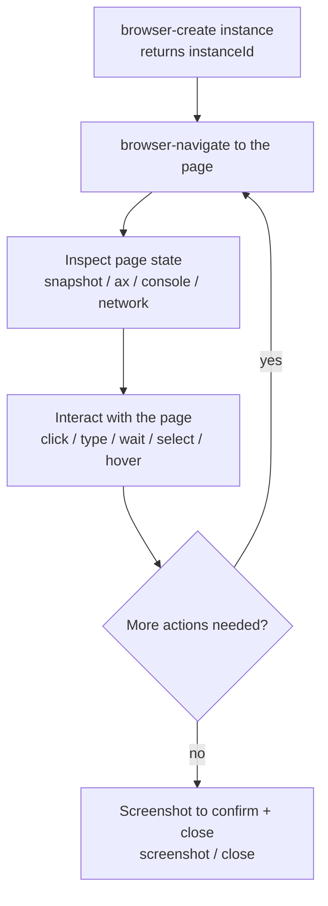

# 6-Browser Automation

Snow App ships an embedded Electron browser that the AI agent can drive
directly to test, scrape and interact with web pages. This guide covers all
tools of the built-in `browser` server and typical workflows.

## 1. Tools Overview

| Tool                                                 | Purpose                                                                                                                                                                                                                                                                                                                                                     |
| ---------------------------------------------------- | ----------------------------------------------------------------------------------------------------------------------------------------------------------------------------------------------------------------------------------------------------------------------------------------------------------------------------------------------------------- |
| `browser-create`                                     | Create a browser instance (optional initial URL)                                                                                                                                                                                                                                                                                                            |
| `browser-navigate`                                   | Navigate to a URL                                                                                                                                                                                                                                                                                                                                           |
| `browser-click`                                      | Click page elements with real mouse events (CSS selector / visible text / accessibility ref)                                                                                                                                                                                                                                                                |
| `browser-type`                                       | Type text into an element (set at once or key by key; ref targeting supported)                                                                                                                                                                                                                                                                              |
| `browser-wait`                                       | Wait for text/element to appear or disappear, or a fixed duration                                                                                                                                                                                                                                                                                           |
| `browser-press_key`                                  | Press a keyboard key or combination (Enter/Tab/Escape/arrows, `Ctrl+A`-style)                                                                                                                                                                                                                                                                               |
| `browser-scroll`                                     | Scroll the document or an inner scroll container (feeds, virtual lists) and report whether it moved plus the before/after position                                                                                                                                                                                                                          |
| `browser-select_option`                              | Select option(s) in a dropdown (match by value or label)                                                                                                                                                                                                                                                                                                    |
| `browser-hover`                                      | Hover an element (triggers hover overlays)                                                                                                                                                                                                                                                                                                                  |
| `browser-upload-file`                                | Upload file(s) (CDP injection, no dialog)                                                                                                                                                                                                                                                                                                                   |
| `browser-back` / `browser-forward`                   | Browser history back/forward (waits for navigation)                                                                                                                                                                                                                                                                                                         |
| `browser-navigate_back` / `browser-navigate_forward` | Browser history back/forward (no navigation wait)                                                                                                                                                                                                                                                                                                           |
| `browser-evaluate`                                   | Run arbitrary JavaScript in the page and return the result                                                                                                                                                                                                                                                                                                  |
| `browser-screenshot`                                 | Capture the page as PNG (full page supported)                                                                                                                                                                                                                                                                                                               |
| `browser-devtools`                                   | Text/accessibility-tree snapshot / performance trace / console messages / network requests & details / offline simulation / API mocking and fault injection (failures, latency, test-server forwarding) / logpoints (runtime variables without editing source) / encrypted login-state save & restore / cookie management / dialog handling / open DevTools |
| `browser-close`                                      | Close a browser tab                                                                                                                                                                                                                                                                                                                                         |
| `browser-focus`                                      | Switch to a tab                                                                                                                                                                                                                                                                                                                                             |
| `browser-list`                                       | List all open tabs (tabs not shared with the agent only return `instanceId` and a placeholder title, `url` is null)                                                                                                                                                                                                                                         |
| `browser-request_share`                              | Ask the user to share a tab with the agent (in-app confirmation bar; a refusal or timeout returns `shared: false`)                                                                                                                                                                                                                                          |

## 2. Typical Workflows



### 2.1 Open a page

```text
browser-create url=https://example.com
→ creates an instance and returns its instanceId

browser-navigate instanceId=<id> url=https://example.com/docs
→ navigate to another URL
```

### 2.2 Inspect page state

```text
browser-devtools action=snapshot instanceId=<id>
→ page metadata + text snapshot (understand the page structure)

browser-devtools action=ax instanceId=<id>
→ accessibility-tree snapshot (structured interactive elements with [uid=eN];
  engine-level AX tree, pierces closed shadow DOM, elements are ref-addressable).
  Compact output includes control values (value/min/max) and states
  (checked/selected/expanded/disabled), aggregates table row cells into text,
  and masks password-like values

browser-devtools action=ax verbose=true maxNodes=500 instanceId=<id>
→ every node plus all AX properties (higher token cost, use on demand)

browser-devtools action=console level=error instanceId=<id>
→ console errors (troubleshoot page JS failures)

browser-devtools action=network filter=api instanceId=<id>
→ network request list (compact by default: id, method, url, status, resourceType,
  duration, source, failure reason; request/response headers and bodies are not
  expanded. CDP records include a requestId; webRequest fallback records do not)

browser-devtools action=network methods=["OPTIONS"] instanceId=<id>
→ only CORS preflight requests (the response's preflightTotal reports how many
  preflight requests exist in the current filter)

browser-devtools action=network_detail requestId=<numeric id> instanceId=<id>
→ full record of one request by the numeric id from the list (incl. headers)

browser-devtools action=network includeHeaders=true instanceId=<id>
→ compatibility mode: the list carries request/response headers (higher token cost)

browser-devtools action=networkDetails requestId=<requestId> instanceId=<id>
→ full details of one request: request/response headers + request body + response body
  (default limit 128KB, adjustable via maxBodyBytes)

browser-devtools action=networkState state=offline instanceId=<id>
→ simulate offline (all requests fail); state=online restores connectivity
```

Cross-origin/OOPIF iframe network records, console entries and dialogs are captured and answered per frame CDP session: the network list includes `cdpFrameId` and `requestId` is a frame-scoped detail key, console entries carry `cdpFrameId`, and the dialog list marks `frame` as `main`/`iframe`. A missing frame session fails explicitly instead of falling back to the main frame.

### 2.3 Mock APIs, inject failures (route interception)

```text
# Intercept requests matching /api/users and return custom JSON
# (pattern supports /regex/ or plain substring)
browser-devtools action=route pattern="/api/users" body='{"code":0,"data":[]}' contentType=application/json instanceId=<id>

# Simulate a server error
browser-devtools action=route pattern="/login" status=500 body='{"error":"boom"}' instanceId=<id>

# Make the request fail outright (network down / API gone), optional CDP error reason
browser-devtools action=route pattern="/api/orders" abort=ConnectionRefused instanceId=<id>

# Inject latency (respond after 3 seconds)
browser-devtools action=route pattern="/api/search" delayMs=3000 body='{"data":[]}' instanceId=<id>

# Match one method / resource type only, and apply just once (test retry logic)
browser-devtools action=route pattern="/api/pay" method=POST times=1 abort=TimedOut instanceId=<id>

# Serve the body from a local file (re-read per request: edit the file, not the frontend)
browser-devtools action=route pattern="/api/config" bodyFile=/Users/me/mocks/config.json contentType=application/json instanceId=<id>

# Replace real responses: forward the request to a test server and return its response
browser-devtools action=route pattern="/api/" proxyTo=https://staging.example.com/api/ instanceId=<id>

# Inspect active rules with hit counts
browser-devtools action=routeList instanceId=<id>

# Remove all mock rules and restore real network
browser-devtools action=routeClear instanceId=<id>
```

Re-calling the same pattern replaces that rule; several rules can be active at once
(matched in registration order). Hit counts survive unchanged rules and reset when a
rule changes, so `times` can be replayed. When `proxyTo` forwarding fails the page
receives a 502 with a JSON error instead of a hanging request; the method, request
headers and body are forwarded, and response headers are passed back except transport
headers such as content-length / content-encoding / host.

### 2.4 Logpoints (inspect runtime variables without editing source)

```text
# Set a logpoint by source path (resolved through source maps; line numbers match the file on disk)
browser-devtools action=logpointSet url="src/cart.ts" lineNumber=42 \
  expressions='["cart.total","cart.items.length"]' instanceId=<id>

# Not sure where? Search first: returns url / lineNumber / columnNumber ready for logpointSet
browser-devtools action=scriptSearch query="function checkout" instanceId=<id>
browser-devtools action=scriptSearch query="submitOrder\\(" isRegex=true url="app." instanceId=<id>

# List parsed scripts; sources=true also lists original source files from source maps
browser-devtools action=scriptList filter="app" sources=true instanceId=<id>

# Set a logpoint on one line: record local variables on hit, execution continues
browser-devtools action=logpointSet url="/static/js/app.4f2c.js" lineNumber=482 \
  expressions='["userId","state.items.length","payload.id"]' label="checkout" instanceId=<id>

# Only record under a condition (avoids noise)
browser-devtools action=logpointSet url="/static/js/app.4f2c.js" lineNumber=482 \
  condition="state.items.length > 0" expressions='["state.items[0]"]' maxHits=10 instanceId=<id>

# Match the script URL by regex (hashed bundle names)
browser-devtools action=logpointSet url="/app\\.[0-9a-f]+\\.js$" urlRegex=true \
  lineNumber=482 expressions='["userId"]' instanceId=<id>

# Read collected hits and variable values
browser-devtools action=logpointHits instanceId=<id>
browser-devtools action=logpointHits logpointId=<logpointId> limit=20 instanceId=<id>

# List / remove / clear logpoints and hits
browser-devtools action=logpointList instanceId=<id>
browser-devtools action=logpointRemove logpointId=<logpointId> instanceId=<id>
browser-devtools action=logpointClear instanceId=<id>
browser-devtools action=logpointHitsClear instanceId=<id>
```

Logpoints use CDP `Debugger.setBreakpointByUrl` with a generated condition: on a hit
the values are formatted inside the page and sent back, and the condition always
returns `false`, so the page keeps running - no pause and no source edit.

- **Location**: `url` first matches an original source file from a source map (full
  URL or path suffix such as `src/cart.ts`); `lineNumber` is then the line of the file
  on disk. Otherwise it is a **literal substring** of a loaded script URL, and
  `/regex/` or `urlRegex=true` matches script URLs by regular expression (source maps
  are not consulted). `lineNumber` and `columnNumber` are both 1-based; minified
  single-line bundles need `columnNumber`, which `scriptSearch` returns. After a
  rebuild and reload, source-path logpoints are re-resolved automatically.
- **Binding feedback**: `logpointSet` returns `bound`, `locations` (where it actually
  landed) and `warning` (no match yet, line past the end of the script, line moved to
  the next executable code, ...). A path matching several source files, or a line with
  no executable code after it, is rejected. Scripts that have not loaded yet stay
  pending and bind when they load.
- **Values**: expressions run **before** the line executes (a variable declared on
  that line is not set yet) and hits are keyed by the expression text. An expression
  that throws only affects itself and shows `[Thrown: ...]`; `undefined`, `Error`,
  `Map`, `Set`, circular references and DOM nodes all have readable forms, and deep or
  long values are truncated. Use the minified variable names in minified code.
- **No hits?** `logpointHits` returns `diagnostics` with each logpoint's bound state,
  warning and last evaluation error, which separates "not bound", "line never ran" and
  "expression threw".
- **Other**: a logpoint retires after `maxHits` (default 20, max 50) and is skipped
  inside the page once the limit is reached. Opening the page's DevTools takes the
  debugger, so logpoints pause until it is closed (`logpointList` reports `suspended`
  meanwhile) and are then restored. The debugger domain is switched off when idle
  after all logpoints are cleared. Hits never leak into `action=console` records.

### 2.5 Interact with the page

```text
# Click (by CSS selector, visible text, or accessibility ref)
browser-click selector="#submit-btn" instanceId=<id>
browser-click text="Sign in" instanceId=<id>
browser-click ref=e3 instanceId=<id>

# Type text (ref targeting supported too)
browser-type selector="#username" value="user1" instanceId=<id>
browser-type text="password field" value="secret" delayMs=30 instanceId=<id>
browser-type ref=e6 value="hello" submit=true instanceId=<id>

# Wait for async content (operate only after SPA rendering completes)
browser-wait text="Loaded" instanceId=<id>
browser-wait textGone="Loading..." timeoutMs=15000 instanceId=<id>

# Keyboard actions
browser-press_key key="Tab" instanceId=<id>
browser-press_key key="Control+a" instanceId=<id>   # Ctrl+A select all
browser-press_key key="Escape" instanceId=<id>

# Dropdown / hover / upload
browser-select_option selector="#country" values=["CN"] instanceId=<id>
browser-hover text="User menu" instanceId=<id>
browser-upload-file selector="input[type=file]" files=["C:/tmp/avatar.png"] instanceId=<id>

# History navigation
browser-back instanceId=<id>
browser-forward instanceId=<id>
browser-navigate_back instanceId=<id>
browser-navigate_forward instanceId=<id>

# Execute arbitrary JS (read/modify page state)
browser-evaluate expression="document.title" instanceId=<id>
```

### 2.6 Action receipts and bounded observation (observe / expect)

`browser-click`, `browser-type`, `browser-fill_form`, `browser-select_option` and
`browser-press_key` split their receipt so "the event was dispatched" is never
mistaken for "the site succeeded":

- `success` / `dispatched`: the real input event was delivered (nothing more);
- `before`: URL and title before the action; the top-level `url` / `title` are the
  current page state after it;
- `observation`: the bounded post-action result (`status` = `changed` / `unchanged` /
  `navigating` / `blocked` / `expect-timeout`) with the changed signals, visible
  search/filter fields, and any new console errors, dialogs or downloads produced
  inside this action's window. Observation never waits for network-idle and never
  retries the action.

```text
# Default brief: wait up to 1500ms and return early as soon as a change is seen
browser-click text="Add to cart" instanceId=<id>

# Dispatch only, keep the lowest latency
browser-click selector="#more" observe=none instanceId=<id>

# Also return condensed page text
browser-click text="Details" observe=snapshot instanceId=<id>

# Combine the action with an explicit completion condition (no sleeping, no re-click)
browser-click text="Search" expect={urlIncludes:"/products"} observeTimeoutMs=5000 instanceId=<id>
browser-type selector="#q" value="hammer" submit=true expect={text:"Thor Hammer"} instanceId=<id>
```

Notes:

- `unchanged` means no page change was observed in the window, **not that the action
  failed**; verify with `browser-devtools action=snapshot` or `browser-wait` instead of
  repeating a side-effecting action;
- `navigating` means the page was still loading; `blocked` means a JS dialog is blocking
  page scripts (use `browser-devtools action=dialog`); `expect-timeout` is only an
  observation timeout, not a failed action;
- URL query/fragment are removed by the redaction policy and the receipt marks that with
  `urlRedaction`; read search conditions from `observation.state.searchFields` instead of
  relying on the address bar.

### 2.7 Performance analysis (trace)

```text
# Record 3s of performance data; returns long-task/event stats (main-thread jank)
browser-devtools action=trace instanceId=<id>
browser-devtools action=trace durationMs=5000 instanceId=<id>
→ { eventCount, longTasks: { count, totalMs, longestMs }, topEventTypes }
```

Long tasks (runnable events >50ms) are the core jank indicator; `topEventTypes`
shows the main event mix — combine with `action=network` and `action=console`
for deeper diagnosis.

### 2.8 Screenshot and close

```text
browser-screenshot instanceId=<id> fullPage=true
→ returns a PNG image

browser-close instanceId=<id>
```

## 3. Login-state save & restore (cookies + localStorage)

The embedded browser uses a persistent session, but login state can be
explicitly archived/restored for multi-account switching and backup. Files are
encrypted with OS-level encryption (safeStorage) under `~/.snowapp/browser-state/`
and are **never stored as plaintext**; the current state is automatically
backed up (also encrypted) before every restore. All browser cookies are also
snapshotted periodically to an encrypted `auto-cookies` file in the same
directory (auto-restored on startup if cookie loss is detected).

```text
# Save the current login state (cookies + localStorage of the current origin)
browser-devtools action=storageSave instanceId=<id>
browser-devtools action=storageSave fileName=github-account1.bin instanceId=<id>
→ returns file name and counts (cookies / origins), never the contents

# Restore login state (current state is auto-backed up to backups/ first)
browser-devtools action=storageRestore fileName=github-account1.bin instanceId=<id>
→ returns restore stats + backup file path

# List cookies (values masked by default: first 4 chars + length)
browser-devtools action=cookies instanceId=<id>
browser-devtools action=cookies domain=".github.com" instanceId=<id>
# Explicitly request plaintext for debugging (response carries a sensitive-data warning)
browser-devtools action=cookies showValues=true domain=".github.com" instanceId=<id>

# Delete one cookie (name + domain for precise targeting)
browser-devtools action=cookieDelete name="_gh_sess" domain=".github.com" instanceId=<id>
```

Security notes:

- **Encryption**: files are encrypted with OS-level encryption (Windows DPAPI /
  macOS Keychain / Linux keyring); saving is refused when the keyring is unavailable;
- **No echo**: save/restore only return counts — cookie values never enter the
  conversation context; `showValues=true` is required for plaintext and adds a warning;
- **Origin checks**: localStorage is only restored to origins that exactly match
  the saved origin;
- **File-name whitelist**: only `[A-Za-z0-9._-]` is allowed; the real path is
  composed by the app (no path traversal);
- **Backup**: current state is auto-backed up (encrypted) to the `backups/`
  subdirectory before restore.

## 4. Dialog (alert / confirm / prompt) handling

When the page shows a dialog, subsequent agent actions may be blocked:

```text
browser-devtools action=dialog instanceId=<id>
→ list pending dialogs

browser-devtools action=dialog dialogResponse={accept:true} instanceId=<id>
→ accept (OK) the dialog
browser-devtools action=dialog dialogResponse={accept:false} instanceId=<id>
→ dismiss (Cancel) the dialog
browser-devtools action=dialog dialogResponse={accept:true, promptText:"input"} instanceId=<id>
→ provide input for a prompt dialog
```

## 5. Agent access, sharing and isolation

Browser tabs are private by default: only tabs the user explicitly shared, or tabs the agent
opened itself, can be driven by the browser tools. Any command targeting another tab fails
immediately.

- **Share a tab**: the robot button in the toolbar (`Bot` / `BotOff`) shares or revokes the
  current tab in one click; a shared tab highlights the button and shows a dot on the tab,
  and clicking again revokes access instantly (no restart, no re-login);
- **Agent requests access**: the agent may call `browser-request_share`; the app switches to
  that tab and shows an Allow / Deny bar, returning `{ shared: false, reason: "denied" }`
  when the user denies or does not answer within 60 seconds;
- **Agent-opened tabs**: tabs created by `browser-create` count as shared and run in an
  **isolated session** by default (their own in-memory cookies and storage, never touching
  your login state). Turn isolation off in **Settings > Browser > Agent access** to let the
  agent reuse your login state in tabs it opens;
- **Global switch**: the same settings page can disable browser access for the agent entirely
  (every browser tool then returns an error);
- **Domain policy**: optionally restrict the agent to (or exclude it from) a domain list,
  matching a host and its subdomains, on top of tab sharing;
- **Visible and auditable**: every tool call's arguments and results stay in the conversation
  transcript, and the sharing state is always visible in the toolbar and the tab bar.

## 6. Best Practices

- **Snapshot before interacting**: for dynamic/complex pages prefer
  `browser-devtools action=ax` and target elements deterministically with
  `ref=<uid>` (instead of guessing CSS selectors); plain static pages work
  fine with `action=snapshot`;
- **Refs go stale**: after the page changes (re-render/navigation) take a new
  `action=ax` snapshot — stale refs fail with a clear re-snapshot hint;
- **Multi-tab management**: `browser-list` lists all tabs,
  `browser-focus` switches to the target one;
- **Pair with the network panel**: when a page misbehaves, check
  `action=console level=error` and `action=network` before re-navigating;
- **Real mouse events**: `browser-click` uses real Electron mouse input
  events, unlike script injection — handlers relying on real events fire;
- **Not headless**: the built-in browser is an embedded window and requires
  the app to be running.

## 7. Related config

- Browser tools can pop the current page out into a **standalone window**; standalone windows support full **tab migration and restoration** — tabs can be moved between the standalone window and the main panel, and reopening a standalone window restores its tabs and session state (the agent sharing state migrates with the tab);
- Proxy and browser paths are configured in **Settings → Proxy & Browser** (`app-control-openSettings page=proxy-browser-settings`); fields are documented in [3-config-file-field-reference](../3-reference/3-config-file-field-reference.md) under `proxy-config.json` (`browserPath`, `browserDebugPort`);
- Other browser settings are covered in [17-browser-settings-passwords-and-import](17-browser-settings-passwords-and-import.md).
