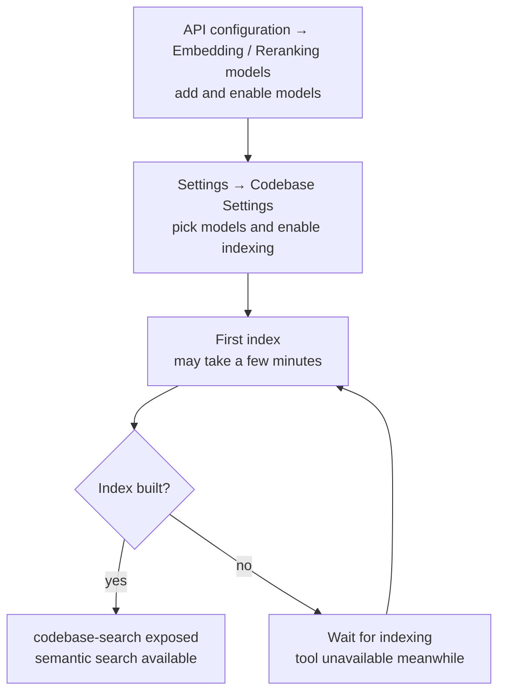

# 7-Codebase Index & Symbol Location

Snow App provides codebase semantic search (the `codebase` server) and code
symbol location through external language servers (the `lsp` server) to help
the agent understand and navigate code quickly.

## 1. Codebase semantic search (codebase)

### 1.1 Enable and index

`codebase-search` is **only exposed when the project has codebase indexing
enabled and an index has been built**. First add models in **Settings → API
configuration → Embedding models / Reranking models** (several models, each
can be enabled, disabled and connection-tested), then pick the embedding and
reranking model in **Settings → Codebase Settings** (`app-control-openSettings
page=codebase-settings`; reranking can be set to "No reranking") and enable
indexing for the project. The first index may take a few minutes; rebuild the
index after switching the embedding model.

Embedding, reranking and decision models live in the database tables
`embedding_models` / `reranking_models` / `decision_models` (each row also keeps
its latest connection test result); the codebase settings only keep the
selected ids (`embeddingModelId` / `rerankingModelId` / `agentReviewModelId`),
which Rust expands while indexing and searching. Deleting a model clears every
selection that points to it (codebase settings, the decision tool default model
and the sensitive command assist). Model lists and connection test results that
older versions kept in the system settings, plus embedding / reranking / Jev
configs stored inline in the codebase settings (including configs synced from
Snow CLI), are migrated into the tables and selected automatically at startup.
Agents manage the lists with
`config-set scope=codebase key=embeddingModels|rerankingModels`.



### 1.2 Tool

| Tool              | Purpose                                  |
| ----------------- | ---------------------------------------- |
| `codebase-search` | Semantic search over the embedding index |

Parameters: `query` (natural-language query text, required), `topN` (result
cap, default 10, max 50).

### 1.3 Example

```text
codebase-search query="how is config backslash escaping handled" topN=10
→ returns semantically related code snippets

codebase-search query="retry logic" topN=5
→ returns semantically related code snippets
```

### 1.4 Choosing between grep and codebase

| Scenario                                                  | Use                                     |
| --------------------------------------------------------- | --------------------------------------- |
| Exact keywords, regex, path-limited search                | `grep-search` (faster, precise)         |
| Semantic/intent queries ("find the login handling logic") | `codebase-search` (understands meaning) |

## 2. Code symbol location (LSP)

Snow App's `lsp` server consumes **external language servers** (rust-analyzer /
gopls / pyright ...) for semantics-based **diagnostics** (`lsp-diagnostics`)
and **hover** (`lsp-hover`).

Configuration is persisted in the app database table `lsp_server_configs`
(**DB-backed, no config file**):

- **Agent config**: `config-set scope=lsp-config key=servers value={...}`
  (full replacement, deep-validated; takes effect immediately, no restart).
- **User config**: Settings → LSP settings (`lsp-settings` page).
- The legacy `~/.snow/lsp-config.json` (reserved-era file) is imported once on
  first start (source=legacy); never read afterwards.

**Tools are off by default:** enable the LSP domain in project MCP settings and verify that the language server is enabled, installed and stack/capability-matched. Global/project per-tool disabling and sub-agent whitelists still apply. Turning on an installed language server does not expose every tool to every request. SSH/remote projects are unsupported.

Common tools include `lsp-diagnostics` (file diagnostics), `lsp-hover` (types/docs), `lsp-goto{kind}` (definition/type-definition/implementation), references, symbols, rename, call/type hierarchies and the two workspace tools. The old standalone definition/type-definition/implementation tools are merged into `lsp-goto`; see [built-in tools](../3-reference/2-builtin-tools-reference.md) for full parameters.

Project configurations override global configurations for the same language; Global/Project scopes are managed separately in LSP settings. These are parameter examples only: replace paths with real absolute local paths and first check tool visibility.

```text
lsp-diagnostics filePaths=["/absolute/project/src/main.rs"]
lsp-symbols filePaths=["/absolute/project/src/main.rs"]
lsp-goto items=[{"filePath":"/absolute/project/src/main.rs","line":12,"column":4,"kind":"definition"}]
lsp-workspace-symbols query=TargetName workspaceRoot=/absolute/project
lsp-workspace-diagnostics workspaceRoot=/absolute/project
lsp-hover items=[{"symbol":"TargetName","workspaceRoot":"/absolute/project"}]
```

For partial or ambiguous results, address warnings, narrow scope and verify coordinates instead of assuming uniqueness. Preview rename edits with `dryRun=true` first.

### 2.1 LSP preference and troubleshooting (2026-09-26)

- **Check actual tools first:** main and sub-agent requests use final `ToolSnapshot` data for the LSP section and analysis list. Global/project tool switches, installation/capabilities and sub-agent whitelists all matter. Disabled grep/read/codebase tools are not an unconditional baseline either.
- **Choose scope deliberately:** `lsp-workspace-symbols` (Workspace Symbol Search), `lsp-workspace-diagnostics` and symbol-only addressing accept optional `workspaceRoot`. Supply an existing absolute local directory, not a relative path, file or SSH path. When omitted, the current project root is used; without a reliable root, supply one explicitly. This does not search every other project or elevate permissions.
- **Read completeness first:** partial, warnings, unsupportedOperations, incomplete and `partial_symbol_search` indicate coverage gaps. An empty list does not prove a clean project; a single candidate does not establish uniqueness. `requiresExplicitCoordinates` means inspect the declaration and provide `filePath/line/column`; ordinary ranges are not safe rename coordinates.
- **Running is not ready:** a running badge describes process/session state; initialization, indexing or diagnostic builds may still take time. Refresh stale snapshots. Neither completed prompt prewarming nor instantaneous first calls are guaranteed.
- **Document/diagnostic freshness:** `ensure_open` compares full text each time, updates send didChange, and workspace requests close deleted documents. Diagnostics no longer read/write persistent result caches; old tables/data are not deleted. Re-diagnosis cost is preferred to stale results after dependency/configuration changes.
- **Fallback path:** uncovered languages/extensions/operations or incomplete scans have no extra static-analysis service; use the visible `grep-search` / `filesystem-read` instead, without bypassing a sub-agent whitelist.

Labels are `全局符号搜索` / `全域符號搜尋` / `Workspace Symbol Search`; the tool ID remains `lsp-workspace-symbols`. <!-- docs-check: allow-cjk -->

Collapsing large UI results reduces rendering work without removing warnings or changing completeness. See [LSP design §0](../4-architecture-and-development/7-lsp-external-language-server-design.md) for pending acceptance scenarios.

**Troubleshooting** (check in order when LSP is not working):

| Symptom                                        | Check                                                                           | Fix                                                                                                                                                                                      |
| ---------------------------------------------- | ------------------------------------------------------------------------------- | ---------------------------------------------------------------------------------------------------------------------------------------------------------------------------------------- |
| `lsp-*` tools missing                          | Config exists and enabled (`config-get scope=lsp-config key=servers`)           | `config-set scope=lsp-config key=servers value={...}`; enable in Settings → LSP settings                                                                                                 |
| Error "not found or cannot start"              | Command in PATH (`which <command>` / ❌ not-installed badge)                    | Install per the `installCommand` hint; enable in Settings after install                                                                                                                  |
| Error "no LSP server configured for x"         | File extension in the server's `fileExtensions`                                 | Add the extension (e.g. missing `.tsx`); confirm the project language matches the server                                                                                                 |
| Project has no programming language / mismatch | Project has matching language files (no Language Servers section in the prompt) | Language detection = project markers (Cargo.toml etc.) + extension scan; no match → not injected nor exposed                                                                             |
| SSH remote project                             | `ssh://` path                                                                   | LSP is local-only; SSH projects never expose lsp-* tools                                                                                                                                 |
| `crashed; restarts on next use`                | Session crashed (≥2 consecutive restarts error out)                             | Check installation/configuration and startup backoff; do not loop during cooldown                                                                                                        |
| Dig deeper                                     | Snow App SQLite system logs                                                     | Use `config-logs-read` for the current conversation (conversationId is runtime-injected), filtered to `module=lsp`; development-mode native `[lsp]` fallback logs remain in the terminal |

**Logging**: LSP fallback/failure reasons are written to Snow App SQLite `app_logs`, the same source as Settings → System Logs. `config-logs-read` is scoped to the current conversation; API request/response bodies are truncated, with sensitive-name fields and exact occurrences of the active API key redacted before persistence. This does not guarantee detection of every possible credential format. Request headers are not logged. Filter by `module=lsp` for prompt injection, scope checks and project-root failures. Native stderr remains visible in development terminals. `~/.snow/log/` belongs to Snow CLI and is not accessible through Snow App's config scopes.

### 2.2 Batch diagnostics and safe rename

The 11 semantic labels match across both i18n families and all three locales, with unchanged tool IDs; see the [tool reference](../3-reference/2-builtin-tools-reference.md). Semantic work **MUST** use the corresponding visible LSP tool when it supports the target language/operation. Check languages, capabilities and health per tool, not a global language list. Do not loop during startup backoff; explain unmet conditions and use visible fallbacks.

These are parameter examples, not execution records. Replace paths with real absolute local files:

```json
{ "filePaths": ["/absolute/project/src/a.ts"] }
```

```json
{ "filePaths": ["/absolute/project/src/a.ts", "/absolute/project/src/b.ts"] }
```

Diagnostics require a `filePaths` array; use a one-item array for one file too. Only 1..30 nonempty path strings are accepted; wrong types, empty arrays/entries and oversized lists are rejected. Paths are deduplicated by physical file identity while preserving first occurrence. Responses always use a `batch:true` envelope with aggregate status, summary and per-file results; individual failures, ambiguities and partial results remain visible.

For rename, first use `dryRun=true`, inspect edits, then pass the returned `previewId` with `dryRun=false` through normal approval. The capability has a 5-minute TTL, at most 32 per session, is single-use and content-bound. Do not paste its raw value into reports. Changed files, expiry, missing/consumed capabilities or `requiresNewPreview` require another preview; the UI never applies automatically. Multi-file writes are not transactional: inspect `appliedFiles/failedFile/error/failedFileMayBeModified`, never claim rollback, and do not replay a capability when files may already have changed.

Read-only batches are capped at concurrency 3 and preserve input order. The Rust LSP module tests pass; live language-server runtime acceptance was outside this validation scope. See [LSP design §0.6–0.8](../4-architecture-and-development/7-lsp-external-language-server-design.md) for the full contract.

## 3. Typical workflow

```text
1. Confirm scope/access → current tools, project root; explicit workspaceRoot if needed
2. Understand/locate    → visible supported LSP; `grep-search` / raw reads for gaps
3. Check completeness  → warnings / partial / candidate coordinates; text matches are literal evidence
4. Formally verify     → project builds/tests, not just empty diagnostics or a running badge
```
