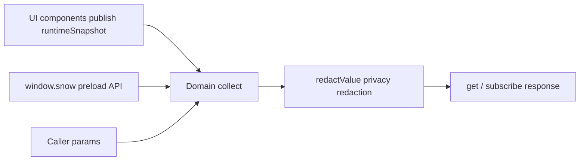

# 6-Plugin Metadata Domains

> Applies to: Snow App desktop plugins (`renderMode` is `esm` or `iframe`). This reference lists, domain by domain, the application metadata a plugin can read through `api.metadata`: domain ids, privacy declaration requirements, liveness, accepted parameters, and return shapes, plus a requirement-to-domain map. Writing application data uses the separate `api.write` (225 write actions, each with its own sensitive scope): call shapes, failure handling, and the action cheat sheet live in the writable-capabilities section of [24-Plugin development and installation](../2-guides/24-plugin-development-and-installation.md), which also covers the manifest and installation workflow. Client UI scripts (Plugins → Plugin list → Script plugins) reach the very same domains and actions through `snow.metadata` / `snow.write`; sensitive scopes must be declared with `@snow-privacy` in the script metadata header - see the client-script chapter of [22-Userscripts](../2-guides/22-userscripts.md).

## 1. Scope and sources

Metadata is collected in the renderer process and has exactly three sources:

| Source           | Description                                                                                                                                                                                                |
| ---------------- | ---------------------------------------------------------------------------------------------------------------------------------------------------------------------------------------------------------- |
| Runtime snapshot | Live UI state continuously published by components into `src/renderer/plugins/runtimeSnapshot.ts` (focused conversation, streaming metrics, right panel, active project, and so on); changes can be pushed |
| Preload API      | `window.snow.*` queries that read the app database and the Rust layer, shared with the settings panels                                                                                                     |
| Call context     | The current plugin record itself (the `plugins` domain) and the caller-supplied `params`                                                                                                                   |

The metadata domains themselves are a **read-only** capability: `api.metadata` cannot write application data. Writing application data uses the separate `api.write`, which shares the exact same `privacy` rule, so a write action with a non-null `scope` must be declared too (see chapter 7); plugin-private data still goes to `api.storage`.



### 1.1 Call shapes

Message footers read their display data through the same privacy-controlled metadata, with the host defaulting only conversation and known directory identifiers; see “Message footer v1” in [24-Plugin development and installation](../2-guides/24-plugin-development-and-installation.md) for DOM mounting and subscription ownership.

```javascript
const response = await api.metadata.get(["conversations", "memos"], {
  params: { directoryId: "local:D:/repo" },
});

const sub = api.metadata.subscribe(
  "runtime",
  (next) => render(next.domains.runtime),
  { intervalMs: 2000 },
);
sub.unsubscribe();

const list = api.metadata.domains(); // [{ id, scope, granted, live, sensitiveFields }]
```

`get` and `subscribe` deliver the same response object:

| Field         | Type     | Description                                                                                |
| ------------- | -------- | ------------------------------------------------------------------------------------------ |
| `generatedAt` | number   | Collection timestamp (epoch milliseconds)                                                  |
| `domains`     | object   | Domain id to collected value; a domain whose `collect` throws is omitted here              |
| `denied`      | object   | Domain id to `{ reason, scope }`; `reason` is currently only `privacy-declaration-missing` |
| `withheld`    | object   | Domain id to the list of stripped field paths (for example `["0.apiKey", "api.apiKey"]`)   |
| `unknown`     | string[] | Domain ids that do not exist                                                               |

`get(domain)` accepts a single domain id or an array; an empty array requests all 37 domains (undeclared sensitive domains are still denied).

The app ships the same catalog for users: **Plugins** at the bottom of the sidebar, then **Metadata catalog** in the toolbar, opens the "App metadata available to plugins" modal. It groups all 37 domains with a one-line summary, the privacy requirement, live-versus-polled behavior and accepted parameters, and offers keyword search; the per-plugin "Metadata n/37" link marks that plugin's declared (readable) and undeclared (denied) domains. The modal offers "Reading" and "Writable" tabs; the Writable tab uses the same catalog source (225 write actions with their required `scope` and declaration state), and the "Write n/225" badge on a plugin row counts the write actions that plugin has declared; the amber privacy-scope badges on plugin and script rows open the "Privacy scopes" dialog, which lists each declared scope with its purpose and the readable / writable surface it unlocks - see [24-Plugin development and installation](../2-guides/24-plugin-development-and-installation.md).

### 1.2 Parameters (`params`)

| Key                 | Default                                                      | Domains and meaning                                                                                                                        |
| ------------------- | ------------------------------------------------------------ | ------------------------------------------------------------------------------------------------------------------------------------------ |
| `projectId`         | Active project (`runtime.activeDirectory.directoryId`)       | Project and code domains; `mcp`, `lsp`, `skills`, `hooks`, `subAgents`, `permissions`, and `codebase` use it to resolve project-level data |
| `directoryId`       | Same as above                                                | `projects`, `memos`, `memory`, `git`, `ssh`, `usage`                                                                                       |
| `projectPath`       | Active project path                                          | `git` (repository path)                                                                                                                    |
| `conversationId`    | Focused conversation (`runtime.conversation.conversationId`) | `messages`, `settings.conversationModes`, `settings.conversationRuntime`                                                                   |
| `limit` / `offset`  | memory 200/0, memos 200/0, logs 200/0, usage records 100/0   | Paging for list domains                                                                                                                    |
| `page` / `pageSize` | 1 / 50                                                       | `codebase.indexedFiles`                                                                                                                    |
| `since` / `until`   | Usage: last 30 days to now; logs: empty                      | ISO timestamps                                                                                                                             |
| `profileName`       | Empty (all profiles)                                         | `usage`                                                                                                                                    |
| `level` / `module`  | Empty                                                        | `logs`                                                                                                                                     |

When a parameter is missing, mistyped, or the underlying data is unavailable, the corresponding field is `null` instead of throwing; list fields degrade to `null` in the same way.

### 1.3 Liveness and refresh

| Kind                | Push behavior                                                                         | Domains                                                                        |
| ------------------- | ------------------------------------------------------------------------------------- | ------------------------------------------------------------------------------ |
| Live (`live: true`) | Re-collected and pushed after a 200 ms debounce whenever the runtime snapshot changes | `projects`, `git`, `conversations`, `messages`, `runtime`, `panels`, `plugins` |
| Non-live            | Pushed once on subscribe; pass `intervalMs` (minimum 1000 ms) to poll                 | The other 30 domains                                                           |

The `live` flag from `api.metadata.domains()` lets a panel distinguish "realtime once subscribed" from "poll to refresh" domains.

## 2. Requirement to domain map

| UI or feature you want                                          | Domain to read                                      | Key fields                                                  |
| --------------------------------------------------------------- | --------------------------------------------------- | ----------------------------------------------------------- |
| Conversation list, titles, pinned items, message counts         | `conversations`                                     | `items[]`, `pinned[]`, `active`                             |
| Message bodies and thinking traces of one conversation          | `messages`                                          | `items[]` (with `content`, `thinking`, `toolCallsJson`)     |
| A streaming metrics bar (tokens, elapsed time, TTFT)            | `runtime`                                           | `conversation.*`, `streamingSessions[]`                     |
| The chat-input token usage ring                                 | `runtime` + `conversations`                         | `chatInput.maxContextTokens`, `conversation.tokenUsage`     |
| The current chat-input content                                  | `runtime`                                           | `chatInput.inputText` (raw text, keeps `@@file:...@@` tags) |
| Which right-panel tabs are open                                 | `panels`                                            | `tabs[]`, `activeTabId`                                     |
| Project (workspace) list, collections, relink history           | `projects`                                          | `directories[]`, `collections[]`, `relinks[]`               |
| A memo panel with pending/done counts                           | `memos`                                             | `summary`, `items[]`                                        |
| Project memory browsing and statistics                          | `memory`                                            | `stats`, `items[]`                                          |
| A scheduled task board                                          | `scheduledTasks`                                    | Task array (with `nextRunAt`, `runCount`)                   |
| Usage charts                                                    | `usage`                                             | `summary`, `daily[]`, `models[]`, `records`                 |
| A log viewer                                                    | `logs`                                              | `items[]`, `total`                                          |
| Git status, branches, repo identity                             | `git`                                               | `status`, `branches[]`, `identity`                          |
| Codebase index progress and file list                           | `codebase`                                          | `indexStats`, `indexedFiles`, `resumableSessions[]`         |
| API profile and model pickers                                   | `apiProfiles`                                       | Profile array (`profileName`, `advancedModel`, ...)         |
| Live channel model picker                                       | `apiModels`                                         | `models[]` (for the profile in `profileName`)               |
| Matching the app theme                                          | `theme`                                             | `mode`, `custom`, `fontFamily`                              |
| Reading app switches (lite, auto-format, shortcuts, ...)        | `settings`                                          | See 4.1.3                                                   |
| MCP servers and tools                                           | `mcp`                                               | `servers[]`, `projectServersWithTools[]`                    |
| Sub-agents, Hooks, Skills, and LSP inventory                    | `subAgents`, `hooks`, `skills`, `lsp`               | Their respective arrays                                     |
| Tool approvals and sensitive command rules                      | `permissions`                                       | `alwaysApprovedTools[]`, `sensitiveCommands[]`              |
| Privacy filtering settings                                      | `privacy`                                           | `enabled`, `mode`, `toolResults`                            |
| System prompts, custom headers, global ROLE                     | `systemPrompts`, `customHeaders`, `personalization` | Record arrays or file content                               |
| App version, engine, storage locations, memory usage            | `app`                                               | `appVersion`, `engine`, `storageLocations`                  |
| Task manager process CPU, memory, and threads                   | `processes`                                         | `processes[]`, `totalMemoryBytes`                           |
| SSH credentials, `~/.ssh/config` hosts, remote drafts           | `ssh`                                               | `credentials[]`, `configHosts[]`, `remoteDrafts[]`          |
| Pending tool authorizations and questions (interaction replies) | `interactions`                                      | `authorizations[]`, `questions[]`                           |
| Mobile remote-control pairing and tunnel state                  | `remoteControl`                                     | `pairing`, `tunnel`                                         |
| Browser passwords, bookmarks, downloads, import sources         | `browser`                                           | Four arrays                                                 |
| Userscript inventory                                            | `userscripts`                                       | Script array                                                |
| Image library and albums                                        | `imageLibrary`                                      | `images[]`, `albums[]`                                      |
| Desktop pets and their settings                                 | `pets`                                              | `installed[]`, `settings`                                   |
| Installed plugins (including this one)                          | `plugins`                                           | Plugin array                                                |
| Opening an external IDE                                         | `ide`                                               | `id`, `name`, `executable`                                  |

## 3. Domain quick reference

| Domain            | Privacy declaration | Live | Main parameters                                        | Summary                                                              |
| ----------------- | ------------------- | ---- | ------------------------------------------------------ | -------------------------------------------------------------------- |
| `app`             | —                   | No   | —                                                      | Version, updates, engine, storage locations, environment             |
| `theme`           | Field-level         | No   | —                                                      | Theme mode, palettes, font, background, stream cursor                |
| `settings`        | Field-level         | No   | `conversationId`                                       | App switches, shortcuts, conversation modes, Git scan                |
| `privacy`         | `privacyConfig`     | No   | —                                                      | Privacy filter switch, mode, and API configuration                   |
| `permissions`     | —                   | No   | `projectId`                                            | Approval lists, read-only tools, sensitive command rules             |
| `ide`             | —                   | No   | —                                                      | IDEs usable for "open in editor"                                     |
| `pets`            | —                   | No   | —                                                      | Installed pets and pet window settings                               |
| `plugins`         | `plugins`           | Yes  | —                                                      | Installed plugin inventory                                           |
| `apiProfiles`     | Field-level         | No   | —                                                      | API profiles (keys stripped)                                         |
| `apiModels`       | —                   | No   | `profileName`                                          | Live provider model list (ids only)                                  |
| `systemPrompts`   | `systemPrompts`     | No   | —                                                      | System prompt entries                                                |
| `customHeaders`   | `customHeaders`     | No   | —                                                      | Custom request-header schemes                                        |
| `personalization` | `personalization`   | No   | —                                                      | The global ROLE rules file                                           |
| `mcp`             | Field-level         | No   | `projectId`                                            | MCP servers, tools, and project-level state                          |
| `subAgents`       | Field-level         | No   | `projectId`                                            | Sub-agent configurations                                             |
| `hooks`           | —                   | No   | `projectId`                                            | Global and project-level hooks                                       |
| `skills`          | —                   | No   | `projectId`                                            | Available Skills and project overrides                               |
| `lsp`             | —                   | No   | `projectId`                                            | LSP servers, effective config, session states                        |
| `codebase`        | —                   | No   | `projectId`, `page`, `pageSize`                        | Index scope, stats, files, resumable sessions                        |
| `conversations`   | `conversations`     | Yes  | `directoryId`                                          | Project conversation list and focused conversation                   |
| `messages`        | `messages`          | Yes  | `conversationId`                                       | Messages, including thinking and tool-call JSON                      |
| `runtime`         | —                   | Yes  | —                                                      | Live runtime snapshot (conversation, streaming, panels, projects)    |
| `panels`          | —                   | Yes  | —                                                      | Right-panel tab state                                                |
| `memos`           | `memos`             | No   | `directoryId`, `limit`, `offset`                       | Memo entries and counts                                              |
| `memory`          | `memory`            | No   | `directoryId`, `limit`, `offset`                       | Project memory entries and statistics                                |
| `scheduledTasks`  | Field-level         | No   | —                                                      | Scheduled task definitions and run state                             |
| `usage`           | `usage`             | No   | `since`, `until`, `profileName`, `limit`, `offset`     | Usage summary, daily/model breakdowns, and records                   |
| `logs`            | `logs`              | No   | `level`, `module`, `since`, `until`, `limit`, `offset` | Paged application logs                                               |
| `projects`        | —                   | Yes  | `directoryId`                                          | Project list, collections, relinks, active project                   |
| `git`             | `git`               | Yes  | `projectPath`, `projectId`                             | Repository status, branches, repo identity                           |
| `ssh`             | `ssh`               | No   | `directoryId`                                          | SSH credentials, config hosts, remote drafts                         |
| `interactions`    | `messages`          | No   | —                                                      | Pending tool authorizations and questions of the active conversation |
| `remoteControl`   | `remoteControl`     | No   | —                                                      | Mobile pairing state and tunnel status                               |
| `browser`         | `browserData`       | No   | —                                                      | Passwords, bookmarks, downloads, import sources                      |
| `userscripts`     | `userscripts`       | No   | —                                                      | Userscript inventory                                                 |
| `imageLibrary`    | —                   | No   | —                                                      | Library images, albums, and root directory                           |
| `processes`       | Field-level         | No   | —                                                      | Task manager process tree: roles, CPU, memory, threads, children     |

"Field-level" means the whole domain is readable, but values whose key name matches a sensitive field are stripped unless the matching privacy scope is declared; chapter 4 lists each domain.

## 4. Field reference by domain

Every section states the privacy requirement, liveness, parameters, and return shape. All calls fall back to `null` on failure.

### 4.1 Application and appearance

#### 4.1.1 `app`

No declaration · Not live · No parameters

| Field                                 | Type           | Description                                                                                                        |
| ------------------------------------- | -------------- | ------------------------------------------------------------------------------------------------------------------ |
| `appVersion`                          | string \| null | App version (`app:get-version`)                                                                                    |
| `updateStatus`                        | object \| null | `{ available, version, downloading, progress, downloaded, error, releaseNotes, releaseNotesZh, releaseNotesZhTw }` |
| `engine`                              | string \| null | Rust engine information string                                                                                     |
| `storageLocations`                    | object \| null | `{ databasePath, archiveDbPath, checkpointDir, uploadDir, checkpointRoot, uploadRoot }`                            |
| `pluginsDirectory`                    | string \| null | Plugin install root (`~/.snowapp/plugins`)                                                                         |
| `locale`                              | string         | UI language (`en` / `zh-CN` / `zh-TW`)                                                                             |
| `language` / `platform` / `userAgent` | string         | Matching `navigator` values                                                                                        |
| `hardwareConcurrency`                 | number         | Logical core count                                                                                                 |
| `timezone`                            | string         | IANA time zone                                                                                                     |
| `startedAt`                           | number         | Renderer `performance.timeOrigin`                                                                                  |
| `now`                                 | number         | Collection timestamp (epoch milliseconds)                                                                          |

#### 4.1.2 `theme`

Field-level sensitive: `backgroundValue` to `privacyConfig` · Not live · No parameters

| Field          | Type                          | Description                                                                                     |
| -------------- | ----------------------------- | ----------------------------------------------------------------------------------------------- |
| `mode`         | `system` \| `light` \| `dark` | Theme mode                                                                                      |
| `presetId`     | string                        | Preset theme id                                                                                 |
| `custom`       | object                        | `{ light: ThemePalette, dark: ThemePalette }`                                                   |
| `background`   | object                        | `{ enabled, source, imagePath, petId, petScale, opacity, blur }` (`source` is `image` or `pet`) |
| `fontFamily`   | string                        | UI font                                                                                         |
| `streamCursor` | object                        | `{ iconType, lucideName, svgPath, iconSize }` streaming cursor                                  |

`ThemePalette` keys: `bgPrimary`, `bgSecondary`, `bgTertiary`, `bgHover`, `bgActive`, `chromeBg`, `appBg`, `borderColor`, `borderLight`, `borderSubtle`, `textPrimary`, `textSecondary`, `textTertiary`, `textMuted`, `accentGreen`, `accentGreenBg`, `accentGreenText`, `accentRed`, `accentRedBg`, `accentRedText`, `accentBlue`, `accentBlueBg`, `accentBlueText`, `accentColor`, `onSolid`, `selectionBg`, `focusRing`.

#### 4.1.3 `settings`

Field-level sensitive: `proxyPassword` to `privacyConfig`, `apiKey` to `apiKeys` · Not live · Parameters: `conversationId`

| Field                 | Type            | Description                                                                                                            |
| --------------------- | --------------- | ---------------------------------------------------------------------------------------------------------------------- |
| `liteMode`            | boolean \| null | Lite mode (disables the Browser / App Control / Terminal built-in servers)                                             |
| `autoFormat`          | boolean \| null | Prettier after file edits                                                                                              |
| `toolCorrection`      | boolean \| null | Auto tool correction (repair failed tool calls and retry)                                                              |
| `yoloMode`            | boolean \| null | Confirmation-free mode (read-only mirror; cannot be changed here)                                                      |
| `requestLogging`      | object \| null  | `{ enabled: boolean, expiresAt: number }` request-body logging switch and expiry                                       |
| `keyboardShortcuts`   | object \| null  | 12 actions to `{ key, enabled, foregroundOnly }`; `key` looks like `mod+f`                                             |
| `conversationModes`   | object \| null  | `{ goalMode, worktreeMode, workflowMode, goalModeTokenBudget }`; `null` means the conversation follows global defaults |
| `conversationRuntime` | object \| null  | `{ thinkingStrength, responsesFastMode }` per-conversation overrides                                                   |
| `gitScan`             | object \| null  | `{ maxDepth, ignoredFolders, changeDebounceMs, remotePollIntervalMs, statusLimit, autoRefresh, confirmPullPush }`      |
| `imageLibraryDir`     | string \| null  | Image library directory (empty string means the default)                                                               |
| `storageLocations`    | object \| null  | Same as `app.storageLocations`                                                                                         |

#### 4.1.4 `privacy`

**Whole-domain sensitive: `privacyConfig`** · Not live · No parameters

| Field           | Type     | Description                                                                                                  |
| --------------- | -------- | ------------------------------------------------------------------------------------------------------------ |
| `enabled`       | boolean  | Master switch of the privacy filter                                                                          |
| `mode`          | string   | `local` or `api`                                                                                             |
| `api`           | object   | `{ url, apiKey, model }` (`apiKey` is a global sensitive field and is stripped unless `apiKeys` is declared) |
| `toolResults`   | object   | `{ tools: string[] }` fully qualified tool names routed through the filter                                   |
| `disabledRules` | string[] | Switched-off local masking rule ids (an empty array means every rule is on)                                  |

#### 4.1.5 `permissions`

No declaration · Not live · Parameters: `projectId`

| Field                  | Type             | Description                                                                                |
| ---------------------- | ---------------- | ------------------------------------------------------------------------------------------ |
| `alwaysApprovedTools`  | string[] \| null | Globally approved tool names (no confirmation)                                             |
| `readonlyTools`        | string[] \| null | Built-in read-only tool names                                                              |
| `projectApprovedTools` | string[] \| null | Project-level approvals (`null` without project context)                                   |
| `sensitiveCommands`    | object[] \| null | `{ id, commandId, pattern, description, enabled, isPreset, sortOrder, source, updatedAt }` |

#### 4.1.6 `ide`

No declaration · Not live · No parameters

| Field                        | Type   | Description                                       |
| ---------------------------- | ------ | ------------------------------------------------- |
| `id` / `name` / `executable` | string | IDE identifier, display name, and executable path |

The domain returns an array of IDEs, used by "open in editor" style panels.

#### 4.1.7 `pets`

No declaration · Not live · No parameters

| Field       | Type             | Description                                                                                                                  |
| ----------- | ---------------- | ---------------------------------------------------------------------------------------------------------------------------- |
| `installed` | object[] \| null | Pet manifests: `{ id, displayName, description, spritesheetFile, dirPath, spritesheetPath, source, version, columns, rows }` |
| `settings`  | object \| null   | `{ enabled, activePetId, scale }`                                                                                            |

#### 4.1.8 `plugins`

**Whole-domain sensitive: `plugins`** · Live · No parameters

Returns a read-only array of installed plugins from the renderer plugin store. Each entry:

| Field                                                                               | Type                      | Description                                                                                             |
| ----------------------------------------------------------------------------------- | ------------------------- | ------------------------------------------------------------------------------------------------------- |
| `pluginId` / `name` / `description` / `version` / `author` / `homepage` / `license` | string / localized object | Manifest metadata (`name` and `description` are `{ default, zh-CN, ... }`)                              |
| `icon`                                                                              | string                    | `lucide:Name`, a relative path, or a URL                                                                |
| `renderMode`                                                                        | string                    | `esm` or `iframe`                                                                                       |
| `kind` / `entry`                                                                    | string                    | `plugin` (panel plugin) or `oauth` (OAuth sign-in plugin); entry file relative path                     |
| `panels`                                                                            | object[]                  | `{ id, title, entry, icon, widthHint, chatInput, chatInputAction, chatInputTitle, chatInputSettings? }` |
| `privacy` / `privacyNote`                                                           | string[] / string         | Declared sensitive scopes and the explanation                                                           |
| `enabled`                                                                           | boolean                   | Whether the plugin is enabled                                                                           |
| `installPath` / `sourcePath`                                                        | string                    | Install directory and source directory                                                                  |
| `minAppVersion`                                                                     | string                    | Minimum app version (not enforced today)                                                                |
| `createdAt` / `updatedAt`                                                           | string                    | Install and update timestamps                                                                           |

### 4.2 AI and configuration

#### 4.2.1 `apiProfiles`

Field-level sensitive: `apiKey`, `visionApiKey` to `apiKeys` · Not live · No parameters

Returns the API profile array. Key fields: `profileName`, `displayName`, `isActive`, `baseUrl`, `baseUrlMode`, `requestMethod`, `advancedModel`, `basicModel`, `supportsVision`, `visionModel`, `maxContextTokens`, `maxTokens`, `enableAutoCompress`, `autoCompressThreshold`, `systemPromptIdsJson`, `customHeaderSchemeId`, `sortOrder`, `source`, `updatedAt`.

#### 4.2.2 `apiModels`

No declaration · Not live · Parameters: `profileName`

| Field         | Type             | Description                                                                           |
| ------------- | ---------------- | ------------------------------------------------------------------------------------- |
| `profileName` | string           | The profile actually used                                                             |
| `models`      | string[] \| null | Model ids fetched live from the provider (sorted by id); `null` when the fetch failed |

The host requests the provider with the profile's stored base URL, request method, custom headers and credentials, through the same chain as the input-toolbar model picker (`api-models:fetch-for-config` → native `fetch_available_models_for_config`), and returns **model ids only, never a key**; it covers OpenAI-compatible `/v1/models`, Gemini, Anthropic and OAuth subscription channels.

- A network request is made only when `profileName` is passed explicitly; a missing parameter, an unknown profile or an unavailable domain returns `null` instead of silently falling back to another or the active profile.
- This is an **outbound request**: every read may reach the provider network (15-second timeout). Panel-style consumers should fetch once when opening or on an explicit user refresh, never inside high-frequency polling or live subscriptions.
- `models: null` means this fetch failed (network, credentials, timeout) and must not be read as "the channel has no models"; consumers fall back to the profile's `basicModel`/`advancedModel` and tell the user.
- Provider model lists change over time and domain fields may be added; read `models` as needed and stay tolerant of unknown fields.

#### 4.2.3 `systemPrompts`

**Whole-domain sensitive: `systemPrompts`** · Not live · No parameters

Returns system prompt entries: `{ promptId, name, content, isActive, sortOrder, scope, projectId, updatedAt }` where `scope` is `global` or `project`.

#### 4.2.4 `customHeaders`

**Whole-domain sensitive: `customHeaders`** · Not live · No parameters

Returns header schemes: `{ schemeId, name, headersJson, isActive, sortOrder, updatedAt }`.

#### 4.2.5 `personalization`

**Whole-domain sensitive: `personalization`** · Not live · No parameters

| Field      | Type   | Description                                               |
| ---------- | ------ | --------------------------------------------------------- |
| `filePath` | string | Absolute path of the global ROLE file (`~/.snow/ROLE.md`) |
| `content`  | string | File content (empty string when the file does not exist)  |

#### 4.2.6 `mcp`

Field-level sensitive: `env`, `headers`, `url` to `mcpSecrets` · Not live · Parameters: `projectId`

| Field                     | Type             | Description                                                                                                                                         |
| ------------------------- | ---------------- | --------------------------------------------------------------------------------------------------------------------------------------------------- |
| `servers`                 | object[] \| null | Global servers: `{ serverId, name, transportType, url, command, argsJson, envJson, headersJson, enabled, timeoutMs, sortOrder, source, updatedAt }` |
| `projectServers`          | object[] \| null | Project-level servers (`null` without a project)                                                                                                    |
| `tools`                   | object[] \| null | Global tools: `{ name, description, inputSchemaJson, enabled }`                                                                                     |
| `projectServersWithTools` | object[] \| null | Project servers with tool state: `{ id, name, source, globalEnabled, enabled, tools[], toolsPending, error }`                                       |

#### 4.2.7 `subAgents`

Field-level sensitive: `systemPrompt`, `toolsJson` to `subAgents` · Not live · Parameters: `projectId`

Returns sub-agent entries: `{ agentId, name, description, systemPrompt, toolsJson, configProfile, model, builtin, sortOrder, source, projectId, updatedAt }`.

#### 4.2.8 `hooks`

No declaration · Not live · Parameters: `projectId`

| Field     | Type             | Description                                                                                                                                                                                                                                                  |
| --------- | ---------------- | ------------------------------------------------------------------------------------------------------------------------------------------------------------------------------------------------------------------------------------------------------------ |
| `global`  | object[] \| null | Global hooks: `{ hookType, scope, projectId, rulesJson, updatedAt }`; `hookType` is one of `onUserMessage`, `beforeToolCall`, `toolConfirmation`, `afterToolCall`, `onSubAgentComplete`, `beforeCompress`, `onSessionStart`, `onStop`, `beforeSubAgentStart` |
| `project` | object[] \| null | Project-level hooks (`null` without a project)                                                                                                                                                                                                               |

#### 4.2.9 `skills`

No declaration · Not live · Parameters: `projectId`

| Field       | Type             | Description                                                                                  |
| ----------- | ---------------- | -------------------------------------------------------------------------------------------- |
| `available` | object[] \| null | Available skills: `{ id, name, description, location, source, path, allowedTools, enabled }` |
| `project`   | object[] \| null | Project skills (additionally carry `defaultEnabled`)                                         |

#### 4.2.10 `lsp`

No declaration · Not live · Parameters: `projectId`

| Field       | Type             | Description                                                                                                                                               |
| ----------- | ---------------- | --------------------------------------------------------------------------------------------------------------------------------------------------------- |
| `servers`   | object[] \| null | Global configuration: `{ lang, command, argsJson, fileExtensionsJson, installCommand, initializationOptionsJson, enabled, sortOrder, source, updatedAt }` |
| `effective` | object[] \| null | Effective configuration for the project (global and project overrides merged, same shape)                                                                 |
| `sessions`  | object[] \| null | Runtime sessions: `{ lang, projectRoot, status, restartCount, lastUsedMs, error }`; `status` is `running` / `dead` / `exited`                             |

### 4.3 Conversations, content, and runtime

#### 4.3.1 `conversations`

**Whole-domain sensitive: `conversations`** · Live · Parameters: `directoryId`

| Field         | Type             | Description                                                             |
| ------------- | ---------------- | ----------------------------------------------------------------------- |
| `directoryId` | string           | The project id actually used                                            |
| `items`       | object[] \| null | Conversation list ordered by most recent update                         |
| `pinned`      | object[] \| null | Pinned conversations                                                    |
| `active`      | object \| null   | Live state of the focused conversation (same as `runtime.conversation`) |

Conversation record fields: `conversationId`, `title`, `summary`, `lastMessagePreview`, `messageCount`, `model`, `apiProfileName`, `status`, `directoryId`, `forkedFromConversationId`, `forkMessageCount`, `conversationType`, `parentConversationId`, `subAgentId`, `subAgentName`, `subAgentStatus`, `subAgentError`, `createdAt`, `updatedAt`, `inputTokens`, `outputTokens`, `cacheCreationInputTokens`, `cacheReadInputTokens`, `totalDurationMs`, `runInputTokens`, `runOutputTokens`, `runCacheCreationInputTokens`, `runCacheReadInputTokens`, `lastRunDurationMs`, `runTtftSumMs`, `runRequestCount`.

#### 4.3.2 `messages`

**Whole-domain sensitive: `messages`** · Live · Parameters: `conversationId`

| Field            | Type             | Description                                                                                                                                                                                 |
| ---------------- | ---------------- | ------------------------------------------------------------------------------------------------------------------------------------------------------------------------------------------- |
| `conversationId` | string           | The conversation id actually used                                                                                                                                                           |
| `live`           | object \| null   | Live state of that conversation (same as `runtime.conversation`)                                                                                                                            |
| `items`          | object[] \| null | Messages: `{ id, role, content, thinking, thinkingDurationMs, thinkingTokenCount, status, model, responseId, checkpointId, toolCallsJson, interruptionReason, recoveryOutcome, createdAt }` |
| `userMessages`   | object[] \| null | User message summaries: `{ id, content, createdAt, isContextCompaction }`                                                                                                                   |

#### 4.3.3 `runtime`

No declaration · Live · No parameters

| Field                       | Type           | Description                                                                                                                                                                                                                                                                                                                                                                                                                                                                                                      |
| --------------------------- | -------------- | ---------------------------------------------------------------------------------------------------------------------------------------------------------------------------------------------------------------------------------------------------------------------------------------------------------------------------------------------------------------------------------------------------------------------------------------------------------------------------------------------------------------- |
| `conversation`              | object \| null | Focused conversation: `{ conversationId, sessionKey, title, directoryId, isStreaming, isPaused, isAborting, messageCount, pendingMessageCount, tokenUsage, runTokenUsage, conversationTokenUsage, streamElapsedMs, streamTtftMs, streamStartedAt, runTtftMs, lastRunDurationMs, streamTokenCount, goalMode, liteMode, yoloMode, fileChangeStats, fileChangeCoverage, fileChangeTrackingVersion, streamingConversationIds, completedConversationIds, attentionRequiredConversationIds, subAgentSessions, todos }` |
| `chatInput`                 | object \| null | Chat input data: `{ conversationId, inputText, maxContextTokens, isLoadingApiConfig }` (`conversationId` is `null` for the new-conversation input; `inputText` is the raw input text keeping `@@file:...@@` / `@@image:...@@` tag markers, an empty string means nothing has been typed)                                                                                                                                                                                                                         |
| `streamingSessions`         | object[]       | Running sessions: `{ sessionKey, conversationId, title, directoryId, isStreaming, isPaused, isAborting, messageCount, tokenCount, elapsedMs, ttftMs, runTtftMs, startedAt, lastRunDurationMs, runTokenUsage }`                                                                                                                                                                                                                                                                                                   |
| `panels`                    | object         | Right-panel state (same as the `panels` domain)                                                                                                                                                                                                                                                                                                                                                                                                                                                                  |
| `activeDirectory`           | object \| null | Active project record (`directoryId`, `name`, `path`, `kind`, `isActive`, `pathState`, ...)                                                                                                                                                                                                                                                                                                                                                                                                                      |
| `activeSessionDirectoryIds` | string[]       | Project ids that currently have running sessions                                                                                                                                                                                                                                                                                                                                                                                                                                                                 |
| `revisions`                 | object         | `{ workspace, memories, scheduledTasks, conversationList, plugins }` change counters for detecting what just changed                                                                                                                                                                                                                                                                                                                                                                                             |
| `locale`                    | string         | Current UI language                                                                                                                                                                                                                                                                                                                                                                                                                                                                                              |

Live metric semantics: `startedAt` is the wall-clock start of the current run, so live duration is `Date.now() - startedAt` and live speed is `tokenCount / elapsedMs`, matching the streaming metrics bar in the UI.

`chatInput.inputText` is published by the chat input while it is mounted and reflects the last published value (the previous value is kept when the input is not mounted). ESM panels also receive the same value as an `inputText` entry prop (see [24-Plugin development and installation](../2-guides/24-plugin-development-and-installation.md)).

#### Safe drafts and optimization are not metadata writeback

A preview snapshot does not prove the input is still mounted or the project/session is unchanged, and cannot detect A→B→A edits. Use public write actions `chatInput.captureDraft({})`, `chatInput.applyDraft({ draftToken, text })`, and `chatInput.restoreDraft({ restoreToken })` (ESM sugar or `api.write.run`; iframe may call draft actions through `write.run`). Standard responses are `{ ok, action, data, error?, denied? }`; success `data` is respectively `{ draftToken, inputText, text, conversationId }`, `{ restoreToken }`, and `{ restored: true }`. Tokens live only in a bounded host-private map and bind the plugin, input instance, project, real / pending session, synchronous draft revision and original content. They are single-use, expire after five minutes, and are limited to 128 entries. Changes including ABA and actual sends/clears, project/session/input-instance switching and unmount reject stale tokens without overwriting new drafts; streaming, stopping, compaction and live Agent replies alone do not invalidate tokens. Restoration performs the same checks.

Captured `text` excludes encoded chips without expanding attachments; `inputText` preserves the complete input for host restoration. Apply replaces only plain text, retains chips verbatim, uses controller `restoreContent` and synchronizes the draft pool; it never sends a message. Optimize with **ESM-only** `api.ai.optimizePrompt({ draft, conversationId?, apiProfile?, model?, contextRounds?, includeContext?, optimizationInstructions?, onChunk?, signal? }): Promise<{ content: string }>`; pass captured `text` only after an explicit user click. `includeContext` defaults to `false`, and explicit `true` requires `messages`. Optimization uses its own stream UUID and cancellation, independent of normal chat, and does not persist conversation messages. There is no iframe `ai` capability. On older versions, check `typeof api.ai?.optimizePrompt === "function"` and `api.write.domains()`; show an upgrade hint when missing, never bypass privacy or guess DOM writes.

`panels[].chatInput: true` declares a public input entry, not privacy authorization: enabled panels show a localized icon immediately before the input toolbar's model selector, and clicking invokes the declared ESM `chatInputAction` only on user request; an empty action or iframe still only opens the panel. Empty plain text, unavailable / loading API configuration or an unmounted input disable execution; streaming / stopping / compaction alone do not. Optional per-panel `chatInputSettings: { defaultVisible?: boolean, storageKey: string }` controls only the ESM configuration gear via a private JSON boolean. The default gear remains visible; declare `defaultVisible: false` to hide it initially. Successful `api.storage.setJson` writes notify the plugin store's storage revision without replacing plugin identities, disabling the plugin or cancelling optimization; the wand contribution is unchanged. See section 6.1 of [24-Plugin development and installation](../2-guides/24-plugin-development-and-installation.md) for the complete contract and user-action flow.

Action tooltips use localized `chatInputTitle`, falling back to `panel.title`. An ESM action has a separate configuration gear, usable without text or API configuration. The Action receives `{ api, signal, onStatus, confirm }` and returns `Promise<{ message?, preview?, apply?: () => Promise<PluginChatInputActionResult>, undo?: () => Promise<void> }>`. Each click reloads preferences through a fresh API, not the configuration panel's storage snapshot; storage read failure prevents execution. Default actions safely refill the draft and return undo, exposed by the host through the "More actions" dropdown next to the wand; the input toolbar no longer renders a persistent preview box, diff box or Apply button, and a returned `preview` stays result data with no separate Apply / Copy entry point. Confirmation uses the host Modal; cancellation affects only the independent Action signal. Parameter, real/pending session, project, plugin update/disable and input lifecycle changes cancel and invalidate late callbacks. Draft token safety still governs all refill/restoration, never DOM writes or message sending. `optimizationInstructions?: string` is limited to 8000 raw Unicode code points, with whitespace-only values omitted; backend instructions use a separate system section without overriding fixed constraints. See section 6.1 of [24-Plugin development and installation](../2-guides/24-plugin-development-and-installation.md) for exact fields and safety rules.

#### Enhanced conversation file tracking (`fileChangeTrackingVersion: 1`)

**These runtime file records remain conversation-cumulative, not task snapshots.** Current-source task-end contributions explicitly set `taskHistory: true` in `messageFooters` and consume immutable file evidence through `context.task`; do not subtract cumulative arrays or split them by time to invent tasks. See the [task-end slot in plugin development](../2-guides/24-plugin-development-and-installation.md).

Check `runtime.conversation.fileChangeTrackingVersion === 1` before consuming enhanced fields. Both `fileChangeStats` and the new `fileChangeCoverage` are objects keyed by `conversationId`, but the snapshot contains only the current `runtime.conversation.conversationId` key (`{}` without a real conversation id). Read that key only; do not enumerate or merge other conversations. A parent key already includes its own sub-agent records; a sub-agent key includes only that sub-agent's records.

| Field                    | Contract                                                                                                                                                                                                            |
| ------------------------ | ------------------------------------------------------------------------------------------------------------------------------------------------------------------------------------------------------------------- |
| `fileChangeStats[id]`    | `FileChangeRecord[]`: `{ filePath, fileKey?, kind: 'create' \| 'edit' \| 'delete', source?: 'filesystem' \| 'terminal', root?: string \| null, timestamp, agent: 'main' \| 'sub', subAgentName?, diff? }`           |
| `fileChangeCoverage[id]` | `FileChangeCoverageRecord[]`: `{ coverage: 'scoped' \| 'partial' \| 'unavailable', reasons: string[], source: 'filesystem' \| 'terminal', root: string \| null, timestamp, agent: 'main' \| 'sub', subAgentName? }` |

- v1 evidence comes from a tool result's `fileTracking: { version: 1, source, root, coverage, reasons, files: [{ filePath, fileKey, kind }] }`. `filePath` is the backend's actual absolute normalized response path. `fileKey` is the backend-provided identity key: do not regenerate it, case-fold it, or infer identity from a basename. Legacy filesystem history may fall back to original arguments without `fileKey/source/root`; this is not canonical evidence.
- Deduplicate file lists by `fileKey ?? filePath`, displaying the last record with the highest timestamp. Raw arrays retain individual records. The last record's `source` describes that record only, **not the file's exclusive source**. For source counts, group the raw records by source and deduplicate identities within each group. Groups may overlap; summing their counts is not a total unique-file count.
- `scoped` means precise attribution within an explicit filesystem tool's write scope, not a comprehensive project scan. Terminal collection observes before/after content changes with at least `partial` coverage. Out-of-scope files and concurrent writers cannot be guaranteed: this is not an operating-system audit or exhaustive write attribution. `root` is the actual collection root, or `null` when unknown; never fill it from the currently selected workspace.
- In the current companion source, a successful filesystem write overlapping a repository-level terminal window retains operation-target evidence when the physical target identity remains reliable. Coverage is `partial` with `concurrent-execution` / `operation-evidence-only`, rather than unconditionally empty records. A concurrent record's `kind: 'edit'` proves successful writing, not that the file previously existed. Changed path identity, unverifiable state or failed tools never fabricate records; copy excludes an unmodified source, while cut includes the actually rewritten source and target. This evidence is not a net disk diff.
- A terminal window overlapping other operations remains marked as contaminated and ends with empty `unavailable` / `concurrent-execution` evidence, rather than attributing another session's or filesystem tool's writes to itself. A shared repository is not a shared task. Coordination does not block long commands and retains independent worktrees' physical-root isolation. This is not an OS audit: attribution cannot be guaranteed for outside processes or detached children writing after their tool returns. A companion native build is required; real concurrent UI acceptance is still pending.
- A non-zero terminal exit can still return actual `files`; retain both files and coverage. Detached/SSH execution may return `unavailable`. Even with no files, display `partial/unavailable` and the actual `reasons`; do not interpret them as “no files changed.” The file panel displays coverage separately.
- Main sessions, sub-agents and their parents record both files and coverage. After restart, full-history restoration uses actual tool results, including valid v1 evidence from failed toolcalls; an assistant interruption/error by itself never proves a write. Legacy terminal history and missing, truncated or invalid envelopes produce `unavailable` (`missing_file_tracking` / `invalid_file_tracking`) without invented files. Successful legacy filesystem records likewise report missing-envelope coverage. Hook suffixes are excluded from JSON parsing; truncated JSON is never repaired into evidence. When a thrown backend result is preserved by catch as an outer `result.error` string, only one complete JSON layer is parsed and its v1 envelope and tool source are validated. Terminal evidence may restore actual files; filesystem errors accept only valid empty-file coverage, never inferred success. Original error messages and authorization handling remain unchanged.
- `diff` retains filesystem content-diff behavior, matching copy source/target by actual response paths. Terminal evidence has no such tool-content diff. File records, tracking coverage and rollback checkpoints are different data; none proves the others complete.

Implementation anchors: `src/renderer/components/mainContent/chatMessages/hooks/fileChangeTracking.ts`, `useChatConversation.ts`, `toolExecution.ts`, `subAgentActivation.ts`, `useConversationManagement.ts` (same directory), and `src/renderer/plugins/PluginRuntimeBridge.tsx`.

#### 4.3.4 `interactions`

**Whole-domain sensitive: `messages`** · Not live (poll it) · No parameters

Returns only the pending items of the **active conversation**, from the same source as mobile remote control. The domain does not push updates: poll it with `subscribe` plus `intervalMs` (minimum 1000 ms), or, in a plugin background module, with `ctx.every` together with `ctx.metadata.get`, to learn about new requests.

| Field            | Type     | Description                                                                                                                                                                        |
| ---------------- | -------- | ---------------------------------------------------------------------------------------------------------------------------------------------------------------------------------- |
| `authorizations` | object[] | Pending tool authorizations: `{ authorizationId, interactionId, name, status, sensitive, arguments }`; `sensitive` is `true` for sensitive commands, which a plugin cannot approve |
| `questions`      | object[] | Pending questions: `{ questionId, question, options }`                                                                                                                             |

Replies to these items use the four write actions of the `interactions` domain: `approveAuthorization` and `rejectAuthorization` (require the `toolApproval` declaration), and `answerQuestion` and `cancelQuestion` (require the `conversations` declaration). For call shapes, privacy rules and a background-module example, see the "8.5 Write action cheat sheet" and "13. Resident background modules, long connections and interaction replies" sections of [24-Plugin development and installation](../2-guides/24-plugin-development-and-installation.md).

Source anchors: `src/renderer/plugins/metadata/domains.ts` (`interactions` collector), `src/renderer/plugins/writes/domains/interactions.ts` (the four write actions), `src/mobile/interactions.ts` (the authorization and question implementation shared with mobile remote control).

#### 4.3.5 `panels`

No declaration · Live · No parameters

| Field                          | Type           | Description                                                                                      |
| ------------------------------ | -------------- | ------------------------------------------------------------------------------------------------ |
| `tabs`                         | object[]       | `{ id, type, title, isActive, pluginId, panelId }`; plugin panels carry `pluginId` and `panelId` |
| `activeTabId`                  | string \| null | Currently active tab                                                                             |
| `isCollapsed` / `isFullscreen` | boolean        | Panel collapse and fullscreen state                                                              |

#### 4.3.6 `memos`

**Whole-domain sensitive: `memos`** · Not live · Parameters: `directoryId`, `limit`, `offset`

| Field     | Type           | Description                                                                                                                                     |
| --------- | -------------- | ----------------------------------------------------------------------------------------------------------------------------------------------- |
| `summary` | object \| null | `{ total, pending, done }`                                                                                                                      |
| `items`   | object \| null | `{ items, total, hasMore }`; entries are `{ id, memoId, directoryId, content, status, createdAt, updatedAt }` with `status` `pending` or `done` |

#### 4.3.7 `memory`

**Whole-domain sensitive: `memory`** · Not live · Parameters: `directoryId`, `limit`, `offset`

| Field   | Type           | Description                                                                                                                                                                                                                                                         |
| ------- | -------------- | ------------------------------------------------------------------------------------------------------------------------------------------------------------------------------------------------------------------------------------------------------------------- |
| `stats` | object \| null | `{ total, active, pending, archived }`                                                                                                                                                                                                                              |
| `items` | object \| null | `{ items, total, hasMore }`; entries are `{ memoryId, kind, title, content, source, status, importance, tags, conversationId, lastRecalledAt, recallCount, createdAt, updatedAt }` with `kind` one of `fact` / `decision` / `preference` / `pitfall` / `task_state` |

#### 4.3.8 `scheduledTasks`

Field-level sensitive: `prompt`, `preScript` to `scheduledTasks` · Not live · No parameters

Returns the scheduled task array:

| Field                                                      | Type                      | Description                                                                                      |
| ---------------------------------------------------------- | ------------------------- | ------------------------------------------------------------------------------------------------ |
| `id` / `directoryId` / `name`                              | string                    | Task id, owning project (empty string means a global task), and name                             |
| `prompt`                                                   | string                    | Prompt sent to the AI Loop on fire (stripped unless `scheduledTasks` is declared)                |
| `scheduleJson`                                             | string                    | Schedule JSON: `{ type: "once" \| "recurring", executeAt?, mode?, intervalMs?, hour?, minute? }` |
| `status`                                                   | string                    | `pending` / `running` / `completed` / `error`                                                    |
| `paused`                                                   | boolean                   | Whether the task is paused                                                                       |
| `nextRunAt` / `lastRunAt` / `createdAt` / `updatedAt`      | string                    | Schedule and timestamps                                                                          |
| `runCount` / `skipCount`                                   | number                    | Executions and pre-script skips                                                                  |
| `lastError` / `lastSkipReason` / `lastSkippedAt`           | string                    | Most recent failure and skip reasons                                                             |
| `preScript` / `preScriptTimeoutMs` / `runOnScriptError`    | string / number / boolean | Pre-script configuration                                                                         |
| `apiProfile` / `basicModel` / `model` / `thinkingStrength` | string                    | Model overrides used by the fired conversation                                                   |
| `history`                                                  | object[]                  | `{ runAt, status, durationMs, error }`, at most 20 entries                                       |

#### 4.3.9 `usage`

**Whole-domain sensitive: `usage`** · Not live · Parameters: `since`, `until`, `profileName`, `conversationId`, `directoryId`, `limit`, `offset`

| Field          | Type             | Description                                                                                                                                                                                                                                                                                    |
| -------------- | ---------------- | ---------------------------------------------------------------------------------------------------------------------------------------------------------------------------------------------------------------------------------------------------------------------------------------------- |
| `profileNames` | string[] \| null | Profile names that have usage records                                                                                                                                                                                                                                                          |
| `summary`      | object \| null   | `{ totalInputTokens, totalOutputTokens, totalCacheCreationInputTokens, totalCacheReadInputTokens, totalRequests, errorRequests, totalTokens, effectiveCacheReadTokens, nonCachedInputTokens }`                                                                                                 |
| `daily`        | object[] \| null | `{ date, totalRequests, errorRequests, totalInputTokens, totalOutputTokens, totalCacheCreationInputTokens, totalCacheReadInputTokens, totalTokens }`                                                                                                                                           |
| `models`       | object[] \| null | `{ model, requestMethod, totalRequests, errorRequests, ...same token fields }`                                                                                                                                                                                                                 |
| `records`      | object \| null   | `{ items, total }`; entries are `{ id, conversationId, responseId, model, apiProfileName, requestMethod, inputTokens, outputTokens, cacheCreationInputTokens, cacheReadInputTokens, status, isSubAgent, directoryId, createdAt, totalTokens, effectiveCacheReadTokens, nonCachedInputTokens }` |

#### 4.3.10 `logs`

**Whole-domain sensitive: `logs`** · Not live · Parameters: `level`, `module`, `since`, `until`, `limit`, `offset`

| Field   | Type             | Description                                                                                              |
| ------- | ---------------- | -------------------------------------------------------------------------------------------------------- |
| `items` | object[] \| null | `{ id, level, module, func, line, message, input, output, duration, context, error, source, createdAt }` |
| `total` | number           | Total number of matching entries                                                                         |

### 4.4 Projects and code

#### 4.4.1 `projects`

No declaration · Live · Parameters: `directoryId`

| Field                       | Type             | Description                                                                                                                                                                                                                                                                                                                        |
| --------------------------- | ---------------- | ---------------------------------------------------------------------------------------------------------------------------------------------------------------------------------------------------------------------------------------------------------------------------------------------------------------------------------- |
| `directories`               | object[] \| null | Projects: `{ directoryId, name, path, kind, isActive, sortOrder, source, pathState, lastKnownPath, updatedAt }`; `kind` is `local` / `ssh` and `pathState` is `ok` / `missing` / `mismatch` / `offline` / `permission_error` / `remote` / `unknown`                                                                                |
| `collections`               | object[] \| null | Project collections (linked project groups): `{ collectionId, name, color, sortOrder, memberDirectoryIds, linkedDirectoryIds, createdAt, updatedAt }`; `color` is the shared dot color (`#rrggbb`) and `linkedDirectoryIds` is the subset taking part in the link (the rest are unlinked members that only stay in the collection) |
| `relinks`                   | object[] \| null | Relocation history: `{ relinkId, oldDirectoryId, newDirectoryId, oldPath, newPath, movedBy, createdAt, undoneAt }`                                                                                                                                                                                                                 |
| `active`                    | object \| null   | Active project (same as `runtime.activeDirectory`)                                                                                                                                                                                                                                                                                 |
| `activeSessionDirectoryIds` | string[]         | Project ids with running sessions                                                                                                                                                                                                                                                                                                  |

#### 4.4.2 `git`

**Whole-domain sensitive: `git`** · Live · Parameters: `projectPath`, `projectId`

| Field      | Type             | Description                                                                                                                                                                                              |
| ---------- | ---------------- | -------------------------------------------------------------------------------------------------------------------------------------------------------------------------------------------------------- |
| `repoPath` | string           | Repository path used for the query                                                                                                                                                                       |
| `status`   | object \| null   | `{ isRepo, currentBranch, upstream, ahead, behind, files[], stagedCount, unstagedCount, untrackedCount, statusLimitHit }`; `files[]` entries are `{ path, oldPath, indexStatus, workdirStatus, status }` |
| `branches` | object[] \| null | `{ name, isCurrent, isRemote, remoteName }`                                                                                                                                                              |
| `identity` | object \| null   | Repo identity (from git config and origin remote): `{ isRepo, repoPath, name, email, remoteUrl, hasIdentity, error }`                                                                                    |

#### 4.4.3 `codebase`

No declaration · Not live · Parameters: `projectId`, `page`, `pageSize`

| Field               | Type             | Description                                                                                                                                                         |
| ------------------- | ---------------- | ------------------------------------------------------------------------------------------------------------------------------------------------------------------- |
| `projectScope`      | object \| null   | `{ projectId, enabled, enableAgentReview, enableReranking }` project-level three-state overrides                                                                    |
| `indexStats`        | object \| null   | `{ totalChunks, totalFiles, totalSizeBytes, isIndexed }`                                                                                                            |
| `indexedFiles`      | object \| null   | `{ items, total, page, pageSize }`; `items[]` are `{ relativePath, filePath, chunkCount, startLine, endLine, sizeBytes, updatedAt }`                                |
| `resumableSessions` | object[] \| null | Resumable indexing sessions: `{ sessionId, projectId, status, totalFiles, processedFiles, totalChunks, processedChunks, currentFile, error, createdAt, updatedAt }` |

### 4.5 Connections and assets

#### 4.5.1 `ssh`

**Whole-domain sensitive: `ssh`** · Not live · Parameters: `directoryId`

| Field          | Type             | Description                                                                                                                       |
| -------------- | ---------------- | --------------------------------------------------------------------------------------------------------------------------------- |
| `credentials`  | object[] \| null | `{ profileKey, host, port, username, authMethod, privateKeyPath, encryptedSecret, jump? }` (the secret is an encrypted reference) |
| `configHosts`  | object[] \| null | `~/.ssh/config` hosts: `{ alias, host, user, port, identityFile, proxyJump?, proxyJumpHost? }`                                    |
| `remoteDrafts` | object[] \| null | Remote drafts: `{ id, profileId, workspaceId, remotePath, baseVersionJson, content, status, updatedAt }`                          |

#### 4.5.2 `remoteControl`

**Whole-domain sensitive: `remoteControl`** · Not live · No parameters

| Field     | Type           | Description                                                                                                                                                                                                                                                                         |
| --------- | -------------- | ----------------------------------------------------------------------------------------------------------------------------------------------------------------------------------------------------------------------------------------------------------------------------------- |
| `pairing` | object \| null | `{ enabled, running, host, port, configuredPort, pairingUrls[], generation, token, tokenPinned, tokenStorageAvailable, wan }`; `wan` is `{ enabled, localPort, publicOrigin, pairingUrl, token, tokenPinned }`. **Tokens are highly sensitive**; read them only when truly required |
| `tunnel`  | object \| null | `{ config, stage, listenerPort, attempt, nextRetryAt, endpoint, error }`; `config` exposes only flags such as `hasToken` and `hasCaCertificate`                                                                                                                                     |

#### 4.5.3 `browser`

**Whole-domain sensitive: `browserData`** · Not live · No parameters

| Field           | Type             | Description                                                                                                 |
| --------------- | ---------------- | ----------------------------------------------------------------------------------------------------------- |
| `passwords`     | object[] \| null | `{ id, origin, username, createdAt, updatedAt }` (**never plaintext passwords**)                            |
| `bookmarks`     | object[] \| null | `{ id, title, url, folder, createdAt }`                                                                     |
| `downloads`     | object[] \| null | `{ id, url, filename, path, state, receivedBytes, totalBytes, startedAt, endedAt }`                         |
| `importSources` | object[] \| null | `{ id, name, profile, accountName, passwordDb, cookieDb, passwordCount, cookieCount, bookmarkCount, note }` |

#### 4.5.4 `userscripts`

**Whole-domain sensitive: `userscripts`** · Not live · No parameters

Returns scripts: `{ scriptId, name, version, description, namespace, author, enabled, runAt, noframes, grant, matches, includes, excludes, requires, filePath, sourceRepo, createdAt, updatedAt }`.

#### 4.5.5 `imageLibrary`

No declaration · Not live · No parameters

| Field       | Type             | Description                                                                                                       |
| ----------- | ---------------- | ----------------------------------------------------------------------------------------------------------------- |
| `images`    | object[] \| null | `{ id, relativePath, fileName, mimeType, sizeBytes, width, height, prompt, model, provider, createdAt, albumId }` |
| `albums`    | object[] \| null | `{ id, name, createdAt, coverPath, imageCount }`                                                                  |
| `directory` | string \| null   | Absolute path of the image library root                                                                           |

### 4.6 Other

#### 4.6.1 `processes`

Field-level sensitive: `title`, `url` to `privacyConfig` · Not live · No parameters

| Field              | Type             | Description                                                                                                                                                          |
| ------------------ | ---------------- | -------------------------------------------------------------------------------------------------------------------------------------------------------------------- |
| `count`            | number           | Number of processes in the tree                                                                                                                                      |
| `totalMemoryBytes` | number           | Resident memory of all processes, in bytes                                                                                                                           |
| `totalCpuPercent`  | number \| null   | Summed CPU percentage of all processes relative to the previous sample, normalized by the machine's logical processor count; `null` when this sample has no baseline |
| `processes`        | object[] \| null | Per-process entries, listed below                                                                                                                                    |

Each `processes[]` entry:

| Field                         | Type    | Description                                                                                                                              |
| ----------------------------- | ------- | ---------------------------------------------------------------------------------------------------------------------------------------- |
| `pid` / `parentPid`           | number  | Process id and parent process id                                                                                                         |
| `name`                        | string  | Executable file name                                                                                                                     |
| `exePath`                     | string  | Full executable path (empty string when unavailable)                                                                                     |
| `kind`                        | string  | `browser` / `renderer` / `gpu` / `utility` / `child`: the Electron-owned process role; app-spawned child processes are `child`           |
| `serviceName`                 | string  | Utility service name (empty for other kinds)                                                                                             |
| `title` / `url`               | string  | Page title and URL of a renderer process (empty for other processes); field-level sensitive, stripped unless `privacyConfig` is declared |
| `cpuPercent`                  | number  | CPU percentage relative to the previous sample; `-1` means no baseline                                                                   |
| `memoryBytes` / `threadCount` | number  | Resident memory (bytes) and thread count                                                                                                 |
| `killable`                    | boolean | Whether the process may be terminated: `false` for Electron-owned processes, `true` for app-spawned children                             |

Data source: the app task manager process tree snapshot - the Electron `app.getAppMetrics()` list merged with the Rust `listProcessTree` result, so it covers both Electron-owned processes (browser, renderer, GPU, utility) and app-spawned child processes; process icons are not included.

## 5. Examples

### 5.1 Live token usage ring

```javascript
export function mount(container, api) {
  container.innerHTML = "<div class='ring'>--</div>";
  const render = (response) => {
    const runtime = response.domains.runtime;
    if (!runtime) return;
    const usage = runtime.conversation?.tokenUsage;
    const total = usage ? usage.inputTokens + usage.outputTokens : 0;
    const limit = runtime.chatInput?.isLoadingApiConfig
      ? null
      : runtime.chatInput?.maxContextTokens;
    const ratio = limit ? Math.min(total / limit, 1) : total > 0 ? 1 : 0;
    container.firstChild.textContent = limit
      ? `${Math.round(ratio * 100)}%`
      : `~${total}`;
  };
  const subscription = api.metadata.subscribe("runtime", render);
  return () => subscription.unsubscribe();
}
```

### 5.2 Project memo list (polling)

```javascript
const subscription = api.metadata.subscribe(
  "memos",
  ({ domains, denied }) => {
    if (denied.memos) {
      showDeclareHint(denied.memos.scope); // declare "memos" in plugin.json
      return;
    }
    renderList(domains.memos?.items?.items ?? []);
  },
  { intervalMs: 5000 },
);
```

### 5.3 Combining domains: conversations plus usage

```javascript
const response = await api.metadata.get(["conversations", "usage"], {
  params: { directoryId: activeProjectId, since, until, limit: 20 },
});
const rows = response.domains.conversations?.items ?? [];
const tokensByConversation = new Map(
  (response.domains.usage?.records?.items ?? []).map((record) => [
    record.conversationId,
    record.totalTokens,
  ]),
);
```

### 5.4 Git status badge (live)

```javascript
api.metadata.subscribe("git", ({ domains }) => {
  const status = domains.git?.status;
  paint(
    status?.isRepo
      ? `${status.currentBranch} ${status.ahead}/${status.behind}`
      : "—",
  );
});
```

## 6. States and errors

| Symptom                                                             | Cause and handling                                                                                                                                                                                      |
| ------------------------------------------------------------------- | ------------------------------------------------------------------------------------------------------------------------------------------------------------------------------------------------------- |
| `denied[domain] = { reason: "privacy-declaration-missing", scope }` | The domain is whole-domain sensitive; declare the scope in `plugin.json` (for example `"privacy": { "scopes": ["conversations"] }`), then reinstall or run `rescan`                                     |
| Field paths appear in `withheld[domain]`                            | A key matched a global or domain-level sensitive field name (`apiKey`, `secret`, `password`, `token`, ...) without the matching privacy scope; declare the scope only when the data is genuinely needed |
| `unknown: ["xxx"]`                                                  | Misspelled domain id; list the valid ids with `api.metadata.domains()`                                                                                                                                  |
| A field is `null`                                                   | Collection failed or the data is unavailable (no project, no configured profile, failed command); `null` is the normal fallback, so no try/catch is required                                            |
| A domain appears in neither `domains` nor `denied`                  | Its `collect` threw; retry, fall back to another domain, and log the investigation through `api.log`                                                                                                    |
| `subscribe` never pushes again                                      | Non-live domains require `intervalMs` (>= 1000); without it only the initial value is pushed                                                                                                            |

## 7. Security and compatibility

- Keep privacy declarations honest: declared scopes are shown to the user as amber tags with the manifest note in the Plugins modal, so an inflated declaration is visible to the user.
- Even with a declaration, minimize usage: read high-sensitivity values such as `remoteControl.token` or the `ssh` credential references only when required, and never persist them into plugin storage or logs.
- `browser.passwords` never contains plaintext passwords; rely on `origin` and `username` when a panel needs account context.
- The domain set is stable, but **fields inside a domain may be added over releases**: read only what you need and stay tolerant of unknown fields.
- Metadata reads stay **read-only**: `api.metadata` cannot write application data. Writing application data must go through the separate `api.write`, declaring each write action's `scope` in the `plugin.json` `privacy` list under exactly the same rule as reads (except for public actions, whose `scope` is `null`).
- A sensitive write action without its declared `scope` is denied: `api.write` returns `ok: false` with `denied.reason = "write-declaration-missing"` (including the required `scope`); the "Write" badge in the Plugins modal and the Writable tab of the metadata catalog modal show the declaration state per action so users can audit it.
- `iframe` mode can use the capabilities `metadata`, `write`, `storage`, and `assets` with the same domain semantics as ESM, but writes are limited to `api.write.run` / `api.write.domains`, and `window.snow` is not reachable.

## Source anchors

- `src/renderer/plugins/metadata/domains.ts::METADATA_DOMAINS`: definitions, parameter resolution, and collectors for all 37 domains
- `src/renderer/plugins/metadata/index.ts::collectMetadata`, `::subscribeMetadata`, `::describeMetadataDomains`: privacy checks, field redaction, subscribe/poll plumbing
- `src/renderer/plugins/metadata/catalog.ts::METADATA_DOMAIN_CATALOG`: grouping, accepted parameters and quick-reference summaries for the 37 domains (data source of the in-app catalog)
- `src/renderer/plugins/writes/index.ts::executeWrite`, `::describeWriteDomains`: privacy-declaration checks for write actions and the action list returned by `api.write.domains()` (data source of the write badge and modal section)
- `src/renderer/plugins/writes/domains/`: 225 write action definitions in `content.ts`, `system.ts`, `draft.ts`, `config.ts`, `admin.ts`, and `interactions.ts`
- `src/renderer/components/sidebar/PluginMetadataCatalog.tsx`: the user-facing "App metadata available to plugins" modal (including the writable-capabilities section)
- `src/renderer/plugins/runtimeSnapshot.ts::RuntimeSnapshot`: live data source behind the `runtime` and `panels` domains
- `src/renderer/plugins/pluginApi.ts`: plugin-facing `api.metadata.get / subscribe / domains` wrappers
- `src/renderer/plugins/pluginIframeBridge.js`: capability allow-list of the iframe runtime
- `src/preload/types/*.ts`: authoritative return types per domain (`chat.ts`, `settings.ts`, `workspace.ts`, and others)
