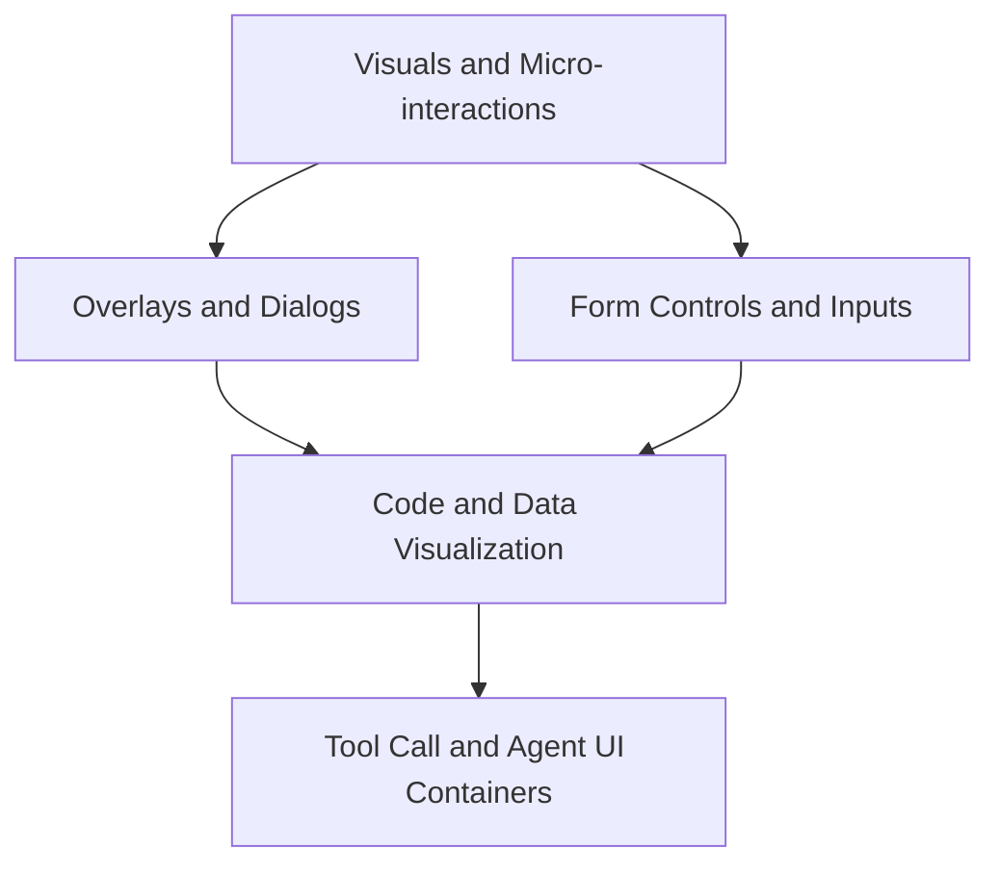
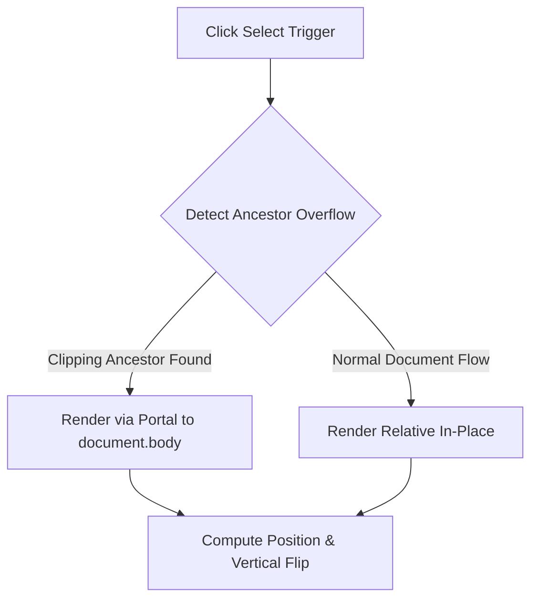
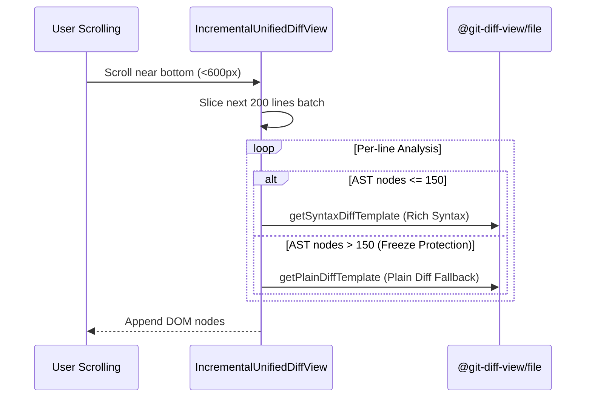
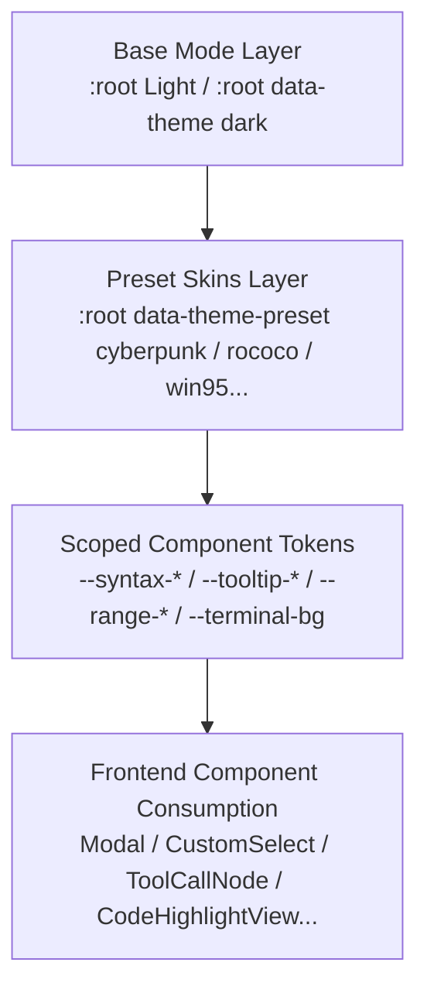

# Frontend Reusable Component Architecture and Specifications

> For frontend and client contributors: Snow App's reusable component system, layered design, API contracts, performance safeguards, and engineering standards.  
> Read alongside: [Architecture overview](1-architecture-overview.md), [Developer guide](2-developer-guide.md), [Frontend design and beautification workflow](../2-guides/15-frontend-design-and-beautification-workflow.md).

---

## 1. Context and Goals

Snow App's renderer process is built with **React 19, TypeScript, and Vite**. As a native desktop client designed for AI-native software engineering, the user interface handles high-throughput real-time data flows (SSE streaming thought and inference tokens, continuous terminal ANSI output, real-time large unified diffs, complex JSON payloads), nested modal dialogs, and context menus, all under strict memory and 60 FPS fluidity requirements.

Rather than importing heavyweight third-party component libraries that cause bundle bloat, styling collisions, and slow cold-starts, Snow App uses a **lightweight bespoke architecture driven by semantic atomic CSS variables**.

### Core Goals

1. **Visual and Interaction Consistency**: Modals, dropdowns, sliders, code views, and tool container cards share a coherent design language and standard keyboard shortcuts.
2. **Zero `any` Type Safety**: Strict TypeScript generics and discriminated unions eliminate uncontrolled component states and runtime contract mismatches.
3. **Resilience in Extreme Scenarios**: Virtualized chunk rendering, truncation safeguards, and automated self-healing mechanisms handle tens of thousands of diff rows, massive terminal logs, oversized pasted snippets, and dynamic module load failures.
4. **Accessibility and Native Desktop Feel**: Built-in focus traps, complete ARIA semantics, automatic viewport clamping, and multi-level `Escape` propagation controls.

---

## 2. Responsibilities and Non-Responsibilities

### Component Responsibilities

- **Interaction Boundary Encapsulation**: Manages portal mounts, keyboard cyclic navigation, debounce/throttle mechanics, and theme token consumption.
- **Decoupled Presentation and State**: Receives explicit props and informs parent controllers via controlled callbacks, without tight coupling to application business stores.
- **Defensive Performance Safeguards**: Implements lazy body mounting, batch chunking, and LRU caches inside rendering lifecycles.

### Non-Responsibilities

- **Business Workflow Orchestration**: Components do not trigger Rust business exports or persistence services directly (such as session archiving or Git commits); business effects are handled by upper hooks and controllers.
- **Silent Error Swallowing**: Components must never convert exceptions into fake successes or empty states, ensuring raw error contexts remain inspectable for fast troubleshooting.

---

## 3. Component Architecture Atlas

Snow App's reusable components are structured into five distinct layers, forming a clear dependency topology from visual primitives to high-level agent containers:



### Layered Component Summary

| Layer                              | Representative Components                                                                                            | Key Responsibilities and Features                                                             | Primary Source Anchors                                                                                  |
| ---------------------------------- | -------------------------------------------------------------------------------------------------------------------- | --------------------------------------------------------------------------------------------- | ------------------------------------------------------------------------------------------------------- |
| **Overlays and Dialogs**           | `Modal`, `ConfirmDialog`, `FormDialog`, `ContextMenu`, `Tooltip`                                                     | Portal mounting, focus traps, viewport clamping/flipping, `Escape` bubbling suppression       | `src/renderer/components/common/`                                                                       |
| **Form Controls and Inputs**       | `CustomSelect`, `RangeSlider`, `RichContentInput`, `HoverCopyButton`                                                 | Clipping ancestor detection, drag throttle vs commit decoupling, chip capsule folding         | `src/renderer/components/common/`, `src/renderer/components/mainContent/chatInput/`                     |
| **Code and Data Visualization**    | `CodeHighlightView`, `IncrementalUnifiedDiffView`, `MiniDiffViewer`, `JsonTreeView`, `DataTableViewer`, `AnsiOutput` | Incremental batch mounting, AST overload fallback, ANSI color parsing, column sorting         | `src/renderer/components/common/`, `src/renderer/components/mainContent/chatMessages/toolCalls/shared/` |
| **Tool Call and Agent Containers** | `ToolCallNode`, `ThinkingBlock`, `ChatFileArtifactCard`, `TokenUsageRing`, `ModelSelector`                           | Dynamic plugin attribution, lazy body rendering, streaming tail preview, 4-segment SVG ring   | `src/renderer/components/mainContent/chatMessages/`                                                     |
| **Visual Primitives and Helpers**  | `ModelBrandIcon`, `PluginIcon`, `OverlayScrollbar`, `HighlightedText`, `DisplayPath`, `AppErrorBoundary`             | Model brand vector matching, custom floating scrollbars, path segmenting, chunk load recovery | `src/renderer/components/common/`, `src/renderer/components/icons/`                                     |

---

## 4. Component Specifications and API Contracts

### 4.1 Overlays and Dialogs

#### 1. `Modal` Universal Dialog

Centered modal dialog for complex configurations, settings views, and embedded surfaces.

- **Focus Management**: Uses `FOCUSABLE_SELECTOR` to query focusable elements, listens to `Tab` and `Shift+Tab` for cyclic keyboard trapping, and restores focus to previously active elements upon dismissal.
- **Scroll Locking**: Sets `document.body.style.overflow = "hidden"` on mount and restores the previous style on cleanup.
- **`Escape` Event Protection**: Defaults to `closeOnEscape = false` to prevent closing parent modals when inner menus consume `Escape`. When explicitly enabled, it stops event propagation to protect global interrupt shortcuts.

```typescript
type ModalProps = {
  open: boolean;
  title: string;
  description?: string;
  closeLabel: string;
  onClose: () => void;
  children: ReactNode;
  footer?: ReactNode;
  size?: "medium" | "large";
  closeDisabled?: boolean;
  className?: string;
  closeOnEscape?: boolean;
};
```

_Source anchor_: `src/renderer/components/common/Modal.tsx::Modal`

#### 2. `ConfirmDialog` Semantic Confirmation Dialog

Used for destructive confirmations (deleting conversations, overwriting configurations, discarding changes).

- **Three-action Layout**: Supports `confirmLabel` (primary action), `cancelLabel` (optional, falls back to single-button alert when omitted), and `extraLabel` + `onExtra` (tertiary action, e.g., "minimize to tray").
- **Semantic Variants**: `variant: "default" | "warning" | "danger"`.
- **Async Loading State**: When `isConfirming = true`, disables buttons and renders a spinning indicator in the confirm button.

_Source anchor_: `src/renderer/components/common/ConfirmDialog.tsx::ConfirmDialog`

#### 3. `FormDialog` Form-Oriented Dialog

Designed for forms requiring keyboard input and asynchronous submission (creating projects, editing connections, SSH setup).

- **Initial Focus Guarantee**: Accepts `initialFocusRef` and schedules focus inside a `requestAnimationFrame` frame.
- **Submission Protection State Machine**: Differentiates `isSubmitting` from `dismissableWhenSubmitting`. Non-interruptible jobs lock out dismissal, while background tasks (such as repository cloning) allow the user to close the dialog.

_Source anchor_: `src/renderer/components/common/FormDialog.tsx::FormDialog`

#### 4. `ContextMenu` and `EditContextMenu` Viewport-Aware Menus

- **Viewport Boundary Clamping**: Measures layout in `useLayoutEffect`. When bottom or right edges exceed viewport bounds, it shifts inward to keep items fully visible.
- **System Edit Actions**: `EditContextMenu` exposes standard undo, redo, cut, copy, paste, and select-all actions across input controls.

_Source anchors_: `src/renderer/components/common/ContextMenu.tsx::ContextMenu`, `src/renderer/components/common/EditContextMenu.tsx::EditContextMenu`

#### 5. `Tooltip` Smart Floating Tips

- **Bidirectional Flipping**: Supports `placement: "top" | "bottom" | "right"`. Automatically flips to bottom when space above is constrained.
- **Accurate Arrow Alignment**: Computes the `--tooltip-arrow-x` CSS custom property dynamically, keeping the triangle arrow pointing at the trigger element's geometric center even when the tooltip container is clamped.

_Source anchor_: `src/renderer/components/common/Tooltip.tsx::Tooltip`

---

### 4.2 Form Controls and Inputs

#### 1. `CustomSelect` Enterprise Dropdown Select

A universal select replacement addressing cross-platform styling, multiselect support, and clipping issues.

- **Discriminated Union Types**:
  - Single select: `multiple?: false`, `value: string`, `onChange: (value: string) => void`
  - Multi select: `multiple: true`, `value: string[]`, `onChange: (values: string[]) => void`
- **Automatic Clipping Container Escape**: Recursively inspects ancestor DOM elements for `overflow` clipping. If inside a modal or scroll container, it renders via portal into `document.body` automatically.
- **Search and Custom Rendering**: Offers `filterable` search filtering alongside `renderOption` and `renderLabel` customizations.



_Source anchor_: `src/renderer/components/common/CustomSelect.tsx::CustomSelect`

#### 2. `RangeSlider` Unified Slider Control

- **CSS-Driven Track**: Dynamically computes `--range-progress` percentage for fill styling, styled via `--range-*` theme variables.
- **Dragging vs Commit Decoupling**:
  - `onChange: (value: number) => void`: Fires continuously during dragging for live preview.
  - `onCommit?: () => void`: Fires once on `pointerup` or `keyup` to avoid excessive writes to SQLite or disk configuration.

_Source anchor_: `src/renderer/components/common/RangeSlider.tsx::RangeSlider`

#### 3. `RichContentInput` Multimodal Input Control

A lightweight `contenteditable` input component managing images and massive text pastes.

- **DOM Explosion Shield**: Folds oversized pasted text into `@@text-snippet:...@@` chip capsules, avoiding thousands of raw DOM nodes that lock the renderer thread.
- **Image Chips**: Formats pasted screenshots into `@@image:...@@` chips with inline deletion and preview.
- **Snippet Overlay**: Hovering chips triggers `TextSnippetOverlay` previews; clicking allows in-place editing.
- **Imperative Handle**: Exposes `getContent()`, `clear()`, and `focusAtEnd()` via `forwardRef`.

_Source anchor_: `src/renderer/components/mainContent/chatInput/RichContentInput.tsx::RichContentInput`

#### 4. `HoverCopyButton` and `MessageCopyButton` Feedback Buttons

- **Non-Bubbling State Machine**: Calls `event.stopPropagation()` to avoid triggering parent cards, copies text to clipboard, displays a checkmark with `.copied` state, and resets cleanly after 1600ms.

_Source anchor_: `src/renderer/components/common/HoverCopyButton.tsx::HoverCopyButton`

---

### 4.3 Code and Data Visualization

#### 1. `IncrementalUnifiedDiffView` Incremental Batch Diff Viewer

High-performance diff rendering core built on top of `@git-diff-view/file`.

- **Incremental Chunk Mounting**: Renders in batches of `RENDER_BATCH = 200` lines. Appends next batches when scroll position reaches within `APPEND_THRESHOLD = 600px` of the bottom.
- **AST Node Overload Fallback**: When an individual line exceeds 150 AST nodes, it drops rich syntax highlighting and falls back to plain text diff rendering (`getPlainDiffTemplate`), preventing thread freezes on complex minified code.



_Source anchor_: `src/renderer/components/common/IncrementalUnifiedDiffView.tsx::IncrementalUnifiedDiffView`

#### 2. `CodeHighlightView` Universal Code Viewer

- **Automatic Language Resolution**: Accepts explicit `language` or resolves syntax from `filePath` extensions.
- **Large Content Folding**: Defaults to collapsing files exceeding `MAX_INITIAL_LINES = 300` lines with an expand button.
- **Line Offset Calibration**: Accepts `startLine` to show true original file row numbers for partial excerpts.

_Source anchor_: `src/renderer/components/mainContent/chatMessages/toolCalls/shared/CodeHighlightView.tsx::CodeHighlightView`

#### 3. `JsonTreeView` High-Performance Collapsible JSON Tree

- **Depth and Expand Control**: Configurable `defaultExpandDepth` (defaults to 3 levels).
- **Escaped Newlines Normalization**: Restores raw `\n` and `\r\n` characters via `decodeEscapedNewlines` for inspecting system prompts and structured outputs.
- **Long String Folding**: Collapses strings longer than `longStringThreshold` (defaults to 80 characters) into single-line previews expandable on click.

_Source anchor_: `src/renderer/components/mainContent/chatMessages/toolCalls/shared/JsonTreeView.tsx::JsonTreeView`

#### 4. `DataTableViewer` Tabular Data Viewer

- **Interactive Header Sorting**: Toggles asc/desc/original order, with numeric and locale-aware string comparison.
- **Live Filtering**: Includes an integrated instant search bar.
- **CSV Export**: Enables one-click copying of table rows as valid CSV data.

_Source anchor_: `src/renderer/components/mainContent/chatMessages/toolCalls/shared/DataTableViewer.tsx::DataTableViewer`

#### 5. `AnsiOutput` Terminal ANSI Formatter

- **16-Color Standard Mapping**: Parses ANSI escape sequences (`\u001b[...m`) into semantic color spans.
- **Error Filtering**: Offers `defaultFilterErrors` to immediately isolate lines containing `error` or `failed`.

_Source anchor_: `src/renderer/components/mainContent/chatMessages/toolCalls/shared/AnsiOutput.tsx::AnsiOutput`

---

### 4.4 Tool Call and Agent UI Containers

#### 1. `ToolCallNode` Universal Tool Call Card

Standard foldable container card for all MCP tool executions.

- **Polymorphic Statuses**: Handles `status: "pending" | "running" | "completed" | "error"`.
- **Plugin Attribution**: Uses `usePluginToolOwner(toolName)` to detect third-party plugin origin and displays plugin badge and icon in the header.
- **Category Badge**: Colors headers via `ToolNameBadge` based on tool domains (filesystem, bash, browser, lsp, codebase, config, etc.).
- **Lazy Body Mounting**: Unmounts heavy child components (such as diff viewers) when folded using `lazyBody = true`.

_Source anchor_: `src/renderer/components/mainContent/chatMessages/toolCalls/shared/ToolCallNode.tsx::ToolCallNode`

#### 2. `ThinkingBlock` Deep Reasoning Block

Container for reasoning tokens generated by thinking models.

- **Streaming Tail Preview**: Pulls the trailing line of the reasoning stream (`getPreviewText`) for live visibility while collapsed.
- **Throttled Markdown Rendering**: Renders markdown at 300ms intervals during streaming; drops to 600ms for extra-long outputs (>100k characters).
- **Micro-Interaction Polish**: Keeps expanded while streaming; auto-folds upon completion with a 1500ms checkmark transition; displays exact backend timing and token counts.

_Source anchor_: `src/renderer/components/mainContent/chatMessages/components/ThinkingBlock.tsx::ThinkingBlock`

#### 3. `TokenUsageRing` Circular SVG Token Meter

Compact 28×28 meter matching the action button footprint.

- **4-Segment Precision Geometry**:
  $$\text{Circumference } C = 2 \pi r$$
  Dynamically calculates arc segments for:
  - Non-cached input
  - Generated output
  - Cache creation
  - Cache read
- **Context Limit Warning**: Switches to warning/danger hues when approaching `maxContextTokens`.

_Source anchor_: `src/renderer/components/mainContent/chatInput/TokenUsageRing.tsx::TokenUsageRing`

#### 4. `ModelSelector` Top-level Model Configuration Switcher

Chat input bar's primary controller.

- **Multi-Provider Hierarchy**: Groups active API profiles, available models, and manual model entry.
- **Thinking and Fast Mode**: Links with `ThinkingStrengthMenu` to toggle thinking budgets and fast mode.
- **Quota Awareness**: Embeds `OAuthQuotaPanel` for instant inspection of free tiers and balance.

_Source anchor_: `src/renderer/components/mainContent/chatInput/ModelSelector.tsx::ModelSelector`

---

### 4.5 Visual Primitives, Icons, and Micro-interactions

#### 1. `ModelBrandIcon` Intelligent Model Vector Icon

- **Fuzzy Brand Matching and Fallback**: Matches `model` strings against `@lobehub/icons` presets to show vendor logos (OpenAI, Anthropic, DeepSeek, Google, etc.).
- **Baseline Alignment**: Applies flex centering in `styles.css` to fix SVG alignment, falling back to a neutral Bot badge when unmatched.

_Source anchor_: `src/renderer/components/common/ModelBrandIcon.tsx::ModelBrandIcon`

#### 2. `OverlayScrollbar` Custom Floating Thin Scrollbar

- **Zero Layout Shift**: Replaces thick native OS scrollbars, preventing layout shifts when scrollbars appear or disappear.
- **Smooth RAF Tracking**: Updates thumb sizes and translations dynamically via `ResizeObserver` and `requestAnimationFrame`.

_Source anchor_: `src/renderer/components/common/OverlayScrollbar.tsx::OverlayScrollbar`

#### 3. `HighlightedText` Safe Keyword Highlighter

- **RegExp Escaping**: Sanitizes search terms with `escapeRegExp` and wraps matched segments in `<mark className="search-hit-mark">` across memos and project memory search.

_Source anchor_: `src/renderer/components/common/HighlightedText.tsx::HighlightedText`

#### 4. `DisplayPath` Cross-Platform Path Segmenter

- **Visual Hierarchy**: Segments Windows backslashes and POSIX slashes into dimmed parent paths (`display-path-parent`) and high-contrast filenames (`display-path-name`), optimizing path readability.

_Source anchor_: `src/renderer/components/common/DisplayPath.tsx::DisplayPath`

#### 5. `AppErrorBoundary` Resilience Boundary

- **Dynamic Chunk Failure Self-Healing**: Detects module loading failures after updates via `isChunkLoadError`. Stores retry counts in `sessionStorage` and triggers automated reloads up to twice within 5 seconds before showing fallback troubleshooting UI.
- **Subsystem Isolation**: Wraps plugin panels and message viewports to prevent local errors from causing full white screens.

_Source anchor_: `src/renderer/components/common/AppErrorBoundary.tsx::AppErrorBoundary`

---

## 5. Theme Color Architecture and Hardcoding Prohibition

### 5.1 Layered Theme Architecture

Snow App uses a three-tier cascading theme color architecture managed under `src/renderer/themes/`. Theme transitions never mutate React state trees; they are performed via root HTML attributes and CSS variable re-resolution:



1. **Base Mode Layer**: Declared in `src/renderer/themes/tokens.css` via `:root` (light default) and `:root[data-theme="dark"]` (dark mode), defining neutral scales and default accents.
2. **Preset Skins Layer**: 9 bundled skins (`preset-cyberpunk.css`, `preset-rococo.css`, `preset-win95.css`, `preset-notion.css`, etc.) re-assign semantic variables on `:root[data-theme-preset="<name>"]`, transforming colors, neon glows, vintage bevels, or fonts.
3. **Scoped Component Tokens**: Secondary abstractions tailored for specialized reusable components (e.g., syntax roles `--syntax-*`, slider tracks `--range-*`, popovers `--tooltip-*`, terminal background `--terminal-bg`).

---

### 5.2 Core Semantic Color Tokens Matrix

Reusable components must select colors exclusively from the semantic token dictionary below in both CSS stylesheets and TSX inline styles. Absolute hex or rgb values are prohibited:

| Category                 | CSS Token Variable                                                                                | Typical Use Case                                                | Light Baseline                   | Dark Baseline                            |
| ------------------------ | ------------------------------------------------------------------------------------------------- | --------------------------------------------------------------- | -------------------------------- | ---------------------------------------- |
| **Background Hierarchy** | `--bg-primary`                                                                                    | Main workspace, editor canvas, context menu base                | `#ffffff`                        | `#0a0a0a`                                |
|                          | `--bg-secondary`                                                                                  | Card containers (ToolCallNode), panel backgrounds, table frames | `#f9fafb`                        | `#111111`                                |
|                          | `--bg-tertiary`                                                                                   | Nested input fields, dropdown menus, toolbars, folded headers   | `#f3f4f6`                        | `#1a1a1a`                                |
|                          | `--bg-hover`                                                                                      | List item hover, button hover state                             | `#f3f4f6`                        | `#1f1f1f`                                |
|                          | `--bg-active`                                                                                     | Button press, selected active item background                   | `#e5e7eb`                        | `#2a2a2a`                                |
|                          | `--surface-island`                                                                                | Translucent frosted island surface                              | `rgba(255,255,255,0.78)`         | `rgba(17,17,17,0.78)`                    |
|                          | `--surface-island-strong`                                                                         | Opaque floating surface (Tooltip, select menus)                 | `rgba(255,255,255,1)`            | `rgba(24,24,24,1)`                       |
| **Text Contrast**        | `--text-primary`                                                                                  | Headings, primary content, active text                          | `#111827`                        | `#f5f5f5`                                |
|                          | `--text-secondary`                                                                                | Secondary descriptions, field labels, subheadings               | `#374151`                        | `#d4d4d4`                                |
|                          | `--text-tertiary`                                                                                 | Supporting hints, timestamps, counter tags                      | `#6b7280`                        | `#a3a3a3`                                |
|                          | `--text-muted`                                                                                    | Placeholders, disabled actions                                  | `#9ca3af`                        | `#737373`                                |
| **Borders & Shadows**    | `--border-color`                                                                                  | Standard container outlines, divider rules                      | `#e5e7eb`                        | `#2b2b2b`                                |
|                          | `--border-subtle`                                                                                 | Subtle outlines (popover boundary borders)                      | `#d1d5db`                        | `#3a3a3a`                                |
|                          | `--border-focus`                                                                                  | Keyboard focus ring outlines                                    | `var(--accent-color)`            | `var(--accent-color)`                    |
|                          | `--shadow-sm` / `--shadow-md`                                                                     | Floating menus, card elevations                                 | Soft shadow                      | Diffuse dark shadow                      |
| **Paired Status Colors** | `--accent-green-text` / `--accent-green-bg`                                                       | Success badges, diff additions, verified items                  | Dark green text / pale green bg  | Bright green text / translucent green bg |
|                          | `--accent-red-text` / `--accent-red-bg`                                                           | Error blocks, diff deletions, dangerous actions                 | Dark red text / pale red bg      | Bright red text / translucent red bg     |
|                          | `--accent-amber-text` / `--accent-amber-bg`                                                       | Warnings, blocked jobs, pending items                           | Amber brown text / pale amber bg | Bright amber text / translucent amber bg |
|                          | `--accent-blue-text` / `--accent-blue-bg`                                                         | Links, in-progress items, primary action highlights             | Deep blue text / pale blue bg    | Sky blue text / translucent blue bg      |
| **Syntax Roles**         | `--syntax-text` / `--syntax-keyword` / `--syntax-string` / `--syntax-number` / `--syntax-comment` | Shared code reader and tool execution highlighting              | Resolved dynamically             | Resolved dynamically                     |

---

### 5.3 Why Hardcoded Colors Are Strictly Prohibited

Hardcoding colors such as `#fff`, `#3b82f6`, or `rgba(...)` inside reusable components constitutes a **critical anti-pattern (P0 visual defect)**:

1. **Dark/Light Mode Catastrophic Failure**:
   - A component hardcoding `background: #ffffff` renders as a blinding white box in dark mode.
   - A component hardcoding `color: #000000` or `color: #333333` has a 1:1 contrast ratio against the dark background (`#0a0a0a`), making text **completely invisible**.
2. **Preset Theme Visual Disruption**:
   - When a user switches to Cyberpunk (neon pink on black), Rococo (cream and gold), or Win95 (classic gray bevels), hardcoded generic blues (`#3b82f6`) or reds (`#ef4444`) break visual immersion and render like broken foreign widgets.
3. **Accessibility Contrast Invalidation (A11y)**:
   - Paired status tokens (e.g., `--accent-green-bg` with `--accent-green-text`) are calibrated for WCAG AA/AAA compliance across light and dark modes. Hardcoded colors cannot guarantee readable contrast across skins.
4. **Custom Accent Decoupling**:
   - When users customize application accent colors, hardcoded components fail to respond, defeating personalization features.

---

### 5.4 Developer Rules and Anti-Pattern Constraints

| Dimension                 | ❌ Prohibited Anti-Patterns                                                               | ✅ Compliant Best Practices                                                                                                       |
| ------------------------- | ----------------------------------------------------------------------------------------- | --------------------------------------------------------------------------------------------------------------------------------- |
| **CSS Color Declaration** | `background-color: #fff;`<br/>`color: #111827;`                                           | `background: var(--bg-primary);`<br/>`color: var(--text-primary);`                                                                |
| **Paired Status Tokens**  | Light background with unreadable hardcoded text:<br/>`background: #dcfce7; color: green;` | Always pair matching background and text tokens:<br/>`background: var(--accent-green-bg);`<br/>`color: var(--accent-green-text);` |
| **TSX Inline Styles**     | `<div style={{ border: "1px solid #e5e7eb" }} />`                                         | `<div style={{ border: "1px solid var(--border-color)" }} />`                                                                     |
| **Translucent Overlays**  | `background: rgba(239, 68, 68, 0.15);`                                                    | Native `color-mix` dynamic blending:<br/>`background: color-mix(in srgb, var(--accent-red-text) 14%, transparent);`               |
| **SVG Vector Icons**      | `<path fill="#3b82f6" />`<br/>`<path stroke="#000" />`                                    | Inherit parent text color or bind semantic tokens:<br/>`<path fill="currentColor" />`<br/>`<path stroke="var(--accent-color)" />` |
| **Elevations & Rings**    | `box-shadow: 0 4px 12px rgba(0,0,0,0.1);`                                                 | `box-shadow: var(--shadow-md);`<br/>`outline: 2px solid var(--border-focus);`                                                     |

---

## 6. Accessibility and Internationalization (A11y and i18n)

1. **Localized Strings**: Every user-visible text, tooltip, and placeholder must consume `t(...)` from `useI18n()`, registered in `src/renderer/i18n/`.
2. **Accessible Semantics**:
   - Interactive buttons must provide `aria-label` or `title`.
   - Modals must include `role="dialog"`, `aria-modal="true"`, `aria-labelledby`, and `aria-describedby`.
   - Decorative icons must declare `aria-hidden="true"`.
3. **Keyboard Navigation**: All floating overlays must close on `Escape`. List selections (`CustomSelect`, `ContextMenu`) must support `ArrowUp` / `ArrowDown` traversal and `Enter` selection.

---

## 7. New Component Checklist

Before merging a new reusable component, verify the following checklist:

- [ ] **Minimal Dependencies**: Use React primitives and existing icons (`lucide-react`, `@lobehub/icons`); avoid external UI bundles.
- [ ] **Strict Types**: Export full Props interfaces without `any`; provide proper discriminant unions for variant modes.
- [ ] **Mount and Memory Safety**: Always clean up `setTimeout`, `requestAnimationFrame`, and DOM event listeners in `useEffect` returns.
- [ ] **Clipping and Viewport Awareness**: Handle ancestor overflow clipping with portals and clamp floating coordinates to viewport edges.
- [ ] **Performance Safeguards**: Enforce batch rendering, row ceilings, or lazy unmounting for large data inputs.
- [ ] **Theme Token Compliance**: Rely on `tokens.css` variables for colors, borders, and shadows across dark and light presets.
- [ ] **Bilingual Localization**: Register translation keys across English, Simplified Chinese, and Traditional Chinese dictionaries.
