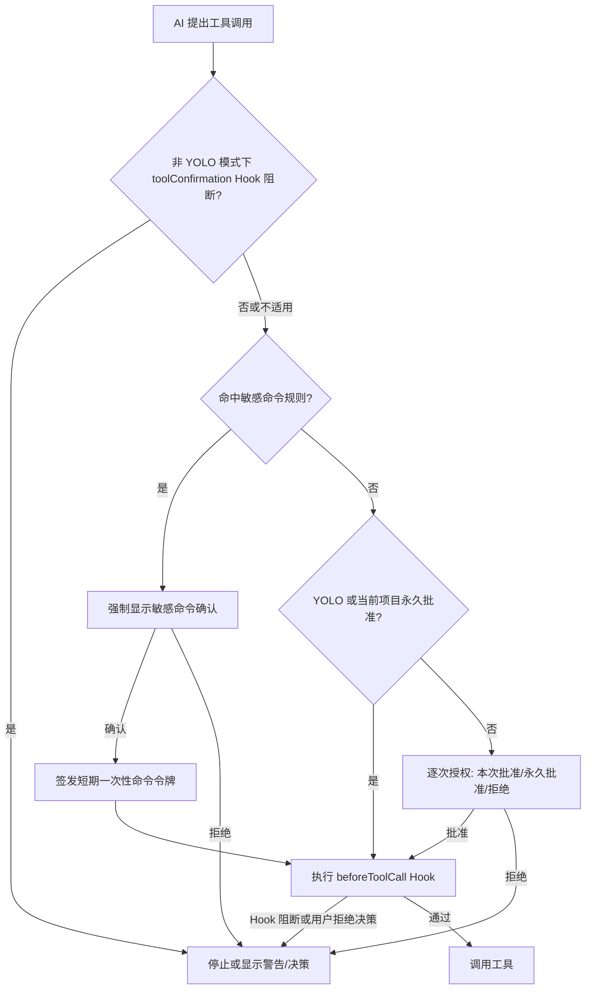

# 16-安全、隐私与工具授权

Snow App 把 AI 建议、工具执行、本地数据和外部服务连接在同一个桌面应用中。本指南说明可配置的安全控制、它们实际保护的边界，以及仍需由用户承担的判断责任。

> 安全控制用于降低风险，不等于对命令、网页、Hook 或外部 MCP 的安全背书。对删除数据、执行脚本、上传内容、导入会话等高影响操作，始终先核对目标、参数和影响范围。

## 1. 窗口隔离模型

Snow 的不同窗口采用不同策略，不能笼统地称为“所有窗口均已 sandbox”。

| 窗口/内容          | `contextIsolation`   | Node 集成 | sandbox                      | 说明                                                                  |
| ------------------ | -------------------- | --------- | ---------------------------- | --------------------------------------------------------------------- |
| Snow 主窗口        | 开启                 | 禁用      | **关闭**（`sandbox: false`） | 受控原生能力经 preload / `contextBridge` 暴露；主窗口允许 `<webview>` |
| 内置浏览器网页弹窗 | 开启                 | 禁用      | **开启**                     | 由主进程为 guest 的 `window.open` / `target=_blank` 创建              |
| 系统浏览器         | 不属于 Snow 渲染环境 | 不适用    | 不适用                       | 主窗口普通 `window.open` 被拒绝后交给系统浏览器打开                   |

主窗口渲染代码不能直接使用 Node API。`contextIsolation` 将网页上下文与 preload 隔开，但主窗口明确不是 sandbox；只有预先设计的桥接接口才能从渲染层请求主进程或 Rust 能力。内置 `<webview>` 以及其中加载的远程页面构成额外信任边界。

浏览器弹窗与 opener webview 共用 session/Cookie，并保留 `window.opener` 与 `postMessage`，以支持 OAuth 登录。弹窗可继续打开下一层弹窗，后续弹窗仍应用 sandbox、上下文隔离和禁用 Node 的策略。主窗口关闭时，Snow 会清理这些弹窗，避免残留孤儿窗口。

## 2. 隐私过滤

隐私过滤默认关闭（**设置 → 隐私**，设置页 id：`privacy-settings`）。启用后，它只处理设置中选中的**工具结果**，不是覆盖聊天输入、网页、日志、Hook 和所有网络请求的全局 DLP。

默认选中的工具为：

- `filesystem-read`
- `grep-search`
- `bash-terminal-execute`

设置界面还可选择 `codebase-search`、`websearch-websearch-search` 与 `websearch-websearch-fetch`。未选中的工具结果保持原样。

### 2.1 本地模式

本地模式在 Rust MCP 后端使用正则和校验规则脱敏，处理后才跨 NAPI 边界返回 Node/Electron。规则覆盖私钥块、JWT、常见 API Key、敏感键值、`Authorization`、URL 查询令牌、中国身份证号和支付卡号等。

本地规则不调用外部服务，但仍可能误报、漏报或保留上下文中可推断的信息。不要因为开启过滤就主动读取不需要的密钥文件或扩大工具范围。

### 2.2 API 模式及失败回退

API 模式会把待处理文本以 JSON 请求发送到配置的隐私过滤 HTTP API，请求包含 `text`、`aggregation_strategy: "simple"` 和 `mask_token: "[{label}]"`。若配置 API Key，会同时尝试发送 `x-api-key` 与 Bearer `Authorization` 请求头。API 必须成功返回 `masked_text`。

这意味着 API 端点成为新的信任方，待处理文本会离开设备。HTTP 错误、网络错误、响应解析失败或缺少 `masked_text` 时，Snow 会**回退到本地规则**，而不是直接放行原文。极少数本地后台任务本身失败时才可能返回原文，因此高敏感场景仍应采用最小化读取与人工复核。

## 3. 工具授权决策流程

正常模式下，工具按调用逐项请求授权；并行批次中的一个拒绝不会自动拒绝其他项。用户可以批准本次、拒绝，或在有活动项目时把某个工具设为当前项目永久批准。

`beforeToolCall` 在实际执行前运行，即使工具因 YOLO 自动批准也不会跳过。非 YOLO 模式还会在授权 UI 前运行 `toolConfirmation` Hook。Hook 自身失败时，部分调用路径会继续普通授权，因此 Hook 不应作为唯一安全控制。

## 4. 项目永久授权

“永久批准”绑定当前项目/工作区的 `directoryId`：

- 切换项目后会加载另一个项目的批准列表；
- 没有活动项目时，不会持久化为跨项目批准；当前调用仍可继续；
- 持久化失败不会回滚已经批准的当前调用；
- 永久批准按工具名授予，不会理解每次参数的业务风险。

因此只应永久批准行为窄、参数可审计、后果可恢复的工具。终端、文件写入、浏览器状态恢复和外部 MCP 等能力更适合保留逐次确认。

输入框旁的**项目授权面板**（或 `/permissions` 命令）可查看当前项目已永久授权的工具列表，并**删除**不再需要的授权；该命令在 YOLO 模式下禁用。

## 5. YOLO 模式

YOLO 是持久化的全局设置。开启后，普通工具可跳过逐次授权，当前待授权队列中的非敏感项也会被自动批准。它适合完全受控、可回滚、已审查的环境，不适合包含生产凭据、个人资料或共享工作区的会话。

YOLO **不会绕过所有安全检查**：

- 命中敏感命令规则的非交互式 Bash 命令仍需明确确认；
- `beforeToolCall` Hook 仍会执行；
- 工具自身的参数校验、项目启用状态和子代理工具白名单仍然有效。

交互式终端命令**同样经过敏感命令检查**：`isInteractive` 标志只控制终端会话的展示方式（输入框、无超时），不再作为绕过敏感命令门禁的通道；合法的交互命令（如 `npm init`、`git add -i`）不命中任何规则时不受影响。

## 6. 敏感命令规则

敏感命令由已启用的正则规则匹配（**设置 → 敏感命令**，设置页 id：`sensitive-command-settings`；agent 也可用 `config-set settings sensitiveCommands` 读写），可使用全局规则及项目继承/覆盖后的有效规则。格式错误的正则会被跳过，避免阻断后续规则。命中时 UI 显示规则 ID、表达式和说明。

确认后，Snow 为**完整命令文本**签发有效期约 60 秒、消费一次即删除的授权令牌；Rust Bash 执行层会校验令牌、命令和过期时间。令牌不能批准另一条命令，也不能重复使用。

设置页还提供可选的**决策模型辅助**（默认关闭，保存在系统设置 `sensitive_command_assist`）。选好决策模型后，命中规则的命令会先由该模型（TypeSafe System One）判定。判定问的是这条命令**真实的风险**：命令文本、执行目录与模型自己写的命令说明都作为判定依据，规则命中只是提示（规则同样会命中文件名、参数和提交信息）。判定结果、理由分类、置信度与模型名会显示在确认卡片上。同一次请求还会用 score 问题给出**风险等级**（低 / 中 / 高，取各档概率最高的一档；TypeSafe Jev 与 OpenAI Decisions 都支持），以徽标显示在判定旁，悬停可看分值；风险等级只用于展示与日志，是否需要确认仍只由判定结果决定。模型未返回等级或返回了预设之外的档位时不猜等级：该次判定不显示等级徽标，判定结果照常生效，并在系统日志（模块 `decision_model`，WARN）记录原因。打开「由决策模型托管」后判定直接生效——允许则签发令牌直接执行；拒绝则该命令被拒绝。保持关闭时仍由人工确认。托管下还可以打开「拒绝时仍让我确认」（默认关闭，仅托管开启时可用）：允许仍直接放行，拒绝则不直接生效，而是弹出确认卡片并标注「决策模型判定拒绝，确认执行即表示你正在覆盖该判定」，由你复核理由分类、置信度与模型名后决定是否执行；YOLO 模式下同样会弹出。确认后命令执行，工具卡片显示「模型拒绝，用户已确认」；拒绝则与普通拒绝一致。每次复核结果都会写入系统日志（模块 `sensitive_command`，含规则 ID、模型名、理由分类、置信度、用户选择与截断后的命令），可用于评估模型误判率。该开关不提供永久豁免，放宽拦截仍应通过编辑敏感规则完成。**敏感命令被拒绝不会终止 AI 流程**：无论用户点「拒绝」还是决策模型判定拒绝，都只否决这一条命令，并把拒绝理由作为工具结果回传模型，让 AI 换一种做法继续（普通工具授权在用户未填理由直接拒绝时仍会终止整个流程）。未启用辅助、未选择或所选模型不可用、请求失败时，都回退到原有的确认流程。

**参考最近会话**（默认关闭）让判定能看到命令的来由，从而区分「用户刚要求清理构建产物」与「AI 自行决定删除 `build/`」。开启后每次判定都会把最近若干条会话消息（「发送的会话条数」，默认 8，可设 1-50）发给所选决策模型：用户与助手的文本，以及已结束工具调用的名称、参数摘要与输出摘要（待判定的命令本身不在其中）。渲染层发送前会逐条裁剪，图片与内联 base64 数据替换为占位符，工具输出在离开本机前再走一遍现有隐私过滤（设置 > 隐私，按工具生效）。决策模型不会自行读取会话历史，只能看到这段裁剪后的片段。两种 provider 都支持：OpenAI Decisions 按官方 GA 形态以原生多轮 `input` 接收（消息 + 按 `call_id` 配对的 `function_call` / `function_call_output`，待判定命令放在末尾的 developer 消息中）；只支持 GA 前协议的端点（其 `input` 只认纯文本与 user 消息的 `input_text` / `input_image`）会用 400 拒绝该请求体，此时自动改发兼容形态——片段渲染成带角色标注的文本，待判定命令作为同一条 user 消息的下一段文本（带前缀说明它由助手提出、并非用户输入），此后该端点沿用兼容形态，并在系统日志（模块 `api`，WARN）记录一次；TypeSafe Jev 没有多轮输入协议，片段以结构化的 `recentConversation` 字段放进 state——这正是 TypeSafe 官方文档给 Jev 提供会话的方式。整个 state 共用该 provider 的字符预算（TypeSafe Jev 48000、OpenAI Decisions 200000，依据各自官方文档的上下文限制换算）：放不下时丢弃最早的消息，卡片注明上下文已截断，并在系统日志（模块 `decision_model`）记录 WARN。开关打开但没有可用消息时按无上下文判定，卡片同样注明。片段结构非法视为错误，回退人工确认，不会静默改成无上下文判定。开关关闭时请求与之前完全一致。

限制必须明确：

- 规则只能拦截已覆盖的文本模式；未命中的危险命令仍可能执行；
- 错误正则被忽略后不会提供保护；
- 参数拼接、编码、脚本间接调用可能超出规则意图；
- 交互式命令同样需要授权令牌（`isInteractive` 只是展示方式，不绕过检查）；
- 敏感命令是附加安全门，不是 Shell 安全证明。

## 7. Hook 与外部 MCP

### 7.1 Hook

Hook 可以执行 shell 命令、注入上下文并改变工具调用流程。命令退出码通常解释为：

| 退出码 | 结果                                  |
| ------ | ------------------------------------- |
| `0`    | 通过；stdout 可作为上下文             |
| `1`    | 软警告；结构化决策 JSON 可触发确认 UI |
| `2+`   | 阻断当前可阻断流程                    |

`onStop`、`onSessionStart` 等 fire-and-forget Hook 无法真正阻断原流程；待决策结果会降级为普通 warning。Hook 脚本及其依赖与应用拥有不同信任来源，应像本地自动化程序一样审计。

### 7.2 外部 MCP

外部 MCP 可以通过 stdio 启动本地进程，也可以连接 HTTP 服务。工具描述、网络端点、身份验证和副作用都由外部实现提供。Snow 的授权只控制“是否从 Snow 发起调用”，不能证明服务内部安全，也不能阻止它在已授予范围内保留、转发或滥用数据。

详见 [配置 MCP 服务器](1-配置MCP服务器.md) 与 [配置 Hooks 与子代理](5-配置Hooks与子代理.md)。

## 8. 应用锁（PIN + 谷歌身份验证器）

「通用设置 → 隐私」里的应用锁用 PIN 码把整个界面锁起来，避免离开座位时他人直接看到会话内容。锁定**只影响查看**：进行中的会话、流式生成、终端、内置浏览器、定时任务与手机远控都继续在后台运行。

- **启用前置条件**：必须先绑定谷歌身份验证器。设置页本地生成 Base32 密钥并给出 `otpauth://totp/...` 二维码，用身份验证器扫码或在应用内手动输入密钥，再回填 6 位动态码确认绑定。密钥仅保存在本机应用数据库。**PIN 与身份验证器绑定必须同时存在**：缺少任意一项都会被判定为未启用，锁定永远不会在不具备找回手段时生效。
- **PIN 存储**：PIN 为 4-8 位数字，落库前经 PBKDF2-HMAC-SHA256 加盐哈希（随机盐 + 12 万次迭代），数据库中没有明文 PIN；校验在 Rust 后端用常量时间比较完成。
- **锁定时机**：可选「窗口失焦后立即」「1 分钟」「5 分钟」「10 分钟」。倒计时由主进程持有，窗口回到前台即取消；设置页的「立即锁定」可随时手动锁定。**每次启动应用都会立刻进入锁定态**，重启无法绕过 PIN 防护。
- **锁定表现**：毛玻璃遮罩覆盖整个界面（含顶栏与左右面板），只能输入 PIN 或动态码解锁；解锁后所有后台进度原样接续。
- **忘记 PIN**：在锁定界面切到「忘记 PIN？使用身份验证器」，输入 6 位动态码即可解锁（接受 ±1 个 30 秒时间窗），解锁后应尽快重设 PIN。
- **失败保护**：连续 5 次校验失败进入冷却（30 秒起，逐次翻倍，上限 5 分钟）；PIN 与动态码共用计数，重启应用不清零。
- **修改、停用、重绑与解绑**：更换 PIN 与停用应用锁都接受当前 PIN 或身份验证器的 6 位动态码（忘记 PIN 也能操作）；重新绑定需验证当前 PIN；**解绑身份验证器只接受动态码**。停用应用锁会保留身份验证器绑定，方便日后重新启用；解绑会同时关闭应用锁并清除 PIN：PIN 不允许脱离身份验证器独立生效。未绑定身份验证器时，设置页不展示 PIN 相关配置。
- **手机远控解锁**：绑定身份验证器后，手机在局域网或公网远控页可切到「身份验证器」，用 6 位动态码代替配对令牌解锁（该开关可在设置页随时关闭；关闭后只能用配对链接或令牌）。动态码解锁失败单独限流（5 分钟内 5 次），不占用桌面端解锁的尝试次数与冷却。

应用锁保护的是屏幕可见内容，不是磁盘数据——本地数据库并未加密，需要静态加密时请依赖操作系统的全盘加密。

## 9. 推荐安全基线

1. 默认关闭 YOLO，对写入、终端和外部工具保留逐次授权。
2. 项目永久授权只授予最小工具集合，并定期撤销不再需要的授权。
3. 为破坏性命令配置具体、可测试的敏感命令正则，同时保留人工复核。
4. 高敏感项目优先使用本地隐私过滤；使用 API 模式前审查端点的数据政策。
5. 不向网页、Hook 或 MCP 提供超出任务所需的凭据。
6. 安装或更新第三方扩展前确认发布者、代码来源和权限变化。
7. 定期查看日志、项目授权和启用的 Hook/MCP，发现异常立即停用并轮换凭据。

## 10. 常见误区与排障

| 误区/现象                 | 正确理解或处理                                                  |
| ------------------------- | --------------------------------------------------------------- |
| “主窗口启用了 sandbox”    | 错误；主窗口 `sandbox: false`，但启用上下文隔离并禁用 Node 集成 |
| “浏览器弹窗不共享登录态”  | OAuth 弹窗与 opener webview 共享 session/Cookie                 |
| “隐私 API 失败会放行原文” | API 失败会回退本地规则；仍需考虑本地任务异常和规则漏报          |
| “YOLO 会绕过敏感命令”     | 非交互式命令命中规则时仍强制确认                                |
| “永久批准对所有项目生效”  | 批准绑定当前项目/工作区                                         |

进一步了解浏览器凭据和登录态，请参阅 [浏览器设置、密码与数据导入](17-浏览器设置密码与数据导入.md)；完整边界矩阵见 [安全与信任边界](../3-参考手册/5-安全与信任边界.md)。
