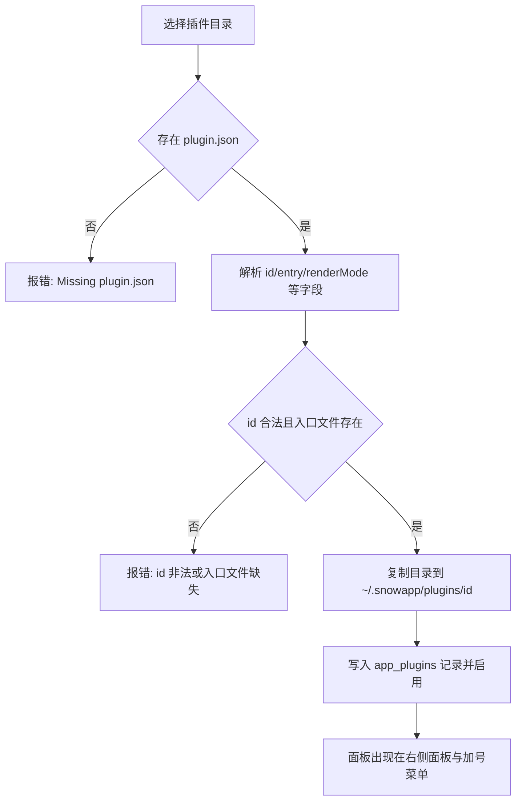
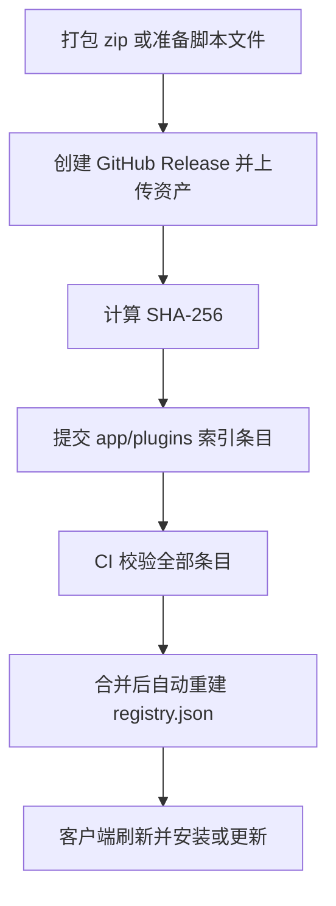
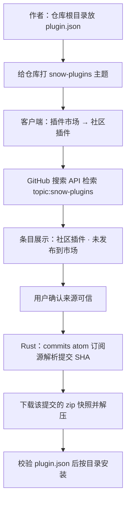

# 24-插件开发与安装（Plugins）

> 适用：Snow App 桌面端（Windows / macOS / Linux）。插件是**本地目录形式**的扩展包，为右侧面板提供自定义标签页；本文同时覆盖「安装与卸载（本地目录、官方插件市场与社区通道）」「自己写一个插件」与「发布到插件市场 / 被社区通道检索到」。

## 目标

- 从本地目录或**插件市场**安装插件，并在右侧面板打开它提供的面板；
- 会写 `plugin.json` 清单与入口模块，能读取元数据、通过 `api.write` 写入应用数据、保存插件私有设置并声明隐私域；
- 把插件**发布到插件市场**：准备 Release 资产、计算 SHA-256、提交索引条目；
- 了解插件市场的两条通道：**官方市场**（索引收录 + SHA-256 锁定，条目带「官方市场 / 官方认证」标签）与**社区通道**（按 GitHub `snow-plugins` 主题检索，条目标注「社区插件 · 未发布到市场」）；
- 让 AI 通过 `config` 工具的 `plugins` 域**自动完成安装、启停、重载与卸载**，不必打开设置界面。

## 前置条件

- 插件目录必须包含 `plugin.json` 与清单里声明的入口文件（`entry`，默认 `index.js`），入口文件缺失会直接安装失败。
- 插件以**本地代码**运行：`renderMode: "esm"` 的入口在主窗口渲染进程里作为 ES 模块执行，拥有与页面相同的 DOM 与网络能力；`renderMode: "iframe"` 的入口在独立沙箱文档中运行，只能通过桥访问受限 API。请只安装可信来源的插件。
- 插件对应用数据是「只读 + 受控写入」：读取走 `api.metadata`，写入走 `api.write`，写动作按其 `scope` 决定是否需要在 `privacy` 中声明（见「可写能力」一节）。
- 安装时目录总大小上限 **128 MB**，并会跳过 `.git` 与 `node_modules`。
- 单个文本文件读取上限 8 MB，单个二进制资源上限 16 MB。
- 「插件市场」需要能访问 GitHub raw 或 jsDelivr 镜像；发布插件需要插件自己的 GitHub 仓库与 Release。

## 入口

侧边栏底部的 **插件** 按钮（带已安装数量角标）打开插件管理页面——它是主内容区的一个视图（视图 id `plugins`），不是设置页，也没有独立设置页 id。页面顶部有三个顶层标签页：**插件列表**（角标为面板插件 + 客户端脚本总数）、**插件市场** 与 **元数据清单**（角标为元数据域总数）：

| 标签页         | 内容                                                                                                                                                                                                                                                                                 |
| -------------- | ------------------------------------------------------------------------------------------------------------------------------------------------------------------------------------------------------------------------------------------------------------------------------------ |
| **插件列表**   | 插件管理主区域；内部还有 **面板插件** / **脚本插件** 两个次级小标签（各带数量角标），前者是本文其余章节介绍的本目录插件，后者是客户端 UI 脚本                                                                                                                                        |
| **插件市场**   | 四个分类：**面板插件** / **OAuth 插件** / **脚本插件** 来自 snow-plugin-store 官方索引（一键安装或更新，条目带「官方市场 / 官方认证」标签），**社区插件** 按 GitHub `snow-plugins` 主题检索第三方仓库（标注「社区插件 · 未发布到市场」）；两条通道的差异与安装校验见「插件市场」一节 |
| **元数据清单** | 插件可读的应用元数据域、可写动作与网络能力清单                                                                                                                                                                                                                                       |

「面板插件」小标签下的工具栏提供 **从目录安装** 与 **刷新** 两个动作；每行显示插件的版本、作者与渲染模式，声明了隐私数据域的插件会用琥珀色标签逐个列出所申请的数据（文案跟随界面语言，如「API 密钥」「会话消息」），并在下方展示清单里的 `note` 说明；点击任意琥珀色标签即可打开「隐私域声明」弹窗，逐个域给出用途说明，以及它放行的可读元数据域（字段级声明会标出具体字段）与可写能力（按写域聚合的动作数），并标出声明位置（`plugin.json` 的 `privacy` / 脚本头的 `@snow-privacy`）。「脚本插件」小标签下同一位置也用同样的琥珀色标签列出脚本的 `@snow-privacy` 声明，点击弹出同一个弹窗。**元数据清单** 标签页以「可读元数据 / 可写能力 / 网络能力」三个子标签并列展示：按分组列出全部 36 个域及一句话说明、隐私声明要求、实时/轮询与可用参数，支持关键词搜索；可写能力按动作给出所需 `scope` 与声明状态；网络能力列出 `api.net.fetch` 外部请求能力（经主进程转发，需声明 `network` 隐私域）。每个插件行上的「可读元数据 n/36」与「可写能力 n/212」入口用同一份清单标出该插件已声明（可读/可写）与未声明（调用会被拒绝）的域与动作，方便用户核对 `privacy` 声明。该页面只做管理，打开面板请用顶栏加号菜单的「插件」分组或右侧面板的插件入口。

## 脚本插件（客户端 UI 脚本）

「插件列表 → 脚本插件」小标签管理的是**注入 Snow 桌面窗口本身**的客户端 UI 脚本，和同一层的「面板插件」是两类不同形态的扩展——共用同一个管理页面，但存储、运行方式与能力边界完全独立：

| 维度     | 面板插件（插件列表 → 面板插件）                                                                 | 客户端 UI 脚本（插件列表 → 脚本插件）                                                                                                                             |
| -------- | ----------------------------------------------------------------------------------------------- | ----------------------------------------------------------------------------------------------------------------------------------------------------------------- |
| 形态     | 本地目录包：`plugin.json` + 入口文件（`entry`）                                                 | 单文件 Tampermonkey 兼容脚本（`// ==UserScript==` 元数据头）                                                                                                      |
| 运行方式 | `renderMode: "esm"` 的主窗口渲染进程 ES 模块；`renderMode: "iframe"` 的沙箱文档                 | 默认运行在**独立隔离世界**（沙箱档，拿不到 `window.snow`）；声明 `@snow-sandbox false` 或 `@grant unsafeWindow` 后改在主世界执行（完全权限档）                    |
| 能做什么 | 提供右侧面板标签页，通过 `api.metadata` / `api.write` 读写应用数据（受 `privacy` 声明约束）     | 用锚点 / 插槽契约定制界面，调用 `GM_*` 与 `snow` API（受作用域与沙箱档约束）；同样通过 `snow.metadata` / `snow.write` 读写应用数据（受 `@snow-privacy` 声明约束） |
| 界面入口 | 加号菜单「插件」分组、右侧面板标签体系                                                          | 无独立面板，直接作用于界面元素                                                                                                                                    |
| 存储位置 | `~/.snowapp/plugins/<pluginId>/` + `app_plugins` 表                                             | `~/.snowapp/browser-script/{script_id}.user.js` + `userscripts` 表（`target` 为 `client` / `all`）                                                                |
| 安装方式 | **从目录安装**、`config` 工具的 `plugins` 域                                                    | **新建脚本** / **导入文件** / **从链接安装**（https 直链）/ **让 AI 制作**、`config` 工具的 `userscripts` 域                                                      |
| 图标     | `plugin.json` 的 `icon`（`lucide:Name`、插件目录内相对路径；面板可按 `panels[].icon` 单独覆盖） | 元数据头的 `@icon` / `@iconURL`（`lucide:Name`、http(s) URL 或 data URI），显示在脚本插件列表                                                                     |

该小标签内可**新建**（弹窗编辑器预填客户端脚本模板）、**导入文件**、**从链接安装**，列表为空时还会在空状态里给出 **让 AI 制作** 需求框（描述需求后关闭插件页面并新建会话自动发送；AI 先加载 `snow-app-docs` 技能定位内置文档，再按 22 号文档的客户端脚本规范写出 `.user.js` 并安装启用），并对每个脚本启用 / 停用 / 编辑 / 删除；市场索引中存在更高版本时行内直接出现 **更新** 按钮（原地更新并保持启用状态，与「面板插件」一致）。新建与编辑都用与「设置 → 浏览器设置 → 油猴脚本」同一个大号弹窗编辑器（`Modal` + 带行号与高亮的 `FileViewerContent`，编辑时虚拟文件名为 `<脚本名>.user.js`；保存即写库、重新匹配并立即生效，关闭弹窗即取消），连续出错 5 次的脚本会被自动禁用。指令表（含 `@snow-privacy`）、GM / `snow` / `snow.metadata` / `snow.write` API 清单、锚点与插槽契约、最小示例见 [22-油猴脚本](22-油猴脚本.md) 的「客户端脚本（桌面窗口）」。

> 两个入口共用同一张 `userscripts` 表：脚本插件小标签只显示 `target` 为 `client` / `all` 的脚本，浏览器设置里的「油猴脚本」列表只显示 `browser` 与 `all`；按元数据头里的 `@snow-target` 或 `@match snow://client/<view>` 决定归属。

> **脚本类插件同样要显式声明类型。** 制作客户端脚本时在元数据头写 `@snow-target client`（或 `@match snow://client/<view>`）：该指令可选（缺省 `browser`），但不写就只会出现在「设置 → 浏览器设置 → 油猴脚本」里，不会进入「插件列表 → 脚本插件」，发布到市场时索引条目也无法按脚本归类——脚本条目应写 `kind: "script"`。

## 操作步骤

### 1. 安装插件

1. 点击 **从目录安装**，在系统目录选择框里选中插件目录（包含 `plugin.json` 的那一层）。
2. 后端读取并校验清单，把目录复制到 `~/.snowapp/plugins/<pluginId>/`（Windows 为 `C:\Users\<用户名>\.snowapp\plugins\<pluginId>\`），写入应用数据库并**默认启用**。
3. 同名插件（`id` 相同）重复安装是**原地替换**：目录被新内容覆盖，已保存的启用状态保留。



### 2. 管理已安装插件

列表每行显示名称、版本、作者、渲染模式与安装路径，并提供：

- **启用开关**：立即生效；禁用后其面板不再出现在加号菜单，已打开的面板会提示「插件已禁用」。
- **重新读取清单**：手工修改过安装目录里的 `plugin.json` 后用它重新解析（清单 `id` 与记录不一致会报错）。
- **在文件夹中显示**：定位到 `installPath`。
- **更新**：与「插件市场」共用同一份索引——索引中存在更高版本时行内直接出现 **更新** 按钮（悬停显示 `已安装 v<旧版本> → v<新版本>`），点击即原地更新，无需切换到市场标签页；条目要求的 `minAppVersion` 高于当前应用版本时按钮禁用并在悬停提示中说明原因。
- **卸载**：二次确认后删除数据库记录并**删除插件目录**（不可恢复）。

### 3. 打开插件面板

插件在 `panels` 里声明的每个面板都会出现在顶栏 **加号菜单** 的「插件」分组与右侧面板标签体系中；点击即以右侧面板标签打开，多个面板可同时打开。面板标题按当前界面语言从 `panels[].title` 解析。

### 4. 编写一个插件

最小目录结构：

```text
my-plugin/
  plugin.json
  index.js
  locales/
    zh-CN.json
  style.css
```

`plugin.json` 示例：

```json
{
  "id": "com.example.hello",
  "name": { "default": "Hello", "zh-CN": "你好" },
  "description": { "default": "Demo panel", "zh-CN": "示例面板" },
  "version": "1.0.0",
  "author": "You",
  "license": "MIT",
  "icon": "lucide:Sparkles",
  "kind": "plugin",
  "renderMode": "esm",
  "entry": "index.js",
  "panels": [
    {
      "id": "main",
      "title": { "default": "Hello", "zh-CN": "你好" },
      "icon": "lucide:Sparkles"
    }
  ],
  "locales": { "zh-CN": "locales/zh-CN.json" },
  "styles": ["style.css"],
  "privacy": {
    "scopes": ["apiKeys"],
    "note": "只读取 API 档案用于展示模型列表。"
  }
}
```

字段说明（均为解析后的实际语义）：

| 字段                              | 类型                | 必填 | 默认值         | 约束与说明                                                                                                                                       |
| --------------------------------- | ------------------- | ---- | -------------- | ------------------------------------------------------------------------------------------------------------------------------------------------ |
| `id`                              | 字符串              | 是   | —              | 仅字母、数字、`.`、`-`、`_`，最长 96 字符，不能以 `.` 开头；同时是安装目录名与数据库主键                                                         |
| `name`                            | 字符串或本地化对象  | 否   | `id`           | 对象键支持 `default`、`zh-CN`、`zh-TW`、`en`，其余键原样保留                                                                                     |
| `description`                     | 字符串或本地化对象  | 否   | `name.default` | 同上                                                                                                                                             |
| `version`                         | 字符串              | 否   | `1.0.0`        | 仅展示                                                                                                                                           |
| `author` / `homepage` / `license` | 字符串              | 否   | 空             | 仅展示                                                                                                                                           |
| `icon`                            | 字符串              | 否   | 空             | `lucide:IconName` 用内置图标；其它值按插件目录内**相对路径**读取为图片；`http(s):` 与 `data:` 前缀不作为资源解析                                 |
| `kind`                            | `plugin` 或 `oauth` | 否   | `plugin`       | 插件类型：`plugin` = 面板插件，`oauth` = OAuth 登录插件（必须同时声明 `oauth.entry`，否则安装失败）；缺省或非法值时按是否存在 `oauth.entry` 推导 |
| `renderMode`                      | `esm` 或 `iframe`   | 否   | `esm`          | 大小写不敏感，非法值回退 `esm`                                                                                                                   |
| `entry`                           | 字符串              | 否   | `index.js`     | 相对插件目录的路径，**必须存在**，否则安装失败                                                                                                   |
| `panels`                          | 数组                | 否   | `[]`           | 每项 `id` 必填；`title`（也接受 `name`）缺省为 `id`；`entry` 缺省沿用顶层 `entry`；`icon` 缺省沿用插件图标；`widthHint` 原样透传                 |
| `locales`                         | 对象                | 否   | `{}`           | 语言标签到语言包文件相对路径的映射                                                                                                               |
| `styles`                          | 字符串数组          | 否   | `[]`           | CSS 文件相对路径，面板挂载时注入、卸载时移除                                                                                                     |
| `privacy`                         | 数组或对象          | 否   | `[]`           | 数组形式为敏感域列表；对象形式取 `scopes`（也接受 `domains`）与 `note`；也接受 `permissions` 作为键名                                            |
| `privacyNote`                     | 字符串              | 否   | 空             | 只有 `privacy` 用对象形式时的 `note` 会被读取并展示                                                                                              |
| `minAppVersion`                   | 字符串              | 否   | 空             | 当前仅记录与展示，**不做版本拦截**                                                                                                               |

> **制作插件时请显式写上 `kind`。** 它本身可选（缺省时按是否存在 `oauth.entry` 推导，历史插件行为不变），但显式声明类型能让「插件列表」分组、市场索引条目与审核流程都不再依赖推断：面板插件写 `"kind": "plugin"`，OAuth 登录插件必须写 `"kind": "oauth"` 并同时提供 `oauth.entry`（只声明 `oauth` 而没有 `oauth.entry` 会安装失败；反过来只提供 `oauth.entry` 而未声明 `kind` 时仍按 OAuth 插件处理）。

清单面板可额外声明 `"chatInput": true`（仅布尔 `true` 生效，缺省 `false`），开启输入工具栏入口；不影响既有 `entry`、`icon`、`widthHint` 和隐私规则，详见 6.1。

### 5. 写入口模块（`renderMode: "esm"`）

入口会被当作 ES 模块动态导入，可任选一种导出方式：

```javascript
// 方式一：默认导出 React 组件（注入 props: api / locale / panelId / panel / pluginId / isActive / inputText）
// inputText 为输入框当前原始内容（保留 @@file:...@@ 等标签标记），随输入实时更新
export default function Panel({ api, isActive }) {
  const { React } = window.SnowAppPlugin;
  const [count, setCount] = React.useState(0);
  return React.createElement(
    "button",
    { onClick: () => setCount(count + 1) },
    api.t("clicked", {
      defaultValue: "已点击 {{count}} 次",
      values: { count },
    }),
  );
}

// 方式二：导出 mount(container, api)，返回清理函数或 { unmount }
export function mount(container, api) {
  container.textContent = api.name;
  return () => {
    container.replaceChildren();
  };
}
```

挂载前宿主会注入全局对象 `window.SnowAppPlugin`：

| 成员                      | 说明                                                   |
| ------------------------- | ------------------------------------------------------ |
| `React` / `createElement` | 宿主 React 实例，避免插件自带副本                      |
| `icons`                   | lucide 图标命名空间（也可用 `api.ui.icon(name)`）      |
| `api`                     | 与 `mount(container, api)` 收到的同一个运行时 API 对象 |
| `locale`                  | 当前界面语言（`en` / `zh-CN` / `zh-TW`）               |
| `plugin`                  | `{ id, version, installPath }`                         |

`renderMode: "iframe"` 时不注入上述全局对象，入口在沙箱文档中通过 `window.SnowPlugin` 访问桥接 API，字段为 `runtime: "iframe"`、`plugin: {id, name, version}`、`locale`、`t`、`metadata`、`write`、`storage`、`assets`、`net`、`on`、`log`，语义与下表一致（iframe 可以请求 `metadata`、`write`、`storage`、`assets`、`net` 五类能力，其中写入只有 `api.write.run` 与 `api.write.domains`，没有按域展开的语法糖）。

#### 5.1 工程化源码与单文件打包

`entry` 指向的文件会被整体读取后作为 ES 模块执行，其中的相对路径 `import`（如 `./utils.js`）和裸模块名（如 `react`）都无法解析。源码可以按模块拆分、使用 TypeScript / JSX、依赖 npm 包，但发布前必须打包为**单个 ES 模块文件**，放进插件目录的是构建产物而不是源码：

- **构建选项**：`format: "esm"`、`bundle: true`、`splitting: false`。开启代码分割会产生多个 chunk，同样无法加载。每个入口（面板、消息插槽、工具卡片等）各自打包为独立文件。
- **React 不打进包**：把 `react` 映射到宿主的 `window.SnowAppPlugin.React`（见上表），避免同时存在两份 React。映射后，经典 JSX 转换所需的 `React` 标识符可由 `import React from "react"` 提供。
- **JSX 转换**：推荐经典转换（`jsx: "transform"`，编译为 `createElement` 调用）。使用自动运行时（`jsx: "automatic"`）时，编译产物会从 `react/jsx-runtime` 导入 `jsx` / `jsxs`，其 `key` 是第三个参数。若直接把它们映射到 `createElement`，`key` 会被丢弃，列表渲染时报 `unique "key" prop` 警告。此时必须写包装函数，把第三个参数 `key` 显式合并进 props 后再调用 `createElement`。
- **图标**：通过 `api.ui.icon(name)` 取得宿主的 lucide 图标，不要把 `lucide-react` 打进包。
- **样式**：CSS 会输出为独立文件，在 `styles` 中声明即可。
- **体积**：入口文件按文本读取，单个文本文件上限 8 MB；安装目录总大小上限 128 MB。

### 6. 运行时 API

| API                                                                      | 说明                                                                                                                                                                                                                                                                                                                                                                                                                                                                                                                                                                          |
| ------------------------------------------------------------------------ | ----------------------------------------------------------------------------------------------------------------------------------------------------------------------------------------------------------------------------------------------------------------------------------------------------------------------------------------------------------------------------------------------------------------------------------------------------------------------------------------------------------------------------------------------------------------------------- |
| `api.id` / `api.version` / `api.name` / `api.installPath` / `api.locale` | 插件标识与当前语言                                                                                                                                                                                                                                                                                                                                                                                                                                                                                                                                                            |
| `api.t(key, { defaultValue, values })`                                   | 语言包取词，`key` 缺失时回退 `defaultValue` 或键名；`{{name}}` 按 `values` 插值                                                                                                                                                                                                                                                                                                                                                                                                                                                                                               |
| `api.metadata.get(domain \| domain[], { params })`                       | 采集元数据域，返回 `{ generatedAt, domains, denied, withheld, unknown }`                                                                                                                                                                                                                                                                                                                                                                                                                                                                                                      |
| `api.metadata.subscribe(domain, listener, { params, intervalMs })`       | 订阅：`live` 域随运行时快照变化（200 ms 防抖）推送，其余域按 `intervalMs`（最小 1000 ms）轮询；不传间隔只推一次初值；返回 `Promise<{ unsubscribe }>`，需 `await`                                                                                                                                                                                                                                                                                                                                                                                                              |
| `api.metadata.domains()`                                                 | 列出域清单与授权状态：`{ id, scope, granted, live, sensitiveFields }`                                                                                                                                                                                                                                                                                                                                                                                                                                                                                                         |
| `api.write.<domain>.<action>(params)`                                    | 调用一个写动作（仅 ESM），等价于 `api.write.run("<domain>.<action>", params)`                                                                                                                                                                                                                                                                                                                                                                                                                                                                                                 |
| `api.write.run(actionId, params)`                                        | 按动作 id 调用写动作，返回 `{ ok, action, data, denied, error }`（见「可写能力」）                                                                                                                                                                                                                                                                                                                                                                                                                                                                                            |
| `api.write.domains()`                                                    | 列出写动作与声明状态：`{ id, granted, actions: [{ id, scope, granted, summary }] }`                                                                                                                                                                                                                                                                                                                                                                                                                                                                                           |
| `api.net.fetch(url, { method, headers, body, timeoutMs, responseType })` | 经主进程网络栈发起外部 HTTP 请求：走应用代理设置、无 CORS 限制、不携带 Cookie；返回 `{ ok, status, statusText, headers, body, bodyBase64?, url, error }`，网络层失败不抛异常而是以 `error` 返回。需在 `privacy` 中声明 `network`，未声明时直接返回 `error`。超时默认 30s（上限 120s），响应体上限 5MB（按原始字节计）。`responseType` 缺省 `"text"`（宿主按 UTF-8 解码 `body`）；传 `"arraybuffer"` 时宿主不猜测字符集，`body` 为空串、原始字节以 base64 放在 `bodyBase64`，解码由插件决定（如 GBK / GB18030 站点用 `TextDecoder("gb18030")`），base64 相比原始字节膨胀约 33% |
| `api.storage.get / set / remove / all`                                   | 插件私有持久化（应用数据库 `app_plugin_values` 表），值为字符串                                                                                                                                                                                                                                                                                                                                                                                                                                                                                                               |
| `api.storage.getJson / setJson`                                          | 上述接口的 JSON 便捷封装                                                                                                                                                                                                                                                                                                                                                                                                                                                                                                                                                      |
| `api.assets.resolve(relativePath)`                                       | 按相对路径读取插件目录内的图片等资源，返回 data URL；失败返回 `null`                                                                                                                                                                                                                                                                                                                                                                                                                                                                                                          |
| `api.ui.React` / `api.ui.icon(name)`                                     | 与 `window.SnowAppPlugin.React` / 图标查找等价                                                                                                                                                                                                                                                                                                                                                                                                                                                                                                                                |
| `api.log(...args)`                                                       | 带 `[plugin:<id>]` 前缀的日志                                                                                                                                                                                                                                                                                                                                                                                                                                                                                                                                                 |

`params` 常用键：`projectId`、`projectPath`、`directoryId`、`conversationId`（缺省取当前激活项目/会话），以及各域自己的分页与过滤参数。

`runtime` 域是实时数据源：`conversation` 是焦点会话的完整快照，含 `conversationId`、`sessionKey`、`title`、`directoryId`、`isStreaming`、`isPaused`、`isAborting`、`streamTokenCount`、`streamElapsedMs`、`streamTtftMs`、`streamStartedAt`、`runTtftMs`、`lastRunDurationMs`、`streamingConversationIds` 等；`streamingSessions` 列出所有正在运行的会话（含新会话槽位），每项含 `sessionKey`、`conversationId`、`title`、`directoryId`、`isStreaming`、`isPaused`、`isAborting`、`messageCount`、`tokenCount`、`elapsedMs`、`ttftMs`、`runTtftMs`、`startedAt`、`lastRunDurationMs`、`runTokenUsage`。`startedAt` 是本轮 run 的墙钟起点，实时墙钟时长按 `Date.now() - startedAt` 计算，实时速度按 `tokenCount / elapsedMs` 计算，与输入框上方的流式指标条同源。`chatInput` 是输入区的实时数据（由输入区在挂载期间发布，输入区未挂载时保留最后一次发布值）：`inputText` 是输入框当前原始内容（保留 `@@file:...@@`、`@@image:...@@` 等标签标记，空串表示未输入，随输入实时变化），`conversationId` 是输入区当前绑定的会话（null = 新会话输入区），`maxContextTokens` 是会话生效 API 档案的上下文窗口上限，`isLoadingApiConfig` 是 API 配置加载态。配合 `conversation.tokenUsage`（Rust 已归一化，cache read 是 input 的子集）即可复刻输入框右侧的 Token 用量环：`total = inputTokens + outputTokens`，占比按 `min(total / maxContextTokens, 1)` 计算（`maxContextTokens` 为空时退回以 total 为分母的满环口径），`isLoadingApiConfig` 为 `true` 时按占位环处理，避免把加载中的配置误判为满容量。

### 6.1 提示词优化与安全草稿（ESM）

面板声明 `panels[].chatInput: true`（布尔值，缺省 `false`）后，已启用面板的图标出现在输入工具栏模型选择器左侧。`chatInputTitle` 是入口本地化标题，回退 `panel.title`；`chatInputAction` 是合法 JS 导出名（支持 Unicode IdentifierName，非法 / 空值归一化为空）。**空值 / iframe 只打开面板**；非空 ESM Action 仅在用户点击时执行，不打开配置。独立齿轮只打开该面板，不执行或取消 Action，无草稿 / API 时也可配置。执行入口在无纯文本（只有 chip 也算空）、API 不可用 / 加载中或输入区未挂载时禁用；流式运行、停止与压缩都不影响输入可用性。用户可在 Agent 运行中手动优化草稿，结果仍由用户发送，经现有排队 / steer 通道处理；不自动发送、不写优化策略进聊天、不改队列条目。加号菜单与右侧面板入口保持原有行为，不绑定特定插件 id。

可选通用 `panels[].chatInputSettings: { defaultVisible?: boolean, storageKey: string }` 仅控制 ESM Action 的配置齿轮。`defaultVisible` 缺省 `true`，设为 `false` 默认隐藏；省略贡献保持原有齿轮显示。`storageKey` 必须为非空字符串，宿主读取该插件私有 storage 下的 **JSON 布尔值**，有效值覆盖默认；缺失、非法值或读取失败回退默认。插件用 `api.storage.setJson(storageKey, boolean)` 保存，成功后经 plugin store 的 storage revision 通知刷新输入栏，**不替换插件 / Action 身份、不取消优化**。此声明从已保存 `manifestJson` 解析，不依赖原生面板归一化的新字段。显示偏好不改变魔杖贡献或插件 enabled，也不保存未保存的优化规则。提示词优化声明默认隐藏，开关立即独立保存；该能力需要本次配套宿主构建，尚未确认正式发布版本，插件安装不会升级宿主。

#### 同一面板的 Action 二级菜单

可选 `panels[].chatInputMenuActions: [{ id, action, title, icon? }]` 仅用于已有主 `chatInputAction` 的 ESM / `chatInput: true` 面板，直接从已保存 `manifestJson` 解析，与 `chatInputSettings` 是否有效无关。菜单与主 Action **共用父面板入口、身份、私有配置和安全流水线**，不能声明不同 `entry`，不增加 panel、scope 或授权能力。

宿主最多保留 8 项，最多扫描前 32 项；`id` 在面板内唯一，遵循 `[A-Za-z_][A-Za-z0-9_-]*`，原值最长 64；`action` 与主 Action 共用 Unicode JS IdentifierName 规则，原值最长 128；`title` 支持字符串或本地化映射，必须有非空标题，最多扫描 16 个语言键（键最长 64，标题原值最长 256）；可选 `icon` 最长 256。非法、重复或带 `entry` 的项忽略，空 / 全非法菜单降级为默认执行和打开配置。

主魔杖左键仍执行默认 Action，运行中点击仍只取消本次操作；右键、旁边可发现的「更多」按钮，以及聚焦按钮时的 `Shift+F10` / `ContextMenu` / `Alt+ArrowDown` 打开菜单。无草稿 / API 时执行项禁用，但「更多」与「打开配置」仍可访问。菜单支持上下箭头、Home / End、Enter / Space、Escape、外部点击和焦点移出关闭；Escape 恢复触发器焦点，选择操作在执行前恢复焦点，关闭清理不抢占新 Modal / 配置控件焦点。运行中菜单执行项不能启动或抢占；打开配置始终只打开父 `panel.id`，不执行、不取消、不保存未保存规则。打开 / 关闭菜单本身不触发费用；每次选择执行项仍重新读取已保存配置并创建 fresh API。项目 / 会话 / 插件 / 参数身份变化会关闭旧菜单并拒绝晚到点击。

该契约仅是本次宿主源码能力，需配套宿主构建部署；当前运行的 0.4.22 安装包没有此菜单契约，也缺少项目检索 Native 导出，不代表正式发布支持。插件安装不会升级宿主，不猜测 `minAppVersion`。旧宿主忽略新字段，保留一个父配置面板与原主 Action；若先前声明过第二个面板，移除该旧声明后，用户可能需手动关闭一次旧标签，宿主不静默修改 panel 存储或用户数据。

`optimizationInstructions?: string` 是可选优化 meta prompt / 策略，按 **Unicode 码点**计数，原值最多 8000 字符（不是 UTF-16 长度），超限 / 非字符串在 renderer 与 backend 均拒绝。backend 去除首尾空白后，空值等同省略，旧请求行为不变；策略使用独立可信 system 段落，不能覆盖固定安全底线。不要把 API 密钥或附件内容拼到策略里。

#### 通用输入 Action 签名与交互

清单示例：

```json
{
  "id": "optimizer",
  "title": { "default": "Optimization strategy", "zh-CN": "优化策略" },
  "chatInput": true,
  "chatInputAction": "optimizeDraft",
  "chatInputTitle": { "default": "Optimize draft", "zh-CN": "优化草稿" },
  "chatInputMenuActions": [
    {
      "id": "project-context",
      "action": "optimizeDraftWithProjectContext",
      "title": {
        "default": "Optimize with project code (this run)",
        "en": "Optimize with project code (this run)",
        "zh-CN": "本次检索项目代码并优化",
        "zh-TW": "本次檢索專案程式碼並優化"
      },
      "icon": "lucide:Search"
    }
  ],
  "icon": "lucide:WandSparkles"
}
```

入口模块导出 `async optimizeDraft({ api, signal, onStatus, confirm }): Promise<PluginChatInputActionResult>`；不调用 `mount`，配置面板仍是独立入口。宿主导出类型如下（类型路径 `src/renderer/plugins/pluginApi.ts`）：

```typescript
type PluginChatInputActionContext = {
  api: PluginRuntimeApi;
  signal: AbortSignal;
  onStatus: (message: string) => void;
  confirm: (message: string) => Promise<boolean>;
};
type PluginChatInputActionResult = {
  message?: string;
  preview?: string;
  apply?: () => Promise<PluginChatInputActionResult>;
  undo?: () => Promise<void>;
};
```

- 右侧面板只配置优化 meta prompt / 策略并保存私有偏好；默认魔杖一次点击执行优化，插件调用安全 `applyDraft` 成功后自动回填并返回基于 `restoreToken` 的 `undo` 闭包。宿主在魔杖右侧的「更多操作」下拉菜单中提供「还原」入口，输入栏本身不再显示常驻按钮。无需再次到右侧面板操作，不会发送消息。
- 宿主输入栏不再渲染常驻预览框与优化差异框。Action 返回的 `preview` 只作为结果数据保留，不提供单独的应用 / 复制入口；草稿已失效时返回不含 `undo` 的只读结果，不静默覆盖新草稿。
- `onStatus` 更新输入区状态文案：执行 / 还原期间主按钮只显示转圈，状态文字仅保留给读屏（`aria-live` 仍播报），Action 结束后才在按钮旁显示结果文案；再次点击主按钮只取消本次 Action 信号，绝不停止普通聊天。Action 应把 `signal` 传给 `api.ai.optimizePrompt`；宿主绑定 API 还会合并该 Action 的取消信号。
- `confirm` 使用宿主现有 Modal：确认返回 `true`，关闭 / ESC 拒绝，运行被取消或上下文失效会结清等待并中断 continuation。它只是运行时用户 UI 确认，不是工具授权，也不是收费请求的自动批准。
- 每次点击重新 `loadPluginMessages`、创建 **fresh API**（重新读取当前插件 storage 偏好；读取失败不启动 Action）、`loadPluginModule` 后取 `module[panel.chatInputAction]`。不缓存配置面板的 API/storage 快照；`api.storage` 接口未改。加载各 await 阶段检查取消；缺少导出显示错误，不调用收费 fallback。
- 参数 / API 档案 / 模型、项目 / 真实或 pending 会话切换（含 pending→真实身份迁移）、插件更新 / 禁用 / 卸载、输入区卸载时自动取消并使旧回调失效。晚到的状态、确认、结果和 Action 绑定 API 的 AI/写调用被拦截；已完成结果移除 `apply/undo` 后可保留只读预览。主 Agent 实时回复与流式 / 停止状态本身不取消优化。齿轮只打开当前插件面板，不取消 Action；执行使用点击时读取的已保存策略快照，配置面板未保存编辑不影响执行。
- 配置面板挂载、模块 import 顶层、metadata 订阅 / 刷新均不得调用 Action 或付费 API。宿主只在用户点击时调用导出；ESM 是可信本地代码，并不是对恶意插件顶层代码的沙箱。自动回填 / 还原仍必须走 token 动作，不能猜写 DOM、绕过 privacy 或普通会话发送通道。

`api.ai.optimizePrompt(options): Promise<{ content: string }>` **仅限 ESM**；iframe 桥没有 `ai` 能力。`options` 为：

| 字段                       | 类型                    | 契约                                                                                       |
| -------------------------- | ----------------------- | ------------------------------------------------------------------------------------------ |
| `draft`                    | string                  | 必填非空纯文本；只能在用户明确点击优化后发送，不得挂载、订阅或打开面板即请求               |
| `conversationId`           | string?                 | 可选会话 id；新会话不伪造 id                                                               |
| `apiProfile` / `model`     | string?                 | 可选档案 / 模型覆盖；缺省选取与模型回退由宿主 backend 处理                                 |
| `includeContext`           | boolean?                | 缺省 `false`；只有显式 `true` 才附带上下文，并要求 `privacy.scopes` 声明 `messages`        |
| `optimizationInstructions` | string?                 | 可选优化 meta prompt / 策略；原值最多 8000 Unicode 码点，trim 空值省略，不覆盖固定安全底线 |
| `contextRounds`            | number?                 | 非负整数，上下文轮数；backend 决定缺省与实际截取规则                                       |
| `onChunk`                  | (delta: string) => void | 可选增量回调，不是累计全文                                                                 |
| `signal`                   | AbortSignal?            | 可选取消信号；取消以 `AbortError` 拒绝 Promise                                             |

宿主为每次请求创建独立 UUID，走专用优化与取消通道，不取消普通聊天会话，也不把优化请求或结果保存为会话消息。成功、失败与取消时清理取消监听器；停止后不再向插件交付增量。上下文声明缺失在调用 backend 前拒绝，不通过读取其他元数据或普通会话接口绕过 `privacy`。草稿不会自动附加 chip、附件内容或历史消息；插件应只传下面捕获结果中的 `text`，不要传 `inputText`。这是用户主动把草稿交给模型处理，不需要新增敏感 scope，插件仍须清楚提示可能产生 API 费用。

旧运行版本不保证具备新能力，`minAppVersion` 也不是运行时门禁。面板先检查 `typeof api.ai?.optimizePrompt === "function"`，再通过 `api.write.domains()` 检查三个草稿动作是否存在；缺失时显示升级提示或只读预览，不得改用 DOM 猜写或普通会话调用。

三个公开 `chatInput` 写动作使用原有标准响应 `{ ok, action, data, error?, denied? }`，无新 privacy scope；先检查 `ok`，再取 `data`：

| 动作                     | 参数                                   | 成功时 `data`                                                                             |
| ------------------------ | -------------------------------------- | ----------------------------------------------------------------------------------------- |
| `chatInput.captureDraft` | `{}`                                   | `{ draftToken: string, inputText: string, text: string, conversationId: string \| null }` |
| `chatInput.applyDraft`   | `{ draftToken: string, text: string }` | `{ restoreToken: string }`                                                                |
| `chatInput.restoreDraft` | `{ restoreToken: string }`             | `{ restored: true }`                                                                      |

- `captureDraft` 要求真实输入区已挂载且可编辑。`inputText` 是宿主采集的完整原稿（保留 `@@file/image/...@@` 等编码 chip）；`text` 只含纯文本，不展开 chip，也不读取文件、图片或引用附件内容。
- `applyDraft` 只替换纯文本，将捕获的 chip 按原顺序原样保留在新文本后；拒绝含编码 chip 的替换文本。成功后用户仍需自行发送。`restoreDraft` 还原捕获时的完整原始输入，二者都通过 `useChatInputController.restoreContent` 同步界面、即时草稿镜像与草稿池，不发送消息。
- 令牌是宿主私有内存表中的随机 UUID，最多 128 个、5 分钟失效、单次使用，绑定插件 id、输入区唯一实例、项目、真实 / pending 会话、draft revision、实际原稿。令牌不应保存到插件 storage，也不能跨插件使用。
- 用户编辑、实际发送导致草稿变化 / 清空、程序写回、会话 / 项目切换（含 pending→真实身份迁移）、进入不可编辑压缩、输入区卸载都会使旧结果不可写回；流式运行、停止状态及主 Agent 实时回复本身不影响草稿令牌。输入文本先 A→B→A 也因同步修订递增而拒绝，不能只按文本相等认定仍有效。还原同样校验优化后的实际输入与修订，用户改过就不再覆盖。
- 失败返回 `ok: false` 与 `error`，原文不变；令牌失效后重新捕获并让用户确认，不静默覆盖。读取 `runtime.chatInput.inputText` 或入口 prop 只能用于预览，旧快照不能替代安全捕获。

示例流程（在按钮点击处理器中执行；还原由「更多操作」菜单项触发）：

```javascript
const captured = await api.write.run("chatInput.captureDraft", {});
if (!captured.ok) throw new Error(captured.error);
const controller = new AbortController();
const result = await api.ai.optimizePrompt({
  draft: captured.data.text,
  conversationId: captured.data.conversationId ?? undefined,
  includeContext: false,
  signal: controller.signal,
  onChunk: (delta) => appendPreview(delta),
});
// 用户确认应用时：
const applied = await api.write.run("chatInput.applyDraft", {
  draftToken: captured.data.draftToken,
  text: result.content,
});
// 用户点击还原时，只有 applied.ok 才能使用其 restoreToken：
if (applied.ok) {
  await api.write.run("chatInput.restoreDraft", {
    restoreToken: applied.data.restoreToken,
  });
}
// 取消按钮 / 面板卸载时调用 controller.abort()。
```

#### 可选项目代码库上下文（配套开发构建）

以下契约是当前源码的配套能力，**尚未确认正式发行版本，插件安装不会更新宿主**。仅限用户点击执行的 ESM 输入 Action；没有新能力时维持原草稿/会话优化，并明确标记 `unsupported`。`codebase` 元数据域仍只是索引状态/文件清单，不能当作搜索结果。

- 先探测 `api.ai.capabilities?.promptOptimization?.projectContext === 1`；`sourceReview`、`diff`、`queryPlanner` 同样为版本 `1`。能力由主进程检查真实 Native 导出，不能只看版本号或 preload 函数存在。
- 清单另声明 `privacy.scopes: ["messages", "projectContext"]`；`messages` 仅在使用会话历史时必需。`projectContext` 不提供通用文件系统权限，也不是恶意 ESM 的沙箱。
- 项目检索选项 `codebaseContext` 与 `includeContext` 独立，省略或 `mode: "off"` 不检索。开启时必须传本次 `captureDraft` 的 `draftToken`；捕获结果另有 `projectId`，只用于项目偏好，不能由插件自报项目/工作目录。
- 宿主非消费校验草稿令牌、纯文本、修订和输入区的真实/pending 会话，冻结项目与有效根目录。不使用全局活动项目兜底，不跨项目或自动读取关联仓库；SSH、无可靠工作树索引等明确降级，不把主仓库索引伪装成工作树现状。

`codebaseContext` 的结构：

| 字段                            | 值与限制                                                                                                |
| ------------------------------- | ------------------------------------------------------------------------------------------------------- |
| `mode`                          | `off` / `auto` / `always`；自动模式先本地判断，普通聊天不请求 embedding；强制模式不绕过安全门禁         |
| `budget`                        | `fast` / `balanced`，受查询长度、调用次数、片段/文件数量、总字符数与超时上限约束                        |
| `planner`                       | `local` / `model`；可选模型规划最多一次，不运行多轮 Agent review                                        |
| `rerank`                        | boolean；明确开启才使用额外重排服务，失败保留受限检索顺序                                               |
| `reviewSources`                 | boolean；请求来源审核，同名歧义亦要求确认                                                               |
| `includePaths` / `excludePaths` | 当前项目相对目录/文件数组，按路径段匹配；拒绝绝对路径、上级跳转等非法范围，不能用字符串前缀扩大目录范围 |

`api.ai.getProjectContext({ draftToken?, apiProfile?, model?, codebaseContext? })` 是只读状态查询，不执行检索或收费规划；返回 `bindingHandle/projectId/projectName?/status/authorized/services[]`。没有令牌时只查看当前真实输入区绑定。`api.ai.revokeProjectContextAccess(...)` 幂等撤回当前插件/项目授权；即使当前服务配置不再匹配旧授权，也仍允许撤回。

授权必须由宿主 Action 确认流程完成，插件没有公开 grant 方法，也不能传 `authorized: true` 自批。告知查询可能发往 embedding 服务、所选代码发往优化模型，可选 planner/rerank 还有额外请求和费用。授权绑定项目、根目录、插件和实际服务配置指纹；主进程私有保管短期一次性确认票据，确认期间配置改变则拒绝，不自动授权新配置。工具启停和隐私契约仍单独校验。

优化成功结果扩展为 `{ content, contextReport?, contextHandle?, reviewRequired?, warnings? }`：

- `contextReport` 包含 `outcome/reason/sources/warnings/indexState/queryKind/characters/elapsedMs/cacheHit/truncated`；来源只含 ID、相对路径、行号、匹配类别、字符数、候选新鲜度和选择状态，不向插件返回原始代码。
- `reviewRequired: true` 时 `content` 为空，尚未调用最终优化模型；返回短期内存 `contextHandle`。Action 返回 `sourceSelection: { sources, defaultSelectedIds, contextHandle, apply }`，宿主展示勾选与专用只读代码预览。继续时传同一 `draftToken/contextHandle` 与已有 `selectedSourceIds`；`[]` 表示不带代码继续，禁止任意路径替代来源 ID。
- `details: { originalText, contextReport?, warnings? }` 配合 `preview` 显示回执和原稿/结果差异；只作本次内存展示，不写入提示词、插件配置或聊天消息。自动回填成功仍保留安全 `undo`。
- `onProgress(phase)` 只交付 `planning/searching/checking/optimizing` 阶段，不交付原始查询。忙碌工具栏只显示转圈，保留读屏播报；来源审核与差异在可展开详情中展示。

每次候选、预览、继续和外发前重新检查授权、索引/扫描策略指纹、当前 gitignore/硬排除、canonical 根归属、模型/维度和文件 BLAKE3；片段强制本地秘密过滤。不能把候选文件通过检查当成整个索引已完全最新。索引构建中、不可用或无可靠片段时明确降级；取消、身份失效、已进入来源复核后授权/上下文改变时中止，不静默重新收费重试。

整个查询规划、embedding、重排与优化链路均处于非持久化执行范围。短时内存缓存受 owner/会话/项目/根/权限/服务/索引策略/文件变化与容量限制；没有可靠监听器不复用检索缓存。原始草稿、代码、来源句柄和 provider 错误不进入请求日志或插件存储。不自动更新索引、不自动发送消息；约束保真告警是启发式提示，不保证模型改写正确。静态编译/构建通过不等于 UI、费用、取消与跨平台行为已验收。

### 6.2 消息结束插槽（Message footer v1，ESM-only）

插件可在 `plugin.json` **顶层**贡献正式消息结束插槽，与现有 `panels`、输入 Action 并存：

```json
{
  "renderMode": "esm",
  "entry": "index.js",
  "contributions": {
    "messageFooters": [
      { "id": "files", "entry": "footer.js", "exportName": "mountFooter" }
    ]
  }
}
```

- 仅 `renderMode: "esm"` 加载 footer v1；`iframe` 的贡献被忽略，不会改为 ESM 或升级权限。没有贡献的旧插件维持原行为。
- 每个插件只检查前 16 项；`id` 必须匹配 `[A-Za-z_][A-Za-z0-9_-]*`，同插件内去重；`exportName` 必须是完整 JavaScript 导出标识，不是 `obj.mount` 等表达式。宿主按该名字查找函数，不推断 React 组件。
- `entry` 使用插件目录内安全相对路径（例如 `ui/footer.js`），禁止绝对路径、盘符、反斜杠、空路径段、`.` / `..`、URL、编码路径和查询/片段；仅省略时回退到插件 `entry`，显式非法值不会回退。
- 面板可用 `api.ui.messageFooterVersion === 1` 探测宿主支持；旧宿主未提供该字段时，可在自己的面板给出兼容提示，而不要查询聊天 DOM 注入替代界面。

挂载契约是**同步 DOM 挂载函数**：

```javascript
export function mountFooter(container, api, context, signal) {
  let subscription;
  const render = (response) => {
    if (signal.aborted) return;
    const current = response.domains.runtime?.conversation;
    if (current?.conversationId !== context.conversationId) return;
    container.textContent = api.t("footer.completed", {
      defaultValue: "回复已结束",
    });
  };
  void (async () => {
    // subscribe 返回 Promise<MetadataSubscription>，必须 await 后才可 unsubscribe。
    const sub = await api.metadata.subscribe("runtime", render);
    if (signal.aborted) {
      sub.unsubscribe();
      return;
    }
    subscription = sub;
  })().catch(() => {
    if (!signal.aborted) api.log("Footer subscription unavailable");
  });
  return () => {
    subscription?.unsubscribe();
    container.replaceChildren();
  };
}
```

`mountFooter(container, api, context, signal)` 可返回 `void`、清理函数或 `{ unmount() }`；不能返回 Promise。`container` 是此贡献专属的 DOM 容器，插件只在它里面挂载。`context` 冻结为 `{ slot: "message-footer", conversationId, messageId, directoryId }`（未知目录为 `undefined`），基础上下文不携带正文或思维；旧贡献仍通过有隐私检查的元数据接口按需读取。显式选择 `taskHistory: true` 的贡献可额外获得下述只读 `task` 文件证据，宿主不负责业务统计渲染或 worktree 数据。

Footer 的 `api` 是**受生命周期约束的读取子集，加上文件阅读器与只读 diff 导航能力**：插件身份字段、`t`、`log`、`assets.resolve`、`ui`（含 `React`、`icon`、`messageFooterVersion`）以及 `metadata.get / subscribe / domains`；另提供冻结的 `write: { domains, run }`，不提供完整写域语法糖、`ai`、`net`、`storage`。`write.domains()` 只列出 `panels.openFile` 和 `panels.openFileDiff`（参数与返回见 8.5），插件应探测目标动作的 `id` 与 `granted` 后，在用户点击时通过 `write.run` 请求文件阅读或真实 patch 预览。其他动作在 footer 层返回 `{ ok: false, action, denied: { reason: "unsupported-runtime" }, error }`，不会委托到宿主写动作。调用前检查 `signal` 与当前会话/挂载身份；失效的 `run` 返回 `{ ok: false, action, error: "Footer context expired" }`，迟到的结果不交付（已发出的导航请求不会被回滚）。元数据默认补入此挂载的 `conversationId` 和已知 `directoryId`，调用方仍可显式指定参数，不补造跟踪根目录；原 `privacy` 声明与字段剥离规则不变。失效后读调用及 `write.domains()` 拒绝为 `AbortError`、日志不再输出，迟到的 `get` / 资源结果不交付，订阅回调不再触发。

未选择 `taskHistory: true` 的旧贡献，仅当前焦点会话的**最后一条非 tool 消息是本条已结束 assistant 回复**，且未流式、暂停或中止时挂载；新的 user 消息进入就隐藏旧 footer。禁用、卸载、刷新后记录替换、切会话/回复、新 run、语言切换和组件卸载都会中止 `signal` 并清理容器、样式与订阅。宿主拥有 `subscribe` 返回的 Promise 及订阅：即使插件未返回 cleanup，或 Promise 在卸载后才完成，也会取消订阅；cleanup 抛错不会阻止自身资源回收。一个插件失败不影响其他 footer 或聊天。

> 受限 API 和生命周期回收**不是沙箱安全承诺**：ESM 模块初始执行仍在主渲染进程，已有 `window.SnowAppPlugin` 全局加载机制不具隔离性，仅安装可信插件。Footer 插件应使用显式传入的 `api` / `container`，不要捕获全局 API 或操作容器外 DOM。启用/停用使用现有插件管理流程，不会自动执行写动作或 AI。

#### 可选的持久任务结束插槽（当前源码能力，未确认正式发行版本）

清单项可显式添加 `"taskHistory": true`（只接受布尔 `true`；省略保持旧贡献语义）。该贡献挂在每个具有可靠持久任务结束记录的 assistant 回复上，而非会话最新回复；下一任务运行、暂停或停止不会移除旧任务卡片，挂载身份不包含下一任务的 `streamStartedAt`。禁用/卸载、插件记录替换、切换会话、语言切换与组件卸载仍中止 `signal` 并执行原有安全回收。历史消息虚拟化后重新挂载可重建同一快照；不承诺保持展开状态。

冻结的 `context.task` 为 `{ id: string, records: FileChangeRecord[], coverage: FileChangeCoverageRecord[] }`，两类记录形状与 runtime 文件追踪相同，记录、diff、coverage 与 reasons 均冻结。仅提供这次任务文件证据，不提供正文、思维、原始工具参数/结果或扩大元数据权限；文件数量、去重与 diff UI 由插件负责。无文件任务的 `records` 为空，不能借前次记录。没有可靠任务历史时，当前宿主不挂载该消息的 `taskHistory: true` 贡献；有可靠任务但无文件时，是否隐藏空卡片由插件决定。插件不得退回会话累计记录或通过聊天 DOM 推断任务。

开发中修改源码不会自动替换已安装插件，也不会更新正在运行的宿主构建。插件重新安装/记录刷新与任务结束会重新读取历史；同一回复已恢复的快照在刷新失败时保留，切换回复身份后不会借用旧快照。收尾先封闭采集，再对暂态读取/保存失败最多尝试两次；保存成功与采集关闭是独立状态。单个旧任务恢复失败不会阻断后续任务卡片。数据库清理仅针对较大的旧 assistant 流式数组，保留含任务引用的对象元数据。

调试配套宿主时可查询系统日志模块 `chat/taskHistory` 与 `plugins/messageFooter`，按 `conversation_id` 关联保存、恢复和挂载阶段。诊断仅记录固定原因码、阶段、身份及计数，不记录正文、工具参数/结果、路径或 patch；`no-task-snapshot` 不等于无文件，挂载记录中的 `fileRecordCount` 为零仅表示该次快照没有已采集文件；结合 `unavailableCoverageCount` / `concurrentCoverageCount` 判断是否存在采集缺口，不能把空记录当成没有发生修改。这些修复需要重新构建宿主及原生模块，静态检查不代表实际卡片交互已验收。

任务由 `useAgentLoop.ts` 的外层用户发送创建稳定 UUID；工具多轮与递归模型请求、自己的子代理、运行中 steer 同属此任务，暂停恢复不新建，FIFO 队列真正启动时另建。真实外层收尾、下一排队任务启动前，以实际返回的 response ID 与其持久 assistant/tool 记录链固定归属；call ID 配对限定在调用 assistant 的记录链内，避免不同任务重复 call ID 继承前次结果，不以时间窗口或 checkpoint 判定。子代理通过当前父任务传播归属，恢复/续跑仅收集该次实际响应，不把旧子会话全部历史带入。

原生 `saveTaskHistory` 将 `{ version: 1, taskId, sources: [{ conversationId, subAgentName, recordIds }] }` 保存在结束 assistant 的现有 `raw_json.__snowTaskHistory`，只保存记录引用，不新建独立存储或复制正文/patch。保存验证源会话属于父会话/子代理链、记录存在且任务拥有结束回复；事务写入，已保存元数据不可改写（相同值可幂等重试）。内部 `listTaskHistory` 仅返回结束消息身份与该引用清单；宿主读取所引用的原始工具记录，复用 `extractFileTrackingFromRecords` 构建冻结文件快照后才传给插件。切换/重开会话、重启后使用同一引用恢复，不读取当前磁盘作为旧 diff。

旧历史没有任务结束元数据时不伪造迁移，不回退累计；源记录丢失、结束回复未持久化、进程在收尾保存前退出或存储失败也不假装成功恢复。分叉/导入若复制元数据但未重映射引用，不读取原会话冒充当前任务。删除/回滚历史的原有行为仍可删除相关消息，不承诺在消息被删除后永久保留卡片。本能力需要配套更新并构建原生模块；安装插件本身不会更新宿主。

代码锚点：`src/renderer/components/mainContent/chatMessages/hooks/taskHistory.ts`、`useAgentLoop.ts`、`subAgentActivation.ts`、`native/src/storage/services/chat_conversations/task_history.rs`、`PluginMessageFooters.tsx` 与 `src/renderer/plugins/pluginMessageFooter.ts`。

### 6.3 外部 MCP 工具卡片渲染 v1（桌面 ESM）

> 当前仅为本地配套宿主源码能力，尚未确认正式发行版本；安装插件不更新宿主。只有可信 `renderMode: "esm"` 插件且 `privacy` 声明 `messages` 时生效，无须提供 `panels`。内置工具专用卡片与授权/拒绝 UI 先处理，插件只接管原通用卡片插槽。

```json
{
  "renderMode": "esm",
  "entry": "index.js",
  "privacy": { "scopes": ["messages"] },
  "contributions": {
    "toolCallRenderers": [
      {
        "id": "anysearch",
        "prefixes": ["anysearch-", "anysearch_"],
        "exportName": "renderAnysearch",
        "priority": 10
      }
    ]
  }
}
```

每项为 `{ id, entry?, exportName, tools?, prefixes?, priority? }`。只扫描前 64 项，按 `id` 去重，非法项忽略；`id` 最多 64 字符（字母或 `_` 起始，后续字母/数字/`_`/`-`），导出名最多 128 字符且为有效 JS 标识符。`entry` 省略回退插件入口，显式非法路径拒绝；最多 256 字符，路径安全规则与 footer 相同。`tools` 是精确工具名，`prefixes` 是字面前缀，均扫描前 128 个值、去重、最多 128 字符，仅字母/数字/`_`/`-`，首字符不能是 `-`；前缀至少 3 字符，不接受空前缀、通配符或正则表达式。至少有一个有效匹配值；`priority` 缺省为 0，只接受 -1000～1000 的安全整数。候选依次比较：精确匹配优先、最长前缀、priority 降序、插件 sortOrder 升序、插件 id 与贡献 id 字典序；选择一个渲染器，失败不串用其他插件。

```js
// Only capture the shared React constant, never the global loading-time API.
const React = window.SnowAppPlugin.React;

export function renderAnysearch(api, context) {
  if (api.ui.toolCallRendererVersion !== 1) return null;
  return React.createElement(SearchCard, { api, context });
}

function SearchCard({ api, context }) {
  const call = context.toolCall;
  // Hooks are allowed here, not in renderAnysearch itself.
  const [expanded, setExpanded] = React.useState(false);
  return React.createElement(
    api.ui.ToolCallNode,
    {
      toolName: call.name,
      status: call.status,
      displayName: api.t("search.title", { defaultValue: "Search" }),
    },
    React.createElement(
      "button",
      {
        onClick: () => setExpanded(!expanded),
      },
      expanded ? call.result : api.t("toolCall.result"),
    ),
  );
}
```

`render(api, context)` 必须同步返回 `ReactNode | null`，不能是 Promise，也不能直接调用 hooks；返回组件子树后可在组件中使用 hooks。该子树在原 React 主树中渲染，保留主题与 i18n context，不另建 `createRoot`。能力探测为 `api.ui.toolCallRendererVersion === 1`。

冻结的 `context` 只含 `{ slot: "tool-call", conversationId?, messageId?, toolCall }`；`toolCall` 也冻结且仅选择 `{ name, arguments, interactionId, status, result?, streamingStdout?, streamingStderr? }`。状态为 `pending | running | completed | error`。`messages` 在此插槽只放行当前工具快照，不传消息正文/思维、授权 ID、执行/session IDs，也不提供会话遍历能力。原始工具协议、持久化历史和回传模型的数据均不改变；本地化只用于展示。

受限且冻结的 `api` 只有 `id / version / locale / t / signal / ui / links`。`t(key, { defaultValue?, values? })` 先用插件词典，再用宿主 `useI18n().t` 的通用词典后备，再 defaultValue/key，`values` 为字符串或数字插值。`ui` 含共享 `React`、`icon(name)`、版本标志、通用组件 `ToolCallNode / DataTableViewer` 与 `localizeToolError(t, message)`；插件应使用这些稳定 UI，而非导入宿主源码。`links.open(url, target?)` 仅 HTTP(S)，target 为 `browser`（缺省）或 `external`，仅在显式用户点击的有效用户激活内调用；宿主将浏览器导航送入 `browser:navigate`（现有打开浏览器标签事件的兼容别名），外部打开沿用桌面现有系统浏览器路径。不开放 AI、网络、写入、存储、metadata 或 `window.snow` API。

模块及词典按插件对象、entry、locale 缓存，多个卡片共享懒加载；同一插件的同时挂载卡片共享一份样式，最后一张卸载清理。每卡 API/signal 独立，不共享首张卡片 signal；流式状态/参数更新仅重渲染，不逐 chunk 重读模块。工具身份、会话、消息、语言变化，禁用/卸载/刷新记录替换，或虚拟化卸载时中止生命周期并拒绝迟到结果；刷新替换对象使旧缓存失效。无匹配、加载中/失败、抛错、返回 null/Promise 或组件 render 错误均回退通用卡片，局部错误边界保护聊天；宿主不记录插件错误对象或工具参数/结果。

**受限 API 不是安全沙箱**：可信 ESM 仍在主渲染进程运行，可直接访问页面全局对象。模块只允许通过已有 `window.SnowAppPlugin.React` 桥取得 React 常量，勿捕获全局 API，勿访问插槽外 DOM。启用、停用和刷新走既有插件管理，不自动安装、执行工具或写配置。

### 7. 可读取的元数据域与隐私声明

未在 `privacy` 中声明的**整域敏感域**在 `denied` 中返回 `{ reason: "privacy-declaration-missing", scope }`，`domains` 里不会出现该域。可用域共 36 个：**每个域的可用参数、返回字段与典型用途见 [插件元数据域参考](../3-参考手册/6-插件元数据域参考.md)**；下表先给出声明要求总览：

| 域                                                                                                                                                                                                                | 整域隐私域                  | 说明                                                                                                                                                            |
| ----------------------------------------------------------------------------------------------------------------------------------------------------------------------------------------------------------------- | --------------------------- | --------------------------------------------------------------------------------------------------------------------------------------------------------------- |
| `app`、`theme`、`settings`、`apiProfiles`、`apiModels`、`mcp`、`subAgents`、`hooks`、`skills`、`lsp`、`permissions`、`codebase`、`projects`、`scheduledTasks`、`runtime`、`panels`、`ide`、`imageLibrary`、`pets` | —                           | 这 19 个域无需声明即可读取；`theme`、`settings`、`apiProfiles`、`mcp`、`subAgents`、`scheduledTasks` 仍会剥离个别敏感字段；`apiModels` 会发起一次服务商网络请求 |
| `privacy`                                                                                                                                                                                                         | `privacyConfig`             | 隐私过滤设置                                                                                                                                                    |
| `systemPrompts`                                                                                                                                                                                                   | `systemPrompts`             | 系统提示词                                                                                                                                                      |
| `customHeaders`                                                                                                                                                                                                   | `customHeaders`             | 自定义请求头方案                                                                                                                                                |
| `personalization`                                                                                                                                                                                                 | `personalization`           | 全局 ROLE 规则                                                                                                                                                  |
| `conversations`、`messages`                                                                                                                                                                                       | `conversations`、`messages` | 会话与消息                                                                                                                                                      |
| `memos`、`memory`                                                                                                                                                                                                 | `memos`、`memory`           | 备忘录与项目记忆                                                                                                                                                |
| `logs`、`usage`、`git`、`ssh`、`userscripts`、`remoteControl`、`plugins`                                                                                                                                          | 同名域                      | 日志、用量、Git、SSH、油猴脚本、远控、插件清单                                                                                                                  |
| `browser`                                                                                                                                                                                                         | `browserData`               | 浏览器密码、书签、下载与导入源                                                                                                                                  |
| `processes`                                                                                                                                                                                                       | —                           | 任务管理器进程树：进程角色、CPU、内存、线程与派生子进程；`title`、`url` 字段级敏感，需声明 `privacyConfig`                                                      |

字段级敏感字段（`apiKey`、`visionApiKey`、`secret`、`password`、`token`、`credentials` 等）命中名称即按对应域剥离，被剥离的路径记录在 `withheld[domain]` 中。对象形式声明示例：`"privacy": { "scopes": ["apiKeys", "privacyConfig"], "note": "说明用途" }`。`api.metadata.domains()` 可用于在面板里自查某个域是否已授权。

域的完整字段清单、live 域与轮询差异、需求到域的对照表和可直接复制的示例见 [插件元数据域参考](../3-参考手册/6-插件元数据域参考.md)：动手写面板前先按需求找到对应域，再按该域的参数与字段取数，可以省掉大量试错。

### 8. 可写能力（`api.write`）

`api.metadata` 负责读，`api.write` 负责写，两者共用同一套隐私声明规则：写动作的 `scope` 非空时，必须在 `plugin.json` 的 `privacy` 中声明，否则调用会被拒绝。

#### 8.1 调用形态与返回结构

```javascript
// 按动作 id 调用（ESM 与 iframe 都可用）
const created = await api.write.run("memos.create", {
  directoryId: "local:/path/to/project",
  content: "买牛奶",
});

// ESM 面板还有按域展开的语法糖，等价于上一行
const same = await api.write.memos.create({
  directoryId: "local:/path/to/project",
  content: "买牛奶",
});

// 列出全部写动作与声明状态
const domains = api.write.domains();
// [{ id, granted, actions: [{ id, scope, granted, summary }] }]
```

- ESM 运行时：`api.write.<domain>.<action>(params)` 与 `api.write.run("<domain>.<action>", params)` 等价，`api.write.domains()` 返回按域分组的动作清单（`scope` 为 `null` 表示公开动作）。
- iframe 运行时：桥只暴露 `api.write.run` 与 `api.write.domains`，没有按域展开的语法糖。
- 写入**不会抛异常**，始终返回同一结构：

| 字段     | 类型    | 说明                                                                        |
| -------- | ------- | --------------------------------------------------------------------------- |
| `ok`     | boolean | 是否执行成功                                                                |
| `action` | string  | 本次调用的动作 id（`domain.action`）                                        |
| `data`   | unknown | 成功时的返回值；动作无返回值时为 `null`                                     |
| `denied` | object  | 被拒绝时的 `{ reason, scope? }`，见 8.2                                     |
| `error`  | string  | 失败说明；参数非法时指出哪个参数不合法，这类失败只有 `ok: false` 与 `error` |

#### 8.2 失败与 `denied` 判定

| `denied.reason`             | 含义与处理                                                                           |
| --------------------------- | ------------------------------------------------------------------------------------ |
| `write-declaration-missing` | 动作需要 `scope`（由 `denied.scope` 给出）但 `privacy` 未声明；声明后重装或 `rescan` |
| `unknown-action`            | 动作 id 不存在（拼写错误或跨版本差异）；先用 `api.write.domains()` 核对现有动作      |
| `unsupported-runtime`       | 当前运行时不允许该动作（预留值，当前两种运行时都不返回）                             |

参数缺失或类型不符、后端调用失败时只有 `ok: false` 与 `error`，没有 `denied`；因此 `api.write` 可以像读接口一样直接 `await`，不需要 try/catch。

#### 8.3 声明规则与敏感域

- `scope` 为 `null` 的动作是**公开**动作，无需声明即可调用（212 个动作中有 66 个）。
- 敏感写动作与同域读取共用 `scope`：写备忘录要声明 `memos`，写文件要声明 `filesystem`，调用 MCP 工具要声明 `mcpSecrets`。
- 本次新增 6 个只服务于写入的敏感域（原有 21 个域不变，敏感域共 27 个）：

| 新增敏感域     | 覆盖的写动作                                               |
| -------------- | ---------------------------------------------------------- |
| `terminal`     | 新建、写入、调整尺寸与关闭终端会话                         |
| `filesystem`   | 本地文件写入、重命名、删除与批量删除                       |
| `window`       | 窗口最小化、最大化、关闭、隐藏到托盘、置顶、重载与状态重置 |
| `storage`      | 存储目录、数据库修复与优化、清理、迁移与回滚、内存整理     |
| `updater`      | 检查、下载与安装应用更新                                   |
| `toolApproval` | 全局与项目免审批工具清单、敏感命令规则                     |

27 个敏感域的完整定义见 [插件元数据域参考](../3-参考手册/6-插件元数据域参考.md)；其中 `messages` 只服务于读取，没有任何写动作。

#### 8.4 写动作速查表：内容与项目（43 个）

| 域               | 声明             | 动作 id                                                                                                                                                                                                                                                          | 说明                                                                                                                                                                                                                                                                                                                                                                                                                                                                                                                                                                                                                                                                                                                                                                                                                                                                                  |
| ---------------- | ---------------- | ---------------------------------------------------------------------------------------------------------------------------------------------------------------------------------------------------------------------------------------------------------------- | ------------------------------------------------------------------------------------------------------------------------------------------------------------------------------------------------------------------------------------------------------------------------------------------------------------------------------------------------------------------------------------------------------------------------------------------------------------------------------------------------------------------------------------------------------------------------------------------------------------------------------------------------------------------------------------------------------------------------------------------------------------------------------------------------------------------------------------------------------------------------------------- |
| `memos`          | `memos`          | `memos.create`、`memos.updateContent`、`memos.updateStatus`、`memos.remove`                                                                                                                                                                                      | 新建、修改内容、标记完成或待办、删除备忘录                                                                                                                                                                                                                                                                                                                                                                                                                                                                                                                                                                                                                                                                                                                                                                                                                                            |
| `memory`         | `memory`         | `memory.create`、`memory.update`、`memory.remove`                                                                                                                                                                                                                | 写入、更新与删除项目记忆                                                                                                                                                                                                                                                                                                                                                                                                                                                                                                                                                                                                                                                                                                                                                                                                                                                              |
| `scheduledTasks` | `scheduledTasks` | `scheduledTasks.create`、`scheduledTasks.update`、`scheduledTasks.setPaused`、`scheduledTasks.runNow`、`scheduledTasks.remove`                                                                                                                                   | 新建、编辑任务全部字段、暂停或恢复、立即运行、删除定时任务                                                                                                                                                                                                                                                                                                                                                                                                                                                                                                                                                                                                                                                                                                                                                                                                                            |
| `imageLibrary`   | —                | `imageLibrary.createAlbum`、`imageLibrary.renameAlbum`、`imageLibrary.removeAlbum`、`imageLibrary.reorderAlbums`、`imageLibrary.assignImage`、`imageLibrary.setAlbumCover`、`imageLibrary.importImages`、`imageLibrary.removeImage`                              | 相册增删改与排序、图片归入相册、设置封面、导入与删除图片                                                                                                                                                                                                                                                                                                                                                                                                                                                                                                                                                                                                                                                                                                                                                                                                                              |
| `conversations`  | `conversations`  | `conversations.rename`、`conversations.setStatus`、`conversations.archive`、`conversations.restore`、`conversations.remove`、`conversations.sendMessage`、`conversations.create`、`conversations.setApiProfile`、`conversations.activate`、`conversations.abort` | 重命名、改状态、归档、恢复与删除会话；向指定主会话投递用户消息（`{conversationId, text}`，空闲即开始新回合，忙碌时排队；会话已绑定 API 档案时整轮含子代理都使用该档案）；`abort` 中止指定会话的运行（`{conversationId}`，返回 `{conversationId, aborted}`，级联中止其子代理与 WorkFlow 节点）；`create` 在项目中新建会话（`{directoryId, title}`，返回 `{conversationId, apiProfile}`；可选 `text` 携带初始内容，默认只写入不触发回复，`autoReply: true` 时才触发一个回合；可选 `apiProfile` 传档案名（取自 `apiProfiles` 元数据域的 `profileName`）把会话绑定到该档案，档案不存在时报错且不建会话，缺省则不绑定、沿用全局启用档案）；`setApiProfile` 改绑既有主会话的档案（`{conversationId, apiProfile}`，传空串解除绑定、恢复跟随全局启用档案，从下一次请求起生效；子代理 / WorkFlow 节点会话不可改绑）；`activate` 切换界面到指定会话（`{conversationId}`，跨项目时自动切换项目） |
| `projects`       | —                | `projects.create`、`projects.addDirectory`、`projects.activate`、`projects.reorder`、`projects.relink`、`projects.undoRelink`                                                                                                                                    | 新建项目目录、添加已有目录、激活、排序、迁移位置与撤销迁移                                                                                                                                                                                                                                                                                                                                                                                                                                                                                                                                                                                                                                                                                                                                                                                                                            |
| `collections`    | —                | `collections.create`、`collections.rename`、`collections.remove`、`collections.moveMember`、`collections.removeMember`、`collections.reorderMembers`                                                                                                             | 项目合集增删改、移入或移出成员、合集内排序                                                                                                                                                                                                                                                                                                                                                                                                                                                                                                                                                                                                                                                                                                                                                                                                                                            |

#### 8.5 写动作速查表：系统与界面（14 个）

`panels.openFileDiff` 是公开、纯内存只读 UI 导航（`scope: null`）。在用户点击时调用 `api.write.run("panels.openFileDiff", { filePath, patch, changeType })`，其中 `filePath` 和真实 unified diff `patch` 必须为非空字符串且不能含 NUL；`changeType` 严格为 `added`、`modified` 或 `deleted`。路径仅用于标签标识、提示和文件名推断（兼容 `/` 与 `\` 分隔），不要求文件存在，不读盘、不执行命令、不开放文件编辑、不伪造旧新全文。宿主将原始 patch 发给既有 `open-file-diff-preview`，复用 `file-diff-preview` 标签。返回 `{ ok: true, action: "panels.openFileDiff", data: { requested: true, filePath, changeType } }`，不返回 patch 或文件内容；`requested` 仅确认导航事件发出，不保证面板已挂载或 patch 已成功渲染。参数错误返回标准失败响应。ESM 面板也可用 `api.write.panels.openFileDiff(params)`，footer 仅有 `write.domains / run`；调用前探测动作是否存在与 `granted`。此动作不授予 `filesystem` / `ssh` 权限。

`panels.openFile` 是公开 UI 导航动作（`scope: null`），通过已有 `open-file` 事件请求内置右侧阅读器打开文件，不读取或向插件返回内容，也不授予 `filesystem` / `ssh` 敏感元数据权限。建议仅在用户点击文件时调用。

```js
const result = await api.write.run("panels.openFile", {
  filePath: "D:/project/src/main.ts",
  focusLine: 12,
});
// { ok: true, action: "panels.openFile",
//   data: { requested: true, filePath: "D:/project/src/main.ts", isSsh: false } }
```

- `filePath` 必填非空字符串。本地支持 Windows 盘符绝对路径、UNC 和 POSIX 绝对路径；不接受相对路径、`file://`、`ssh://` 文件 URL，不解析 `:line` / `#Lline` 后缀。
- `focusLine` 可选，为从 1 开始的正安全整数。文件名和标签标题由阅读器从路径推断。
- SSH 调用必须使用远程 POSIX 绝对路径（如 `/home/user/project/main.ts`），并传 `sshWorkspacePath: "ssh://user@host/home/user/project"`；可选 `sshWorkspaceId` 用于既有远程草稿绑定。连接、凭据解析、工作区写入边界与错误呈现均沿用宿主阅读器。不接受插件传入的 SSH 会话 ID、凭据或文件内容。
- `requested: true` 只表示事件已发出，**不保证文件存在、面板已挂载、SSH 已连接或文件已加载**；异步加载结果由内置阅读器负责，不会返回给插件。参数错误仍返回通用 `{ ok: false, action, error }`。
- ESM 可用 `api.write.panels.openFile(params)`；iframe 使用 `api.write.run`。旧宿主可先用 `api.write.domains()` 检查动作是否存在。

| 域            | 声明            | 动作 id                                                                                                | 说明                                                     |
| ------------- | --------------- | ------------------------------------------------------------------------------------------------------ | -------------------------------------------------------- |
| `ide`         | —               | `ide.open`                                                                                             | 在外部 IDE 中打开项目                                    |
| `system`      | —               | `system.notify`、`system.writeClipboardText`、`system.showItemInFolder`、`system.openStorageDirectory` | 系统通知、写入剪贴板、在文件管理器中显示、打开存储目录   |
| `nav`         | —               | `nav.openSettings`                                                                                     | 打开指定设置页面                                         |
| `chatInput`   | —               | `chatInput.insertText`、`chatInput.captureDraft`、`chatInput.applyDraft`、`chatInput.restoreDraft`     | 追加文本，或按单用令牌安全捕获、应用与还原草稿（见 6.1） |
| `chatInput`   | `conversations` | `chatInput.sendMessage`                                                                                | 向当前会话发送消息                                       |
| `pluginsSelf` | —               | `pluginsSelf.openPanel`                                                                                | 打开本插件自己的面板                                     |
| `panels`      | —               | `panels.openFile`、`panels.openFileDiff`                                                               | 请求内置文件阅读器或只读 diff 预览（契约见上文）         |

#### 8.6 写动作速查表：应用配置（62 个）

| 域                     | 声明              | 动作 id                                                                                                                                                                                                             | 说明                                                          |
| ---------------------- | ----------------- | ------------------------------------------------------------------------------------------------------------------------------------------------------------------------------------------------------------------- | ------------------------------------------------------------- |
| `apiProfiles`          | `apiKeys`         | `apiProfiles.upsert`、`apiProfiles.remove`、`apiProfiles.reorder`                                                                                                                                                   | 保存、删除与排序 API 档案                                     |
| `systemPrompts`        | `systemPrompts`   | `systemPrompts.upsert`、`systemPrompts.remove`                                                                                                                                                                      | 保存与删除系统提示词                                          |
| `customHeaders`        | `customHeaders`   | `customHeaders.upsert`、`customHeaders.remove`                                                                                                                                                                      | 保存与删除请求头方案                                          |
| `customCommands`       | —                 | `customCommands.upsert`、`customCommands.remove`                                                                                                                                                                    | 保存与删除自定义命令                                          |
| `mcp`                  | `mcpSecrets`      | `mcp.upsert`、`mcp.remove`、`mcp.upsertProject`、`mcp.removeProject`、`mcp.setToolEnabled`、`mcp.setToolsEnabled`、`mcp.setProjectServerEnabled`、`mcp.setProjectToolEnabled`                                       | MCP 服务器与项目级服务器增删、服务器与工具启停                |
| `lsp`                  | —                 | `lsp.upsert`、`lsp.remove`、`lsp.upsertProject`、`lsp.removeProject`                                                                                                                                                | 保存与删除 LSP 服务器及项目级配置                             |
| `subAgents`            | `subAgents`       | `subAgents.upsert`、`subAgents.remove`                                                                                                                                                                              | 保存与删除子代理                                              |
| `hooks`                | —                 | `hooks.upsert`、`hooks.remove`                                                                                                                                                                                      | 保存与删除 Hook 配置                                          |
| `skills`               | —                 | `skills.setEnabled`、`skills.setProjectEnabled`、`skills.installGithub`、`skills.uninstallGithub`                                                                                                                   | 技能启停、项目级启停、从 GitHub 安装与卸载                    |
| `userscripts`          | `userscripts`     | `userscripts.create`、`userscripts.update`、`userscripts.remove`、`userscripts.setEnabled`、`userscripts.install`                                                                                                   | 用户脚本增删改、启停与安装                                    |
| `appSettings`          | —                 | `appSettings.setLiteMode`、`appSettings.setAutoFormat`、`appSettings.setToolCorrection`、`appSettings.setImageLibraryDir`、`appSettings.setSystemSetting`                                                           | 精简模式、自动格式化、自动纠错、图库目录与单项系统设置        |
| `theme`                | `privacyConfig`   | `theme.setSettings`、`theme.setBackgroundColor`                                                                                                                                                                     | 保存主题设置与主题背景色                                      |
| `keyboardShortcuts`    | —                 | `keyboardShortcuts.set`                                                                                                                                                                                             | 保存快捷键设置                                                |
| `privacy`              | `privacyConfig`   | `privacy.set`                                                                                                                                                                                                       | 保存隐私过滤设置                                              |
| `personalization`      | `personalization` | `personalization.saveRole`                                                                                                                                                                                          | 保存全局角色规则                                              |
| `codebase`             | —                 | `codebase.setProjectEnabled`、`codebase.setProjectAgentReview`、`codebase.setProjectReranking`、`codebase.startIndex`、`codebase.pauseIndex`、`codebase.resumeIndex`、`codebase.cancelIndex`、`codebase.clearIndex` | 项目索引开关与三项覆盖、索引会话开始/暂停/恢复/取消、清空索引 |
| `usage`                | `usage`           | `usage.removeRecords`                                                                                                                                                                                               | 删除用量记录                                                  |
| `logs`                 | `logs`            | `logs.clear`                                                                                                                                                                                                        | 清空应用日志                                                  |
| `pets`                 | —                 | `pets.installZip`、`pets.uninstall`、`pets.setEnabled`、`pets.setActive`、`pets.setScale`                                                                                                                           | 安装、卸载、显示或收起、选择与缩放宠物                        |
| `requests`             | —                 | `requests.setLogging`、`requests.setExpiry`                                                                                                                                                                         | 请求日志开关与到期时间                                        |
| `conversationSettings` | `conversations`   | `conversationSettings.setModes`、`conversationSettings.setRuntime`                                                                                                                                                  | 会话模式与运行参数的会话级覆盖                                |

#### 8.7 写动作速查表：管理与运维（92 个）

| 域              | 声明            | 动作 id                                                                                                                                                                                                                                                                                                                                                                                                                                                                                                                                                                                                                         | 说明                                                                                                                                                      |
| --------------- | --------------- | ------------------------------------------------------------------------------------------------------------------------------------------------------------------------------------------------------------------------------------------------------------------------------------------------------------------------------------------------------------------------------------------------------------------------------------------------------------------------------------------------------------------------------------------------------------------------------------------------------------------------------- | --------------------------------------------------------------------------------------------------------------------------------------------------------- |
| `browserData`   | `browserData`   | `browserData.passwordSave`、`browserData.passwordDelete`、`browserData.passwordDeleteBatch`、`browserData.bookmarkAdd`、`browserData.bookmarkUpdate`、`browserData.bookmarkDelete`、`browserData.bookmarkDeleteBatch`、`browserData.importPasswords`、`browserData.importCookies`、`browserData.importBookmarks`、`browserData.cookieDelete`、`browserData.clearCache`、`browserData.clearCookies`、`browserData.routeSet`、`browserData.routeClear`、`browserData.storageSave`、`browserData.storageRestore`、`browserData.deviceEmulate`、`browserData.dialogRespond`、`browserData.cdpCommand`、`browserData.cancelDownload` | 密码与书签增删改及批量删除、导入密码与 Cookie 与书签、删除 Cookie、清理缓存、路由规则设置与清除、登录态保存与恢复、设备模拟、弹窗应答、CDP 命令、取消下载 |
| `ssh`           | `ssh`           | `ssh.saveCredential`、`ssh.deleteCredential`、`ssh.writeFile`、`ssh.deleteEntry`、`ssh.deleteEntries`、`ssh.renameEntry`、`ssh.executeCommand`、`ssh.upsertDraft`、`ssh.deleteDraft`、`ssh.disconnect`                                                                                                                                                                                                                                                                                                                                                                                                                          | SSH 凭据保存与删除、远端文件写入、条目删除与批量删除、重命名、执行远端命令、草稿保存与删除、断开会话                                                      |
| `remoteControl` | `remoteControl` | `remoteControl.setEnabled`、`remoteControl.setPort`、`remoteControl.setFixedToken`、`remoteControl.saveTunnelConfig`、`remoteControl.connectTunnel`、`remoteControl.disconnectTunnel`、`remoteControl.removeTunnelConfig`                                                                                                                                                                                                                                                                                                                                                                                                       | 远控开关、端口、固定令牌、隧道配置保存、连接、断开与移除                                                                                                  |
| `storage`       | `storage`       | `storage.setDir`、`storage.repair`、`storage.optimize`、`storage.scanCleanup`、`storage.deleteCleanupData`、`storage.prepareMigration`、`storage.commitMigration`、`storage.rollbackMigration`、`storage.optimizeMemory`                                                                                                                                                                                                                                                                                                                                                                                                        | 存储目录、数据库修复与优化、清理扫描与删除、迁移准备/提交/回滚、内存整理                                                                                  |
| `checkpoints`   | `checkpoints`   | `checkpoints.create`、`checkpoints.restore`、`checkpoints.restoreMany`、`checkpoints.remove`                                                                                                                                                                                                                                                                                                                                                                                                                                                                                                                                    | 新建、恢复、按顺序批量恢复与删除检查点                                                                                                                    |
| `filesystem`    | `filesystem`    | `filesystem.writeFile`、`filesystem.rename`、`filesystem.delete`、`filesystem.deleteBatch`                                                                                                                                                                                                                                                                                                                                                                                                                                                                                                                                      | 本地文件写入、重命名、删除与批量删除                                                                                                                      |
| `terminal`      | `terminal`      | `terminal.create`、`terminal.write`、`terminal.resize`、`terminal.kill`                                                                                                                                                                                                                                                                                                                                                                                                                                                                                                                                                         | 新建终端会话、写入内容、调整尺寸与关闭                                                                                                                    |
| `window`        | `window`        | `window.minimize`、`window.toggleMaximize`、`window.close`、`window.hideToTray`、`window.setAlwaysOnTop`、`window.reload`、`window.clearState`                                                                                                                                                                                                                                                                                                                                                                                                                                                                                  | 最小化、切换最大化、关闭、隐藏到托盘、置顶、重载与重置窗口状态                                                                                            |
| `updater`       | `updater`       | `updater.check`、`updater.download`、`updater.install`                                                                                                                                                                                                                                                                                                                                                                                                                                                                                                                                                                          | 检查更新、下载更新与安装更新                                                                                                                              |
| `mcpTools`      | `mcpSecrets`    | `mcpTools.call`、`mcpTools.abort`、`mcpTools.writeStdin`                                                                                                                                                                                                                                                                                                                                                                                                                                                                                                                                                                        | 调用 MCP 工具、中止运行中的工具调用、向工具会话写入输入                                                                                                   |
| `toolApproval`  | `toolApproval`  | `toolApproval.setGlobal`、`toolApproval.setProject`、`toolApproval.setProjectMany`、`toolApproval.sensitiveCommandUpsert`、`toolApproval.sensitiveCommandDelete`、`toolApproval.sensitiveCommandReset`、`toolApproval.sensitiveCommandUpsertProject`、`toolApproval.sensitiveCommandDeleteProject`、`toolApproval.sensitiveCommandSetProjectEnabled`                                                                                                                                                                                                                                                                            | 覆盖全局免审批工具、项目工具授权与批量授权、敏感命令规则增删改与重置                                                                                      |
| `pluginsAdmin`  | `plugins`       | `pluginsAdmin.install`、`pluginsAdmin.rescan`、`pluginsAdmin.setEnabled`、`pluginsAdmin.remove`                                                                                                                                                                                                                                                                                                                                                                                                                                                                                                                                 | 安装、重新扫描、启停与卸载插件                                                                                                                            |
| `team`          | `git`           | `team.configureIdentity`、`team.upsert`、`team.remove`、`team.fileSave`、`team.mediaSave`、`team.mediaDelete`、`team.sync`                                                                                                                                                                                                                                                                                                                                                                                                                                                                                                      | 设置团队 Git 身份、团队记录增删、消息附件与笔记图片保存、媒体删除、同步                                                                                   |

#### 8.8 用户侧可见性

- 插件页面每行的「可写能力 X/Y」徽章：X 是该插件已声明可写动作数，Y 是动作总数（212）；只要声明的 scope 覆盖到动作就计入 X。
- 「元数据清单」标签页的「可写能力」子标签：逐个动作列出 `domain.action`、所需 `scope`（公开动作显示「公开」）与声明状态（「可写」/「未声明」），并支持与元数据相同的关键词搜索。
- 两个入口由同一份 `api.write.domains()` 数据生成，面板里也可以用它自查当前声明状态。

### 9. 本地化与样式

- 语言包是**扁平 JSON**（`{"key": "文案"}`），文件名与键名自定；`api.t` 取不到时按 `defaultValue`、键名依次回退。
- `locales` 按当前语言精确匹配 → 同语言小写匹配 → 主语言（`zh` / `en`）匹配 → `default` → 首个条目的顺序挑选文件。
- `styles` 里的 CSS 以 `<style data-snow-plugin="<id>">` 注入文档头，面板卸载时移除；选择器建议加插件前缀避免影响应用界面。
- 面板图标可用 `panels[].icon` 单独覆盖插件图标（同样是 `lucide:Name` 或相对路径）。

### 10. 让 AI 自动安装插件（`config` 工具的 `plugins` 域）

不必打开插件页面，AI 可以直接写文件并安装：

```text
# 1) 先把插件目录写到磁盘（filesystem 工具）
filesystem-create ./my-plugin/plugin.json
filesystem-create ./my-plugin/index.js

# 2) 安装（key 用 "new"，真实 id 以 plugin.json 为准）
config-set scope=plugins key="new" value={sourceDir: "/abs/path/my-plugin"}
#   也接受 value={sourcePath: "/abs/path/my-plugin/plugin.json"}

# 3) 查看 / 启停 / 重载清单
config-list scope=plugins
config-get  scope=plugins key=com.example.hello
config-set  scope=plugins key=com.example.hello value={enabled: false}
config-set  scope=plugins key=com.example.hello value={rescan: true}

# 4) 卸载（需用户确认；deleteFiles 缺省 true，连目录一起删）
config-delete scope=plugins key=com.example.hello confirmed=true
config-delete scope=plugins key=com.example.hello value={deleteFiles: false} confirmed=true
```

要点：

- `sourceDir` 与 `sourcePath` 都接受绝对路径、`~/` 路径与相对当前工作目录的路径；传文件路径时取其所在目录。
- 安装使用与 UI 完全相同的存储层，因此复制目录、跳过清单、注册数据库、默认启用等行为一致；**面板宿主不会自动刷新列表**，打开插件页面或面板时会重新读取。
- 卸载是破坏性操作：`config-delete` 要求先经用户确认再携带 `confirmed: true`。

### 11. 插件市场（安装、更新与发布）

「插件市场」标签页读取索引仓库 [snow-plugin-store](https://github.com/MayDay-wpf/snow-plugin-store) 的 `app/registry.json`，一键安装或更新面板插件与用户脚本：插件本体由各作者自己的 GitHub 仓库以 Release 资产分发，客户端按索引锁定的 SHA-256 校验通过后才安装。索引在打开该标签页时拉取（60 秒内复用内存缓存，**刷新** 强制重取）：主源 GitHub raw 失败时自动改走 jsDelivr 镜像，两者都失败时回退最近一次成功的磁盘缓存（`~/.snowapp/plugin-market/registry.json`）。

标签页有四个分类，对应两条**互补**的分发通道——官方市场保证「可追溯 + 哈希锁定」，社区通道提供「无需收录即可被检索」的开放入口：

| 分类                             | 通道         | 条目来源                                      | 收录方式                                 | 安装校验                             |
| -------------------------------- | ------------ | --------------------------------------------- | ---------------------------------------- | ------------------------------------ |
| 面板插件 / OAuth 插件 / 脚本插件 | **官方市场** | snow-plugin-store 索引（`app/registry.json`） | 作者提 PR、维护者合并、CI 校验索引与哈希 | 索引锁定的 SHA-256，下载后逐字节校验 |
| 社区插件                         | **社区通道** | GitHub 上打了 `snow-plugins` 主题的第三方仓库 | 作者自行打主题，无人工收录、无审核       | 无哈希锁定：固定到默认分支最新提交   |

#### 11.1 在客户端安装与更新

- 市场分为 **面板插件**、**OAuth 插件**、**脚本插件** 三个官方分类与 **社区插件** 通道并显示条目数：`kind: "script"` 归入脚本插件，`kind: "oauth"` 或带 `oauth` 标签归入 OAuth 插件（安装流程与面板插件相同，下载 zip），其余归入面板插件；社区分类的条目来自 GitHub 主题检索（见 11.3）。「插件列表」同样按此分组，`plugin.json` 声明了 `kind: "oauth"`（或存在 `oauth.entry`）的插件显示在 OAuth 插件下。
- 官方条目在名称旁带来源标签：索引条目声明 `verified: true` 时显示绿色 **官方认证**（维护者人工审核后合并），其余显示蓝色 **官方市场**（已收录，索引格式与归档哈希通过校验）；鼠标停在标签上会说明口径——**收录不等于对插件行为的安全背书**。社区条目标注琥珀色 **社区插件**（未发布到市场、未经审核），若该仓库同时被官方索引收录，还会额外标注「官方市场已有」，提示回官方分类安装（带哈希校验）。
- 每个条目显示名称、版本、作者、标签与类型（脚本条目带「脚本」标注），支持在当前分类内按名称、描述、作者与标签搜索；`icon` 为 `lucide:Name` 时解析为对应图标，否则用占位图标。
- 工具栏提供 **隐藏已安装插件** 开关（默认关闭，选择持久化到本地），并显示当前标签页的「插件总数 · 已安装数」；开启后只列出未安装的插件，已安装但有新版本的插件仍会显示，保证更新入口可见。该开关与搜索叠加生效，全部被隐藏时显示「全部插件均已安装」空态提示。
- 未安装时按钮为 **安装**；已安装且索引版本不更高时显示「已安装」；索引版本更高时显示 **更新** 与 `已安装 v<旧版本> → v<新版本>` 提示——更新为原地覆盖：面板插件保留启用状态，脚本重新匹配并保持启用状态。
- 条目声明了 `privacy` 敏感域时逐枚显示琥珀色徽章，点击打开统一的「隐私域声明」弹窗；条目的 `minAppVersion` 高于当前应用版本时禁用安装并提示「需要应用 v<版本> 或更新版本」。
- 点击安装/更新先显示确认弹窗：版本、作者、描述、来源仓库链接、SHA-256 前 16 位与隐私徽章；确认后由 Rust 侧执行下载 → SHA-256 校验 → 安装。
  - 面板插件：下载 zip（`plugin.json` 位于 zip 根目录，或唯一顶层子目录下），解压后校验 `plugin.json` 的 `id` 必须等于条目 `id`，再复用与「从目录安装」相同的存储层；`source_path` 记录条目仓库地址，供更新展示与来源核对。
  - 脚本条目（`kind: "script"`）：直接下载 `.user.js` 文件，以条目 `id` 作为脚本标识写入 `userscripts` 表并立即重新匹配生效；同一 id 再次安装为原地更新，不影响启用状态。

大小限制与本地安装一致：zip 上限 128 MB，解压后总量上限 512 MB，脚本文件上限 10 MB。

#### 11.2 发布插件到市场（作者流程）

上架与更新都通过在索引仓库 [snow-plugin-store](https://github.com/MayDay-wpf/snow-plugin-store) 提 PR 完成，合并后客户端刷新即可看到新版本：



1. **准备插件**：按本文规范编写插件；脚本条目按 [22-油猴脚本](22-油猴脚本.md) 的客户端脚本规范编写，并先在本地完成一次安装自测。
2. **发布 Release**：把插件目录打包为 zip——`plugin.json` 必须在 zip 根目录，不要套一层文件夹——在插件自己的 GitHub 仓库创建 Release（tag 建议语义化版本，如 `v1.2.0`）并把 zip 作为 Release 资产上传；脚本条目直接上传单个 `.user.js` 文件（不要打包），文件里的 `@snow-target` 要写明类型（客户端脚本写 `client`），索引条目 `kind` 写 `"script"`。
3. **计算 SHA-256**：Linux / macOS 用 `sha256sum my-plugin-1.2.0.zip`，Windows 用 `Get-FileHash .\my-plugin-1.2.0.zip -Algorithm SHA256`；脚本文件同理。哈希必须对应 Release 资产的原始字节。
4. **提交索引条目**：新增或更新 `app/plugins/<id>.json`（一插件一文件，文件名必须等于 `<id>.json`），提交 PR；本地可先运行 `node app/scripts/validate-registry.mjs` 校验。
5. **合并生效**：CI 校验通过并由维护者合并后自动重建 `app/registry.json`（不要手动编辑它）；客户端「插件市场」**刷新** 后即可一键安装或更新。

条目字段（权威 JSON Schema 为仓库内的 `app/entry.schema.json`）：

| 字段                   | 必填 | 说明                                                                                                                                                                       |
| ---------------------- | ---- | -------------------------------------------------------------------------------------------------------------------------------------------------------------------------- |
| `id`                   | 是   | 唯一 ID；面板插件必须与 `plugin.json` 的 `id` 完全一致。字母、数字、`.`、`-`、`_`，最长 96，不能以 `.` 开头                                                                |
| `kind`                 | 否   | `plugin`（默认，面板插件）、`oauth`（OAuth 登录插件）或 `script`（用户脚本，Release 资产是 `.user.js` 文件本身）；OAuth 插件应与 `plugin.json` 的 `kind: "oauth"` 保持一致 |
| `name` / `description` | 是   | 展示名与简介，字符串或本地化对象（如 `{"default": "...", "zh-CN": "..."}`）                                                                                                |
| `repo`                 | 是   | 插件仓库地址，形如 `https://github.com/owner/repo`                                                                                                                         |
| `version`              | 是   | 版本号，与 Release 内容一致                                                                                                                                                |
| `tag` / `asset`        | 条件 | Release tag 与资产文件名；未提供 `downloadUrl` 时两者必填，下载地址按 `https://github.com/<owner>/<repo>/releases/download/<tag>/<asset>` 推导                             |
| `downloadUrl`          | 否   | 显式指定资产直链（https）；提供后不再按 `tag`/`asset` 推导                                                                                                                 |
| `sha256`               | 是   | 资产 SHA-256（64 位十六进制）                                                                                                                                              |
| `author` / `homepage`  | 否   | 作者署名与主页 / 文档地址                                                                                                                                                  |
| `minAppVersion`        | 否   | 要求的最低应用版本；低于它的客户端禁用安装并提示                                                                                                                           |
| `privacy`              | 否   | 敏感数据域列表，与插件 `plugin.json`（脚本为 `@snow-privacy`）的声明保持一致，用于市场徽章与安装确认                                                                       |
| `tags`                 | 否   | 检索关键词                                                                                                                                                                 |
| `icon`                 | 否   | 市场列表图标，如 `lucide:Puzzle`；缺省显示占位图标                                                                                                                         |
| `verified`             | 否   | 置 `true` 表示该条目已由维护者人工审核（客户端显示绿色「官方认证」徽章）；缺省为普通收录，显示蓝色「官方市场」徽章                                                         |

> 合并条目只代表索引格式与哈希校验通过，不代表对插件行为的安全背书——插件代码仍由作者仓库分发，安装前请核对来源与隐私声明。「官方认证」表示维护者额外做过人工审核，同样不构成对插件行为的担保。

#### 11.3 社区通道（GitHub `snow-plugins` 主题检索）

社区通道面向「还没（或不想）提 PR 到官方索引」的作者：只要在自己的插件仓库上打上 GitHub 主题（topic）**`snow-plugins`**，就会被客户端检索到。它是官方市场的开放补充，不是替代——官方分类照旧只展示索引收录的条目。



**检索**（客户端「插件市场 → 社区插件」分类内）：

- 打开该分类即自动检索一次（空关键词表示主题下的全部仓库，按星标降序，单次最多 30 条）；在搜索框输入关键词后回车或点 **搜索**，关键词会追加在 `topic:snow-plugins` 之后（例如输入 `git` 检索主题下与 git 相关的仓库）。
- 结果按查询串缓存 10 分钟（内存 + `~/.snowapp/plugin-market/community.json`）：GitHub 搜索接口匿名限流为 10 次/分钟，缓存可显著降低触发限流的概率。被限流或网络异常时沿用缓存并在列表上方提示原因；设置 `GITHUB_TOKEN` 或 `GH_TOKEN` 环境变量可改用认证请求（搜索 30 次/分钟），重启应用后生效——**只有检索会用到它，安装完全不需要 token**。
- 列表顶部固定一条提示：社区插件由第三方作者自行发布、**未提交到官方插件市场、也未经审核**；「来源」行可跳转 `github.com/topics/snow-plugins`，在浏览器里查看同一批仓库。

**条目与安装**：

- 每条显示 `owner/repo`、描述、星标数、许可证与最近提交时间，并带琥珀色 **社区插件** 标签；仓库已归档（archived）时标注「已归档」并禁用安装。若该仓库同时被官方索引收录，会额外显示「官方市场已有」——建议回到官方分类安装，那里的归档哈希经过索引锁定。
- 点 **安装** 弹出确认框：仓库地址、描述与一条醒目的风险提示（社区通道没有索引锁定的 SHA-256）。确认后由 Rust 侧执行：用 commits atom 订阅源（`github.com/<owner>/<repo>/commits/<默认分支>.atom`）解析默认分支最新提交 SHA → 下载该提交的 zip 快照（`codeload.github.com/<owner>/<repo>/zip/<sha>`）→ 解压 → 定位含 `plugin.json` 的根目录 → 复用与「从目录安装」相同的存储层安装；`source_path` 记录仓库地址，安装后该条目显示「已安装」。
- **安装全程不调用 GitHub API**：订阅源是普通网页请求，快照来自 codeload，因此既不需要 `GITHUB_TOKEN`，也不受匿名 API 配额（60 次/小时）影响。订阅源不可用时自动退化为直接下载默认分支快照（`codeload .../zip/HEAD`），安装仍然继续。
- 下载优先固定到**不可变的提交 SHA**（解析成功时），因此同一次确认装到的内容不会随后续提交变化；再次点安装会取当时的最新提交，相当于一次手动升级。
- 仓库结构要求与官方通道一致：`plugin.json` 位于仓库根目录（或唯一顶层子目录；zip 快照自带一层 `<repo>-<sha>/` 目录，会被自动识别），入口文件、`privacy` 声明等规则完全相同。
- **仓库里没有 `plugin.json` 时自动按用户脚本集合处理**：扫描 `.user.js`（需含 `==UserScript==` 头与 `@name`），只有一个就直接安装，多个则弹窗列出（名称、版本、路径、说明，已安装过的标出「已安装 · 将覆盖」）由用户勾选，默认全选。脚本 id 取文件名主干（`plugins/eye-care-ball/eye-care-ball.user.js` → `eye-care-ball`），与官方市场 `kind: script` 条目同一套语义，因此同一脚本从两种通道安装会原地覆盖同一行。勾选阶段用到的解压目录暂存在 `~/.snowapp/plugin-market/community-tmp/`（超过 1 小时未继续使用会被自动清理），不需要重复下载。
- 用户脚本会记录**来源仓库**（`userscripts.source_repo`，`config-get scope=userscripts` 返回的 `sourceRepo`；本地创建 / 从链接安装为空），因此脚本集合仓库的条目在社区列表里同样显示「已安装」，装了哪些脚本也可在「插件列表 → 脚本插件」核对。既没有 `plugin.json`、也没有可安装的 `.user.js` 时安装失败，错误信息会列出发现的问题文件（缺少 `==UserScript==` 头或 `@name` 时给出提示）。

**想让插件进入官方市场**（拿到「官方市场 / 官方认证」标签、SHA-256 锁定与更新提示）：按 11.2 的流程向 [snow-plugin-store](https://github.com/MayDay-wpf/snow-plugin-store) 提 PR。收录后建议保留 `snow-plugins` 主题——两条通道可以同时存在，客户端会把它们识别为同一仓库，并在社区条目上提示优先从官方分类安装。

### 12. OAuth 登录插件（新增 AI 平台订阅登录）

在 `plugin.json` 中声明 `kind: "oauth"` 与 `oauth.entry`，即可为「API 设置 → OAuth 登录」新增一个平台，无需发布新版本。插件启用 / 停用 / 卸载即热插拔，下一次打开 OAuth 登录弹窗立即生效。只含 OAuth 的插件可以不提供渲染层 `entry` 与 `panels`。

```json
{
  "id": "acme-oauth",
  "name": "Acme 登录",
  "version": "1.0.0",
  "kind": "oauth",
  "oauth": { "entry": "oauth.mjs" }
}
```

`oauth.mjs` 运行在 **Electron 主进程**（Node 全部权限，只安装可信插件），由 Rust 异步回调。会话、PKCE、本机回调监听、落库、令牌刷新调度与并发锁都由 Rust 负责，插件只写平台特有逻辑：

```js
export default {
  providers: [
    {
      id: "acme", // 小写字母数字 . _ -，不能与内置 codex/chatgpt/anthropic/antigravity/xai 重名
      name: { default: "Acme", "zh-CN": "Acme 订阅" },
      description: "通过 OAuth 登录 Acme 订阅账号",
      icon: "icon.svg", // 插件内相对路径、https 或 data:image URL
      flow: "redirect", // redirect | manual | device | panel
      callback: { ports: [1455], path: "/auth/callback", host: "127.0.0.1" },
      api: {
        baseUrl: "https://api.acme.example/v1",
        requestMethod: "chat", // chat | responses | anthropic | gemini
        defaultModel: "acme-coder",
        maxContextTokens: 200000,
        supportsVision: true,
      },
      headers: { "X-Client": "snow-app" }, // 固定头：写入同名自定义请求头方案并绑定档案
      requestHeaders: { "X-Account": "{{accountId}}" }, // 每次请求渲染的模板
      refreshLeadSeconds: 300,

      authorize(ctx) {
        const url = new URL("https://auth.acme.example/authorize");
        url.searchParams.set("redirect_uri", ctx.redirectUri);
        url.searchParams.set("state", ctx.state);
        url.searchParams.set("code_challenge", ctx.codeChallenge);
        url.searchParams.set("code_challenge_method", "S256");
        return { url: url.toString() };
      },
      async exchange(ctx) {
        const res = await ctx.fetch("https://auth.acme.example/token", {
          method: "POST",
          headers: { "content-type": "application/x-www-form-urlencoded" },
          body: new URLSearchParams({
            grant_type: "authorization_code",
            code: ctx.code,
            redirect_uri: ctx.redirectUri,
            code_verifier: ctx.codeVerifier,
          }),
        });
        if (!res.ok) throw new Error(`Token exchange failed: ${res.status}`);
        const token = await res.json();
        return { ...token, email: ctx.decodeJwt(token.id_token)?.email };
      },
      async refresh({ account, fetch }) {
        const res = await fetch("https://auth.acme.example/token", {
          method: "POST",
          body: new URLSearchParams({
            grant_type: "refresh_token",
            refresh_token: account.refreshToken,
          }),
        });
        if (!res.ok) throw new Error(`Refresh failed: ${res.status}`);
        return res.json();
      },
    },
  ],
};
```

钩子一览（`authorize` 在未声明 `panel` 时必填，其余按需导出；未导出的钩子走通用逻辑）：

| 钩子                          | 调用时机                                           | 返回值                                                                                                     |
| ----------------------------- | -------------------------------------------------- | ---------------------------------------------------------------------------------------------------------- |
| `authorize(ctx)`              | 点击「开始登录」                                   | `{ url, redirectUri?, userCode?, instructions?, interval?, expiresIn?, session? }`，`session` 原样回传     |
| `exchange(ctx)`               | 浏览器回调或用户粘贴回调地址                       | 令牌对象（见下）                                                                                           |
| `poll(ctx)`                   | `flow: "device"` 时按间隔轮询                      | 未完成返回 `null` / `{ pending: true }`（`slowDown: true` 放慢），完成返回令牌对象                         |
| `refresh(ctx)`                | 令牌将在 `refreshLeadSeconds` 内过期               | 令牌对象；空字段沿用旧值，`data` 浅合并                                                                    |
| `models(ctx)`                 | 登录后与拉取模型列表                               | 字符串数组或 `[{ id }]`；未导出时按 `requestMethod` 走标准模型接口                                         |
| `quota(ctx)`                  | 配额面板点击刷新                                   | `{ plan?, groups: [{ id, label, buckets: [{ key, label, remainingPercent 或 usedPercent, resetAt }] }] }`  |
| `transformRequest(ctx)`       | 每次对话请求发出前                                 | `{ url?, body?, headers? }`，`headers` 中值为 `null` 表示删除；用于包装请求体等特殊协议                    |
| `transformResponse(ctx)`      | 非 SSE 响应整段接收后、协议解析前                  | `{ body?, headers? }`：`body` 为对象或字符串，`headers` 覆盖响应头（`null` 删除）；未返回的字段不改动      |
| `onResponseChunk(ctx, chunk)` | 每个上游事件交给协议解析器之前（SSE 与 WebSocket） | 字符串（原样事件块）或对象（自动补 `data:` 前缀）；`null` 丢弃、`undefined` 放行；数组表示一个事件拆成多个 |
| `fetch(ctx)`                  | 对话请求发出前（完全接管传输层）                   | `Response`、字符串（响应体）或 `{ status?, headers?, body }`                                               |

- **令牌对象**：`accessToken`（必填）、`refreshToken`、`expiresIn` 或 `expiresAt`（秒 / 毫秒 / ISO 均可），以及 `email`、`accountId`、`planType`、`data`（任意对象，持久化到档案并在后续钩子中通过 `ctx.account.data` 读回）。同时兼容 `access_token` / `refresh_token` / `expires_in` 原始字段名。
- **ctx 公共字段**：`fetch`（Electron `net.fetch`，遵循应用代理）、`decodeJwt(token)`、`log(message, detail?)`、`providerId`、`pluginId`、`pluginDir`。登录类钩子另有 `redirectUri`、`state`、`nonce`、`codeVerifier`、`codeChallenge`、`code`、`params`（回调全部参数）、`session`；账号类钩子有 `account`（`accessToken`、`refreshToken`、`expiresAt`、`accountId`、`email`、`planType`、`data`、`profileName`、`baseUrl`）；`transformRequest` 另有 `protocol`、`model`、`url`、`body`、`headers`。
- **请求头模板**：`requestHeaders` 支持 `{{accessToken}}`、`{{accountId}}`、`{{email}}`、`{{planType}}`、`{{data.<键>}}`；其余占位符（如 `{{session_id}}`）原样保留。
- **自定义请求头方案**：钩子内用 `ctx.headerSchemes` 增删改 Snow App 实际发送的请求头（与设置页「自定义请求头」同源，立即生效）：`upsert({ schemeId?, name?, headers, isActive?, sortOrder?, profileName? })` 按 `schemeId` 或方案名（不区分大小写）创建 / 更新，`headers` 合并写入、值为 `null` 时删除该请求头；账号类钩子省略 `profileName` 时自动绑定当前档案；`bind(schemeId, profileName?)` 绑定方案（空 `schemeId` 解绑，只能绑定本插件的 OAuth 档案）；`remove(schemeId)` 删除方案并清空仍指向它的档案绑定。
- **流程**：`redirect` 自动监听本机回调（未声明端口时由系统分配，端口被占用时退回手动粘贴）；`manual` 只让用户粘贴回调地址或授权码；`device` 展示 `userCode` 并由 Rust 轮询 `poll()`；`panel` 由插件自定义面板接管登录界面（未显式声明 `flow` 时，声明 `panel` 即按 `panel` 处理）。
- **档案**：登录成功后创建 `source = oauth-<id>` 的档案并置顶激活，元数据存于 `configJson.oauthPlugin`；保存档案时令牌与元数据以库内记录为准。
- **热更新**：修改 `oauth.mjs` 后按文件修改时间自动重新加载；修改 `plugin.json` 后在插件弹窗中「重新扫描」。钩子抛出的错误会显示在登录弹窗并写入系统日志（模块 `oauthPlugins`）。
- **响应侧钩子（三档）**：`transformResponse` 只对 HTTP 的整段（非 SSE）响应调用一次；`onResponseChunk` 在 SSE 与 WebSocket 两条 Responses 传输上都逐事件生效（WebSocket 的 `ctx.chunk` 仍是 `data: {...}` 形式）；声明 `fetch` 后由插件自己发请求，原生层只保留事件解析、usage 记账与取消。三档可单独使用也可叠加，未导出时行为与旧版完全一致。
- **`fetch` 的流式与整段（两种正文形态）**：返回 `Response` 且状态 2xx、`content-type` 为 `text/event-stream` 时，正文由宿主逐块读入原生管线、按 SSE 事件逐个解析，因此打字机输出保留（首个 `chat.completion.chunk` 到达即上屏）。字符串、`{ status, headers, body }` 与非事件流 `Response`（`application/json`、自定义 content-type、非 2xx）仍整段读取后解析，行为与旧版一致。
- **响应侧 ctx 字段**：`protocol`、`model`、`url`、`status`、`headers`（响应头）、`account`；`onResponseChunk` 另有 `chunk`（原始事件块，同时作为第二个参数传入）与 `data`（事件块中第一个 `data:` 行的 JSON），WebSocket 传输下 `status` 为 200、`headers` 为空对象；`fetch` 的 ctx 为 `protocol`、`model`、`url`、`method`、`headers`（本次请求的自定义请求头）、`body`（请求体）与 `account`。
- **响应头与事件续接**：`transformResponse` 返回的 `headers` 会覆盖响应头快照（`null` 删除同名头）；其中 `content-type` 为 `text/event-stream` 时，改写后的 `body` 会再按 SSE 事件逐条交给 `onResponseChunk`（未声明则原样透传），覆盖后的响应头也是该钩子 `ctx.headers` 的内容。
- **接管代价**：`fetch` 会绕过跨协议工具调用归一化、原生重试与部分截断保护；取消对话会立即中止上游读取，插件自身的请求超时需自行控制。声明 `transformResponse` 或 `fetch` 的 Responses 档案会跳过 WebSocket 传输、改用 SSE 管线（前者只处理整段响应体，后者要接管连接）；只声明 `onResponseChunk` 时两种传输都可用。声明 `fetch` 的服务商在服务商列表与登录弹窗带「自定义传输」标注。
- **作用范围**：响应钩子只作用于主对话流，摘要、代码库审查、标题生成等辅助请求不触发；非 SSE 响应最多缓冲 16 MB 用于改写，超限原样放行并写入系统日志。

#### 12.1 自定义登录面板

声明 `panel` 后，宿主不再自动打开浏览器，而是在 OAuth 登录弹窗内渲染插件自己的面板（弹窗即面板载体）。面板入口与普通插件面板共用同一运行时：`plugin.json` 的 `renderMode` 决定 ESM（React 组件或 `mount(container, api)`）还是 iframe 沙箱，`panel.entry` 可按 provider 覆盖入口文件；声明 `panel` 后 `authorize` 变为可选。

```js
export default {
  providers: [
    {
      id: "acme",
      name: "Acme",
      flow: "panel", // 可省略：声明 panel 时默认按 panel 处理
      panel: {
        entry: "login.js", // 相对插件目录；缺省用 plugin.json 的 entry
        title: { default: "Acme sign-in", "zh-CN": "Acme 登录" },
      },
      // authorize 可选：面板完全自行构建授权地址时可以不声明
    },
  ],
};
```

面板通过 `api.oauth` 驱动登录（ESM 面板直接使用；iframe 面板使用全局 `SnowPlugin.oauth`，参数与返回值一致）：

| 成员                   | 说明                                                                                                                                                                                                                  |
| ---------------------- | --------------------------------------------------------------------------------------------------------------------------------------------------------------------------------------------------------------------- |
| `session`              | 会话上下文：`sessionId`、`providerId`、`flow`、`authUrl`、`redirectUri`、`state`、`nonce`、`codeChallenge`、`codeVerifier`、`userCode`、`instructions`、`manualMode`、`pluginSession`（`authorize` 返回的 `session`） |
| `status()`             | 读取当前状态（`pending` / `success` / `error` / `cancelled`）                                                                                                                                                         |
| `submitCallback(url)`  | 提交回调地址或授权码，走插件的 `exchange` 钩子                                                                                                                                                                        |
| `submitTokens(tokens)` | 面板自行完成登录后提交令牌对象（字段同 `exchange` 返回值）；Rust 继续执行 `models` 钩子、落库并激活档案                                                                                                               |
| `openBrowser(url?)`    | 用系统浏览器打开授权页；省略 `url` 时打开 `session.authUrl`                                                                                                                                                           |
| `cancel()`             | 取消当前登录会话                                                                                                                                                                                                      |
| `onStatus(listener)`   | 订阅宿主轮询到的状态，返回取消订阅函数                                                                                                                                                                                |

- 面板打开后宿主立即创建会话并每 2 秒轮询状态；成功后弹窗自动切到成功页并激活渠道。声明了 `authorize` 时会在会话创建时调用一次，需要完全自控时序时请省略它，由面板自行构建授权地址。
- 状态为 `error` / `cancelled` 时面板不会被卸载，可在面板内展示错误并自行重试；只有「取消登录」或关闭弹窗会结束会话。
- 令牌对象与 `exchange` / `refresh` 相同：`accessToken` 必填，另支持 `refreshToken`、`expiresIn` / `expiresAt`、`email`、`accountId`、`planType`、`data`。
- 面板入口加载失败时弹窗内显示错误并提供「重新加载」；`submitTokens` 只对插件 provider 生效。
- 自定义面板同样可以使用普通面板的 `api.metadata`、`api.storage`、`api.net`、`api.assets` 与 `api.t()`；面板内发起的网络请求建议走 `api.net.fetch` 以遵循应用代理。

三档响应钩子按需导出（下例同时展示用法）：

```js
export default {
  providers: [
    {
      id: "acme-coder",
      // ...authorize / exchange 等登录钩子
      // 档 1：非 SSE 响应整段改写，例如拆掉 {"data": ...} 信封
      transformResponse(ctx) {
        return ctx.body?.data ? { body: ctx.body.data } : undefined;
      },
      // 档 2：逐条改写 SSE 事件；undefined 放行、null 丢弃、数组拆成多条
      onResponseChunk(ctx, chunk) {
        if (ctx.data?.type !== "vendor.delta") return undefined;
        return { choices: [{ delta: { content: ctx.data.text } }] };
      },
      // 档 3：完全接管传输层，返回 Response / 字符串 / { status, headers, body }
      async fetch(ctx) {
        const res = await ctx.fetch("https://upstream.example/v1/stream", {
          method: ctx.method,
          headers: {
            ...ctx.headers,
            authorization: `Bearer ${ctx.account.accessToken}`,
          },
          body: JSON.stringify(ctx.body),
        });
        return res;
      },
    },
  ],
};
```

## 验证

- `config-list scope=plugins` 返回 `items` 中包含新插件、`enabled` 为 `true`，`pluginsDirectory` 指向 `~/.snowapp/plugins`。
- 安装目录内存在 `plugin.json` 与入口文件，目录名为 `plugin.json` 里的 `id`。
- 插件页面列表出现该插件；顶栏加号菜单的「插件」分组出现其面板，点击后右侧面板打开且无加载错误。
- 面板需要元数据的域已授权时 `api.metadata.get` 的 `denied` 为空。
- 面板需要写入的动作已授权时 `api.write.run` 返回 `ok: true`；未声明时返回 `denied.reason = "write-declaration-missing"` 与所需 `scope`，`api.write.domains()` 能列出全部动作及声明状态。
- 「插件列表 → 脚本插件」的计数与列表只包含 `target` 为 `client` / `all` 的脚本，同样是 `client` 的脚本不会出现在「设置 → 浏览器设置 → 油猴脚本」列表里。
- 「插件市场」能加载条目列表并显示隐私徽章；安装面板插件后「插件列表 → 面板插件」出现且默认启用，安装 `kind: "script"` 条目后「脚本插件」出现该脚本。
- 索引版本高于本地版本时条目显示 **更新** 与版本提示，安装后变为「已安装」；`minAppVersion` 高于当前版本的条目安装按钮被禁用。
- 「面板插件」与「脚本插件」列表中的已安装项在索引版本更高时同样显示 **更新** 按钮，点击后原地更新并保持启用状态。
- 官方条目的名称旁出现「官方市场」或「官方认证」标签：条目声明 `verified: true` 时是绿色「官方认证」，否则是蓝色「官方市场」，悬停可看到口径说明。
- 「插件市场 → 社区插件」打开后自动检索并列出带 `snow-plugins` 主题的仓库，每条都带琥珀色「社区插件」标签与顶部风险提示；输入关键词回车后结果随之收窄。
- 社区条目的安装确认框包含仓库地址与「无 SHA-256 锁定」风险提示；确认后插件安装成功，条目变为「已安装」，`config-get scope=plugins key=<id>` 的 `sourcePath` 为该仓库地址。
- 社区仓库同时被官方索引收录时，该条目额外显示「官方市场已有」。
- 脚本集合仓库（无 `plugin.json`、含多个 `.user.js`）安装时先弹出脚本勾选列表（默认全选，已安装的标「已安装 · 将覆盖」），确认后脚本出现在「插件列表 → 脚本插件」并已启用。
- OAuth 插件声明 `panel.entry` 后，登录弹窗打开即显示插件面板；面板调用 `submitTokens()` 成功后弹窗切到成功页，并出现 `source = oauth-<id>` 的档案。
- 声明 `fetch` 的插件返回 SSE `Response` 时回复逐字出现（首个事件到达即上屏，不必等整段生成完）；返回 `application/json` 体或字符串时仍整段出现。

## 常见问题与恢复

| 现象                                                                                   | 原因与处理                                                                                                                      |
| -------------------------------------------------------------------------------------- | ------------------------------------------------------------------------------------------------------------------------------- |
| `Missing plugin.json in '...'`                                                         | 选中的目录不含清单文件；请选择包含 `plugin.json` 的那一层                                                                       |
| `Plugin id is required and may only contain letters, digits, dot, dash and underscore` | `id` 缺失或含非法字符（如空格、中文、以 `.` 开头）                                                                              |
| `Plugin entry file 'index.js' is missing`                                              | `entry` 指向的文件不存在（复制前先确认文件已写入）                                                                              |
| `Plugin directory is too large to install (limit 128 MB)`                              | 目录过大；`node_modules` 与 `.git` 虽被跳过，仍需自行清理其它大文件                                                             |
| `Plugin manifest id 'x' does not match 'y'`                                            | 重新读取清单时 `plugin.json` 的 `id` 被改过；改回原 id 或按新 id 重新安装（旧记录需卸载）                                       |
| 面板提示入口无效                                                                       | 入口未导出默认 React 组件，也未导出 `mount(container, api)` / `render(...)`                                                     |
| `denied` 中出现 `privacy-declaration-missing`                                          | 在 `plugin.json` 的 `privacy` 中声明对应敏感域后重新读取清单（可重装或 `rescan`）                                               |
| 手工改了安装目录后界面没变                                                             | 点 **重新读取清单** 或 `config-set ... value={rescan: true}`；列表本身可用 **刷新** 重载                                        |
| 卸载后想保留源码                                                                       | 用 `value={deleteFiles: false}` 卸载（或先备份 `~/.snowapp/plugins/<id>/`），目录不会被删除                                     |
| 客户端脚本在浏览器设置里找不到                                                         | 属预期：`@snow-target client` 的脚本只在「插件 → 插件列表 → 脚本插件」管理，浏览器列表只显示 `browser` 与 `all`                 |
| `api.write` 返回 `denied.reason = "write-declaration-missing"`                         | 该写动作需要 `scope`（见 `denied.scope`）；在 `plugin.json` 的 `privacy` 中声明后重装或 `rescan`                                |
| `api.write` 返回 `denied.reason = "unknown-action"`                                    | 动作 id 拼写错误或该版本没有这个动作；用 `api.write.domains()` 列出可用动作                                                     |
| `api.write` 返回 `ok: false` 但没有 `denied`                                           | 参数校验或后端调用失败；按 `error` 里指出的参数名修正入参                                                                       |
| 插件市场加载失败（`Failed to fetch the plugin market index`）                          | 主源与 jsDelivr 镜像都不可达且没有可用缓存；检查网络/代理后点 **刷新** 重试                                                     |
| `Plugin archive SHA256 mismatch (...)`                                                 | Release 资产与索引条目的 `sha256` 不一致：资产被重打包或条目未更新；重新计算哈希并更新条目                                      |
| `Plugin archive id 'x' does not match the market entry 'y'`                            | zip 内 `plugin.json` 的 `id` 与索引条目 `id` 不一致；修正后重新发 Release 并更新条目                                            |
| 市场条目的安装按钮被禁用并提示「需要应用 vX.Y.Z 或更新版本」                           | 当前应用版本低于条目的 `minAppVersion`；升级应用后再安装                                                                        |
| 索引已更新但市场列表仍是旧内容                                                         | 60 秒内存缓存内复用旧结果；点 **刷新** 强制重新拉取                                                                             |
| 社区列表提示限流或网络异常                                                             | GitHub 搜索接口限流（匿名 10 次/分钟）或不可达；当前展示缓存结果，稍后重试，或设置 `GITHUB_TOKEN` / `GH_TOKEN` 后重启应用       |
| `Failed to search community plugins: GitHub search API rate limit reached`             | 检索无缓存可回退且已被限流；配置 `GITHUB_TOKEN` / `GH_TOKEN` 后重启应用再重试（安装不受影响，无需 token）                       |
| `Failed to download plugin archive: HTTP 404`                                          | 仓库不存在、已转私有，或默认分支无法打包；核对仓库地址与可见性                                                                  |
| `plugin.json was not found in the archive downloaded from ...`                         | 仓库根目录没有 `plugin.json`，也没有可安装的 `.user.js`；让作者把清单放到仓库根目录，或给脚本补上 `==UserScript==` 头与 `@name` |
| `This community install session expired; start the installation again`                 | 勾选脚本阶段停留超过 1 小时（临时快照已按 TTL 清理）；重新点 **安装** 即可                                                      |
| 自己的仓库打了主题却搜不到                                                             | GitHub 主题索引有延迟，且需仓库公开、非空；稍后点 **刷新** 重试；也可在搜索框用仓库名关键词确认                                 |

## 实现锚点

- `native/src/storage/plugins.rs`：清单解析、目录复制、安装/重载/启停/卸载
- `native/src/storage/models.rs::PluginRecord`、`native/src/storage/database.rs`：`app_plugins` / `app_plugin_values` 表
- `native/src/exports/storage/plugins.rs`：napi 导出
- `src/main/ipc/handlers/pluginHandlers.ts`：`plugins:*` IPC 通道
- `src/renderer/plugins/pluginStore.ts`、`src/renderer/plugins/manifest.ts`、`src/preload/types/plugins.ts`：渲染层视图模型与解析
- `src/renderer/plugins/pluginRuntime.ts`、`src/renderer/plugins/pluginApi.ts`、`src/renderer/plugins/pluginIframeBridge.js`：ESM / iframe 两种运行时装配与 API
- `src/renderer/plugins/metadata/domains.ts`、`src/renderer/plugins/metadata/index.ts`：元数据域与隐私剥离
- `src/renderer/plugins/writes/index.ts::executeWrite`、`::describeWriteDomains`、`::WRITE_ACTION_IDS`：写动作执行、隐私声明校验与动作清单
- `src/renderer/plugins/writes/domains/content.ts`、`system.ts`、`draft.ts`、`config.ts`、`admin.ts`：212 个写动作定义（含 3 个安全草稿动作；分组对应本文 8.4 至 8.7）
- `src/renderer/components/sidebar/PluginsPanel.tsx`：三个顶层标签页（插件列表 / 插件市场 / 元数据清单）与「插件列表」内的次级小标签（面板插件 / 脚本插件）、计数与「面板插件」工具栏
- `src/renderer/components/sidebar/PluginMetadataCatalog.tsx`：元数据清单标签页（可读元数据 / 可写能力）与徽章数据
- `src/renderer/plugins/privacy.ts`、`src/renderer/components/sidebar/PluginPrivacyBadges.tsx`、`src/renderer/components/sidebar/PluginPrivacyDialog.tsx`：隐私域徽章与「隐私域声明」弹窗（面板插件 / 脚本插件共用）
- `src/renderer/components/sidebar/PluginScriptsSection.tsx`、`src/renderer/userscripts/clientScriptStore.ts`：「插件列表 → 脚本插件」小标签 UI 与客户端脚本状态源
- `native/src/storage/userscripts.rs::parse_meta`：客户端脚本元数据（`target` / `view_json` / `surface_json` / `scope` / `sandbox`）
- `src/renderer/components/rightPanel/PluginPanelContent.tsx`、`src/renderer/components/sidebar/PluginsPanel.tsx`：面板宿主与管理页面
- `native/src/plugin_market.rs::fetch_registry_blocking`、`::install_from_market_blocking`、`::install_script_from_market_blocking`：市场索引拉取（双源降级 + 内存/磁盘缓存）与市场安装（下载、SHA-256 校验、解压、id 校验）；`::download_with_mirror`、`::extract_archive`、`::locate_plugin_root`、`::github_repo_slug`、`::github_token` 等工具函数同时供社区通道复用
- `native/src/plugin_community.rs::fetch_community_plugins_blocking`、`::resolve_community_source_blocking`：社区通道（GitHub `snow-plugins` 主题检索、按查询串缓存与限流回退；安装用 commits atom 订阅源解析提交 + codeload zip 快照，全程不调用 GitHub API；无 `plugin.json` 时自动探测 `.user.js`，多脚本走 `community-tmp` 临时快照 + 勾选二次调用）
- `src/renderer/plugins/market.ts::parseMarketRegistry`（含 `verified` 标签字段）、`::buildMarketDownloadUrl`、`::compareMarketVersions`、`::hasMarketUpdate`、`::isMarketEntryTooNew`、`::parseCommunitySearch`、`::isCommunityRepoSource`、`::formatCommunityTime`、`COMMUNITY_PLUGIN_TOPIC`：索引解析、下载地址推导、版本比较 / 更新判断与社区条目解析
- `src/renderer/plugins/marketStore.ts`、`src/renderer/plugins/communityStore.ts`：官方索引与社区检索的应用级状态（拉取、缓存结果、限流提示、串行检索）
- `src/renderer/components/sidebar/PluginMarketPanel.tsx`：插件市场标签页（四个分类、搜索、官方 / 官方认证标签、安装/更新确认弹窗、`minAppVersion` 门槛与隐私徽章）
- `src/renderer/components/sidebar/PluginCommunityPanel.tsx`：社区插件分类（主题检索工具栏、社区 / 官方市场已有标签、风险提示、安装确认与多脚本勾选列表）
- `src/renderer/plugins/pluginStore.ts::installFromMarket`、`::resolveFromCommunity`：官方条目与社区来源（面板插件 / 用户脚本集合）的安装分发
- `native/src/storage/plugins.rs::install_plugin_with_source`、`native/src/storage/userscripts.rs::install_market_userscript`：市场来源记录与脚本原地更新
- `native/src/mcp/servers/config/plugins_scope.rs`、`native/src/mcp/servers/config/mod.rs`：`config` 工具的 `plugins` 域
- 安装目录与数据位置见 [数据存储位置](../3-参考手册/4-数据存储位置.md)；`config` 域字段见 [内置工具参考](../3-参考手册/2-内置工具参考.md)
