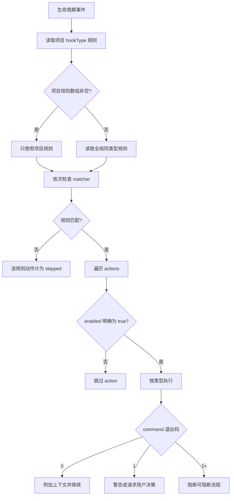
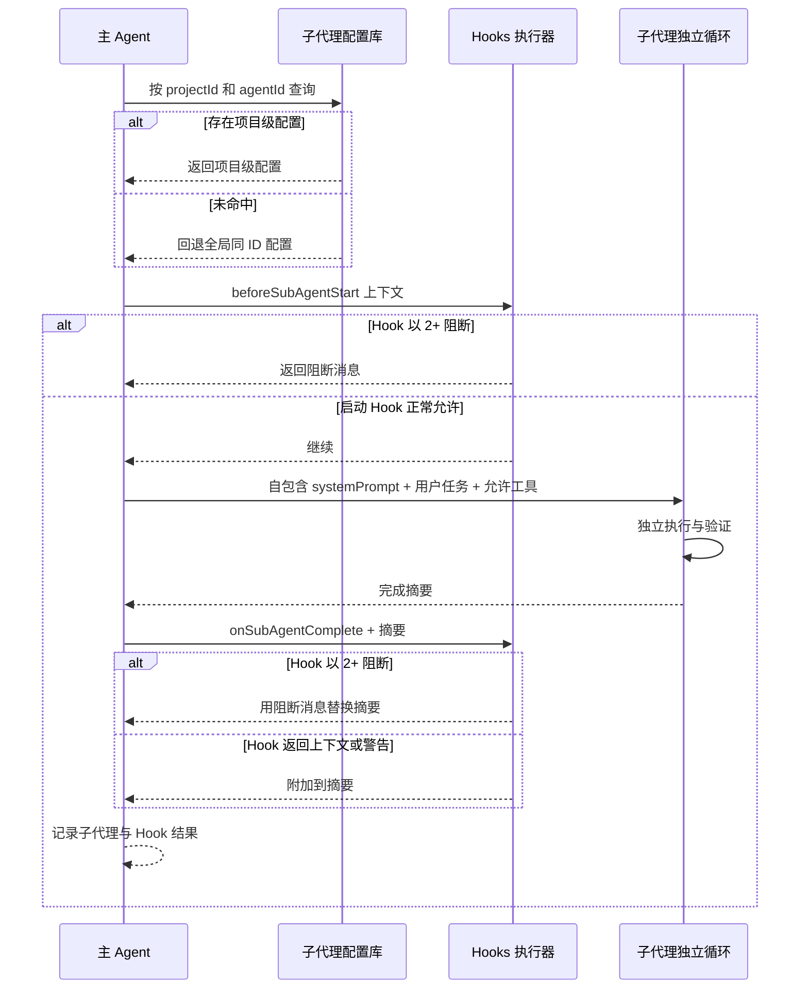

# 5-配置 Hooks 与子代理

Snow App 的 Hooks 和子代理配置存储在应用 SQLite 数据库中，与设置 UI 同源。Agent 可通过内置 `config-manage` 工具读写，成功后立即生效。

## 1. Hooks

### 1.1 作用域与有效规则

- 全局 Hook 对所有项目可用；项目 Hook 需要 `projectId`；
- 执行某个 `hookType` 时，若该项目有**非空规则数组**，使用项目规则；否则回退同类型全局规则；
- 项目规则不会与全局规则合并；即使项目规则中的动作全部禁用，只要规则数组非空，也会阻止回退全局规则；
- 每个 action 只有在 **`enabled` 明确等于 `true`** 时才执行。字段缺省、`null` 或 `false` 都会跳过。设置 UI 保存时会显式写入该字段，通过 config-manage 手写时也必须写。

### 1.2 Hook 类型

| `hookType`             | 触发时机                                                                                                  | 允许的 action        |
| ---------------------- | --------------------------------------------------------------------------------------------------------- | -------------------- |
| `onUserMessage`        | 用户消息进入 AI 前                                                                                        | `command`、`context` |
| `beforeToolCall`       | 工具                                                                                                      | 参数与语义           |
| ---                    | ---                                                                                                       |
| sub-agents-activate    | 新委派；可选 collaborationGroup 表示本次明确协作意图，仍受角色配置工具权限约束。                          |
| sub-agents-continue    | 向可接收的准确活动代际补充要求，或向终态子会话显式创建新 run；不改变旧 run 模式。收尾／取消中拒绝新消息。 |
| sub-agents-cancel      | 按 runId 请求取消，区分 requested、confirmed、already_terminal、too_late，不撤销已有外部副作用。          |
| sub-agents-getResult   | 按 runId/offset/limit 读取终态结果及分页；不得作为等待或进度轮询。完整持久摘要保留。                      |
| sub-agents-sendMessage | 仅授权子代理向宿主提供的 recipientRunId 发消息；使用 requestId 去重，不能触发新 run 或跨任务改投。        |

> `prompt` 是合法配置类型，但当前 native executor 不发起模型调用，而是返回“不支持”的失败记录。不要依赖 `prompt` action 实现生产自动化；优先使用可验证的 `command`，或在允许的触发点使用 `context`。`beforeSubAgentStart` 的 context 目前会被记录，但调用方不会把它追加到子代理 prompt。

### 1.3 Rule 与 action 字段

```json
{
  "description": "为发布检查注入项目规则",
  "matcher": "toolName:bash-*",
  "hooks": [
    {
      "type": "command",
      "command": "node scripts/check-release.mjs",
      "timeout": 5000,
      "enabled": true
    }
  ]
}
```

| 字段          | 位置    | 说明                                                                                                           |
| ------------- | ------- | -------------------------------------------------------------------------------------------------------------- |
| `description` | rule    | 必须存在；建议说明意图和失败影响。                                                                             |
| `matcher`     | rule    | 可选。逗号分隔表示 OR；支持 `key:glob`，如 `toolName:bash-*`；无 key 时优先匹配 `toolName`，再检查上下文文本。 |
| `hooks`       | rule    | 必填 action 数组。                                                                                             |
| `type`        | action  | `command`、`context` 或允许位置的 `prompt`。                                                                   |
| `command`     | command | 通过终端设置中选择的 shell 执行。                                                                              |
| `content`     | context | 静态文本；JSON 中的 `additionalContext` 或 `prompt` 字段会被提取，否则使用全文。                               |
| `prompt`      | prompt  | 当前 native executor 不执行模型调用。                                                                          |
| `timeout`     | command | 毫秒；缺省 `5000`。超时会终止子进程并返回错误。                                                                |
| `enabled`     | action  | **执行必需为 `true`**；缺省不会执行。                                                                          |

command action 会把事件上下文 JSON 写入 stdin，并在上下文包含 `cwd` 时使用该目录。stdout/stderr 按退出码解释：

| 退出码              | 结果                                                                                            |
| ------------------- | ----------------------------------------------------------------------------------------------- |
| `0`                 | 通过；非空 stdout 成为附加上下文。stdout 若为 JSON，可从 `additionalContext` 或 `prompt` 提取。 |
| `1`                 | 软警告；记录日志。stdout 为 `{"decision":{"message":"..."}}` 时，请求交互式用户决策。           |
| `2+` 或无有效退出码 | 阻断当前可阻断流程，优先展示 stderr，其次 stdout。                                              |

`onSessionStart` 与 `onStop` 是 fire-and-forget：调用方会把交互式决策降级为普通警告，不能依赖它们阻断流程。

### 1.4 Hooks 执行流程



### 1.5 通过 UI 配置

1. 打开 **设置 → Hooks 设置**（设置页 id：`hooks-settings`）；
2. 选择全局或项目范围；
3. 选择 `hookType`，添加规则与动作；
4. 确认每个应执行动作的开关已打开；
5. 保存并用低风险事件测试；
6. 查看 Hook 执行记录与应用日志。

### 1.6 通过 `config-manage` 配置

全局 command Hook：

```jsonc
config-manage action=set scope=hooks key=beforeToolCall value={
  "rules": [
    {
      "description": "运行只读工具审计",
      "matcher": "toolName:filesystem-*",
      "hooks": [
        {
          "type": "command",
          "command": "node scripts/audit-tool-call.mjs",
          "timeout": 5000,
          "enabled": true
        }
      ]
    }
  ]
}
```

项目 context Hook：

```jsonc
config-manage action=set scope=hooks key=onUserMessage projectId=<projectId> value={
  "rules": [
    {
      "description": "注入当前项目技术栈",
      "hooks": [
        {
          "type": "context",
          "content": "本项目使用 Electron、React、TypeScript 与 Rust。",
          "enabled": true
        }
      ]
    }
  ]
}
```

包含多个 action 时，每一个都显式设置 `enabled`：

```json
{
  "rules": [
    {
      "description": "压缩前检查并记录上下文",
      "hooks": [
        {
          "type": "command",
          "command": "node scripts/check-context.mjs",
          "timeout": 5000,
          "enabled": true
        },
        {
          "type": "command",
          "command": "node scripts/write-audit.mjs",
          "timeout": 5000,
          "enabled": false
        }
      ]
    }
  ]
}
```

推荐流程：

1. `config-manage action=list scope=hooks projectId=<projectId>` 查看现状和 `guidance`；
2. `config-manage action=get scope=hooks key=<hookType> projectId=<projectId>` 保存当前值；
3. `config-manage action=set` 写入完整 `rules`；
4. 立即 `config-manage action=get` 回读，逐个检查 `enabled`；
5. 用低风险事件测试退出码与 matcher；
6. `config-manage action=delete` 前展示 scope、key、projectId 和影响并取得明确确认。

Hook 数据库写入会创建写入期间的临时备份，成功后删除本次备份；不要把它当持久历史。

## 2. 子代理

### 2.1 配置字段与作用域

子代理通过 `sub-agents-activate` 运行在独立执行循环中，没有主对话历史。配置字段：

| 字段            | 说明                                                                                                                                                                                          |
| --------------- | --------------------------------------------------------------------------------------------------------------------------------------------------------------------------------------------- |
| `name`          | 展示名称，必填。                                                                                                                                                                              |
| `description`   | 告诉主 Agent 何时委派。                                                                                                                                                                       |
| `systemPrompt`  | 必须自包含：使命、输入、流程、工具、安全边界和输出。                                                                                                                                          |
| `toolsJson`     | JSON 字符串或工具名数组。自定义子代理必须使用显式清单，至少包含一个读取类工具（`filesystem-read` 或 `grep-search`），空数组会被拒绝；`["*"]` 仅用于内置 `agent_general`，且仍受项目启停影响。 |
| `configProfile` | 留空时继承启动它的主会话本次运行所用 API Profile 和当前模型；非空时固定使用指定 Profile。                                                                                                     |
| `model`         | 仅固定 Profile 时生效；非空时固定模型，省略、留空或 trim 后为空时使用该 Profile 的 `advancedModel`。若该 Profile 的 `advancedModel` 也为空则激活失败，不会回退 `basicModel`。                 |

激活时先查当前项目的同 ID 配置，未命中才回退全局。内置 `agent_general` 不可通过 config-manage 修改或删除。

主 Agent 的系统提示词会**动态注入当前可用的子代理清单**（含 `agentId`、名称与用途描述）。调用 `sub-agents-activate` 时，主 Agent 应从清单中选择最匹配任务的 `agentId`——存在更合适的配置时**不得默认使用内置 `agent_general`**（它只是通用兜底，仅在无更匹配配置时使用）。清单遵循与激活一致的解析规则：**当前项目的项目级子代理优先**（同 `agentId` 时覆盖全局），未配置项目级的再显示全局/内置。其他项目的子代理不注入。修改配置后新会话立即生效。

启动前会一次性校验工具清单格式、Profile 和模型，并生成运行快照。普通循环、工具递归、自动压缩和压缩后续跑都复用该快照，不会在每轮跟随全局配置变化。每次请求仍按固定 Profile 名读取最新凭证，但 Profile 被删除时会严格失败，不会切换到其他供应商。子会话会持久化启动时实际使用的 Profile 和模型，因此历史展示不受后续子代理/API 配置修改影响。

工具规则：

- 在项目会话中省略 `projectId` 时会自动使用当前项目，结果是项目级子代理；要创建**全局**子代理，请显式传入 `projectId=""`；
- 全局子代理的显式工具清单候选来自系统服务与全局 MCP 服务，不包含项目自有服务器，与项目无关，不必先选择项目；项目级候选还包括当前项目自有 MCP 服务的工具，以及项目级关闭的服务或工具；
- 仅内置 `agent_general` 使用 `["*"]`，运行时展开为当前项目全部可用工具，仍受项目启停影响；自定义子代理不能使用 `"*"`；
- 显式清单必须包含 `filesystem-read` 或 `grep-search` 之一，否则保存失败；
- 通过 config-manage 写入项目级子代理时，工具名必须是内置工具，或属于当前项目可解析的已配置 MCP 服务器，不要求服务器在项目中启用；全局子代理保存时不做项目校验；
- 显式名单仅对本次获授权子代理的工具发现与执行豁免项目级服务或工具禁用，包括项目自有 MCP 配置的 `enabled: false`。例外按完整工具名匹配，不开放未勾选工具、不修改项目开关，也不恢复主会话的访问；
- 全局外部服务的 `enabled: false`、全局工具黑名单、内置工具全局总闸、精简模式、工具就绪与能力条件、代码库索引条件和正常执行授权仍然生效；项目自有服务器只在当前对话项目中解析，不能访问其他项目的服务器。

### 2.2 子代理会话视图

子代理运行时以独立会话呈现，打开该会话可看到：

- **顶部标题**：显示**阶段名称**（激活时 prompt 截断到 80 字符，即该子代理被派发的任务阶段）替代项目名；副标题标注**由哪个主会话启动**；
- **信息卡片**：消息列表上方展示 `agentName` 徽章、阶段标题、**跳转主会话**按钮，以及**完整提示词**（默认 3 行截断，悬停显示全文）；
- **数据来源**：会话记录 `title` / `subAgentName` + 首条用户消息（prompt）+ 父会话标题（异步获取）。

### 2.3 通过 UI 配置

1. 打开 **设置 → 子代理设置**（设置页 id：`sub-agent-settings`）；
2. 选择全局或项目范围；
3. 填写名称、描述和完整 system prompt；
4. 在「MCP 工具」列表中至少勾选一个读取类工具（`filesystem-read` 或 `grep-search`）。全局 Tab 仅列出系统服务与全局 MCP 服务的工具，与当前项目无关；项目 Tab 还列出当前项目自有 MCP 服务的工具，包括项目级关闭的服务或工具。「仅子代理可用」表示显式勾选仅向该子代理开放，不修改项目开关，仍受全局禁用、精简模式及执行授权等限制。自定义子代理必须逐项或按服务组选择工具，不能使用 `"*"`；
5. 保持“跟随主会话（推荐）”，或选择固定 API 配置；固定后可再选择独立模型，留空则使用该配置的高级模型；
6. 保存后，从主对话发起一个边界清晰的测试任务。

### 2.4 通过 `config-manage` 配置

全局子代理示例（`projectId=""` 表示全局）：

```jsonc
config-manage action=set scope=subAgents key=agent_readonly_reviewer projectId="" value={
  "name": "只读审查员",
  "description": "需要独立审查并返回问题清单时使用",
  "systemPrompt": "你是只读审查员。先验证输入和文件，再按严重级别输出问题与证据。不得修改文件、运行命令或推测缺失业务规则。工具不可用时说明无法验证的部分。",
  "toolsJson": ["filesystem-read", "grep-search"],
  "configProfile": "",
  "model": ""
}
```

项目级显式工具示例：

```jsonc
config-manage action=set scope=subAgents key=agent_project_reviewer projectId=<projectId> value={
  "name": "项目审查员",
  "description": "审查当前项目代码并返回带路径的发现",
  "systemPrompt": "你是当前项目的只读代码审查员。使用允许工具读取事实，按严重级别、文件路径、证据和修复建议输出；不得修改文件。",
  "toolsJson": [
    "filesystem-read",
    "grep-search",
    "lsp-symbols"
  ],
  "configProfile": "",
  "model": ""
}
```

写入前先 `config-manage action=list scope=subAgents projectId=<projectId>` 获取 guidance 和当前工具环境；写入后 `config-manage action=get` 回读。`config-manage action=delete` 同样需要用户明确确认。

### 2.5 子代理与 Hooks 时序



注意：`beforeSubAgentStart` 调用抛出异常时，受理失败，不会继续启动子代理，也不会返回 accepted。正常返回的 Hook 决策仍按现有退出码语义处理；安全阻断应明确返回 `2+`，不要依赖异常代替决策。

### 2.6 子代理会话恢复与同会话通信

- **恢复与显式继续**：宿主从持久事实重建有界身份账本，提供真实 conversationId/runId、任务、状态、模式和结果定位，不要求模型调用列表工具。重启后非终态运行变为 interrupted，不自动重放；显式 continue 才建立新 run，旧结果不产生新授权。续跑必须具有持久化 run/snapshot；无项目旧同步路径已停止支持。
- **按需协作**：普通子代理不自动携带通信工具。配置允许 sendMessage（或内置通配符），并在本次委派明确指定 collaborationGroup 后，才提供同一有效任务和组的协作者 runId。发送按 recipientRunId 寻址，不按代理名或子会话的最新代际猜测，不依赖 listTeammates。
- **消息与隔离**：消息复用持久队列并按请求身份去重；同项目、父会话、parentTaskId、组和双方 run 均需校验。收尾／取消／终态不再接受新消息；queued 只表示入队，终止未消费会明确保留为 undelivered，不自动改投下一代。

### 2.7 当前持久化运行：同步与异步

在「设置 → 子代理设置 → 运行限制」选择默认执行方式（默认为同步）。该设置只是默认值：`activate` / `continue` 提供可选的 `executionMode` 参数（`sync` / `async`），AI 可按场景为每次派发单独选择，省略时才使用设置中的默认值。同步：父工具等到终态后返回统一的 result 回包；异步只等待 accepted 回执。Workflow 节点内的子代理只允许同步执行：节点的工具 schema 仅提供 `sync`，显式传 `async` 会被拒绝。忙碌目标的 continue 返回 message_queued，不改变该 run 的模式。

两种模式只支持实际项目／工作区绑定的普通桌面主会话及已登记的独立会话窗口，共享 accept、transition、settle 和结果分页。无项目、Workflow 非持久化子代理执行不再支持；旧子会话缺少 run/snapshot 时明确拒绝续跑，不从旧消息或当前配置重建执行。应用退出后不继续运行。

公开工具仅有以下五个；wait、listSubAgents、listTeammates 不再注册或专用解析，旧工具记录保留原文通用展示，不删除历史数据。

| 工具                   | 参数与语义                                                                                                                                              |
| ---------------------- | ------------------------------------------------------------------------------------------------------------------------------------------------------- |
| sub-agents-activate    | agentId、summary、prompt；可选 requestId、acceptance、collaborationGroup。新运行只有显式协作组与配置权限取交集后才允许通信。                            |
| sub-agents-continue    | conversationId、message；可选 requestId、acceptance、collaborationGroup。活动目标仅给准确代际排队，终态目标显式创建新 run；finalizing/cancelling 拒收。 |
| sub-agents-getResult   | runId、offset、limit；只读终态正文／分页，不查进度。默认16000个 Unicode 字符，limit 为1–64000。                                                         |
| sub-agents-cancel      | runId；区分 requested、confirmed、already_terminal、too_late，不撤销已发生的文件或外部副作用。                                                          |
| sub-agents-sendMessage | recipientRunId、message、可选 requestId；地址来自宿主当前授权协作者账本，不接受旧 conversationId 别名。                                                 |

先在设置选择异步，再向 activate 提交：

```json
{
  "agentId": "agent_general",
  "summary": "只读项目检查",
  "prompt": "只读取当前项目的 package.json，概括构建命令；不运行命令或修改文件。"
}
```

accepted/message_queued 不表示完成、消费或理解。当前回执必须包含实际 executionMode；同步终态与 getResult 统一使用 result.run.outcome，不再返回旧扁平 summary 外壳。错误、验收、取消来源与未消费消息保留在 outcome，结果分页不会裁掉这些元数据。

requestId 标识一次逻辑操作。未知回执重试必须复用原 ID 和业务输入；设置切换不改变已受理模式，也不导致重复派发。新操作才使用新 ID。当前全局／项目配置优先级不变。

父忙时在完整工具屏障后接纳结果，父闲且原任务仍开放时由宿主调度内部续轮。停止、关闭或新用户任务不会复活旧任务。内部结果不是新用户授权；UI 查询不接纳事件或确认唤醒。同步结果与已观察的 getResult 按准确事件身份去重，内部事件等待仍保留，但不暴露为公开 wait。

重启或 owner 丢失将非终态 run 标为 interrupted，不冒充用户取消、不自动重放。归档保留完整运行身份，恢复不重开旧任务。删除／回滚仍须通过门禁、取消与 owner drain；准备阶段可撤销的回滚一旦开始文件恢复，就必须显式恢复／重试。

全局容量由 native 同事务核对，不再使用旧 renderer semaphore。默认预算为128次模型请求与30分钟活跃执行，授权／用户输入／暂停等待不计入；耗尽是失败。取消不承诺撤销已发生的外部副作用。冷热分离时若关联 peer 端点不在同库，须恢复相关归档后重试，不静默丢失效果。

排障请记录时间和 runId/eventId/interactionId，查 sub-agents 日志中的受理、执行、结算、接收和唤醒阶段。不要分享凭据或完整敏感 prompt。源码构建通过不代表当前冻结 preview 已加载新代码。

### 2.8 结果证据与取消归因

- `summary` 是子代理末轮最终正文，不是完整会话转录；工具调用间的逐项报告应在子会话查看。分页只对最终正文按 Unicode 字符切片，不能取回未被最终正文包含的历史。
- 验收清单的宿主校验保证证据 ID 来自该子会话日志，不保证证据与条目的语义相关性或业务事实正确。主控仍需核对真实工具状态与直接相关内容，不把读取成功用于背书未验证条目。
- 新取消记录可含 `cancellation: {source, requestedAt}`，同步最终 outcome、异步 getResult、取消回执和日志保留该字段。source 区分 `cancel_tool`、`parent_stop`、`conversation_stop`、`ui_cancel`、`deletion`、`runtime_abort`、`unspecified`；时间由持久层在首次受理时记录为 UTC epoch milliseconds。后续重试保留首次归因，`already_terminal`/`too_late` 不新增或覆盖来源。旧记录缺失字段表示未记录，不能根据中断文案推断为父停止或用户操作。公共 cancel 工具仍只传 runId，不接受模型指定来源。
- `message_queued` 只证明入队；结果事件的 `deliveryStatus: received` 只证明持久合入父输入，两者不是补充消息的模型理解回执。两个 activate 创建独立子会话，不是同目标 RUN_BUSY 测试。

新元数据需应用加载新 native/renderer 后生效，构建与隔离探针不能替代重启、跨窗口或删除的真实端到端验证。

## 3. 验证与排错

| 症状                                         | 检查                                                                                                                                       |
| -------------------------------------------- | ------------------------------------------------------------------------------------------------------------------------------------------ |
| Hook 保存成功但从不执行                      | action 是否显式 `"enabled": true`；缺省值会被 native executor 跳过。                                                                       |
| 项目 Hook 未回退全局                         | 项目规则数组非空即取代全局；删除项目配置或使用空规则数组才会回退。                                                                         |
| matcher 不命中                               | 核对上下文键名和完整工具名；需要时使用 `toolName:<glob>`。                                                                                 |
| command 超时                                 | 默认 5000 ms；检查 shell、PATH、cwd、stdin 读取和合理的正数 `timeout`。                                                                    |
| 退出 1 没有决策卡                            | stdout 必须是有效 JSON，且包含字符串 `decision.message`；fire-and-forget Hook 只显示警告。                                                 |
| prompt action 没有效果                       | 当前 native executor 不执行 prompt 模型调用；改用 command 或受支持的 context。                                                             |
| context 未进入子代理 prompt                  | `beforeSubAgentStart` 当前只记录结果，不拼接子代理 prompt；把必需内容写入子代理 `systemPrompt`。                                           |
| 保存子代理被拒（工具清单为空或缺少读取工具） | 自定义子代理须使用显式清单，至少包含 `filesystem-read` 或 `grep-search`，不能使用 `"*"`。                                                  |
| 项目关闭服务后子代理不再使用该服务的工具     | 内置 `agent_general` 的 `["*"]` 仍受项目启停影响；显式名单按完整工具名豁免项目级禁用，需核对是否勾选，并检查全局禁用、工具就绪及执行授权。 |
| 全局子代理找不到项目专属服务的工具           | 全局子代理只列出系统服务与全局 MCP 服务的工具；项目专属服务的工具请使用项目级子代理。                                                      |
| 子代理找不到工具                             | 核对显式清单中的完整工具名、当前项目的服务来源，以及全局禁用、工具就绪和执行授权；项目级禁用例外不豁免这些条件。                           |
| 子代理行为依赖主对话                         | 子代理没有主会话历史；把上下文放进任务 prompt 或自包含 `systemPrompt`。                                                                    |
| 同 ID 激活了错误配置                         | 项目级优先于全局；分别 `config-manage action=get` 并核对 `projectId`。                                                                     |
