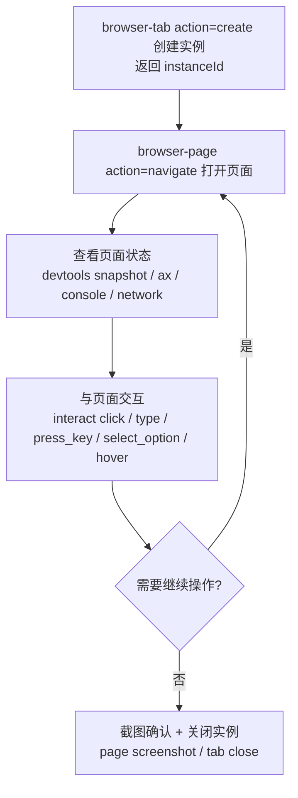

# 6-浏览器自动化（Browser Automation）

Snow App 内置嵌入式 Electron 浏览器，AI Agent 可以直接操控网页完成
测试、抓取、交互验证等任务。本文介绍内置 `browser` 服务器的全部工具
与典型使用流程。

## 1. 工具总览

内置 `browser` 服务器共 10 个工具。其中 9 个是按领域合并的工具，通过 `action` 参数分派具体操作；`browser-devtools` 与 `browser-request_share` 不做合并。

| 工具                    | action 取值                                                                                                  | 用途                                                                                     |
| ----------------------- | ------------------------------------------------------------------------------------------------------------ | ---------------------------------------------------------------------------------------- |
| `browser-tab`           | `create` / `list` / `focus` / `close` / `frames`                                                             | 标签页（实例）的创建、列出、切换、关闭，以及枚举 frame                                   |
| `browser-page`          | `navigate` / `back` / `forward` / `content` / `screenshot` / `wait`                                          | 页面导航、历史前进后退、读取正文、截图、等待文本或元素出现/消失                          |
| `browser-interact`      | `click` / `type` / `fill_form` / `select_option` / `hover` / `press_key` / `scroll` / `drag` / `upload-file` | 真实输入事件：点击、输入、表单填充、下拉选择、悬停、按键、滚动、拖拽、上传文件           |
| `browser-inspect`       | `evaluate` / `css_styles` / `audit`                                                                          | 执行 JavaScript、查看元素的 CSS 级联样式、axe / SEO / 最佳实践审计                       |
| `browser-devtools`      | 不合并，单工具（见下方说明）                                                                                 | 快照、无障碍树、控制台、网络、接口 Mock、日志断点、登录态、cookie、弹窗、trace、DevTools |
| `browser-emulate`       | `emulate` / `resize`                                                                                         | 模拟颜色方案、网络条件、地理位置、UA、视口尺寸                                           |
| `browser-perf`          | `trace_start` / `trace_stop` / `insight` / `screencast_start` / `screencast_stop`                            | 性能 trace 与洞察分析、页面录屏                                                          |
| `browser-heap`          | `take` / `summary` / `query` / `details` / `edges` / `retainers` / `paths` / `strings` / `compare`           | V8 堆快照采集与内存分析（泄漏排查）                                                      |
| `browser-page-tools`    | `list` / `call`                                                                                              | 列出并调用页面自行注册的页面工具（WebMCP 风格）                                          |
| `browser-request_share` | 不合并，单工具                                                                                               | 请求用户把某个标签页共享给 Agent（应用内弹确认条；拒绝或超时返回 `shared: false`）       |

`browser-devtools` 的 `action` 取值包括：`snapshot`、`ax`、`console`、`console_message`、`network`、`network_detail`、`networkDetails`、`network_clear`、`networkState`、`route`、`routeList`、`routeClear`、`logpointSet`、`logpointList`、`logpointHits`、`logpointHitsClear`、`logpointRemove`、`logpointClear`、`scriptList`、`scriptSearch`、`storageSave`、`storageRestore`、`cookies`、`cookieDelete`、`trace`、`dialog`、`open`。

## 2. 典型流程



### 2.1 打开页面

```text
browser-tab action=create url=https://example.com
→ 创建实例，返回 instanceId

browser-page action=navigate instanceId=<id> url=https://example.com/docs
→ 跳转到指定页面
```

### 2.2 查看页面状态

```text
browser-devtools action=snapshot instanceId=<id>
→ 页面元数据 + 文本快照（了解页面结构）

browser-devtools action=ax instanceId=<id>
→ 无障碍树快照（结构化可交互元素，带 [uid=eN]；引擎级 AX 树，
  可穿透 closed shadow DOM，元素可 ref 回指）。默认紧凑输出包含控件取值
  （value/min/max）与状态（checked/selected/expanded/disabled），表格行按
  单元格文本聚合，密码类取值脱敏

browser-devtools action=ax verbose=true maxNodes=500 instanceId=<id>
→ 全量节点 + 全部 AX 属性（token 消耗更大，按需使用）

browser-devtools action=console level=error instanceId=<id>
→ 控制台错误消息（排查页面 JS 报错）

browser-devtools action=network filter=api instanceId=<id>
→ 网络请求列表（默认精简：id、method、url、status、resourceType、耗时、source、
  失败原因；请求/响应头与 body 不随列表展开。CDP 记录含 requestId，webrequest
  回退记录没有 requestId）

browser-devtools action=network methods=["OPTIONS"] instanceId=<id>
→ 只看 CORS 预检请求（列表返回的 preflightTotal 提示当前过滤结果中的预检数量）

browser-devtools action=network_detail requestId=<数字 id> instanceId=<id>
→ 按列表中的数字 id 取单条完整记录（含请求/响应头）

browser-devtools action=network includeHeaders=true instanceId=<id>
→ 兼容模式：列表直接带请求/响应头（token 消耗更大）

browser-devtools action=networkDetails requestId=<requestId> instanceId=<id>
→ 单条请求的完整详情：请求/响应头 + 请求体 + 响应体（默认上限 128KB，可用 maxBodyBytes 调整）

browser-devtools action=networkState state=offline instanceId=<id>
→ 模拟离线（所有请求失败）；state=online 恢复
```

跨域/OOPIF iframe 的网络记录、控制台条目和弹窗按所属帧 CDP 会话采集与响应：网络列表同时给出 `cdpFrameId`，`requestId` 是帧作用域的详情键；控制台条目带 `cdpFrameId`；弹窗列表用 `frame` 标记 `main`/`iframe`。帧会话失效时明确报错，不回退到主帧。

### 2.3 接口 Mock 与异常注入（路由拦截）

```text
# 拦截匹配 /api/users 的请求，返回自定义 JSON（pattern 支持 /正则/ 或子串）
browser-devtools action=route pattern="/api/users" body='{"code":0,"data":[]}' contentType=application/json instanceId=<id>

# 返回 500 模拟服务端错误
browser-devtools action=route pattern="/login" status=500 body='{"error":"boom"}' instanceId=<id>

# 让请求直接失败（模拟断网/接口挂掉），可选 CDP 错误原因
browser-devtools action=route pattern="/api/orders" abort=ConnectionRefused instanceId=<id>

# 注入慢接口（响应延迟 3 秒）
browser-devtools action=route pattern="/api/search" delayMs=3000 body='{"data":[]}' instanceId=<id>

# 只匹配某个方法 / 资源类型，且只生效一次（验证失败重试逻辑）
browser-devtools action=route pattern="/api/pay" method=POST times=1 abort=TimedOut instanceId=<id>

# 用本地文件作为响应体（每次请求重新读取，改文件即换数据，不用改前端）
browser-devtools action=route pattern="/api/config" bodyFile=/Users/me/mocks/config.json contentType=application/json instanceId=<id>

# 真实响应替换：把请求转发到测试服务器，再把真实响应回给页面
browser-devtools action=route pattern="/api/" proxyTo=https://staging.example.com/api/ instanceId=<id>

# 查看当前生效的规则与命中次数
browser-devtools action=routeList instanceId=<id>

# 清除全部 mock 规则，恢复真实网络
browser-devtools action=routeClear instanceId=<id>
```

同一 pattern 重复调用会覆盖规则；多条规则同时生效（按注册顺序匹配）。
规则内容未变化时命中次数会延续，改动过的规则重新计数，`times` 因此可反复重放。
`proxyTo` 转发失败时页面收到 502（带 JSON 错误说明），不会留下挂起请求；
请求方法、请求头和请求体会一起转给测试服务器，响应头（除 content-length /
content-encoding / host 等传输层头）原样回灌。

### 2.4 日志断点（不改源码查看运行时变量）

```text
# 直接用源码路径下断点（经 source map 定位，行号与磁盘文件一致）
browser-devtools action=logpointSet url="src/cart.ts" lineNumber=42 \
  expressions='["cart.total","cart.items.length"]' instanceId=<id>

# 不确定位置时先搜索：返回 url / lineNumber / columnNumber，可直接用于 logpointSet
browser-devtools action=scriptSearch query="function checkout" instanceId=<id>
browser-devtools action=scriptSearch query="submitOrder\\(" isRegex=true url="app." instanceId=<id>

# 列出已解析脚本；sources=true 时同时列出 source map 里的原始源码
browser-devtools action=scriptList filter="app" sources=true instanceId=<id>

# 在指定脚本的某一行打日志断点：命中时记录局部变量，页面继续执行
browser-devtools action=logpointSet url="/static/js/app.4f2c.js" lineNumber=482 \
  expressions='["userId","state.items.length","payload.id"]' label="下单流程" instanceId=<id>

# 只在条件下记录（避免刷屏）
browser-devtools action=logpointSet url="/static/js/app.4f2c.js" lineNumber=482 \
  condition="state.items.length > 0" expressions='["state.items[0]"]' maxHits=10 instanceId=<id>

# 脚本 URL 用正则匹配（如带 hash 的打包文件）
browser-devtools action=logpointSet url="/app\\.[0-9a-f]+\\.js$" urlRegex=true \
  lineNumber=482 expressions='["userId"]' instanceId=<id>

# 查看已采集到的命中与变量值
browser-devtools action=logpointHits instanceId=<id>
browser-devtools action=logpointHits logpointId=<logpointId> limit=20 instanceId=<id>

# 列出 / 移除 / 清空断点与命中
browser-devtools action=logpointList instanceId=<id>
browser-devtools action=logpointRemove logpointId=<logpointId> instanceId=<id>
browser-devtools action=logpointClear instanceId=<id>
browser-devtools action=logpointHitsClear instanceId=<id>
```

日志断点通过 CDP `Debugger.setBreakpointByUrl` 注入条件表达式：命中时在页面内格式化
变量并回传，条件恒返回 `false`，**不会暂停页面、不需要改源码**。

- **定位**：`url` 优先匹配 source map 里的原始源码（完整 URL 或路径后缀，如
  `src/cart.ts`），此时 `lineNumber` 就是磁盘文件的行号；匹配不到原始源码时按
  **字面子串**匹配浏览器加载的脚本 URL；`/正则/` 或 `urlRegex=true` 按正则匹配脚本
  URL（不查 source map）。`lineNumber`、`columnNumber` 都从 1 起；压缩成单行的打包
  文件必须带 `columnNumber`，用 `scriptSearch` 取得。重新构建后重载页面，源码路径
  断点会自动重新定位。
- **绑定反馈**：`logpointSet` 返回 `bound`、`locations`（实际落点）与 `warning`
  （路径没匹配到、行号超出脚本、该行无可执行代码被顺延等）。路径匹配到多个源码
  文件、或该行之后没有可执行代码时直接报错。尚未加载的脚本会保持待绑定，加载后
  自动生效。
- **取值**：表达式在该行执行**之前**求值（该行声明的变量此时还没有值），命中记录
  以表达式原文为键。单个表达式抛错只影响自己，显示为 `[Thrown: ...]`；
  `undefined`、`Error`、`Map`、`Set`、循环引用、DOM 节点都有可读表示，过深或过长
  的值会被截断。压缩代码里要用压缩后的变量名。
- **没有命中时**：`logpointHits` 的 `diagnostics` 会给出每个断点是否绑定、警告和
  最近一次求值错误，用来区分「没绑上 / 那行没执行 / 表达式报错」。
- **其它**：命中达到 `maxHits`（默认 20，上限 50）后断点自动失效，热路径上超限后
  页面内直接跳过。打开页面的 DevTools 会占用调试器，断点暂时失效，关闭后自动恢复
  （期间 `logpointList` 返回 `suspended`）。全部断点清除后调试域会在空闲时关闭。
  命中记录不会混进 `action=console` 的控制台记录。

### 2.5 与页面交互

```text
# 点击（用 CSS 选择器、可见文本或无障碍 ref）
browser-interact action=click selector="#submit-btn" instanceId=<id>
browser-interact action=click text="登录" instanceId=<id>
browser-interact action=click ref=e3 instanceId=<id>

# 输入文本（同样支持 ref 定位）
browser-interact action=type selector="#username" value="user1" instanceId=<id>
browser-interact action=type text="密码框" value="secret" delayMs=30 instanceId=<id>
browser-interact action=type ref=e6 value="hello" submit=true instanceId=<id>

# 等待异步内容（SPA 渲染完成后才操作）
browser-page action=wait text="加载完成" instanceId=<id>
browser-page action=wait textGone="Loading..." timeoutMs=15000 instanceId=<id>

# 键盘操作
browser-interact action=press_key key="Tab" instanceId=<id>
browser-interact action=press_key key="Control+a" instanceId=<id>   # Ctrl+A 全选
browser-interact action=press_key key="Escape" instanceId=<id>

# 下拉框 / 悬停 / 上传
browser-interact action=select_option selector="#country" values=["CN"] instanceId=<id>
browser-interact action=hover text="用户菜单" instanceId=<id>
browser-interact action=upload-file selector="input[type=file]" files=["C:/tmp/avatar.png"] instanceId=<id>

# 历史导航
browser-page action=back instanceId=<id>
browser-page action=forward instanceId=<id>

# 执行任意 JS（读取/修改页面状态）
browser-inspect action=evaluate expression="document.title" instanceId=<id>
```

### 2.6 动作回执与有界观察（observe / expect）

`browser-interact` 的 `click`、`type`、`fill_form`、`select_option`、`press_key`
动作，回执分为三部分，避免把「事件已派发」误读成「业务已成功」：

- `success` / `dispatched`：仅表示真实输入事件已送出；
- `before`：动作前的 URL 与标题；顶层 `url` / `title` 是动作后的当前页面状态；
- `observation`：有界观察结果（`status` = `changed` / `unchanged` / `navigating` /
  `blocked` / `expect-timeout`），包含变化项、搜索/筛选条件、以及本次动作窗口内新增的
  控制台错误、弹窗和下载。观察不等待全局 network-idle，也不会重试动作。

```text
# 默认 brief：派发后最多等 1500ms，检测到变化即提前返回
browser-interact action=click text="加入购物车" instanceId=<id>

# 只需要派发结果时显式关闭观察（保持最低延迟）
browser-interact action=click selector="#more" observe=none instanceId=<id>

# 需要正文时用 snapshot（额外返回精简页面文本）
browser-interact action=click text="详情" observe=snapshot instanceId=<id>

# 用 expect 组合「动作 + 明确的完成条件」，不要 sleep，也不要重复点击
browser-interact action=click text="搜索" expect={urlIncludes:"/products"} observeTimeoutMs=5000 instanceId=<id>
browser-interact action=type selector="#q" value="hammer" submit=true expect={text:"Thor Hammer"} instanceId=<id>
```

要点：

- `unchanged` 表示窗口内没有观察到页面变化，**不代表动作失败**；先用
  `browser-devtools action=snapshot` 或 `browser-page action=wait` 核实，不要盲目重复副作用动作；
- `navigating` 表示页面仍在加载；`blocked` 表示 JS 弹窗阻塞了页面脚本，用
  `browser-devtools action=dialog` 处理；`expect-timeout` 只是观察超时，不是动作失败；
- URL 的 query/fragment 会按脱敏策略移除，回执用 `urlRedaction` 显式标注；
  需要搜索条件时读取 `observation.state.searchFields`，不要依赖地址栏参数。

### 2.7 性能分析（trace）

```text
# 录制 3 秒性能数据，返回长任务/事件统计（主线程卡顿指标）
browser-devtools action=trace instanceId=<id>
browser-devtools action=trace durationMs=5000 instanceId=<id>
→ { eventCount, longTasks: { count, totalMs, longestMs }, topEventTypes }

# 需要完整 trace 与洞察分析时使用 browser-perf
browser-perf action=trace_start instanceId=<id>
browser-perf action=trace_stop instanceId=<id>
browser-perf action=insight insightId=long-tasks instanceId=<id>
```

长任务（>50ms 的可运行事件）数量与总时长是判断页面卡顿的核心指标；
`topEventTypes` 显示主要事件构成，可据此决定是否需要进一步用
`browser-devtools action=network` 与 `action=console` 排查。

### 2.8 截图与关闭

```text
browser-page action=screenshot instanceId=<id> fullPage=true
→ 返回 PNG 图片

browser-tab action=close instanceId=<id>
```

## 3. 登录态保存与恢复（cookie + localStorage）

内置浏览器是持久会话，但登录状态可以显式「存档/取档」，用于多账号切换、
状态备份与还原。文件经系统级加密（safeStorage）保存在 `~/.snowapp/browser-state/`，
**绝不明文落盘**；恢复前自动加密备份当前状态。应用还会周期性自动备份内置浏览器的
全部 Cookie 到同一目录的 `auto-cookies` 文件（检测到 Cookie 库丢失时启动自动恢复）。

```text
# 保存当前登录态（cookies + 当前页面 origin 的 localStorage）
browser-devtools action=storageSave instanceId=<id>
browser-devtools action=storageSave fileName=github-account1.bin instanceId=<id>
→ 返回文件名与统计（cookie 数 / origin 数），不回显内容

# 恢复登录态（恢复前自动备份当前状态到 backups/）
browser-devtools action=storageRestore fileName=github-account1.bin instanceId=<id>
→ 返回恢复统计 + 备份文件路径

# 查看 cookie（值默认脱敏：只显示前 4 位 + 长度）
browser-devtools action=cookies instanceId=<id>
browser-devtools action=cookies domain=".github.com" instanceId=<id>
# 调试需要明文时显式开启（返回值会附带敏感凭据警告）
browser-devtools action=cookies showValues=true domain=".github.com" instanceId=<id>

# 删除指定 cookie（name + domain 精确定位）
browser-devtools action=cookieDelete name="_gh_sess" domain=".github.com" instanceId=<id>
```

安全要点：

- **加密**：文件经 OS 级加密（Windows DPAPI / macOS Keychain / Linux keyring），
  keyring 不可用时拒绝保存；
- **不回显**：保存/恢复只返回统计，cookie 值不进对话上下文；`showValues=true`
  才返回明文并附带警告；
- **origin 校验**：localStorage 恢复只写入与保存时完全一致的 origin；
- **文件名白名单**：只允许 `[A-Za-z0-9._-]`，实际路径由应用拼接（防路径穿越）；
- **备份**：恢复前自动备份当前状态（同样加密），位于 `backups/` 子目录。

## 4. 弹窗（alert / confirm / prompt）处理

页面弹出对话框时，agent 的后续操作可能被阻塞：

```text
browser-devtools action=dialog instanceId=<id>
→ 列出待处理的弹窗

browser-devtools action=dialog dialogResponse={accept:true} instanceId=<id>
→ 接受（确定）弹窗
browser-devtools action=dialog dialogResponse={accept:false} instanceId=<id>
→ 拒绝（取消）弹窗
browser-devtools action=dialog dialogResponse={accept:true, promptText:"输入内容"} instanceId=<id>
→ 给 prompt 对话框提供输入
```

## 5. Agent 授权、共享与隔离

标签页默认**对 Agent 不可见**：只有用户显式共享的标签页，或 Agent 自己打开的标签页，
才能被浏览器工具操作；其余标签页上的任何命令都会直接报错。

- **共享标签页**：工具栏的机器人按钮（`Bot` / `BotOff`）一键共享/撤销当前标签页，
  共享后按钮高亮、标签栏出现圆点标识，再点一次立即撤销（不需要重启或重新登录）；
- **Agent 请求共享**：Agent 可调用 `browser-request_share`，应用会切到该标签页并弹出
  「允许 / 拒绝」确认条，用户不响应（60 秒）或拒绝时返回 `{ shared: false, reason: "denied" }`；
- **Agent 自开标签页**：`browser-tab action=create` 创建的标签页自动视为已共享，且默认运行在
  **隔离会话**（独立的内存级 Cookie / 存储，不共享用户的登录态）；可在
  **设置 → 浏览器 → Agent 授权** 关闭隔离，让 Agent 自开页复用登录态；
- **全局开关**：同一设置页可整体关闭 Agent 的浏览器访问（关闭后所有浏览器工具报错）；
- **域名策略**：可选「仅允许列表 / 仅屏蔽列表」+ 域名清单（匹配域名及其子域名），
  在共享之外再限制 Agent 能操作的站点；
- **可见可审计**：每次工具调用的参数与结果都留在会话记录里，共享状态在工具栏与标签栏
  都有可见标识。

## 6. 最佳实践

- **先快照再交互**：动态/复杂页面优先 `browser-devtools action=ax` 获取
  结构化无障碍树，用 `ref=<uid>` 确定性定位（避免猜 CSS 选择器）；
  简单静态页面用 `action=snapshot` 文本快照即可；
- **ref 会过期**：页面变化（重渲染/导航）后需重新 `action=ax`，旧 ref
  会报错提示重新截图；
- **多标签页管理**：`browser-tab action=list` 查看全部标签页，`browser-tab action=focus`
  切换目标；
- **配合网络面板排查**：页面异常时先看 `browser-devtools action=console level=error`
  与 `action=network`，再决定是否重新导航；
- **真实鼠标事件**：`browser-interact` 的 `click` 使用真实 Electron 鼠标输入事件，
  与脚本注入不同，能触发依赖真实事件的处理逻辑；
- **无头不可用**：内置浏览器是嵌入式窗口，需要应用正常运行。

## 7. 相关配置

- 浏览器工具可把当前页面弹出为**独立窗口**；独立窗口支持完整的**标签迁移与恢复**——标签页可在独立窗口与主面板之间移动，窗口关闭后重新打开可恢复原有标签与会话状态（Agent 共享状态随标签页迁移）；
- 代理与浏览器路径在 **设置 → 代理与浏览器**（`app-control-openSettings page=proxy-browser-settings`），字段见 [3-配置文件字段参考](../3-参考手册/3-配置文件字段参考.md) 的 `proxy-config.json`（`browserPath`、`browserDebugPort`）；
- 其余配置见 [17-浏览器设置、密码与数据导入](17-浏览器设置密码与数据导入.md)。
