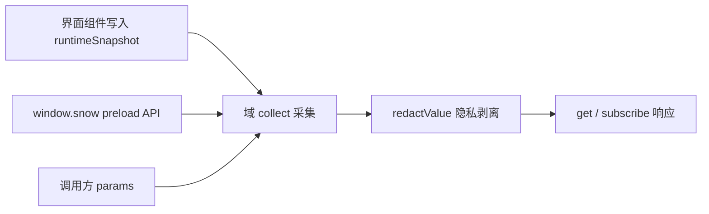

# 6-插件元数据域参考

> 适用：Snow App 桌面端插件（`renderMode` 为 `esm` 或 `iframe`）。本文逐域列出插件通过 `api.metadata` 能读取的应用元数据：域 id、隐私声明要求、实时性、可用参数与返回结构，并提供「需求 → 域」对照。写入应用数据使用独立的 `api.write`（225 个写动作、按动作声明敏感域），调用形态、失败判定与动作速查表见 [24-插件开发与安装](../2-使用指南/24-插件开发与安装.md) 的「可写能力」章节。清单编写与安装流程同样见该文档。客户端 UI 脚本（插件 → 插件列表 → 脚本插件）通过 `snow.metadata` / `snow.write` 使用同一套域与动作，敏感域需在脚本元数据头用 `@snow-privacy` 声明，调用形态见 [22-油猴脚本](../2-使用指南/22-油猴脚本.md) 的「客户端脚本（桌面窗口）」。

## 1. 作用域与来源

元数据由渲染层采集，只有三种来源：

| 来源        | 说明                                                                                                                                 |
| ----------- | ------------------------------------------------------------------------------------------------------------------------------------ |
| 实时快照    | `src/renderer/plugins/runtimeSnapshot.ts` 中由界面组件持续写入的运行时状态（焦点会话、流式指标、右侧面板、激活项目等），变化时可推送 |
| preload API | `window.snow.*` 中与设置面板同源的查询接口，按需读取应用数据库与 Rust 层                                                             |
| 调用上下文  | 当前插件记录本身（`plugins` 域）与调用方传入的 `params`                                                                              |

元数据域本身是**只读**能力：`api.metadata` 无法写入任何应用数据。写入应用数据使用独立的 `api.write`——读写共用同一套 `privacy` 声明规则，写动作的 `scope` 非空时同样必须声明（见第 7 章）；插件私有数据仍用 `api.storage` 保存。



### 1.1 调用形态

消息结束插槽通过同一套隐私受控元数据读取挂载所需数据，宿主仅默认补入会话与已知目录标识；DOM 挂载与订阅回收契约见 [24-插件开发与安装](../2-使用指南/24-插件开发与安装.md) 的「消息结束插槽」。

```javascript
const response = await api.metadata.get(["conversations", "memos"], {
  params: { directoryId: "local:D:/repo" },
});

const sub = api.metadata.subscribe(
  "runtime",
  (next) => render(next.domains.runtime),
  { intervalMs: 2000 },
);
sub.unsubscribe();

const list = api.metadata.domains(); // [{ id, scope, granted, live, sensitiveFields }]
```

`get` 与 `subscribe` 返回同一个响应对象：

| 字段          | 类型     | 说明                                                                         |
| ------------- | -------- | ---------------------------------------------------------------------------- |
| `generatedAt` | number   | 采集时刻（epoch 毫秒）                                                       |
| `domains`     | object   | 域 id → 采集结果；该域采集过程抛错时不会出现在这里                           |
| `denied`      | object   | 域 id → `{ reason, scope }`；`reason` 目前只有 `privacy-declaration-missing` |
| `withheld`    | object   | 域 id → 被剥离的字段路径数组（如 `["0.apiKey", "api.apiKey"]`）              |
| `unknown`     | string[] | 不存在的域 id                                                                |

`get(domain)` 的 `domain` 可为单个字符串或字符串数组；传空数组等价于请求全部 37 个域（未声明的敏感域仍会被拒绝）。

界面上有同一份清单的入口：侧边栏底部 **插件** → 工具栏 **元数据清单** 打开「插件可获取的应用元数据」弹窗，按分组列出全部 37 个域、一句话说明、隐私声明要求、实时/轮询与可用参数，并支持关键词搜索；每个插件行上的「可读元数据 n/37」用同一份定义标出该插件已声明（可读）与未声明（读取会被拒绝）的域。弹窗内以「可读元数据 / 可写能力」两个标签页并列展示（可写能力页按同一份定义列出 216 个写动作、所需 `scope` 与声明状态），插件行上的「可写能力 n/216」徽章给出该插件已声明的写动作数量；插件行与脚本行上的琥珀色隐私域标签可直接点开「隐私域声明」弹窗，按域查看用途说明与放行的可读 / 可写范围，详见 [24-插件开发与安装](../2-使用指南/24-插件开发与安装.md)。

### 1.2 参数（`params`）

| 键                  | 缺省取值                                              | 适用域与说明                                                                                              |
| ------------------- | ----------------------------------------------------- | --------------------------------------------------------------------------------------------------------- |
| `projectId`         | 当前激活项目（`runtime.activeDirectory.directoryId`） | 项目/代码类域；`mcp`、`lsp`、`skills`、`hooks`、`subAgents`、`permissions`、`codebase` 用它决定项目级数据 |
| `directoryId`       | 同上                                                  | `projects`、`memos`、`memory`、`git`、`ssh`、`usage`                                                      |
| `projectPath`       | 当前激活项目路径                                      | `git`（仓库路径）                                                                                         |
| `conversationId`    | 焦点会话（`runtime.conversation.conversationId`）     | `messages`、`settings.conversationModes`、`settings.conversationRuntime`                                  |
| `limit` / `offset`  | 记忆 200/0、备忘录 200/0、日志 200/0、用量记录 100/0  | 列表类域分页                                                                                              |
| `page` / `pageSize` | 1 / 50                                                | `codebase.indexedFiles`                                                                                   |
| `since` / `until`   | 用量：最近 30 天 → 现在；日志：空                     | ISO 时间字符串                                                                                            |
| `profileName`       | 空（全部档案）                                        | `usage`                                                                                                   |
| `level` / `module`  | 空                                                    | `logs`                                                                                                    |

参数缺省、类型不符或数据不可用时，对应字段为 `null`（不是抛错）；数组字段在同样情况下也为 `null`。

### 1.3 实时性与刷新

| 类型                 | 推送方式                                                                   | 域                                                                             |
| -------------------- | -------------------------------------------------------------------------- | ------------------------------------------------------------------------------ |
| 实时（`live: true`） | 运行时快照变化后 200 ms 防抖重新采集并推送                                 | `projects`、`git`、`conversations`、`messages`、`runtime`、`panels`、`plugins` |
| 非实时               | 只在 `subscribe` 时推一次初值；传 `intervalMs`（最小 1000 ms）后按间隔轮询 | 其余 30 个域                                                                   |

`api.metadata.domains()` 的 `live` 字段可用于在面板里区分「订阅即实时」与「需要轮询」的域。

## 2. 需求 → 域对照

| 想做的界面/功能                             | 读取的域                                            | 关键字段                                                        |
| ------------------------------------------- | --------------------------------------------------- | --------------------------------------------------------------- |
| 会话列表、标题、置顶、消息数                | `conversations`                                     | `items[]`、`pinned[]`、`active`                                 |
| 读取某会话的消息正文与思维链                | `messages`                                          | `items[]`（含 `content`、`thinking`、`toolCallsJson`）          |
| 复刻流式指标条（token、耗时、TTFT）         | `runtime`                                           | `conversation.*`、`streamingSessions[]`                         |
| 复刻输入框 Token 用量环                     | `runtime` + `conversations`                         | `chatInput.maxContextTokens`、`conversation.tokenUsage`         |
| 读取当前输入框内容                          | `runtime`                                           | `chatInput.inputText`（原始内容，含 `@@file:...@@` 等标签标记） |
| 观察右侧面板打开了哪些标签                  | `panels`                                            | `tabs[]`、`activeTabId`                                         |
| 项目（工作区）列表、合集、迁移记录          | `projects`                                          | `directories[]`、`collections[]`、`relinks[]`                   |
| 备忘录面板（待办/已完成计数）               | `memos`                                             | `summary`、`items[]`                                            |
| 项目记忆浏览与统计                          | `memory`                                            | `stats`、`items[]`                                              |
| 定时任务看板                                | `scheduledTasks`                                    | 任务数组（含 `nextRunAt`、`runCount`）                          |
| 用量统计图表                                | `usage`                                             | `summary`、`daily[]`、`models[]`、`records`                     |
| 日志查看器                                  | `logs`                                              | `items[]`、`total`                                              |
| Git 状态、分支、仓库身份                    | `git`                                               | `status`、`branches[]`、`identity`                              |
| 代码库索引进度与文件清单                    | `codebase`                                          | `indexStats`、`indexedFiles`、`resumableSessions[]`             |
| API 档案/模型下拉                           | `apiProfiles`                                       | 档案数组（`profileName`、`advancedModel` 等）                   |
| 渠道实时全量模型下拉                        | `apiModels`                                         | `models[]`（`profileName` 指定档案）                            |
| 跟随应用主题配色                            | `theme`                                             | `mode`、`custom`、`fontFamily`                                  |
| 读取应用开关（lite / 自动格式化 / 快捷键…） | `settings`                                          | 见 4.1.3                                                        |
| MCP 服务器与工具清单                        | `mcp`                                               | `servers[]`、`projectServersWithTools[]`                        |
| 子代理、Hooks、Skills、LSP 清单             | `subAgents`、`hooks`、`skills`、`lsp`               | 各自数组                                                        |
| 工具授权与敏感命令规则                      | `permissions`                                       | `alwaysApprovedTools[]`、`sensitiveCommands[]`                  |
| 隐私过滤设置                                | `privacy`                                           | `enabled`、`mode`、`toolResults`                                |
| 系统提示词、自定义请求头、全局 ROLE         | `systemPrompts`、`customHeaders`、`personalization` | 记录数组 / 文件内容                                             |
| 应用版本、引擎、存储位置、内存占用          | `app`                                               | `appVersion`、`engine`、`storageLocations`                      |
| 任务管理器（进程 CPU / 内存 / 线程）        | `processes`                                         | `processes[]`、`totalMemoryBytes`                               |
| SSH 凭据、~/.ssh/config 主机、远程草稿      | `ssh`                                               | `credentials[]`、`configHosts[]`、`remoteDrafts[]`              |
| 待处理的工具授权与待答提问（交互回复）      | `interactions`                                      | `authorizations[]`、`questions[]`                               |
| 手机远控配对与隧道状态                      | `remoteControl`                                     | `pairing`、`tunnel`                                             |
| 浏览器密码/书签/下载/导入源                 | `browser`                                           | 四个数组                                                        |
| 油猴脚本清单                                | `userscripts`                                       | 脚本数组                                                        |
| 图库图片与相册                              | `imageLibrary`                                      | `images[]`、`albums[]`                                          |
| 桌面宠物清单与设置                          | `pets`                                              | `installed[]`、`settings`                                       |
| 读取已安装插件（含自身）                    | `plugins`                                           | 插件数组                                                        |
| 打开外部 IDE                                | `ide`                                               | `id`、`name`、`executable`                                      |

## 3. 域速查表

| 域                | 隐私声明          | 实时 | 主要参数                                               | 一句话                                         |
| ----------------- | ----------------- | ---- | ------------------------------------------------------ | ---------------------------------------------- |
| `app`             | —                 | 否   | —                                                      | 版本、更新、引擎、存储位置、环境信息           |
| `theme`           | 字段级            | 否   | —                                                      | 主题模式、调色板、字体、背景、流式光标         |
| `settings`        | 字段级            | 否   | `conversationId`                                       | 应用开关、快捷键、会话模式与运行参数、Git 扫描 |
| `privacy`         | `privacyConfig`   | 否   | —                                                      | 隐私过滤开关、模式与 API 配置                  |
| `permissions`     | —                 | 否   | `projectId`                                            | 工具放行清单、只读工具、敏感命令规则           |
| `ide`             | —                 | 否   | —                                                      | 可用于「在编辑器中打开」的 IDE 列表            |
| `pets`            | —                 | 否   | —                                                      | 已安装宠物与宠物窗口设置                       |
| `plugins`         | `plugins`         | 是   | —                                                      | 已安装插件清单                                 |
| `apiProfiles`     | 字段级            | 否   | —                                                      | API 档案（密钥已剥离）                         |
| `apiModels`       | —                 | 否   | `profileName`                                          | 服务商实时模型清单（仅模型 ID）                |
| `systemPrompts`   | `systemPrompts`   | 否   | —                                                      | 系统提示词条目                                 |
| `customHeaders`   | `customHeaders`   | 否   | —                                                      | 自定义请求头方案                               |
| `personalization` | `personalization` | 否   | —                                                      | 全局 ROLE 规则文件                             |
| `mcp`             | 字段级            | 否   | `projectId`                                            | MCP 服务器、工具与项目级状态                   |
| `subAgents`       | 字段级            | 否   | `projectId`                                            | 子代理配置                                     |
| `hooks`           | —                 | 否   | `projectId`                                            | 全局与项目级 Hooks                             |
| `skills`          | —                 | 否   | `projectId`                                            | 可用 Skills 与项目覆盖                         |
| `lsp`             | —                 | 否   | `projectId`                                            | LSP 服务器、生效配置与会话状态                 |
| `codebase`        | —                 | 否   | `projectId`、`page`、`pageSize`                        | 代码库索引范围、统计、文件与断点会话           |
| `conversations`   | `conversations`   | 是   | `directoryId`                                          | 项目会话列表与焦点会话                         |
| `messages`        | `messages`        | 是   | `conversationId`                                       | 会话消息（含思维链与工具调用 JSON）            |
| `runtime`         | —                 | 是   | —                                                      | 实时运行时快照（会话、流式、面板、项目）       |
| `panels`          | —                 | 是   | —                                                      | 右侧面板标签状态                               |
| `memos`           | `memos`           | 否   | `directoryId`、`limit`、`offset`                       | 备忘录条目与计数                               |
| `memory`          | `memory`          | 否   | `directoryId`、`limit`、`offset`                       | 项目记忆条目与统计                             |
| `scheduledTasks`  | 字段级            | 否   | —                                                      | 定时任务定义与运行状态                         |
| `usage`           | `usage`           | 否   | `since`、`until`、`profileName`、`limit`、`offset`     | 用量汇总、日/模型维度与明细                    |
| `logs`            | `logs`            | 否   | `level`、`module`、`since`、`until`、`limit`、`offset` | 系统日志分页                                   |
| `projects`        | —                 | 是   | `directoryId`                                          | 项目列表、合集、迁移记录与激活项目             |
| `git`             | `git`             | 是   | `projectPath`、`projectId`                             | 仓库状态、分支与仓库身份                       |
| `ssh`             | `ssh`             | 否   | `directoryId`                                          | SSH 凭据、config 主机与远程草稿                |
| `interactions`    | `messages`        | 否   | —                                                      | 当前激活会话的待处理工具授权与待答提问         |
| `remoteControl`   | `remoteControl`   | 否   | —                                                      | 手机远控配对状态与隧道状态                     |
| `browser`         | `browserData`     | 否   | —                                                      | 密码、书签、下载与导入源                       |
| `userscripts`     | `userscripts`     | 否   | —                                                      | 油猴脚本清单                                   |
| `imageLibrary`    | —                 | 否   | —                                                      | 图库图片、相册与目录                           |
| `processes`       | 字段级            | 否   | —                                                      | 进程树：进程角色、CPU、内存、线程与派生子进程  |

「字段级」表示整域可用，但命中敏感字段名的值会在未声明对应隐私域时被剥离；第 4 章逐域列出。

## 4. 逐域字段参考

各小节固定给出：隐私声明要求、实时性、参数与返回结构。所有接口的失败回退都是 `null`。

### 4.1 应用与外观

#### 4.1.1 `app`

无需声明 · 非实时 · 无参数

| 字段                                  | 类型           | 说明                                                                                                               |
| ------------------------------------- | -------------- | ------------------------------------------------------------------------------------------------------------------ |
| `appVersion`                          | string \| null | 应用版本（`app:get-version`）                                                                                      |
| `updateStatus`                        | object \| null | `{ available, version, downloading, progress, downloaded, error, releaseNotes, releaseNotesZh, releaseNotesZhTw }` |
| `engine`                              | string \| null | Rust 引擎信息字符串                                                                                                |
| `storageLocations`                    | object \| null | `{ databasePath, archiveDbPath, checkpointDir, uploadDir, checkpointRoot, uploadRoot }`                            |
| `pluginsDirectory`                    | string \| null | 插件安装根目录（`~/.snowapp/plugins`）                                                                             |
| `locale`                              | string         | 界面语言（`en` / `zh-CN` / `zh-TW`）                                                                               |
| `language` / `platform` / `userAgent` | string         | `navigator` 对应值                                                                                                 |
| `hardwareConcurrency`                 | number         | 逻辑核心数                                                                                                         |
| `timezone`                            | string         | IANA 时区                                                                                                          |
| `startedAt`                           | number         | 渲染进程 `performance.timeOrigin`                                                                                  |
| `now`                                 | number         | 采集时刻（epoch 毫秒）                                                                                             |

#### 4.1.2 `theme`

字段级敏感：`backgroundValue` → `privacyConfig` · 非实时 · 无参数

| 字段           | 类型                          | 说明                                                                                             |
| -------------- | ----------------------------- | ------------------------------------------------------------------------------------------------ |
| `mode`         | `system` \| `light` \| `dark` | 主题模式                                                                                         |
| `presetId`     | string                        | 预设主题 id                                                                                      |
| `custom`       | object                        | `{ light: ThemePalette, dark: ThemePalette }`                                                    |
| `background`   | object                        | `{ enabled, source, imagePath, petId, petScale, opacity, blur }`（`source` 为 `image` 或 `pet`） |
| `fontFamily`   | string                        | 界面字体                                                                                         |
| `streamCursor` | object                        | `{ iconType, lucideName, svgPath, iconSize }` 流式光标                                           |

`ThemePalette` 键：`bgPrimary`、`bgSecondary`、`bgTertiary`、`bgHover`、`bgActive`、`chromeBg`、`appBg`、`borderColor`、`borderLight`、`borderSubtle`、`textPrimary`、`textSecondary`、`textTertiary`、`textMuted`、`accentGreen`、`accentGreenBg`、`accentGreenText`、`accentRed`、`accentRedBg`、`accentRedText`、`accentBlue`、`accentBlueBg`、`accentBlueText`、`accentColor`、`onSolid`、`selectionBg`、`focusRing`。

#### 4.1.3 `settings`

字段级敏感：`proxyPassword` → `privacyConfig`、`apiKey` → `apiKeys` · 非实时 · 参数：`conversationId`

| 字段                  | 类型            | 说明                                                                                                              |
| --------------------- | --------------- | ----------------------------------------------------------------------------------------------------------------- |
| `liteMode`            | boolean \| null | 精简模式（关闭 Browser / App Control / Terminal 内置工具）                                                        |
| `autoFormat`          | boolean \| null | 文件编辑后自动 Prettier                                                                                           |
| `toolCorrection`      | boolean \| null | 工具调用失败后自动纠错（基础模型修正参数并重试）                                                                  |
| `yoloMode`            | boolean \| null | 免确认模式（只读镜像，无法由此修改）                                                                              |
| `requestLogging`      | object \| null  | `{ enabled: boolean, expiresAt: number }` 请求体日志开关与到期时间                                                |
| `keyboardShortcuts`   | object \| null  | 12 个动作 → `{ key, enabled, foregroundOnly }`；`key` 形如 `mod+f`                                                |
| `conversationModes`   | object \| null  | `{ goalMode, worktreeMode, workflowMode, goalModeTokenBudget }`，`null` 表示跟随全局默认                          |
| `conversationRuntime` | object \| null  | `{ thinkingStrength, responsesFastMode }` 会话级运行覆盖                                                          |
| `gitScan`             | object \| null  | `{ maxDepth, ignoredFolders, changeDebounceMs, remotePollIntervalMs, statusLimit, autoRefresh, confirmPullPush }` |
| `imageLibraryDir`     | string \| null  | 图库目录（空串表示默认目录）                                                                                      |
| `storageLocations`    | object \| null  | 同 `app.storageLocations`                                                                                         |

#### 4.1.4 `privacy`

**整域敏感：`privacyConfig`** · 非实时 · 无参数

| 字段            | 类型     | 说明                                                                           |
| --------------- | -------- | ------------------------------------------------------------------------------ |
| `enabled`       | boolean  | 隐私过滤总开关                                                                 |
| `mode`          | string   | `local` 或 `api`                                                               |
| `api`           | object   | `{ url, apiKey, model }`（`apiKey` 为全局敏感字段，未声明 `apiKeys` 时被剥离） |
| `toolResults`   | object   | `{ tools: string[] }` 参与过滤的工具全名                                       |
| `disabledRules` | string[] | 已关闭的本地脱敏规则 id（空数组表示全部启用）                                  |

#### 4.1.5 `permissions`

无需声明 · 非实时 · 参数：`projectId`

| 字段                   | 类型             | 说明                                                                                       |
| ---------------------- | ---------------- | ------------------------------------------------------------------------------------------ |
| `alwaysApprovedTools`  | string[] \| null | 全局免确认工具全名                                                                         |
| `readonlyTools`        | string[] \| null | 内置只读工具全名                                                                           |
| `projectApprovedTools` | string[] \| null | 项目级免确认工具（无项目上下文时为 `null`）                                                |
| `sensitiveCommands`    | object[] \| null | `{ id, commandId, pattern, description, enabled, isPreset, sortOrder, source, updatedAt }` |

#### 4.1.6 `ide`

无需声明 · 非实时 · 无参数

| 字段                         | 类型   | 说明                             |
| ---------------------------- | ------ | -------------------------------- |
| `id` / `name` / `executable` | string | IDE 标识、显示名与可执行文件路径 |

返回值为 IDE 数组（用于「在编辑器中打开」类面板）。

#### 4.1.7 `pets`

无需声明 · 非实时 · 无参数

| 字段        | 类型             | 说明                                                                                                                    |
| ----------- | ---------------- | ----------------------------------------------------------------------------------------------------------------------- |
| `installed` | object[] \| null | 宠物清单：`{ id, displayName, description, spritesheetFile, dirPath, spritesheetPath, source, version, columns, rows }` |
| `settings`  | object \| null   | `{ enabled, activePetId, scale }`                                                                                       |

#### 4.1.8 `plugins`

**整域敏感：`plugins`** · 实时 · 无参数

返回插件数组（来自渲染层插件 store，只读）。每项：

| 字段                                                                                | 类型                | 说明                                                                                                    |
| ----------------------------------------------------------------------------------- | ------------------- | ------------------------------------------------------------------------------------------------------- |
| `pluginId` / `name` / `description` / `version` / `author` / `homepage` / `license` | string / 本地化对象 | 清单元数据（`name`、`description` 为 `{ default, zh-CN, ... }`）                                        |
| `icon`                                                                              | string              | `lucide:Name`、相对路径或 URL                                                                           |
| `renderMode`                                                                        | string              | `esm` 或 `iframe`                                                                                       |
| `kind` / `entry`                                                                    | string              | `plugin`（面板插件）或 `oauth`（OAuth 登录插件）；入口文件相对路径                                      |
| `panels`                                                                            | object[]            | `{ id, title, entry, icon, widthHint, chatInput, chatInputAction, chatInputTitle, chatInputSettings? }` |
| `privacy` / `privacyNote`                                                           | string[] / string   | 声明的敏感域与说明                                                                                      |
| `enabled`                                                                           | boolean             | 是否启用                                                                                                |
| `installPath` / `sourcePath`                                                        | string              | 安装目录与来源目录                                                                                      |
| `minAppVersion`                                                                     | string              | 最低应用版本（当前不做拦截）                                                                            |
| `createdAt` / `updatedAt`                                                           | string              | 安装与更新时间                                                                                          |

### 4.2 AI 与配置

#### 4.2.1 `apiProfiles`

字段级敏感：`apiKey`、`visionApiKey` → `apiKeys` · 非实时 · 无参数

返回 API 档案数组，关键字段：`profileName`、`displayName`、`isActive`、`baseUrl`、`baseUrlMode`、`requestMethod`、`advancedModel`、`basicModel`、`supportsVision`、`visionModel`、`maxContextTokens`、`maxTokens`、`enableAutoCompress`、`autoCompressThreshold`、`systemPromptIdsJson`、`customHeaderSchemeId`、`sortOrder`、`source`、`updatedAt`。

#### 4.2.2 `apiModels`

无需声明 · 非实时 · 参数：`profileName`

| 字段          | 类型             | 说明                                                                          |
| ------------- | ---------------- | ----------------------------------------------------------------------------- |
| `profileName` | string           | 实际使用的档案名                                                              |
| `models`      | string[] \| null | 从服务商实时拉取的模型 ID 列表（按 id 排序）；拉取失败时为 `null`，不是空数组 |

宿主用档案已保存的 base URL、请求方式、自定义请求头与凭据，经与输入栏模型选择器同源的链路（`api-models:fetch-for-config` → 原生 `fetch_available_models_for_config`）向服务商拉取模型清单，**只返回模型 ID，不返回任何密钥**；覆盖 OpenAI 兼容 `/v1/models`、Gemini、Anthropic 与 OAuth 订阅渠道。

- 仅在显式传入 `profileName` 时发起网络请求；参数缺失、档案不存在或域整体不可用时返回 `null`，不静默改用其他档案或活动档案。
- 这是**出站请求**：每次读取都可能访问服务商网络（15 秒超时）。面板类场景应在打开或用户主动刷新时读取一次并缓存，不要放进高频轮询或实时订阅。
- `models` 为 `null` 表示本次拉取失败（网络、凭据、超时），不能当作「渠道没有模型」；调用方应回退到档案的 `basicModel`/`advancedModel` 并提示用户。
- 模型清单会随服务商变化，域内字段可能新增；按需读取 `models`，对未知字段保持宽容。

#### 4.2.3 `systemPrompts`

**整域敏感：`systemPrompts`** · 非实时 · 无参数

返回系统提示词数组：`{ promptId, name, content, isActive, sortOrder, scope, projectId, updatedAt }`（`scope` 为 `global` 或 `project`）。

#### 4.2.4 `customHeaders`

**整域敏感：`customHeaders`** · 非实时 · 无参数

返回请求头方案数组：`{ schemeId, name, headersJson, isActive, sortOrder, updatedAt }`。

#### 4.2.5 `personalization`

**整域敏感：`personalization`** · 非实时 · 无参数

| 字段       | 类型   | 说明                                        |
| ---------- | ------ | ------------------------------------------- |
| `filePath` | string | 全局 ROLE 文件绝对路径（`~/.snow/ROLE.md`） |
| `content`  | string | 文件内容（不存在时为空串）                  |

#### 4.2.6 `mcp`

字段级敏感：`env`、`headers`、`url` → `mcpSecrets` · 非实时 · 参数：`projectId`

| 字段                      | 类型             | 说明                                                                                                                                            |
| ------------------------- | ---------------- | ----------------------------------------------------------------------------------------------------------------------------------------------- |
| `servers`                 | object[] \| null | 全局服务器：`{ serverId, name, transportType, url, command, argsJson, envJson, headersJson, enabled, timeoutMs, sortOrder, source, updatedAt }` |
| `projectServers`          | object[] \| null | 项目级服务器（无项目时为 `null`）                                                                                                               |
| `tools`                   | object[] \| null | 全局工具：`{ name, description, inputSchemaJson, enabled }`                                                                                     |
| `projectServersWithTools` | object[] \| null | 项目级服务器 + 工具状态：`{ id, name, source, globalEnabled, enabled, tools[], toolsPending, error }`                                           |

#### 4.2.7 `subAgents`

字段级敏感：`systemPrompt`、`toolsJson` → `subAgents` · 非实时 · 参数：`projectId`

返回子代理数组：`{ agentId, name, description, systemPrompt, toolsJson, configProfile, model, builtin, sortOrder, source, projectId, updatedAt }`。

#### 4.2.8 `hooks`

无需声明 · 非实时 · 参数：`projectId`

| 字段      | 类型             | 说明                                                                                                                                                                                                                                                   |
| --------- | ---------------- | ------------------------------------------------------------------------------------------------------------------------------------------------------------------------------------------------------------------------------------------------------ |
| `global`  | object[] \| null | 全局 Hook：`{ hookType, scope, projectId, rulesJson, updatedAt }`；`hookType` 取值为 `onUserMessage`、`beforeToolCall`、`toolConfirmation`、`afterToolCall`、`onSubAgentComplete`、`beforeCompress`、`onSessionStart`、`onStop`、`beforeSubAgentStart` |
| `project` | object[] \| null | 项目级 Hook（无项目时为 `null`）                                                                                                                                                                                                                       |

#### 4.2.9 `skills`

无需声明 · 非实时 · 参数：`projectId`

| 字段        | 类型             | 说明                                                                                 |
| ----------- | ---------------- | ------------------------------------------------------------------------------------ |
| `available` | object[] \| null | 可用技能：`{ id, name, description, location, source, path, allowedTools, enabled }` |
| `project`   | object[] \| null | 项目级技能（额外含 `defaultEnabled`）                                                |

#### 4.2.10 `lsp`

无需声明 · 非实时 · 参数：`projectId`

| 字段        | 类型             | 说明                                                                                                                                          |
| ----------- | ---------------- | --------------------------------------------------------------------------------------------------------------------------------------------- |
| `servers`   | object[] \| null | 全局配置：`{ lang, command, argsJson, fileExtensionsJson, installCommand, initializationOptionsJson, enabled, sortOrder, source, updatedAt }` |
| `effective` | object[] \| null | 项目生效配置（全局 + 项目覆盖合并后的同结构数组）                                                                                             |
| `sessions`  | object[] \| null | 运行时会话：`{ lang, projectRoot, status, restartCount, lastUsedMs, error }`，`status` 为 `running` / `dead` / `exited`                       |

### 4.3 会话、内容与运行

#### 4.3.1 `conversations`

**整域敏感：`conversations`** · 实时 · 参数：`directoryId`

| 字段          | 类型             | 说明                                          |
| ------------- | ---------------- | --------------------------------------------- |
| `directoryId` | string           | 实际生效的项目 id                             |
| `items`       | object[] \| null | 会话列表（按最近更新排序）                    |
| `pinned`      | object[] \| null | 置顶会话                                      |
| `active`      | object \| null   | 焦点会话实时状态（同 `runtime.conversation`） |

会话记录字段：`conversationId`、`title`、`summary`、`lastMessagePreview`、`messageCount`、`model`、`apiProfileName`、`status`、`directoryId`、`forkedFromConversationId`、`forkMessageCount`、`conversationType`、`parentConversationId`、`subAgentId`、`subAgentName`、`subAgentStatus`、`subAgentError`、`createdAt`、`updatedAt`、`inputTokens`、`outputTokens`、`cacheCreationInputTokens`、`cacheReadInputTokens`、`totalDurationMs`、`runInputTokens`、`runOutputTokens`、`runCacheCreationInputTokens`、`runCacheReadInputTokens`、`lastRunDurationMs`、`runTtftSumMs`、`runRequestCount`。

#### 4.3.2 `messages`

**整域敏感：`messages`** · 实时 · 参数：`conversationId`

| 字段             | 类型             | 说明                                                                                                                                                                                        |
| ---------------- | ---------------- | ------------------------------------------------------------------------------------------------------------------------------------------------------------------------------------------- |
| `conversationId` | string           | 实际生效的会话 id                                                                                                                                                                           |
| `live`           | object \| null   | 该会话的实时状态（同 `runtime.conversation`）                                                                                                                                               |
| `items`          | object[] \| null | 消息列表：`{ id, role, content, thinking, thinkingDurationMs, thinkingTokenCount, status, model, responseId, checkpointId, toolCallsJson, interruptionReason, recoveryOutcome, createdAt }` |
| `userMessages`   | object[] \| null | 用户消息摘要：`{ id, content, createdAt, isContextCompaction }`                                                                                                                             |

#### 4.3.3 `runtime`

无需声明 · 实时 · 无参数

| 字段                        | 类型           | 说明                                                                                                                                                                                                                                                                                                                                                                                                                                                                                                 |
| --------------------------- | -------------- | ---------------------------------------------------------------------------------------------------------------------------------------------------------------------------------------------------------------------------------------------------------------------------------------------------------------------------------------------------------------------------------------------------------------------------------------------------------------------------------------------------- |
| `conversation`              | object \| null | 焦点会话：`{ conversationId, sessionKey, title, directoryId, isStreaming, isPaused, isAborting, messageCount, pendingMessageCount, tokenUsage, runTokenUsage, conversationTokenUsage, streamElapsedMs, streamTtftMs, streamStartedAt, runTtftMs, lastRunDurationMs, streamTokenCount, goalMode, liteMode, yoloMode, fileChangeStats, fileChangeCoverage, fileChangeTrackingVersion, streamingConversationIds, completedConversationIds, attentionRequiredConversationIds, subAgentSessions, todos }` |
| `chatInput`                 | object \| null | 输入区数据：`{ conversationId, inputText, maxContextTokens, isLoadingApiConfig }`（`conversationId` 为 `null` 表示新会话输入区；`inputText` 为输入框原始内容，保留 `@@file:...@@`、`@@image:...@@` 等标签标记，空串表示未输入）                                                                                                                                                                                                                                                                      |
| `streamingSessions`         | object[]       | 运行中的会话：`{ sessionKey, conversationId, title, directoryId, isStreaming, isPaused, isAborting, messageCount, tokenCount, elapsedMs, ttftMs, runTtftMs, startedAt, lastRunDurationMs, runTokenUsage }`                                                                                                                                                                                                                                                                                           |
| `panels`                    | object         | 右侧面板状态（同 `panels` 域）                                                                                                                                                                                                                                                                                                                                                                                                                                                                       |
| `activeDirectory`           | object \| null | 激活项目记录（`directoryId`、`name`、`path`、`kind`、`isActive`、`pathState` 等）                                                                                                                                                                                                                                                                                                                                                                                                                    |
| `activeSessionDirectoryIds` | string[]       | 当前有运行中会话的项目 id                                                                                                                                                                                                                                                                                                                                                                                                                                                                            |
| `revisions`                 | object         | `{ workspace, memories, scheduledTasks, conversationList, plugins }` 变更计数，用于判断某类数据是否刚变化                                                                                                                                                                                                                                                                                                                                                                                            |
| `locale`                    | string         | 当前界面语言                                                                                                                                                                                                                                                                                                                                                                                                                                                                                         |

实时指标口径：`startedAt` 是本轮 run 的墙钟起点，实时时长按 `Date.now() - startedAt` 计算；实时速度按 `tokenCount / elapsedMs` 计算，与界面流式指标条同源。

`chatInput.inputText` 由输入区在挂载期间发布，反映最后一次发布值（输入框未挂载时保留旧值）：插件可用它做「输入框内容预览」类面板；ESM 面板还会通过入口 props 直接注入同名 `inputText`（见 [24-插件开发与安装](../2-使用指南/24-插件开发与安装.md)）。

#### 安全草稿与优化不是元数据写回

预览快照不证明输入区仍挂载、项目 / 会话仍相同，也不能检测 A→B→A 编辑。写回请使用公开写动作 `chatInput.captureDraft({})`、`chatInput.applyDraft({ draftToken, text })`、`chatInput.restoreDraft({ restoreToken })`（ESM 语法糖或 `api.write.run`；iframe 可通过 `write.run` 调用草稿动作）。返回标准 `{ ok, action, data, error?, denied? }`；成功 `data` 分别为 `{ draftToken, inputText, text, conversationId }`、`{ restoreToken }`、`{ restored: true }`。令牌只存在宿主私有有界表，绑定插件、输入实例、项目与真实 / pending 会话、同步 draft revision 与原稿，单用、5 分钟失效、最多 128 个。文本变动（包括 ABA 和实际发送清空）、会话 / 项目 / 输入实例切换、卸载后拒绝旧令牌，不覆盖新草稿；流式运行、停止、压缩和 Agent 实时回复本身不使令牌失效，还原也做相同校验。

捕获的 `text` 去掉所有编码 chip，不展开附件；`inputText` 保留完整输入供宿主还原。应用只替换纯文本，原样保留 chip，走控制器 `restoreContent` 并同步草稿池，绝不发送消息。优化用 **ESM-only** `api.ai.optimizePrompt({ draft, conversationId?, apiProfile?, model?, contextRounds?, includeContext?, optimizationInstructions?, onChunk?, signal? }): Promise<{ content: string }>`；传捕获的 `text`，仅在用户点击时调用。`includeContext` 缺省 `false`，显式 `true` 必须声明 `messages`；优化流 UUID 与取消独立于普通聊天，不落会话消息库。iframe 没有 `ai`。旧版本先检查 `typeof api.ai?.optimizePrompt === "function"` 与 `api.write.domains()`，缺失时显示升级提示，不绕过 privacy 或猜写 DOM。

`panels[].chatInput: true` 是公开输入入口声明，不是隐私授权：已启用面板在输入工具栏模型选择器左侧显示图标，tooltip 从本地化 `chatInputTitle` 回退 `panel.title`。`chatInputAction` 非空合法 JS 导出名且插件为 ESM 时，用户点击执行该导出；空值 / iframe 保留只打开面板行为。ESM Action 的独立齿轮只打开本配置，不执行或取消 Action，无纯文本 / API 时仍可配置；执行按钮在无纯文本、API 不可用 / 加载中或输入区未挂载时禁用，流式 / 停止 / 压缩本身不禁用。可选 `chatInputSettings: { defaultVisible?: boolean, storageKey: string }` 以通用 per-panel 声明和插件私有 JSON 布尔偏好控制齿轮；缺省齿轮显示，声明 `defaultVisible: false` 默认隐藏。`api.storage.setJson` 成功后经 plugin store storage revision 刷新显示，不替换插件身份、禁用插件或取消优化，不影响魔杖可发现性；完整契约见开发指南 6.1。

通用 Action 接收 `{ api, signal, onStatus, confirm }`，返回 `Promise<{ message?, preview?, apply?: () => Promise<PluginChatInputActionResult>, undo?: () => Promise<void> }>`。每次点击 fresh API 重新读取偏好，不缓存配置面板的 storage 快照；配置读取失败则不执行。默认 Action 安全自动回填并返回 undo，宿主的「还原」入口位于魔杖右侧「更多操作」下拉菜单，输入栏不再渲染常驻预览框、优化差异框与应用按钮；返回的 `preview` 只作为结果数据，无独立应用 / 复制入口。确认使用宿主 Modal；取消只触发独立 Action 信号。参数 / 真实或 pending 会话 / 项目 / 插件更新或禁用 / 输入区生命周期变化时取消并失效晚到回调，始终依赖真实安全草稿 token，不能写 DOM 或发送消息。`optimizationInstructions?: string` 作为优化策略传给 backend，原值最多 8000 Unicode 码点，trim 空值省略，独立 system 段落不覆盖固定底线。完整签名、字段与安全规则见 [24-插件开发与安装](../2-使用指南/24-插件开发与安装.md) 的「6.1 提示词优化与安全草稿」。

#### 会话文件记录增强（`fileChangeTrackingVersion: 1`）

**上述 runtime 文件记录仍是会话累计数据，不是任务快照。** 当前源码的任务结束贡献需在 `messageFooters` 声明 `taskHistory: true`，从只读 `context.task` 读取该次任务的固定文件证据；不能把累计数组相减或按时间切分为任务。详见[插件开发与安装的任务结束插槽](../2-使用指南/24-插件开发与安装.md)。

插件先检查 `runtime.conversation.fileChangeTrackingVersion === 1` 再使用增强字段。`fileChangeStats` 与新增的 `fileChangeCoverage` 均为按 `conversationId` 索引的对象，但快照只包含当前 `runtime.conversation.conversationId` 的键（无真实会话 id 时为 `{}`）；只能读取该键，不能遍历或合并其他会话。父会话的键已包含归属该父会话的子代理记录，子代理会话的键只包含自身记录。

| 字段                     | 契约                                                                                                                                                                                                                |
| ------------------------ | ------------------------------------------------------------------------------------------------------------------------------------------------------------------------------------------------------------------- |
| `fileChangeStats[id]`    | `FileChangeRecord[]`：`{ filePath, fileKey?, kind: 'create' \| 'edit' \| 'delete', source?: 'filesystem' \| 'terminal', root?: string \| null, timestamp, agent: 'main' \| 'sub', subAgentName?, diff? }`           |
| `fileChangeCoverage[id]` | `FileChangeCoverageRecord[]`：`{ coverage: 'scoped' \| 'partial' \| 'unavailable', reasons: string[], source: 'filesystem' \| 'terminal', root: string \| null, timestamp, agent: 'main' \| 'sub', subAgentName? }` |

- v1 文件记录来自工具结果的 `fileTracking: { version: 1, source, root, coverage, reasons, files: [{ filePath, fileKey, kind }] }`。`filePath` 为后端实际响应的绝对规范路径；`fileKey` 是后端给出的文件身份键，不应由插件重新规范化、大小写转换或按文件名推测。旧 filesystem 历史允许按原工具参数回退，缺少 `fileKey/source/root`，不能把它当作 canonical 证据。
- 文件列表按 `fileKey ?? filePath` 去重，展示时间戳最大的最后一条记录；原始数组仍保留各次记录。最后一条的 `source` 只描述最后一次记录，**不表示文件只由该 source 修改**。按 source 统计时应先从原始数组按各 source 分组，再在组内按身份键去重；各组计数可能重叠，不能直接相加作为总文件数。
- `scoped` 只表示明确 filesystem 工具写入范围的精准归属，不表示整个项目被全面扫描。terminal 是执行前后内容变化的部分采集，至少为 `partial`；范围外文件、并行写入等不可保证覆盖，不能当作操作系统文件审计或无遗漏的写入归因。`root` 为实际采集根，未知时为 `null`，不可自行用当前工作区补齐。
- 当前配套源码中，仓库级终端窗口与文件工具重叠时，文件工具成功且目标物理身份仍可靠的写入保留操作目标证据，以 `partial` 和 `concurrent-execution` / `operation-evidence-only` 标明边界，不再一律变为空记录。并发记录的 `kind: 'edit'` 仅表明发生成功写入，不保证该文件之前存在；路径身份改变、状态不可核实或工具失败不猜造记录，复制不统计未修改的源，剪切统计实际改写的源与目标。该证据不是磁盘净差异。
- 有交叉操作的终端窗口保持污染标记，结束时返回空 `unavailable` / `concurrent-execution`，避免把其他会话或文件工具的写入算为自身；同一仓库不代表同一任务。协调不阻塞长命令，保留独立 worktree 的物理根隔离。它不是 OS 审计，不能保证宿主外进程或 detached 子进程在工具返回后的写入归属；需要配套原生构建，尚未完成真实并发 UI 验收。
- terminal 非零退出仍可产生实际 `files`，必须同时保留文件与覆盖记录。detach/SSH 等返回 `unavailable`；即使 `files` 为空，`partial/unavailable` 与真实 `reasons` 仍必须展示，不能解释为“没有修改文件”。文件面板也独立显示这些覆盖记录。
- 主会话、子代理及其父会话均记录覆盖与文件。重启后从完整历史的实际工具结果恢复，包含失败 toolcall 的有效 v1 证据；不凭 assistant 中断或错误本身推测写入。旧 terminal 历史、缺失或截断/无效的 envelope 为 `unavailable`（`missing_file_tracking` / `invalid_file_tracking`），不伪造文件。旧 filesystem 成功记录的覆盖同样标为缺少 envelope。Hook 后缀不参与 JSON 解析，截断 JSON 不被修复为合法证据。若抛出的后端结果被 catch 保留为外层 `result.error` 字符串，仅完整解析一层 JSON 并校验其 v1 envelope 与工具 source；terminal 可恢复实际文件，filesystem 错误只记录合法的空文件覆盖证据，不据错误推测成功，原错误消息和安全授权处理不变。
- `diff` 保留 filesystem 的内容差异机制，并按真实响应路径匹配 copy 源/目标；terminal 记录没有此类工具内容 diff。文件记录、覆盖边界与回滚检查点是不同数据，不能由其中一个宣称另外一个完整。

实现锚点：`src/renderer/components/mainContent/chatMessages/hooks/fileChangeTracking.ts`、`useChatConversation.ts`、`toolExecution.ts`、`subAgentActivation.ts`、`useConversationManagement.ts`（同目录），以及 `src/renderer/plugins/PluginRuntimeBridge.tsx`。

#### 4.3.4 `interactions`

**整域敏感：`messages`** · 非实时（需轮询）· 无参数

只返回**当前激活会话**中待处理的内容，与手机远控使用同一来源。该域没有推送，需要用 `subscribe` 的 `intervalMs`（最小 1000 ms）轮询，或在插件后台模块中用 `ctx.every` 配合 `ctx.metadata.get` 轮询，以获知新请求。

| 字段             | 类型     | 说明                                                                                                                                       |
| ---------------- | -------- | ------------------------------------------------------------------------------------------------------------------------------------------ |
| `authorizations` | object[] | 待处理的工具授权：`{ authorizationId, interactionId, name, status, sensitive, arguments }`；`sensitive` 为真表示敏感命令，插件不能代为批准 |
| `questions`      | object[] | 待答提问：`{ questionId, question, options }`                                                                                              |

回复这些条目使用 `interactions` 域的 4 个写动作：`approveAuthorization`、`rejectAuthorization`（需声明 `toolApproval`）与 `answerQuestion`、`cancelQuestion`（需声明 `conversations`）。调用形态、隐私规则与后台模块示例见 [24-插件开发与安装](../2-使用指南/24-插件开发与安装.md) 的「8.5 写动作速查表」与「13. 常驻后台模块、长连接与交互回复」。

实现锚点：`src/renderer/plugins/metadata/domains.ts`（`interactions` 采集）、`src/renderer/plugins/writes/domains/interactions.ts`（4 个写动作）、`src/mobile/interactions.ts`（手机远控共用的授权与问答实现）。

#### 4.3.5 `panels`

无需声明 · 实时 · 无参数

| 字段                           | 类型           | 说明                                                                                   |
| ------------------------------ | -------------- | -------------------------------------------------------------------------------------- |
| `tabs`                         | object[]       | `{ id, type, title, isActive, pluginId, panelId }`；插件面板带 `pluginId` 与 `panelId` |
| `activeTabId`                  | string \| null | 当前激活标签                                                                           |
| `isCollapsed` / `isFullscreen` | boolean        | 面板收起与全屏状态                                                                     |

#### 4.3.6 `memos`

**整域敏感：`memos`** · 非实时 · 参数：`directoryId`、`limit`、`offset`

| 字段      | 类型           | 说明                                                                                                                                     |
| --------- | -------------- | ---------------------------------------------------------------------------------------------------------------------------------------- |
| `summary` | object \| null | `{ total, pending, done }`                                                                                                               |
| `items`   | object \| null | `{ items, total, hasMore }`；条目为 `{ id, memoId, directoryId, content, status, createdAt, updatedAt }`，`status` 为 `pending` / `done` |

#### 4.3.7 `memory`

**整域敏感：`memory`** · 非实时 · 参数：`directoryId`、`limit`、`offset`

| 字段    | 类型           | 说明                                                                                                                                                                                                                                                       |
| ------- | -------------- | ---------------------------------------------------------------------------------------------------------------------------------------------------------------------------------------------------------------------------------------------------------- |
| `stats` | object \| null | `{ total, active, pending, archived }`                                                                                                                                                                                                                     |
| `items` | object \| null | `{ items, total, hasMore }`；条目为 `{ memoryId, kind, title, content, source, status, importance, tags, conversationId, lastRecalledAt, recallCount, createdAt, updatedAt }`，`kind` 取值为 `fact` / `decision` / `preference` / `pitfall` / `task_state` |

#### 4.3.8 `scheduledTasks`

字段级敏感：`prompt`、`preScript` → `scheduledTasks` · 非实时 · 无参数

返回定时任务数组：

| 字段                                                       | 类型                      | 说明                                                                                             |
| ---------------------------------------------------------- | ------------------------- | ------------------------------------------------------------------------------------------------ |
| `id` / `directoryId` / `name`                              | string                    | 任务标识、所属项目（空串 = 全局任务）与名称                                                      |
| `prompt`                                                   | string                    | 触发时发送给 AI Loop 的提示词（未声明 `scheduledTasks` 时被剥离）                                |
| `scheduleJson`                                             | string                    | 计划定义 JSON：`{ type: "once" \| "recurring", executeAt?, mode?, intervalMs?, hour?, minute? }` |
| `status`                                                   | string                    | `pending` / `running` / `completed` / `error`                                                    |
| `paused`                                                   | boolean                   | 是否暂停                                                                                         |
| `nextRunAt` / `lastRunAt` / `createdAt` / `updatedAt`      | string                    | 计划与时间戳                                                                                     |
| `runCount` / `skipCount`                                   | number                    | 执行次数与前置脚本跳过次数                                                                       |
| `lastError` / `lastSkipReason` / `lastSkippedAt`           | string                    | 最近失败原因与跳过原因                                                                           |
| `preScript` / `preScriptTimeoutMs` / `runOnScriptError`    | string / number / boolean | 前置脚本配置                                                                                     |
| `apiProfile` / `basicModel` / `model` / `thinkingStrength` | string                    | 触发会话使用的模型覆盖                                                                           |
| `history`                                                  | object[]                  | `{ runAt, status, durationMs, error }`，最多 20 条                                               |

#### 4.3.9 `usage`

**整域敏感：`usage`** · 非实时 · 参数：`since`、`until`、`profileName`、`conversationId`、`directoryId`、`limit`、`offset`

| 字段           | 类型             | 说明                                                                                                                                                                                                                                                                                      |
| -------------- | ---------------- | ----------------------------------------------------------------------------------------------------------------------------------------------------------------------------------------------------------------------------------------------------------------------------------------- |
| `profileNames` | string[] \| null | 有用量记录的档案名                                                                                                                                                                                                                                                                        |
| `summary`      | object \| null   | `{ totalInputTokens, totalOutputTokens, totalCacheCreationInputTokens, totalCacheReadInputTokens, totalRequests, errorRequests, totalTokens, effectiveCacheReadTokens, nonCachedInputTokens }`                                                                                            |
| `daily`        | object[] \| null | `{ date, totalRequests, errorRequests, totalInputTokens, totalOutputTokens, totalCacheCreationInputTokens, totalCacheReadInputTokens, totalTokens }`                                                                                                                                      |
| `models`       | object[] \| null | `{ model, requestMethod, totalRequests, errorRequests, ...同上 token 字段 }`                                                                                                                                                                                                              |
| `records`      | object \| null   | `{ items, total }`；明细为 `{ id, conversationId, responseId, model, apiProfileName, requestMethod, inputTokens, outputTokens, cacheCreationInputTokens, cacheReadInputTokens, status, isSubAgent, directoryId, createdAt, totalTokens, effectiveCacheReadTokens, nonCachedInputTokens }` |

#### 4.3.10 `logs`

**整域敏感：`logs`** · 非实时 · 参数：`level`、`module`、`since`、`until`、`limit`、`offset`

| 字段    | 类型             | 说明                                                                                                     |
| ------- | ---------------- | -------------------------------------------------------------------------------------------------------- |
| `items` | object[] \| null | `{ id, level, module, func, line, message, input, output, duration, context, error, source, createdAt }` |
| `total` | number           | 命中总条数                                                                                               |

### 4.4 项目与代码

#### 4.4.1 `projects`

无需声明 · 实时 · 参数：`directoryId`

| 字段                        | 类型             | 说明                                                                                                                                                                                                                                                 |
| --------------------------- | ---------------- | ---------------------------------------------------------------------------------------------------------------------------------------------------------------------------------------------------------------------------------------------------- |
| `directories`               | object[] \| null | 项目记录：`{ directoryId, name, path, kind, isActive, sortOrder, source, pathState, lastKnownPath, updatedAt }`；`kind` 为 `local` / `ssh`，`pathState` 为 `ok` / `missing` / `mismatch` / `offline` / `permission_error` / `remote` / `unknown`     |
| `collections`               | object[] \| null | 项目合集（关联项目组）：`{ collectionId, name, color, sortOrder, memberDirectoryIds, linkedDirectoryIds, createdAt, updatedAt }`；`color` 为组内统一圆点标识色（`#rrggbb`），`linkedDirectoryIds` 为参与关联的成员子集（其余成员断连，仅留在合集里） |
| `relinks`                   | object[] \| null | 位置迁移记录：`{ relinkId, oldDirectoryId, newDirectoryId, oldPath, newPath, movedBy, createdAt, undoneAt }`                                                                                                                                         |
| `active`                    | object \| null   | 激活项目（同 `runtime.activeDirectory`）                                                                                                                                                                                                             |
| `activeSessionDirectoryIds` | string[]         | 有运行中会话的项目 id                                                                                                                                                                                                                                |

#### 4.4.2 `git`

**整域敏感：`git`** · 实时 · 参数：`projectPath`、`projectId`

| 字段       | 类型             | 说明                                                                                                                                                                                            |
| ---------- | ---------------- | ----------------------------------------------------------------------------------------------------------------------------------------------------------------------------------------------- |
| `repoPath` | string           | 查询使用的仓库路径                                                                                                                                                                              |
| `status`   | object \| null   | `{ isRepo, currentBranch, upstream, ahead, behind, files[], stagedCount, unstagedCount, untrackedCount, statusLimitHit }`；`files[]` 为 `{ path, oldPath, indexStatus, workdirStatus, status }` |
| `branches` | object[] \| null | `{ name, isCurrent, isRemote, remoteName }`                                                                                                                                                     |
| `identity` | object \| null   | 仓库身份（来自 git config 与 origin 远端）：`{ isRepo, repoPath, name, email, remoteUrl, hasIdentity, error }`                                                                                  |

#### 4.4.3 `codebase`

无需声明 · 非实时 · 参数：`projectId`、`page`、`pageSize`

| 字段                | 类型             | 说明                                                                                                                                                     |
| ------------------- | ---------------- | -------------------------------------------------------------------------------------------------------------------------------------------------------- |
| `projectScope`      | object \| null   | `{ projectId, enabled, enableAgentReview, enableReranking }` 项目级三态覆盖                                                                              |
| `indexStats`        | object \| null   | `{ totalChunks, totalFiles, totalSizeBytes, isIndexed }`                                                                                                 |
| `indexedFiles`      | object \| null   | `{ items, total, page, pageSize }`；`items[]` 为 `{ relativePath, filePath, chunkCount, startLine, endLine, sizeBytes, updatedAt }`                      |
| `resumableSessions` | object[] \| null | 可续跑的索引会话：`{ sessionId, projectId, status, totalFiles, processedFiles, totalChunks, processedChunks, currentFile, error, createdAt, updatedAt }` |

### 4.5 连接与资产

#### 4.5.1 `ssh`

**整域敏感：`ssh`** · 非实时 · 参数：`directoryId`

| 字段           | 类型             | 说明                                                                                                         |
| -------------- | ---------------- | ------------------------------------------------------------------------------------------------------------ |
| `credentials`  | object[] \| null | `{ profileKey, host, port, username, authMethod, privateKeyPath, encryptedSecret, jump? }`（密钥为密文引用） |
| `configHosts`  | object[] \| null | `~/.ssh/config` 主机：`{ alias, host, user, port, identityFile, proxyJump?, proxyJumpHost? }`                |
| `remoteDrafts` | object[] \| null | 远程草稿：`{ id, profileId, workspaceId, remotePath, baseVersionJson, content, status, updatedAt }`          |

#### 4.5.2 `remoteControl`

**整域敏感：`remoteControl`** · 非实时 · 无参数

| 字段      | 类型           | 说明                                                                                                                                                                                                                                                     |
| --------- | -------------- | -------------------------------------------------------------------------------------------------------------------------------------------------------------------------------------------------------------------------------------------------------- |
| `pairing` | object \| null | `{ enabled, running, host, port, configuredPort, pairingUrls[], generation, token, tokenPinned, tokenStorageAvailable, wan }`；`wan` 为 `{ enabled, localPort, publicOrigin, pairingUrl, token, tokenPinned }`。**令牌属高敏感信息**，仅在确有需要时读取 |
| `tunnel`  | object \| null | `{ config, stage, listenerPort, attempt, nextRetryAt, endpoint, error }`；`config` 只暴露 `hasToken`、`hasCaCertificate` 等布尔标记                                                                                                                      |

#### 4.5.3 `browser`

**整域敏感：`browserData`** · 非实时 · 无参数

| 字段            | 类型             | 说明                                                                                                        |
| --------------- | ---------------- | ----------------------------------------------------------------------------------------------------------- |
| `passwords`     | object[] \| null | `{ id, origin, username, createdAt, updatedAt }`（**不含明文密码**）                                        |
| `bookmarks`     | object[] \| null | `{ id, title, url, folder, createdAt }`                                                                     |
| `downloads`     | object[] \| null | `{ id, url, filename, path, state, receivedBytes, totalBytes, startedAt, endedAt }`                         |
| `importSources` | object[] \| null | `{ id, name, profile, accountName, passwordDb, cookieDb, passwordCount, cookieCount, bookmarkCount, note }` |

#### 4.5.4 `userscripts`

**整域敏感：`userscripts`** · 非实时 · 无参数

返回脚本数组：`{ scriptId, name, version, description, namespace, author, enabled, runAt, noframes, grant, matches, includes, excludes, requires, filePath, sourceRepo, createdAt, updatedAt }`。

#### 4.5.5 `imageLibrary`

无需声明 · 非实时 · 无参数

| 字段        | 类型             | 说明                                                                                                              |
| ----------- | ---------------- | ----------------------------------------------------------------------------------------------------------------- |
| `images`    | object[] \| null | `{ id, relativePath, fileName, mimeType, sizeBytes, width, height, prompt, model, provider, createdAt, albumId }` |
| `albums`    | object[] \| null | `{ id, name, createdAt, coverPath, imageCount }`                                                                  |
| `directory` | string \| null   | 图库根目录绝对路径                                                                                                |

### 4.6 其他

#### 4.6.1 `processes`

字段级敏感：`title`、`url` → `privacyConfig` · 非实时 · 无参数

| 字段               | 类型             | 说明                                                                                           |
| ------------------ | ---------------- | ---------------------------------------------------------------------------------------------- |
| `count`            | number           | 进程数                                                                                         |
| `totalMemoryBytes` | number           | 全部进程常驻内存合计（字节）                                                                   |
| `totalCpuPercent`  | number \| null   | 全部进程 CPU 百分比合计（相对上次采样、按整机逻辑处理器数归一化）；本次采样没有基线时为 `null` |
| `processes`        | object[] \| null | 进程数组，每项字段见下表                                                                       |

`processes[]` 每项：

| 字段          | 类型    | 说明                                                                                                  |
| ------------- | ------- | ----------------------------------------------------------------------------------------------------- |
| `pid`         | number  | 进程 id                                                                                               |
| `parentPid`   | number  | 父进程 id                                                                                             |
| `name`        | string  | 可执行文件名                                                                                          |
| `exePath`     | string  | 可执行文件完整路径，取不到时为空串                                                                    |
| `kind`        | string  | `browser` / `renderer` / `gpu` / `utility` / `child`：Electron 自身进程角色，应用派生子进程为 `child` |
| `serviceName` | string  | Utility 进程服务名，其它为空串                                                                        |
| `title`       | string  | 渲染进程所属页面标题，其它为空串；字段级敏感                                                          |
| `url`         | string  | 渲染进程所属页面 URL，其它为空串；字段级敏感                                                          |
| `cpuPercent`  | number  | 相对上次采样的 CPU 占用百分比，`-1` 表示本次无基线                                                    |
| `memoryBytes` | number  | 常驻内存（字节）                                                                                      |
| `threadCount` | number  | 线程数                                                                                                |
| `killable`    | boolean | 是否允许结束：Electron 自身进程为 `false`，应用派生子进程为 `true`                                    |

数据来源：应用任务管理器的进程树快照（Electron `app.getAppMetrics` 与 Rust `listProcessTree` 合并），含 Electron 自身进程与应用派生子进程；不含进程图标。

## 5. 示例

### 5.1 实时 Token 用量环

```javascript
export function mount(container, api) {
  container.innerHTML = "<div class='ring'>--</div>";
  const render = (response) => {
    const runtime = response.domains.runtime;
    if (!runtime) return;
    const usage = runtime.conversation?.tokenUsage;
    const total = usage ? usage.inputTokens + usage.outputTokens : 0;
    const limit = runtime.chatInput?.isLoadingApiConfig
      ? null
      : runtime.chatInput?.maxContextTokens;
    const ratio = limit ? Math.min(total / limit, 1) : total > 0 ? 1 : 0;
    container.firstChild.textContent = limit
      ? `${Math.round(ratio * 100)}%`
      : `~${total}`;
  };
  const subscription = api.metadata.subscribe("runtime", render);
  return () => subscription.unsubscribe();
}
```

### 5.2 项目备忘录列表（轮询）

```javascript
const subscription = api.metadata.subscribe(
  "memos",
  ({ domains, denied }) => {
    if (denied.memos) {
      showDeclareHint(denied.memos.scope); // 需要在 plugin.json 声明 "memos"
      return;
    }
    renderList(domains.memos?.items?.items ?? []);
  },
  { intervalMs: 5000 },
);
```

### 5.3 跨域组合：会话 + 用量

```javascript
const response = await api.metadata.get(["conversations", "usage"], {
  params: { directoryId: activeProjectId, since, until, limit: 20 },
});
const rows = response.domains.conversations?.items ?? [];
const tokensByConversation = new Map(
  (response.domains.usage?.records?.items ?? []).map((record) => [
    record.conversationId,
    record.totalTokens,
  ]),
);
```

### 5.4 Git 状态角标（实时）

```javascript
api.metadata.subscribe("git", ({ domains }) => {
  const status = domains.git?.status;
  paint(
    status?.isRepo
      ? `${status.currentBranch} ${status.ahead}/${status.behind}`
      : "—",
  );
});
```

## 6. 状态与错误

| 现象                                                                | 原因与处理                                                                                                                                   |
| ------------------------------------------------------------------- | -------------------------------------------------------------------------------------------------------------------------------------------- |
| `denied[domain] = { reason: "privacy-declaration-missing", scope }` | 该域是整域敏感域，需在 `plugin.json` 的 `privacy` 中声明对应 `scope`（如 `"privacy": { "scopes": ["conversations"] }`），随后重装或 `rescan` |
| `withheld[domain]` 出现字段路径                                     | 命中全局或域级敏感字段名（`apiKey`、`secret`、`password`、`token` 等）且未声明对应隐私域；声明确需该数据后再读取                             |
| `unknown: ["xxx"]`                                                  | 域 id 拼写错误；先用 `api.metadata.domains()` 列出现有 id                                                                                    |
| 某字段为 `null`                                                     | 采集失败或数据不可用（如未配置项目、未登录档案、命令失败）；`null` 是正常回退，不需要 try/catch                                              |
| 域整体缺失（既不在 `domains` 也不在 `denied`）                      | 该域 `collect` 抛错；重试或改用其它域，并在 `api.log` 记录排查                                                                               |
| `subscribe` 不推送                                                  | 非 `live` 域必须传 `intervalMs`（≥1000），否则只推一次初值                                                                                   |

## 7. 安全与兼容性

- 隐私声明必须与真实用途一致：声明了敏感域的插件会在插件弹窗中向用户展示琥珀色标签与说明文案；滥用声明会直接暴露给用户。
- 整域敏感域即使声明后也要遵循最小化原则：`remoteControl` 的 `token`、`ssh` 的密钥引用等高敏数据只在确有必要时读取，且不要写入插件持久化存储或日志。
- `browser.passwords` 永远不含明文密码；需要账号信息的场景请只用 `origin` 与 `username`。
- 域集合稳定，但**域内字段可能随版本新增**：解析时按需读取字段，不要假设字段全集；对未知字段保持宽容。
- 元数据读取仍是**只读**能力：`api.metadata` 不能写回应用数据；写入应用数据必须走独立的 `api.write`，并按每个写动作的 `scope` 在 `plugin.json` 的 `privacy` 中声明，规则与读取完全一致（`scope` 为 `null` 的公开动作除外）。
- 敏感写动作未声明对应 `scope` 时会被拒绝：`api.write` 返回 `ok: false` 与 `denied.reason = "write-declaration-missing"`（并附带所需 `scope`）；插件弹窗的「可写能力」徽章与「元数据清单」弹窗的「可写能力」标签页会按动作展示声明状态，便于用户核对。
- `iframe` 模式可用的能力为 `metadata`、`write`、`storage`、`assets`，域语义与 ESM 一致，但写入只有 `api.write.run` / `api.write.domains`，且拿不到 `window.snow` 的其它接口。

## 源码锚点

- `src/renderer/plugins/metadata/domains.ts::METADATA_DOMAINS`：37 个域的定义、参数解析与采集实现
- `src/renderer/plugins/metadata/index.ts::collectMetadata`、`::subscribeMetadata`、`::describeMetadataDomains`：隐私校验、字段剥离、订阅与轮询
- `src/renderer/plugins/metadata/catalog.ts::METADATA_DOMAIN_CATALOG`：37 个域的分组、可用参数与速览文案（界面清单数据源）
- `src/renderer/plugins/writes/index.ts::executeWrite`、`::describeWriteDomains`：写动作的隐私声明校验与 `api.write.domains()` 返回的动作清单（可写能力徽章与弹窗标签页的数据源）
- `src/renderer/plugins/writes/domains/`：`content.ts`、`system.ts`、`draft.ts`、`config.ts`、`admin.ts`、`interactions.ts` 共 225 个写动作定义
- `src/renderer/components/sidebar/PluginMetadataCatalog.tsx`：用户侧「插件可获取的应用元数据」弹窗（含可读/可写两个标签页）
- `src/renderer/plugins/runtimeSnapshot.ts::RuntimeSnapshot`：`runtime` 与 `panels` 域的实时数据源
- `src/renderer/plugins/pluginApi.ts`：`api.metadata.get / subscribe / domains` 的插件侧包装
- `src/renderer/plugins/pluginIframeBridge.js`：iframe 运行时的能力白名单
- `src/preload/types/*.ts`：各域返回结构的权威类型（`chat.ts`、`settings.ts`、`workspace.ts` 等）
