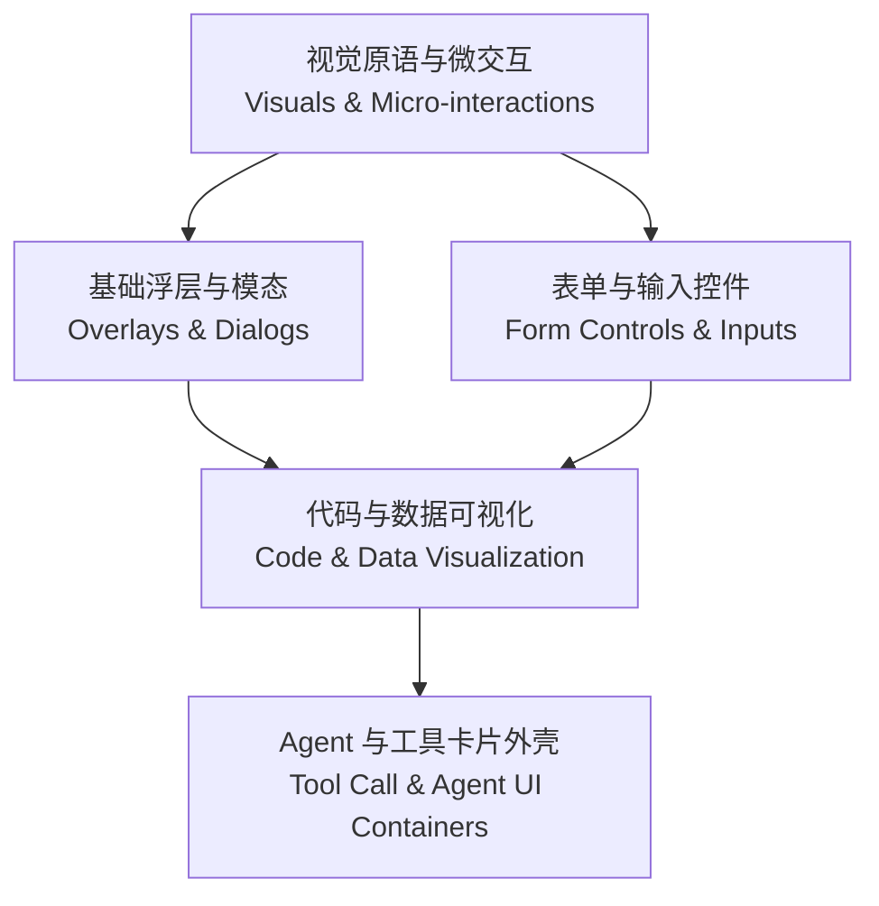
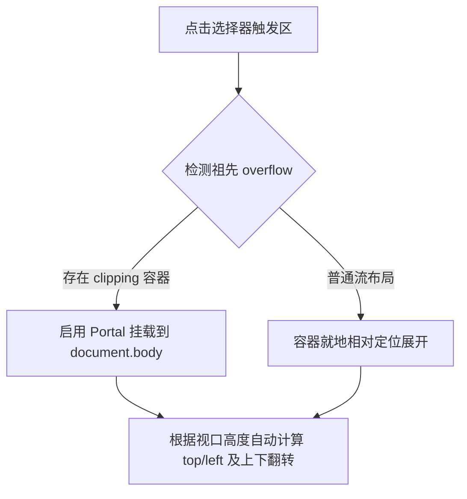
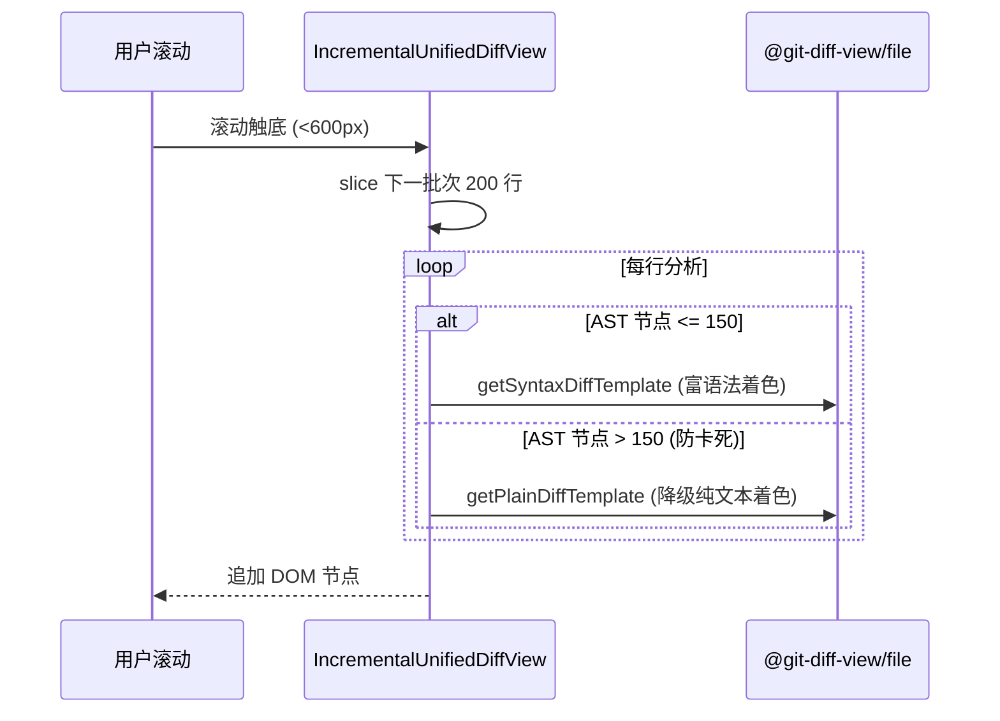

# 前端可复用组件架构与规范

> 面向前端与客户端开发者：Snow App 前端可复用组件体系、分层设计、API 契约、性能防护与开发规范。  
> 配合阅读：[架构总览](1-架构总览.md)、[开发者指南](2-开发者指南.md)、[前端设计与美化工作流](../2-使用指南/15-前端设计与美化工作流.md)。

---

## 1. 上下文与目标

Snow App 渲染进程采用 **React 19 + TypeScript + Vite** 构建。作为面向 AI 原生软件工程的桌面客户端，前端面临高并发数据流（SSE 流式思考与推理文本、持续终端 ANSI 输出、实时大文本 Diff、复杂 JSON 结果）、多层级弹窗与右键菜单交互、以及严苛的内存与流畅度要求。

为避免第三方大型 UI 库带来的体积膨胀、样式污染与启动时延，Snow App 采用**轻量原生自主设计 + 原子语义 CSS 变量**构建前端可复用组件体系。

### 核心目标

1. **视觉与交互一致性**：全应用弹窗、下拉、滑块、代码展示、工具外壳遵循统一设计语言与快捷键规范。
2. **零 `any` 类型安全**：严格使用 TypeScript 泛型与联合类型，在编译期杜绝非受控状态与非法参数。
3. **极端场景弹性**：针对数万行超大 Diff、海量终端日志、长文本粘贴、动态模块加载失败提供开箱即用的虚拟化、截断保护与自愈机制。
4. **无障碍与原生体验**：内置 Focus Trap 焦点陷阱、完整 ARIA 属性、视口越界自适应夹紧及多级 ESC 冒泡防护。

---

## 2. 职责与非职责

### 组件职责

- **交互边界封装**：收敛浮层挂载（Portal）、键盘循环导航、事件防抖节流及主题适配。
- **呈现与操作解耦**：接收明确的 Props，通过受控或非受控回调通知父层，不依赖特定全局单例。
- **防御性性能开销**：在渲染阶段提供分批挂载、惰性渲染（Lazy Body）与 LRU 缓存。

### 非职责边界

- **业务流程编排**：组件不直接调用 Rust 业务导出或持久化服务（如会话归档、Git 提交事务），业务副作用由上层 Hook 或控制器接管。
- **静默吞错**：禁止在组件内部将异常转换为伪成功状态或无意义空值，严格保持错误原始上下文以支持快速排障。

---

## 3. 组件架构全景

Snow App 前端可复用组件划分为五大层次，从底层视觉原语到高级工具卡片形成清晰的依赖拓扑：



### 组件分层总览表

| 层次分类             | 代表组件                                                                                                             | 职责与技术特性                                             | 核心源码锚点                                                                                            |
| -------------------- | -------------------------------------------------------------------------------------------------------------------- | ---------------------------------------------------------- | ------------------------------------------------------------------------------------------------------- |
| **基础浮层与模态**   | `Modal`, `ConfirmDialog`, `FormDialog`, `ContextMenu`, `Tooltip`                                                     | Portal 挂载、焦点陷阱、视口防溢出翻转、ESC 冒泡控制        | `src/renderer/components/common/`                                                                       |
| **表单与输入控件**   | `CustomSelect`, `RangeSlider`, `RichContentInput`, `HoverCopyButton`                                                 | 溢出祖先自动探测、防抖节流持久化、Chip 片段折叠            | `src/renderer/components/common/`, `src/renderer/components/mainContent/chatInput/`                     |
| **代码与数据可视化** | `CodeHighlightView`, `IncrementalUnifiedDiffView`, `MiniDiffViewer`, `JsonTreeView`, `DataTableViewer`, `AnsiOutput` | 增量分批挂载、AST 节点降级、ANSI 颜色解析、表头排序        | `src/renderer/components/common/`, `src/renderer/components/mainContent/chatMessages/toolCalls/shared/` |
| **Agent 与工具卡片** | `ToolCallNode`, `ThinkingBlock`, `ChatFileArtifactCard`, `TokenUsageRing`, `ModelSelector`                           | 插件关联着色、惰性挂载、流式尾部预览、SVG 四色分段环       | `src/renderer/components/mainContent/chatMessages/`                                                     |
| **视觉原语与辅助**   | `ModelBrandIcon`, `PluginIcon`, `OverlayScrollbar`, `HighlightedText`, `DisplayPath`, `AppErrorBoundary`             | 品牌矢量图标、自绘悬浮细滚动条、路径智能分段、分包加载自愈 | `src/renderer/components/common/`, `src/renderer/components/icons/`                                     |

---

## 4. 核心组件详细规范与 API 契约

### 4.1 基础浮层与模态层（Overlays & Dialogs）

#### 1. `Modal` 全屏通用对话框

全屏居中对话框，用于通用复杂配置、展示及嵌入式视图。

- **焦点管理**：利用 `FOCUSABLE_SELECTOR` 扫描所有可获得焦点的元素，监听 `Tab` 与 `Shift+Tab` 实现环形焦点锁定；关闭时恢复先前聚焦元素。
- **滚动锁定**：打开时设置 `document.body.style.overflow = "hidden"`，卸载时精准还原。
- **ESC 冒泡保护**：默认 `closeOnEscape = false`，防止与局部下拉菜单或全局中断会话快捷键冲突；显式开启时吞噬事件并执行 `stopPropagation`。

```typescript
type ModalProps = {
  open: boolean;
  title: string;
  description?: string;
  closeLabel: string;
  onClose: () => void;
  children: ReactNode;
  footer?: ReactNode;
  size?: "medium" | "large";
  closeDisabled?: boolean;
  className?: string;
  closeOnEscape?: boolean;
};
```

_源码锚点_：`src/renderer/components/common/Modal.tsx::Modal`

#### 2. `ConfirmDialog` 语义确认对话框

用于破坏性动作确认（如删除会话、覆盖配置、放弃未保存更改）。

- **三态动作支持**：支持 `confirmLabel`（主确认）、`cancelLabel`（取消，省略时退化为单按钮 Alert）、`extraLabel` + `onExtra`（第三动作，如“最小化至托盘”）。
- **语义变体**：`variant: "default" | "warning" | "danger"`，对应不同视觉警示色。
- **异步 Loading**：`isConfirming = true` 时禁用所有按钮并在确认按钮内展示旋转指示器。

_源码锚点_：`src/renderer/components/common/ConfirmDialog.tsx::ConfirmDialog`

#### 3. `FormDialog` 表单专用对话框

面向需要表单输入与异步提交的交互场景（如新建项目、编辑连接、配置 SSH）。

- **首焦保障**：提供 `initialFocusRef`，在 `requestAnimationFrame` 下精确聚焦至首个输入框。
- **防误关状态机**：支持 `isSubmitting` 与 `dismissableWhenSubmitting`。不可中断的任务（如落库写表）锁死 X、ESC 与遮罩关闭；可后台静默执行的任务（如克隆大仓库）保持可关闭性。

_源码锚点_：`src/renderer/components/common/FormDialog.tsx::FormDialog`

#### 4. `ContextMenu` / `EditContextMenu` 视口感知右键菜单

- **视口碰撞调整**：在 `useLayoutEffect` 中根据 `getBoundingClientRect()` 测算尺寸，当底部或右侧超出视口边界时自动反向收进，保证菜单完整可见。
- **系统级编辑支持**：`EditContextMenu` 封装输入控件的标准“撤销/重做/剪切/复制/粘贴/全选”原生调用链路。

_源码锚点_：`src/renderer/components/common/ContextMenu.tsx::ContextMenu`、`src/renderer/components/common/EditContextMenu.tsx::EditContextMenu`

#### 5. `Tooltip` 智能悬浮提示

- **双向自适应**：支持 `placement: "top" | "bottom" | "right"`。当目标上方高度不足且下方充裕时自动翻转为 bottom。
- **精准箭头对齐**：通过 CSS 自定义属性 `--tooltip-arrow-x` 计算偏移量，使三角箭头始终正对触发元素几何中心，即使浮层因视口边缘夹紧（clamped）产生偏移。

_源码锚点_：`src/renderer/components/common/Tooltip.tsx::Tooltip`

---

### 4.2 表单输入与交互控件层（Form Controls & Inputs）

#### 1. `CustomSelect` 企业级下拉选择器

解决原生 `<select>` 样式难统一、多选支持弱及在截断容器内被裁切的通用组件。

- **类型安全联合**：
  - 单选：`multiple?: false`，`value: string`，`onChange: (value: string) => void`
  - 多选：`multiple: true`，`value: string[]`，`onChange: (values: string[]) => void`
- **裁剪容器自动逃逸**：自动沿 DOM 树向上递归探测祖先元素的 `overflow` 样式。若处于 `Modal` 或局部滚动区域中，自动启用 Portal 挂载到 `document.body`，彻底杜绝内容截断。
- **内置过滤与自定义呈现**：支持 `filterable` 搜索过滤，以及 `renderOption` 和 `renderLabel` 自定义渲染。



_源码锚点_：`src/renderer/components/common/CustomSelect.tsx::CustomSelect`

#### 2. `RangeSlider` 统一滑块控件

- **视觉驱动**：基于 CSS 变量 `--range-progress` 动态计算百分比渐变，配合主题 `--range-*` 变量定制轨道高度与滑块半径。
- **拖动与持久化解耦**：
  - `onChange: (value: number) => void`：拖拽时连续触发，驱动界面数值与预览实时联动。
  - `onCommit?: () => void`：在 `pointerup` 或 `keyup` 时触发单次提交，避免滑块拖动期间高频向 SQLite 数据库或后端配置写盘。

_源码锚点_：`src/renderer/components/common/RangeSlider.tsx::RangeSlider`

#### 3. `RichContentInput` 多模态富文本输入框

基于 `contenteditable` 开发的轻量富文本输入组件，兼顾大文本粘贴与图片插入。

- **DOM 爆炸防护**：粘贴大文本时，自动将超过阈值的文本折叠为 `@@text-snippet:...@@` Chip 胶囊节点，避免数十万字直接在 DOM 树中铺开导致渲染管道卡死。
- **多模态图片 Chip**：粘贴截图时转为 `@@image:...@@` Chip，支持在输入框内直接预览与删除。
- **片段浮层交互**：悬停 Chip 触发 `TextSnippetOverlay` 预览，点击可弹出浮层原位编辑文本。
- **命令式 Handle**：通过 `forwardRef` 暴露 `getContent()`、`clear()`、`focusAtEnd()`。

_源码锚点_：`src/renderer/components/mainContent/chatInput/RichContentInput.tsx::RichContentInput`

#### 4. `HoverCopyButton` / `MessageCopyButton` 复制反馈按钮

- **无感状态机**：点击时通过 `event.stopPropagation()` 阻止触发表单或卡片点击，写入剪贴板后展示对勾与 `.copied` 样式，1600ms 定时器自动复位并在组件卸载时安全清理。

_源码锚点_：`src/renderer/components/common/HoverCopyButton.tsx::HoverCopyButton`

---

### 4.3 代码与数据可视化层（Code, Diff & Data Visualization）

#### 1. `IncrementalUnifiedDiffView` 增量虚拟化 Diff 视图

基于 `@git-diff-view/file` 实现的高性能文件差异展示核心。

- **分批增量挂载（Chunk Rendering）**：单批次仅渲染 `RENDER_BATCH = 200` 行；在滚动监听中计算与容器底部的距离，小于 `APPEND_THRESHOLD = 600px` 时追加下一批次，保证大文件 Diff 初始加载极快。
- **复杂 AST 降级保护**：当行的语法树节点数量超过 150 个时，自动从语法高亮模板 `getSyntaxDiffTemplate` 降级为纯文本差异模板 `getPlainDiffTemplate`，杜绝复杂代码行导致主线程长期阻塞。



_源码锚点_：`src/renderer/components/common/IncrementalUnifiedDiffView.tsx::IncrementalUnifiedDiffView`

#### 2. `CodeHighlightView` 通用代码高亮视图

- **自动语言解析**：显式提供 `language` 或自动根据 `filePath` 提取扩展名并解析语言标识。
- **超长行折叠保护**：超过 `MAX_INITIAL_LINES = 300` 行时默认折叠底部并提供展开按钮。
- **行号偏移校准**：支持 `startLine` 属性，用于展示文件局部片段（如 LSP 引用、修改选区）时呈现真实源文件行号。

_源码锚点_：`src/renderer/components/mainContent/chatMessages/toolCalls/shared/CodeHighlightView.tsx::CodeHighlightView`

#### 3. `JsonTreeView` 高性能折叠 JSON 树

- **层级穿透与折叠**：支持配置 `defaultExpandDepth`（默认 3 层）。
- **特殊换行还原**：内置 `decodeEscapedNewlines`，将转义的 `\n`、`\r\n` 还原，支持包含提示词和角色的复杂对象直观阅读。
- **长文本折叠**：字符串长度超过 `longStringThreshold`（默认 80）时自动折叠为预览行，点击可就地展开。

_源码锚点_：`src/renderer/components/mainContent/chatMessages/toolCalls/shared/JsonTreeView.tsx::JsonTreeView`

#### 4. `DataTableViewer` 表格数据阅读器

- **表头交互排序**：点击表头在升序、降序与原始顺序间切换，数字按数值大小比较，字符按字典序比较。
- **即时过滤**：内置搜索栏实时过滤行数据。
- **数据导出**：支持一键将当前呈现结果复制为合法的 CSV 文本。

_源码锚点_：`src/renderer/components/mainContent/chatMessages/toolCalls/shared/DataTableViewer.tsx::DataTableViewer`

#### 5. `AnsiOutput` 终端 ANSI 格式化解析器

- **16 色标准映射**：将终端转义码（`\u001b[...m`）解析为主题对应的安全色彩 Span。
- **错误行过滤**：提供 `defaultFilterErrors` 开关，在海量编译日志中迅速定位包含 `error`/`failed` 的异常行。

_源码锚点_：`src/renderer/components/mainContent/chatMessages/toolCalls/shared/AnsiOutput.tsx::AnsiOutput`

---

### 4.4 Agent 与工具调用外壳层（Tool Call & Agent UI Containers）

#### 1. `ToolCallNode` 统一工具调用折叠容器

所有 MCP 工具调用的标准外壳卡片。

- **多态状态机**：处理 `status: "pending" | "running" | "completed" | "error"`。
- **插件归属识别**：通过 `usePluginToolOwner(toolName)` 动态匹配该工具是否由外部插件提供，并在头部展示插件图标与名称。
- **分类色彩徽标**：通过 `ToolNameBadge` 根据工具所属类别（文件系统、终端命令、网络检索、LSP 诊断、代码库索引、配置更新等）自动展示不同语义色系。
- **惰性渲染（Lazy Body）**：配置 `lazyBody = true` 时，折叠期间彻底卸载内部昂贵的子组件（如大型 Diff），仅在用户展开时挂载。

_源码锚点_：`src/renderer/components/mainContent/chatMessages/toolCalls/shared/ToolCallNode.tsx::ToolCallNode`

#### 2. `ThinkingBlock` 深度思考折叠块

用于承载大模型思考过程（Reasoning Tokens）。

- **流式动态尾部单行预览**：实时抓取思考流尾部的单行文本（`getPreviewText`），折叠态下依然感知 AI 的当前思考意图。
- **渲染频次节流**：流式阶段以 300ms 间隔防抖渲染 Markdown；超长思考文本（>100k 字符）进一步降频至 600ms。
- **状态感知微交互**：思考进行中保持展开；思考完成后自动收起并展示 1500ms 绿色对勾状态；展示 Rust 测量的准确思考耗时与 Token 统计。

_源码锚点_：`src/renderer/components/mainContent/chatMessages/components/ThinkingBlock.tsx::ThinkingBlock`

#### 3. `TokenUsageRing` 环形 SVG Token 用量仪表盘

与发送按钮对齐的 28×28 极小尺寸环形指示器。

- **四色分段精确几何计算**：
  $$\text{周长 } C = 2 \pi r$$
  按照比例动态切分：
  - 非缓存输入（Non-cached Input）
  - 输出（Output）
  - 缓存创建（Cache Creation）
  - 缓存读取（Cache Read）
- **上下文超限预警**：总 Token 接近或超过模型最大上下文窗口（`maxContextTokens`）时切换为警告/危险高亮色。

_源码锚点_：`src/renderer/components/mainContent/chatInput/TokenUsageRing.tsx::TokenUsageRing`

#### 4. `ModelSelector` 顶层模型切换与快捷配置器

聊天输入区核心控制器。

- **厂商与规格分层**：聚合显示当前生效 API 配置、可用模型列表、手动模型输入入口。
- **思考参数联动**：内嵌 `ThinkingStrengthMenu`，动态根据模型能力切换思考预算与极速响应模式（Fast Mode）。
- **额度感知**：内置 `OAuthQuotaPanel`，直观呈现第三方配额或余额水位。

_源码锚点_：`src/renderer/components/mainContent/chatInput/ModelSelector.tsx::ModelSelector`

---

### 4.5 视觉原语、图标与微交互层（Visuals & Micro-interactions）

#### 1. `ModelBrandIcon` 模型品牌智能矢量图标

- **模糊匹配与 Fallback**：结合 `@lobehub/icons` 的 `modelMappings`，根据传入的 `model` 字符串（如 `gpt-4o`、`claude-3-5-sonnet`、`deepseek-reasoner`、`qwen-max`）模糊推断厂商徽标。
- **居中基线修正**：在 `styles.css` 中补齐针对 SVG 头像容器的 flex 居中与垂直对齐规则，未匹配时优雅降级为中性圆底 Bot 图标。

_源码锚点_：`src/renderer/components/common/ModelBrandIcon.tsx::ModelBrandIcon`

#### 2. `OverlayScrollbar` 自绘悬浮细滚动条

- **避免布局抖动**：隐藏操作系统原生粗滚动条，避免滚动条出现/消失引发容器宽度变化与内容抖动。
- **高性能联动**：基于 `ResizeObserver` 与 `requestAnimationFrame` 动态测算 Thumb 尺寸与平移偏移量（`transform: translate`），支持横向与纵向模式。

_源码锚点_：`src/renderer/components/common/OverlayScrollbar.tsx::OverlayScrollbar`

#### 3. `HighlightedText` 关键词安全高亮

- **正则元字符转义**：对输入的检索词执行 `escapeRegExp`，使用带捕获组的正则安全分割文本，奇数项包装为 `<mark className="search-hit-mark">`，在全应用备忘录与记忆搜索中通用。

_源码锚点_：`src/renderer/components/common/HighlightedText.tsx::HighlightedText`

#### 4. `DisplayPath` 跨平台路径分段展示

- **视觉主次分明**：自动识别 Windows 反斜杠与 POSIX 斜杠，将路径拆分为父目录与最终文件名。父目录使用浅灰色（`display-path-parent`），文件名使用加粗对比色（`display-path-name`），大幅提升长路径的视觉扫描效率。

_源码锚点_：`src/renderer/components/common/DisplayPath.tsx::DisplayPath`

#### 5. `AppErrorBoundary` 应用与模块防雪崩错误边界

- **动态分包 Chunk 加载失败自愈**：利用 `isChunkLoadError` 捕获前端更新或文件热更新造成的模块加载失败，通过 `sessionStorage` 记录重载计数；5 秒内允许最多自动重试刷新 2 次，超出后展示含手动重试与错误堆栈的降级界面。
- **故障隔离**：支持局部包裹高风险插件面板与渲染器，防止单个面板崩溃导致全局白屏。

_源码锚点_：`src/renderer/components/common/AppErrorBoundary.tsx::AppErrorBoundary`

---

## 5. 主题颜色体系与禁止硬编码规范

### 5.1 主题色彩分层架构

Snow App 前端采用三层级联的主题色彩体系，统一在 `src/renderer/themes/` 中维护。主题切换时不触碰任何组件的 React 状态树，纯粹通过 HTML 根节点属性与 CSS 变量的重解析完成：

```mermaid
flowchart TD
    Mode[模式层 Base Mode<br/>:root 明亮 / :root[data-theme='dark'] 暗黑] --> Preset[预设皮肤层 Preset Skins<br/>:root[data-theme-preset='cyberpunk' / 'rococo' / 'win95'...]]
    Preset --> Scoped[专属组件 Token 层 Scoped Component Tokens<br/>--syntax-* / --tooltip-* / --range-* / --terminal-bg]
    Scoped --> Consumer[前端可复用组件消费<br/>Modal / CustomSelect / ToolCallNode / CodeHighlightView...]
```

1. **基础模式层（Base Modes）**：`src/renderer/themes/tokens.css` 中声明的 `:root`（默认明亮）与 `:root[data-theme="dark"]`（暗黑模式），定义核心中性灰度色梯与默认强调色。
2. **预设皮肤层（Preset Skins）**：系统内置 9 款风格迥异的预设皮肤（`preset-cyberpunk.css`、`preset-rococo.css`、`preset-win95.css`、`preset-notion.css` 等），通过在根节点标记 `data-theme-preset="<name>"` 批量重写语义变量，实现霓虹高对比、复古灰阶或典雅粉金的整套重塑。
3. **专属组件 Token 层（Scoped Component Tokens）**：为特定高频可复用组件定制的二次抽象变量（如语法高亮 `--syntax-*`、滑块 `--range-*`、悬浮提示 `--tooltip-*`、终端底色 `--terminal-bg`）。

---

### 5.2 核心语义色彩变量全景表

可复用组件在编写样式的 CSS 或 TSX 行内动态样式时，必须严格从下表中选取语义 Token，严禁任何形式的绝对色值注入：

| 语义分类         | CSS Token 变量名                                                                                  | 典型适用场景                                 | 明亮模式基准             | 暗黑模式基准          |
| ---------------- | ------------------------------------------------------------------------------------------------- | -------------------------------------------- | ------------------------ | --------------------- |
| **背景层级**     | `--bg-primary`                                                                                    | 主窗口工作区、编辑器画布、右键菜单底色       | `#ffffff`                | `#0a0a0a`             |
|                  | `--bg-secondary`                                                                                  | 卡片容器（ToolCallNode）、面板底色、表格外框 | `#f9fafb`                | `#111111`             |
|                  | `--bg-tertiary`                                                                                   | 嵌套输入框、下拉浮层、工具栏、折叠头部       | `#f3f4f6`                | `#1a1a1a`             |
|                  | `--bg-hover`                                                                                      | 列表项鼠标悬停、按钮 hover 态                | `#f3f4f6`                | `#1f1f1f`             |
|                  | `--bg-active`                                                                                     | 按钮点击态、激活选中项底色                   | `#e5e7eb`                | `#2a2a2a`             |
|                  | `--surface-island`                                                                                | 半透明悬浮岛屿表面（毛玻璃底色）             | `rgba(255,255,255,0.78)` | `rgba(17,17,17,0.78)` |
|                  | `--surface-island-strong`                                                                         | 不透明浮层表面（Tooltip、下拉浮层）          | `rgba(255,255,255,1)`    | `rgba(24,24,24,1)`    |
| **文本层级**     | `--text-primary`                                                                                  | 标题、主要正文内容、激活输入文字             | `#111827`                | `#f5f5f5`             |
|                  | `--text-secondary`                                                                                | 次要描述、字段 Key 名、副标题                | `#374151`                | `#d4d4d4`             |
|                  | `--text-tertiary`                                                                                 | 辅助提示、时间戳、计数器标签                 | `#6b7280`                | `#a3a3a3`             |
|                  | `--text-muted`                                                                                    | 占位符（Placeholder）、置灰禁用项            | `#9ca3af`                | `#737373`             |
| **边框与阴影**   | `--border-color`                                                                                  | 标准卡片外框、分隔线（Divider）              | `#e5e7eb`                | `#2b2b2b`             |
|                  | `--border-subtle`                                                                                 | 弱化外边框（浮层阴影边界、次要凹槽）         | `#d1d5db`                | `#3a3a3a`             |
|                  | `--border-focus`                                                                                  | 键盘焦点高亮外圈（Focus Ring 边框）          | `var(--accent-color)`    | `var(--accent-color)` |
|                  | `--shadow-sm` / `--shadow-md`                                                                     | 弹出菜单与普通卡片的立体阴影                 | 浅色柔和阴影             | 深色弥散阴影          |
| **成对状态色**   | `--accent-green-text` / `--accent-green-bg`                                                       | 成功标记、Diff 新增行、通过校验              | 墨绿文字 / 浅绿底        | 亮绿文字 / 半透绿底   |
|                  | `--accent-red-text` / `--accent-red-bg`                                                           | 错误阻断、Diff 删除行、危险动作              | 暗红文字 / 浅红底        | 亮粉红文字 / 半透红底 |
|                  | `--accent-amber-text` / `--accent-amber-bg`                                                       | 警告通知、阻塞中、未决状态                   | 褐黄文字 / 浅黄底        | 亮黄文字 / 半透黄底   |
|                  | `--accent-blue-text` / `--accent-blue-bg`                                                         | 链接、运行中、信息高亮、主色动作             | 深蓝文字 / 浅蓝底        | 浅天蓝文字 / 半透蓝底 |
| **代码语法角色** | `--syntax-text` / `--syntax-keyword` / `--syntax-string` / `--syntax-number` / `--syntax-comment` | 共享代码阅读器与工具调用语法着色             | 随语义映射动态生成       | 随语义映射动态生成    |

---

### 5.3 为什么绝对禁止硬编码颜色？

在前端可复用组件中出现形如 `#fff`、`#3b82f6`、`rgb(...)`、`rgba(...)` 等硬编码颜色，被 Snow App 架构团队视为**严重违规的反模式（P0 级视觉缺陷）**：

1. **暗黑模式严重雪崩（Dark/Light Mode Crash）**：
   - 若组件写死 `background: #ffffff`，切到暗黑模式后会变成刺眼的“白炽灯”白块。
   - 若组件写死 `color: #000000` 或 `color: #333333`，在暗黑模式深黑底色（`#0a0a0a`）下，文字与背景对比度降为 1:1，文本**完全隐形消失**，造成灾难性可用性 Bug。
2. **主题皮肤视觉撕裂（Theme Presets Disruption）**：
   - 用户启用 Cyberpunk（黑底霓虹粉）、Rococo（奶油粉金）或 Win95（复古灰）等预设时，硬编码的常规蓝（`#3b82f6`）或红（`#ef4444`）会彻底摧毁沉浸式皮肤氛围，使该可复用组件形同“第三方外挂违和贴片”。
3. **可访问性对比度失效（A11y Failure）**：
   - 官方定义的成对状态色（如 `--accent-green-bg` + `--accent-green-text`）经过 WCAG AA/AAA 对比度精确校准；硬编码颜色在不同主题背景下无法维持安全的阅读对比度。
4. **自定义配色扩展阻断**：
   - 用户在系统设置中调整主色调（Accent Color）时，硬编码组件无法感知，丧失个性化响应能力。

---

### 5.4 组件开发者“禁止硬编码”执行守则

| 维度                 | ❌ 严禁的反模式（Bad Practices）                                        | ✅ 正确的规范实现（Best Practices）                                                                                   |
| -------------------- | ----------------------------------------------------------------------- | --------------------------------------------------------------------------------------------------------------------- |
| **CSS 颜色声明**     | `background-color: #fff;`<br/>`color: #111827;`                         | `background: var(--bg-primary);`<br/>`color: var(--text-primary);`                                                    |
| **状态色彩搭配**     | 浅底硬编码浅绿文字导致不可见：<br/>`background: #dcfce7; color: green;` | 必须成对消费对应的背景与文字 Token：<br/>`background: var(--accent-green-bg);`<br/>`color: var(--accent-green-text);` |
| **TSX 行内动态样式** | `<div style={{ border: "1px solid #e5e7eb" }} />`                       | `<div style={{ border: "1px solid var(--border-color)" }} />`                                                         |
| **动态半透明遮罩**   | `background: rgba(239, 68, 68, 0.15);`                                  | 原生 `color-mix` 动态与透明混色：<br/>`background: color-mix(in srgb, var(--accent-red-text) 14%, transparent);`      |
| **SVG 矢量图标着色** | `<path fill="#3b82f6" />`<br/>`<path stroke="#000" />`                  | 继承外层文本色彩或绑定语义 Token：<br/>`<path fill="currentColor" />`<br/>`<path stroke="var(--accent-color)" />`     |
| **阴影与聚焦环**     | `box-shadow: 0 4px 12px rgba(0,0,0,0.1);`                               | `box-shadow: var(--shadow-md);`<br/>`outline: 2px solid var(--border-focus);`                                         |

---

## 6. 国际化与无障碍（A11y & i18n）规范

1. **多语言词条**：组件内提示、占位符、按钮文字必须接入 `useI18n()` 导出的 `t(...)` 函数，词条集中维护于 `src/renderer/i18n/` 词典中，禁止出现硬编码中英文。
2. **无障碍语义属性**：
   - 触发按钮必须具备 `aria-label` 或 `title`。
   - 模态弹窗具备 `role="dialog"`、`aria-modal="true"`、`aria-labelledby` 与 `aria-describedby`。
   - 纯装饰性图标必须标记 `aria-hidden="true"`。
3. **键盘可达性**：所有浮层与菜单必须支持 `Escape` 键关闭，列表类组件（`CustomSelect`、`ContextMenu`）必须支持 `ArrowUp` / `ArrowDown` 遍历与 `Enter` 选择。

---

## 7. 新增通用组件开发 Checklist

新组件合入前必须逐一核验以下标准：

- [ ] **依赖最小化**：优先使用纯 React 与项目现有图标库（`lucide-react`、`@lobehub/icons`），禁止引入冗余的第三方组件库。
- [ ] **TypeScript 严格类型**：Props 接口完整导出，无 `any` 类型，关键联合枚举类型具有编译时收窄断言。
- [ ] **挂载与内存安全**：含有 `setTimeout`、`requestAnimationFrame` 或 DOM 监听器的组件，必须在 `useEffect` 清理函数中释放。
- [ ] **溢出与视口感知**：弹窗与下拉菜单考虑了外层裁剪容器与屏幕边界，提供 Portal 或视口夹紧。
- [ ] **性能熔断措施**：对可能接收数千条数据或超大文本的组件，具备限制行数、分批挂载或虚拟化机制。
- [ ] **样式 Token 化**：颜色与间距使用 `tokens.css` 变量，在所有预设主题与暗黑/明亮模式下均正常呈现。
- [ ] **双语同步**：组件附带的文案同步补全中文、英文及繁体中文词条。
